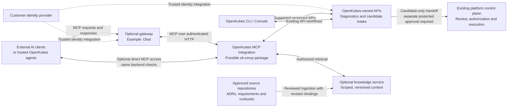
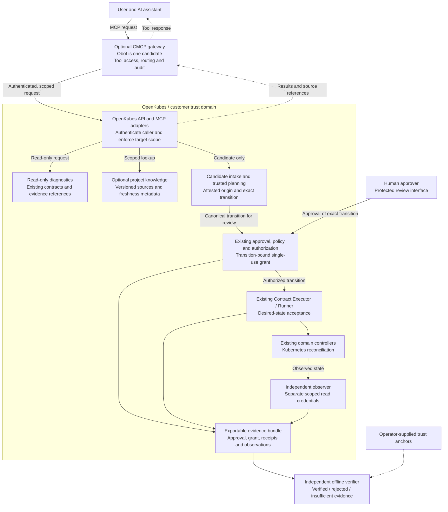

# ADR-Platform-044: Optional CMCP access and evidence contracts for OpenKubes

**Status:** Draft — proposed architecture, not accepted  
**Date:** 2026-11-17  
**Decision owner:** OpenKubes Architecture  
**Author:** Tim Stellfeldt  
**Tracking:** [OK-213](https://kubernauts.atlassian.net/browse/OK-213)  
**Related:** ADR-Platform-001, ADR-Platform-015, ADR-Platform-021, ADR-Platform-030, ADR-Platform-035, ADR-Platform-036, ADR-Platform-037, ADR-Platform-039, ADR-Platform-042

## Decision summary / Status and gates

The [architecture review of PR #511](https://github.com/openkubes/openkubes/pull/511#issuecomment-6948829618)
approved the direction and allocated **ADR-Platform-044**. This record remains
**Draft / Proposed, not Accepted**. ADR-042 and ADR-043 remain unchanged.

| Scope | Status and gate |
|:---|:---|
| Architectural direction and documentation | **GO** for optional, provider-neutral, reuse-first CMCP; final documentation review remains pending |
| Step A: offline contract proof | **DEFER** engineering; proposed 3–5 engineering person-days plus 0.5–1 person-day independent review, subject to separate explicit authorization |
| Step B and pilots | **DEFER** pending Step A review, demonstrated reusable approval/enforcement interfaces and separate explicit authorization |
| Obot selection, `ok-cmcp` repository creation and budget | **DEFER** pending explicit owner decisions; the design does not select a vendor, create a repository or allocate funding |
| Live deployments and operations | **DEFER** pending separate explicit authorization; documentation approval does not authorize customer credentials, live actions or Runner changes |

**Next smallest deliverable:** complete review of this numbered draft and both
rendered diagrams. If separately authorized, the next engineering deliverable is
Step A's pinned fixture profile, synthetic evidence bundle, negative cases and
bounded offline verifier report. No live integration is part of that package.

**Open owner decisions:** Arash/architecture must confirm final ADR acceptance,
Step A authorization, budget and assigned implementation/review owners. Runner
maintainers must confirm the supported contract baseline before engineering.
Gateway selection, repository extraction and deployment ownership remain later
explicit decisions. Console/identity maintainers must establish a reusable
protected approval path before any live phase.

## Context

AI assistants need access to current platform information to give useful answers.
For OpenKubes, relevant information includes cluster diagnostics, runbooks,
architecture decisions and the evidence behind an operation. Without a shared
contract, every assistant integration can repeat connection, identity and audit
work, while returning answers whose scope or freshness is unclear.

MCP (Model Context Protocol) provides a common interface for AI applications to
discover and call tools. **CMCP** is the working OpenKubes **Central MCP** concept:
an optional, governed access layer over OpenKubes-owned capabilities. “Central”
describes shared access and contracts, not a mandatory global service or a new
authority over customer clusters.

The founder accepted an independent, provider-neutral, reuse-first Hybrid
direction in [c15253](https://kubernauts.atlassian.net/browse/OK-213?focusedCommentId=15253).
This draft records that direction for architecture review. Authorization to write
the ADR does not authorize a deployment, implementation pilot or vendor selection.

## Intended value

| User journey | Proposed benefit | How to validate it |
|:---|:---|:---|
| An operator asks why a workload is failing | The assistant gathers scoped diagnostics and relevant runbooks, with source references | Compare time to a supported diagnosis against the same manual task; record incorrect conclusions and missing evidence |
| An operator reviews an agent's proposed change | One exact proposal can be traced through review, authorization, execution and independent observation | Measure review time and evidence completeness; no negative authorization case may succeed |
| A second agent reviews work started by another agent | Both retrieve the same versioned requirements and distinguish decisions from assumptions | Check requirement-to-code/test traceability, stale-context detection and access isolation |

These are hypotheses. The assessment has not demonstrated time savings or a
complete live CMCP integration. The knowledge journey is a separate capability
behind the access layer, not a prerequisite for diagnostics.

## Proposed decision

Adopt **shared, versioned contracts with enforcement inside each customer trust
domain**. Reuse existing OpenKubes APIs, diagnostics adapters and execution
boundaries. An optional gateway can aggregate selected tools and enforce access
to them. Backends must still authorize the authenticated caller for the exact
tenant, target and operation.

1. Keep CMCP optional. Existing CLI, Console and API workflows remain usable
   without CMCP, Obot, OK Bot or any AI model.
2. Keep OpenKubes HTTP/OpenAPI contracts normative where defined. MCP is a bounded
   projection of those contracts, not a second platform API or source of truth.
3. Expose approved read-only capabilities and, separately, candidate-only proposal
   submission. A tool call cannot invoke a mutating executor or grant approval.
4. Keep protected human review, policy decisions, signing, grant consumption,
   deterministic execution and independent observation in their existing trusted
   platform roles. CMCP introduces no parallel executor or policy authority.
5. Support gateway replacement and direct authenticated clients through the same
   backend checks. Gateway bypass must never mean authorization bypass.
6. Define portable evidence bindings so an operator can verify a historical
   outcome independently of the agent and gateway.

## Application context and integration overview

The context view answers which applications interact. The logical view below
then explains the authority boundaries inside those interactions. All new CMCP
interfaces in these diagrams are proposals, not statements of implementation.



The CLI and Console continue to use their existing APIs without traversing CMCP.
The identity arrows describe trust integration, not token forwarding or a chosen
authentication flow. A reviewed identity/delegation profile must bind the user,
workload and target at each hop. The knowledge service must enforce its own
source-level access rights; gateway access cannot grant access to every repository.
Existing independent evidence export and verification remain as shown below.

## Logical architecture

This diagram shows proposed responsibilities, not deployed components. Boxes
within the customer boundary may reuse existing services. The gateway may run
inside that boundary or as an explicitly trusted shared service. Each tenant and
target still requires backend authorization. Solid arrows show requests and
evidence production; dotted arrows show responses, observations or trust input.



An agent cannot write the approval record, mint a grant, change admission policy,
or reach the executor through an MCP mutation tool. A successful tool response or
gateway audit entry does not prove cluster convergence. The evidence export has
its own access controls and must not disclose credentials or cross-tenant data.

## Obot as one possible implementation

Obot is a candidate for the **optional gateway role**. Its documented virtual MCP
endpoints combine selected tools from MCP servers. Its gateway provides caller
authentication, access checks, filtering and activity records
([Obot documentation](https://docs.obot.ai/concepts/mcp-gateway/), consulted
2026-11-17). These features suggest reuse potential, not proven OpenKubes fit.

A hypothetical read-only example:

1. A user asks, “Why is checkout failing in my test cluster?”
2. The assistant connects to an Obot endpoint exposing only the user's permitted
   OpenKubes diagnostics tools.
3. An OpenKubes adapter validates identity and target scope, then calls the
   supported workload-investigation contract. A separate approved lookup can
   retrieve the relevant runbook.
4. The assistant receives evidence references, timestamps, limitations and ranked
   hypotheses. It explains a possible image-pull failure with links to the evidence.
5. Any suggested fix remains a recommendation. A change proposal must enter the
   separate protected review and authorization path.

Before selecting Obot, pin a version and evaluate identity propagation, backend
scope enforcement, tenant isolation, private-network access, credential custody,
audit redaction, failure behavior, licensing and operating cost. Tool selection
in a gateway is not sufficient proof of backend isolation. Identity-provider
integration, including Keycloak if required, needs its own tested configuration.
No Obot plugin or authentication provider is selected by this ADR.

## Possible `ok-cmcp` repository and optional integration package

If an independently released integration is justified, `openkubes/ok-cmcp` could
package the MCP projection, portable fixtures and gateway-specific configuration.
This is a proposed repository boundary; this ADR does not create the repository
or require a new service. Reuse the existing diagnostics adapter first. Extract
code only when a supported second consumer or independent release cycle warrants
it, with clear ownership and without duplicating API schemas.

The preferred initial meaning of **plugin** is an optional integration package:
an ordinary MCP endpoint plus configuration to register it with a gateway.
It is not an Obot-specific in-process plugin, a new Kubernetes controller, or a
new CLI execution plugin. This keeps the same endpoint usable by another gateway
or a direct authenticated MCP client.

```text
ok-cmcp/                         # illustrative layout, language not selected
  contracts/                    # CMCP envelopes and upstream contract references
  adapters/                     # thin mappings to supported OpenKubes APIs
  server/                       # MCP transport, validation and identity integration
  integrations/obot/             # registration examples and compatibility notes
  deploy/                       # optional deployment profile, if separately approved
  conformance/                  # fixtures and gateway-independent contract checks
  docs/                         # tool catalog, trust boundaries and operations guide
```

| Repository / system | Owns | Does not own |
|:---|:---|:---|
| `openkubes` | Architecture decisions and normative platform contracts | Gateway-specific authority semantics |
| Possible `ok-cmcp` | Thin MCP mapping, CMCP-only envelopes, compatibility tests and integration packaging | Copies of the Runner, signing keys, policy engine, protected approval or a new source of desired state |
| Existing Runner/control-plane repositories | Their supported execution, authorization and observation interfaces | MCP client behavior |
| Obot, if selected | Gateway runtime and its own tool-access configuration | OpenKubes transition authorization or cluster reconciliation |
| Optional knowledge service | Versioned context, source permissions and freshness | Approval, executable policy or proof that a cluster operation succeeded |

### How the Obot integration could work

1. Release a versioned MCP server package or image that maps only to supported
   OpenKubes endpoints. Reuse existing adapters and preserve their error semantics.
2. If a hosted endpoint is needed, deploy it through a separately approved
   customer deployment profile with scoped service identity and backend access.
3. Register that endpoint as a remote MCP server in Obot, then expose a selected
   tool set through an Obot virtual MCP endpoint. Obot documents this mechanism
   for independently deployed servers; it does not deploy or sandbox those remote
   services ([remote server integration](https://docs.obot.ai/mcp-gateway/register-remote/),
   consulted 2026-11-17).
4. Configure and test the approved identity/delegation and private-network paths.
   Do not use a broad shared credential or trust arbitrary caller headers as a
   shortcut. Unauthorized callers must fail both through Obot and directly.
5. Connect a compatible AI client and run a read-only diagnostics example. Verify
   source references, partial results, access denials and audit redaction before
   considering any candidate-submission tool.

The first separately approved implementation should expose the smallest useful
read-only projection. Knowledge retrieval and candidate intake remain optional
modules, disabled until their contracts and permissions are reviewed. No generic
shell, arbitrary Kubernetes write tool or direct executor API belongs in this
package. Removing the package must leave the existing platform workflows intact.

This packaging direction is additional design detail, not part of the existing
3–5 day offline-proof estimate. Repository extraction, server deployment, identity
integration and Obot compatibility need a separate estimate after the supported
interfaces and deployment owner are confirmed.

## Placement and reuse options

| Option | Benefits | Costs and risks | Disposition |
|:---|:---|:---|:---|
| One centralized gateway | Shared discovery, consistent connection setup and audit | Concentrated outage and credential exposure; requires strong tenant separation and service ownership | Possible deployment profile, not a mandatory global topology |
| Federated gateways per customer or trust domain | Local control, smaller cross-customer failure scope | Repeated deployment, upgrades and policy coordination | Supported placement direction where isolation requires it |
| Reuse existing APIs/adapters with no new gateway | Lowest incremental service burden; existing access paths remain | More client configuration and potentially fragmented discovery/audit | Required baseline and valid outcome if a gateway adds insufficient value |

The Hybrid proposal shares contract semantics while retaining local authority.
It can use either gateway placement. Obot is an implementation candidate for
those gateway profiles, not an alternative to the OpenKubes contract.

## Contract mapping and boundaries

| CMCP concern | Existing foundation | Required boundary or gap |
|:---|:---|:---|
| Diagnostics | ADR-021 and the normative diagnostics API | Preserve read-only semantics, evidence references and partial/unavailable outcomes |
| Candidate and governance binding | ADR-035 and ADR-042 candidate-only agent path | Bind authenticated origin, canonical request, target, predecessor, exact review and approval; confirm supported interfaces before integration |
| Authorization and execution | ADR-030 and OK-147 Runner work | Preserve audience, plan/stage digest, attempt, validity and single-use claim semantics; no direct dependency on unrelated internal Go packages |
| Stage-5 network evidence | Existing Runner profile and its reviewed operation/evidence contract | CMCP cannot replace required evidence with an agent assertion or assume an unaccepted Stage-Contract is active |
| Stage-7 target access | The bounded sixteen-object writer profile examined in OK-213 | Do not add admission privileges or let the writer install its own safeguards; separately governed enforcement remains a prerequisite |
| Observation and export | Existing receipts and independent observation | Bind producer identity, target and revision; distinguish installation receipts from full convergence and historical outcome from current health |
| Console and identity | ADR-036/037 | Reuse a proven protected approval path; an architectural description alone does not establish its availability |

The detailed implementation inventory in [c15254](https://kubernauts.atlassian.net/browse/OK-213?focusedCommentId=15254)
is a **2026-11-05 baseline**, not a claim about current OK-147 runtime readiness.
Before implementation, maintainers must confirm and pin the then-supported
Runner, admission and stage-contract revisions. Completing this design does not
require all of OK-147 to finish; live integration requires its specific interfaces.

## Evidence and shared knowledge

The proposed portable material consists of a versioned candidate envelope,
governance references and evidence manifest. Bind the request digest, target
identity, execution attempt, contract versions, review/approval, grant, claim,
receipts and observations. Retain profile-specific native formats when possible.

The verifier receives trust anchors independently of the bundle. It reports:

- **Verified:** required evidence is authentic and consistent within the declared
  profile and historical observation window.
- **Rejected:** evidence establishes an invalid signature, conflicting binding,
  unauthorized transition or other violated requirement.
- **Insufficient evidence:** required records, trusted issuer information or
  supported semantics are missing. This never means successful execution.

Offline evidence cannot establish current health, discover unrecorded replay, or
prove subsequent revocation without additional trusted records. Unknown execution
outcomes require inspection and the existing recovery protocol, not blind retry.

The optional knowledge layer stores human-readable, versioned requirements,
decisions and source references. It distinguishes verified assertions, hypotheses,
human decisions and stale/unknown findings. Retrieval includes revision bindings,
coverage and omissions. Writes require ownership, review and concurrency checks.
Retrieved text and agent memory are data, never approval or policy authority.

As requested in [c15255](https://kubernauts.atlassian.net/browse/OK-213?focusedCommentId=15255),
collaboration/workflow coordination remains separate from CMCP connectivity and
durable knowledge. FeatureNetwork is conceptual inspiration only: this decision
does not adopt its code, plugin, storage format or runtime. Storage selection and
knowledge-specific acceptance criteria remain follow-up decisions.

## Security requirements

- Enforce caller, tenant, cluster and operation scope at the backend, including
  direct clients. Reject ambiguous identity, expired credentials and scope mismatch.
- Keep credential custody, signing and approval outside agent-controlled inputs.
  Do not accept caller identity solely from an untrusted forwarding header.
- Bound tool inputs, output size, retrieval scope and execution time. Treat tool
  output and retrieved instructions as untrusted content, including prompt injection.
- Keep approval tied to the exact reviewed transition. A changed target, request
  or predecessor requires renewed validation and approval.
- Separate observer credentials from execution rights. Export only authorized,
  redacted evidence, with tenant-aware retention and audit access.
- Fail closed on unavailable authorization or uncertain grant consumption.
  Gateway outages may interrupt agent access but must not block independent core
  platform workflows.
- Document residual trust in platform administrators and control-plane operators.
  This design does not claim containment of a compromised Kubernetes control plane.

## Validation and effort

**Step A: offline contract proof, proposed 3–5 engineering person-days plus
0.5–1 person-day independent review.** Pin a fixture profile, create one complete
synthetic bundle and negative fixtures, implement the bounded verifier and report
results. This is a conditional planning estimate from OK-213, not a budget grant.

| Fixture | Expected outcome |
|:---|:---|
| Complete, consistent synthetic bundle with independent trusted test keys | Verified within the fixture profile |
| Changed request/target, invalid signature, wrong approval or expired grant at execution | Rejected |
| Bundle attempts to declare its own signers trusted | Rejected |
| Missing required approval, observation or trusted consumption history | Insufficient evidence |
| Authenticated duplicate consumption or contradictory outcomes | Rejected |
| Wrong observer identity, target/revision or observation window | Rejected |
| Unsupported contract version | Insufficient evidence |
| Later drift after a valid historical observation | Preserve the bounded historical result; no current-health claim |

All fixtures must yield the expected result and no negative case may be accepted.
Fixtures do not demonstrate protected human approval, deployed enforcement,
durable live replay prevention or live tenant isolation.

**Step B: separately authorized live proof, conditionally another 4–7 engineering
person-days.** Re-estimate after Step A and confirmation of a reusable approval
path, supported operation and working enforcement. This excludes building missing
Runner/approval infrastructure, production hardening, a new UI and multi-tenancy.
The earlier replica-change illustration is not an existing CreateCluster operation
and must not justify a parallel executor.

Production delivery and monthly operation costs remain unestimated. A gateway
evaluation must inventory hosting, storage/retention, identity integration,
patching, backup and on-call ownership, then compare against the no-new-layer
baseline. The offline estimate cannot serve as a production estimate.

## Consequences and review decisions

The proposal makes AI integrations replaceable and gives operators a consistent
way to inspect evidence. It also adds contract-version coordination and, if a
gateway is selected, another service and credential boundary to operate. Shared
knowledge adds a separate freshness and ownership problem. These costs must earn
their place through measured user benefit.

Before acceptance, architecture reviewers should confirm:

1. The optional Hybrid boundary and continued use of normative OpenKubes APIs.
2. The minimum scope: diagnostics and candidate/evidence contracts, with knowledge
   as an optional separate capability.
3. Named owners and approval for any follow-on engineering package.

Proposed responsibilities: Arash/architecture owns acceptance and scope; Runner
maintainers own supported execution interfaces; Console/identity maintainers own
the approval integration; a separately named independent reviewer owns security
verification. Tim can implement an explicitly assigned follow-up. These are role
proposals, not new assignments.

Acceptance of this ADR would record architecture intent. Deployment, live
operations and technology selection require their own evidence and authorization.

## References

- [ADR-001: Contracts not components](ADR-Platform-001-contracts-not-components.md)
- [ADR-021: Diagnostics](ADR-Platform-021-read-only-platform-diagnostics-contract.md)
- [ADR-030: Control-plane execution](ADR-Platform-030-control-plane-execution-model.md)
- [ADR-035: Hybrid intent](ADR-Platform-035-hybrid-intent-and-control-plane-execution.md)
- [ADR-036: Console](ADR-Platform-036-openkubes-console-architecture.md)
- [ADR-037: Identity federation](ADR-Platform-037-console-authentication-and-identity-federation.md)
- [ADR-042: Hosted and external agents](ADR-Platform-042-openshell-hosted-external-agentic-operations.md)
- [OK-147: Runner implementation](https://kubernauts.atlassian.net/browse/OK-147)
- [OK-199: Obot/MCP evaluation](https://kubernauts.atlassian.net/browse/OK-199)
- [OK-201: Governance alignment](https://kubernauts.atlassian.net/browse/OK-201)
- [Obot gateway concepts](https://docs.obot.ai/concepts/mcp-gateway/)
- [Obot remote-server integration](https://docs.obot.ai/mcp-gateway/register-remote/)
