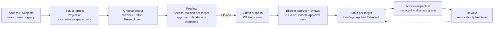

# ADR-Platform-046: Console User and Access Management: Identity Modes, Access Assignments and Multi-Cluster Projects

**Date:** 2026-11-19
**Status:** Proposed
**Tracking:** [OK-214](https://kubernauts.atlassian.net/browse/OK-214)
**Extends:** ADR-Platform-037 (Console Authentication and Identity Federation)
**Related:** ADR-Platform-011 (GitOps), ADR-Platform-013 (Workload Cluster Registration), ADR-Platform-019 (Robotics Fleet, OIDC group delegation), ADR-Platform-034 (Authorized Desired-State Transitions), ADR-Platform-035 (Hybrid Intent), ADR-Platform-036 (Console), ADR-Platform-038 (Session Store), ADR-Platform-039 (Developer Workspace), ADR-Platform-043 (Console Client Identity), ADR-Platform-044 (CMCP), ADR-Platform-045 (Enterprise Workspaces)
**Decision owner:** OpenKubes Architecture
**Scope:** Architecture proposal and draft contracts. No production implementation, contract publication or rollout is authorized by Proposed status.

---

## Context

The Console needs a small operator experience to create local users, assign local or
federated users and groups to namespaces on one or more clusters, preview the effect,
route the change through approval, and inspect or revoke effective access. Standalone
installations must work without an external identity provider; federated deployments use
OIDC (for example Keycloak or Entra ID).

What exists today:

- **Console BFF identity.** OIDC Authorization Code + PKCE against one issuer, mapping only
  `sub` through a static subject file; unmapped subjects fail closed. A local identity
  store (`ok_identity` schema: immutable UUID subjects, scrypt verifiers, durable login
  throttling, last-admin guard, audit, revision-based session revocation) runs only in the
  non-production `ok-local` profile defined by the ADR-037 amendment of 2026-11-04.
  Bootstrap and break-glass are separate, file-based, reason-bound methods.
- **Console authorization.** Flat permissions (`platform.read`, `clusters.read`,
  `evidence.read`, `local.users.*`) scoped by `{environmentId, tenantIds[]}`. No roles,
  groups, projects, namespace scope, Kubernetes RBAC writes, impersonation or
  SubjectAccessReview exist. The BFF never talks to clusters; it reads the observed-state
  producer over mTLS (ADR-043).
- **Presentation Contract** `console.openkubes.io/v0alpha1` (OK-155): read-only kinds;
  mutations and RBAC are explicit non-goals.
- **UI Preview v0.1** (ok-console #147): memory-only simulation of users, one namespace and
  one role (`Viewer`, `Editor`, `Project Admin`). It grants nothing and does not close this
  decision.

## Decision summary

- **D-046-1 Three identity modes, one authorization model.** `Local`, `Federated` and
  `Hybrid` differ only in how a subject authenticates. Access assignments, presets,
  approval and enforcement are identical across modes.
- **D-046-2 Authentication is not authority.** Console identity stores (local accounts, OIDC
  mappings) never grant Kubernetes access. Target-cluster Kubernetes RBAC is the only
  authority for Kubernetes API access (INV-037-2, D-045-5).
- **D-046-3 Access intent lives in Git.** An `AccessAssignment` is declared in the GitOps
  source (ADR-011), changed only by pull request plus approval, rendered deterministically to
  namespaced RoleBindings and applied by the GitOps reconciler. The Console proposes; it
  never merges or applies.
- **D-046-4 Bounded presets.** `Viewer`, `Editor` and `ProjectAdmin` map to three
  OpenKubes-owned ClusterRoles bound only through namespaced RoleBindings. `Editor` and
  `ProjectAdmin` are **namespace-wide trust** grants (§4): they guarantee confinement to the
  namespace, not secrecy of what the namespace holds. Cluster-scope grants are outside this
  ADR and require a separate decision.
- **D-046-5 Project is the Console-facing name of the ADR-045 Enterprise Workspace.** It is
  not a separate domain object (Decision 2, decided yes in OK-214 c15411). This ADR reuses
  the single ADR-045 governance identity and ownership model and introduces no Project API,
  controller, membership model or source of truth. The ADR-039 DeveloperWorkspace contract is
  unchanged.
- **D-046-6 Split BFF.** Effective-access read projections and proposal writes are separate
  routes with separate permissions. The BFF holds no Kubernetes write credential and no
  long-lived kubeconfig.
- **D-046-7 Per-target truth.** Multi-cluster assignments report status per target. An
  aggregate is never "effective" until every target is verified; revocation is never
  reported complete until observed.

## 1. ADR inventory: reuse, gap, conflict

| ADR | Status | Reuse | Gap closed here | Conflict / tension |
|---|---|---|---|---|
| 011 GitOps | Proposed | Git as source of truth; Argo CD on ok-mgmt; `rendered/` tree | Access intent as a GitOps artifact | None |
| 013 Cluster registration | Accepted | Cluster name as single join key; credential custody on ok-mgmt | — | Name-only identity has no incarnation UID (see 045, OK-221 c15382 G2); `clusterUid` reserved, §6 |
| 019 Robotics fleet | Accepted | `oidc:` group prefix; fail-closed ValidatingAdmissionPolicy; "remove RoleBinding first" | General preset model | None |
| 034 Desired-state transitions | Proposed | "Acceptance determines authority; convergence proves realization" | — | A plain PR merge is not yet an ADR-034 Authority Profile (Decision 9) |
| 035 Hybrid intent | Proposed | Candidate branches separated from watched refs; agents may propose, never approve | — | Merge without transition correlation does not satisfy 034 (Decision 9) |
| 036 Console | Proposed | Console is not a control plane; operation invocation seam; INV-036-5, INV-036-10 | Access area in navigation; RBAC model | Console must not become desired-state authority: avoided by proposal-only writes |
| 037 Console authN | Proposed (+ Draft amendment) | OIDC + PKCE; `(issuer, sub)` join; fail-closed mapping; break-glass rules; amendment's local store, last-admin and CSRF rules | Accepted mapping policy for groups; general user/role contract; hybrid rules | **INV-037-1 and §4 limit local login to bootstrap/break-glass; the amendment allows ordinary local users only in non-production `ok-local`.** Standalone production Local/Hybrid needs an explicit extension (Decision 1) |
| 038 Session store | Proposed | Authorization-mapping revision; privilege change revokes sessions; INV-038-7 | Revision bump on access change | Must not cache cluster RBAC results as authority |
| 039 Developer Workspace | Accepted (conditional) | `kubernetes.access = none`; workspace identity is not user identity | Requester authorization (gate O02) can reuse presets later | Presets must never bind into workspace namespaces (§4 denylist) |
| 043 Console client identity | Proposed | mTLS producer as read backend; effective-authority method for tests | Per-target RBAC observation | BFF RoleBinding writes would give the Console identity grant authority over every target namespace (§5); rejected |
| 044 CMCP | Draft | Tenant/target/operation authorization tuple | Candidate "reusable protected approval path" | None, provided Console traffic does not traverse CMCP |
| 045 Enterprise Workspaces | Proposed | Management-plane GitOps desired state; `(cluster, namespaceUID)` binding; pending-revocation rule; no competing reconciler | Revocation and freshness design asked for by D-045-8 | None for grouping: Project is its Console name (Decision 2, §6); non-goal "custom password store" vs local mode (Decision 1) |

No existing ADR defines presets, group-claim mapping, impersonation, per-user cluster
delegation or multi-cluster partial-failure semantics; this ADR does.

## 2. Responsibility and source-of-truth matrix

| Concern | Owner | Source of truth | Never |
|---|---|---|---|
| Federated authentication | IdP (Keycloak, Entra ID, other OIDC) | IdP | Console stores federated passwords |
| Local authentication | Console BFF identity store | `ok_identity` (PostgreSQL) | Local account implies cluster access |
| Identity mapping (subject → K8s subject name) | Console BFF, reviewed mapping policy | Mapping config in Git | Email or display name as key |
| Access intent | Platform/Project admins via PR | GitOps repository (`AccessAssignment`) | Console database, session, UI state |
| Approval eligibility | Required `access-approval-gate` check (§5.1); ADR-034 Authority Profile (target) | Base-branch intent + approver map, bound to the merge commit | CODEOWNERS alone; requester or subject approving |
| Rendering intent → RBAC | Deterministic renderer in CI | Rendered tree, digest-pinned | Hand-edited managed RoleBindings |
| Applying RBAC | GitOps reconciler (ADR-011), syncing as a dedicated target identity | Target cluster | Console BFF service account; the general cluster credential |
| Enforcement | Target-cluster Kubernetes RBAC + admission policy | Target cluster | Console UI state |
| Observation / evidence | Observed-state producer (ADR-043) | `AccessEvidence` | Claiming success without read-back |
| Governance scope (Console label "Project") | ADR-045 Enterprise Workspace domain | Management plane, GitOps (D-045-2) | Implicit RBAC from membership; a second Project store |
| Workspace runtime RBAC | ADR-039 reconciler | DeveloperWorkspace | Preset bindings in workspace namespaces |

## 3. Identity modes

| Mode | Console login | Kubernetes API authentication of the subject | MVP data path |
|---|---|---|---|
| `Local` | Local account (password + MFA) | None; no cluster trusts a local issuer | Access inspection only (§7.1) |
| `Federated` | OIDC (one or more allowed issuers) | API server trusts the same issuer (§3.1 trust map) | Own credentials against the API server |
| `Hybrid` | OIDC for people, local for a small named admin set | OIDC subjects as above; local subjects as in `Local` | As per subject source |

**Native store, not a bundled IdP.** The Console keeps its minimal local store, never becomes
an OIDC issuer and bundles no Keycloak. Direct `kubectl` for local users would come from an
optional, separately installed OIDC issuer profile (Decision 6), keeping the Console
provider-neutral (ADR-019, ADR-037).

### 3.1 Subject namespaces and Kubernetes subject mapping

| Source | Durable key | Kubernetes user | Kubernetes group |
|---|---|---|---|
| Default OIDC issuer | `(issuer, sub)` | `oidc:<sub>` | `oidc:<group>` |
| Additional OIDC issuer `<alias>` | `(issuer, sub)` | `<alias>:<sub>` | `<alias>:<group>` |
| Local account | `(urn:openkubes:local:<installationId>, accountId UUID)` | `ok-local:<accountId>` | none in MVP |

- **Derived, never supplied.** The Kubernetes subject name is computed by the renderer from
  the Git-declared issuer map `(issuer → alias)`; assignments carry only `(kind, issuer,
  subject)`. A request that supplies a name is rejected if it differs (`SUBJECT_NAME_MISMATCH`).
- **Unique, prefix-free aliases.** Each issuer has exactly one alias and each alias one
  issuer. The alias set must be prefix-free over the `:` separator. `oidc` is reserved for the
  default issuer (keeps ADR-019 bindings valid); `ok-local`, `system` and `serviceaccount` are
  rejected. Duplicate or overlapping aliases fail CI.
- **Issuer → cluster trust map.** Git declares, per cluster, which issuers its API server
  trusts and with which prefix. The renderer refuses a target whose cluster does not trust the
  subject's issuer (`ISSUER_NOT_TRUSTED`). At onboarding and on each observation cycle a probe
  identity per issuer calls `SelfSubjectReview`; a returned prefix that differs from the map
  marks the cluster `TrustMismatch` and blocks new grants there.
- Usernames, emails and group display names are never binding keys. Shipped local accounts
  keep their username permanently, including after disablement; deletion and username reuse
  are future behaviour and would always mint a new UUID.
- **Collisions.** Local and OIDC identities are never merged automatically; an explicit,
  audited `SubjectLink` is display-only and never transfers grants.
- **Migration (Local → Federated).** Create or map the OIDC subject, open one PR that adds
  equivalent assignments for the new subject and removes the local ones, then disable the
  local account. Grants never move silently.

### 3.2 Group claims in the Console (delivered by M7)

The shipped OIDC mapper uses only `sub`. Group-derived Console behaviour (visibility, approval
eligibility, effective-access views for group grants) depends on M7, which adds:

- **Capture.** A configured claim name per issuer; values are prefixed with the issuer alias
  and stored in the encrypted session context with `groupsObservedAt`.
- **Revalidation.** At most every 15 minutes (never longer than the ID-token lifetime) the BFF
  refreshes groups through the refresh token or userinfo endpoint; a change bumps the ADR-038
  authorization revision and rotates the session.
- **Expiry and outage.** When revalidation is overdue or the IdP is unreachable, group-derived
  permissions are dropped (fail closed, INV-037-9); subject-direct permissions remain until
  normal session expiry. Missing or malformed claims never fall back to broader access.
- Kubernetes API group evaluation is independent: the API server validates each token itself.

### 3.3 Local account lifecycle (production baseline for Decision 1)

Builds on the existing `ok_identity` implementation (additions marked **new**). Its integration
suite already exercises bootstrap → first admin → create user → login → disable → session
rejection, and login while OIDC is unreachable, on real PostgreSQL in the `ok-local` profile.

| Step | Behaviour |
|---|---|
| Bootstrap | Attended CLI, named bootstrap identity, reason required, one-time `initialize` under lock; setup never reopens because no admins are enabled. No default or shared admin. |
| Create user | Admin via BFF route, protected password input, immutable UUID, audited in the same transaction. |
| Password storage | scrypt-v1 (N=2^17, r=8, p=1), unique salt, versioned profile; **new:** profile upgrade on next login. |
| Login protection | Durable throttle per principal and globally, generic errors, bounded hashing concurrency. |
| MFA | **new:** TOTP mandatory for administrators and approval-eligible accounts in production `Local`; WebAuthn optional. Local sessions are never shown as federated assurance. |
| Password change / reset | **new:** self-service change with current password + MFA; admin reset issues a single-use, short-lived token and forces change; all sessions revoked. |
| Disable / enable | Disable bumps revision and revokes sessions; last-admin guard. **new:** enable is audited and requires a password reset. |
| Recovery | Offline attended recovery, bootstrap session + recovery flag, audited, revokes sessions. |
| Session | Shorter than OIDC sessions (today 5 min idle / 15 min absolute); revision checked on every request. |

## 4. Presets mapped to Kubernetes RBAC

| Preset | ClusterRole | Grants | Trust statement |
|---|---|---|---|
| `Viewer` | `openkubes-access-viewer` | get/list/watch on workloads, pods/log, services, configmaps, events, PVCs, ingresses, jobs, HPAs, quotas | Read-only; no Secrets, exec, attach, port-forward or RBAC objects |
| `Editor` | `openkubes-access-editor` | Viewer + full lifecycle of workloads, services, configmaps, secrets, PVCs, ingresses, jobs, HPAs | **Namespace-wide trust** (below) |
| `ProjectAdmin` | `openkubes-access-project-admin` | Editor + pods/exec, pods/attach, pods/portforward; approval eligibility for its Project (§5.1) | Namespace-wide trust; no RBAC writes |

- **Namespace-wide trust.** Anyone who can create workloads can mount any Secret and run as
  any ServiceAccount in that namespace (Kubernetes privilege escalation via workload creation).
  The MVP therefore does not claim Secret secrecy or ServiceAccount confinement for `Editor`
  or `ProjectAdmin`; it guarantees only that their authority stays inside the namespace. Two
  preconditions make that guarantee hold, and the preview, CI and observer enforce both:
  1. The target namespace enforces Pod Security `restricted` (`baseline` only with a recorded
     exception), so host access cannot leave the namespace.
  2. No ServiceAccount in the target namespace holds a grant beyond that namespace (any
     ClusterRoleBinding or binding elsewhere). Otherwise the target is `ElevatedServiceAccount`
     and `Editor`/`ProjectAdmin` are denied there (`TARGET_SA_ELEVATED`).
- **No in-cluster RBAC writes** for any preset, so a second authorization source cannot appear
  inside a namespace. Project access is administered only through Git intents.
- **Pinned rules.** Preset ClusterRoles carry explicit rules only; `aggregationRule` and
  aggregation labels are forbidden. Each `RolePreset` revision has a rules digest; the observer
  compares installed rules with the approved revision and marks a mismatch `PresetDrifted`,
  which blocks new grants on that cluster.
- **Cluster-scope grants** (ClusterRoleBindings, cluster-scoped resources, `cluster-admin`)
  are rejected by the renderer and the admission policy. Any future cluster-scope preset
  needs a separate ADR with two-person approval.
- **Namespace denylist.** `kube-*`, `openkubes-*`, `crossplane-system`, `argocd`,
  `flux-system`, `cert-manager`, the Console namespace and every namespace labelled as an
  ADR-039 DeveloperWorkspace namespace are never valid targets.

### 4.1 Target admission guard

Each target runs fail-closed `ValidatingAdmissionPolicy` objects (ADR-019 pattern,
`failurePolicy: Fail`, `validationActions: [Deny]`, Kubernetes 1.30+). They match on the
request and the role reference, never on caller-controlled labels:

| Policy | Matches | Rule |
|---|---|---|
| P1 preset bindings | CREATE/UPDATE of any RoleBinding whose `roleRef` is a preset ClusterRole | Requester is the access reconciler identity; namespace not denylisted; `access.openkubes.io/namespace-uid` equals `namespaceObject.metadata.uid`; subjects use trusted prefixes; management labels present and unchanged on UPDATE; assignment ID not in the revocation list (§5.2) |
| P2 reconciler scope | CREATE/UPDATE/DELETE on RoleBindings or ClusterRoleBindings by the reconciler identity | Only RoleBindings that reference a preset ClusterRole; never ClusterRoleBindings |
| P3 preset roles | UPDATE/DELETE of the preset ClusterRoles | Only the platform installer identity; `aggregationRule` always denied |
| Exception | DELETE of a preset RoleBinding | Also allowed for the named break-glass group `openkubes:access-breakglass`; audited |

Removing the label does not escape P1 because P1 keys on `roleRef`. Bindings that reference
other roles remain the cluster administrators' business and appear as alternate grants (§7.1).
The reconciler identity is a dedicated target ServiceAccount
(`openkubes-access-reconciler`). The GitOps tool syncs access manifests as that identity
through Argo CD sync impersonation (AppProject `destinationServiceAccounts`): the registered
ADR-013 cluster credential impersonates only that ServiceAccount for access manifests, so the
cluster keeps one credential source. A separate per-target credential would be a second
credential source and would need an ADR-013 amendment; it is not part of this decision.

## 5. Where access intent lives: GitOps versus direct mutation

| Criterion | A. GitOps PR + approval, reconciled to RBAC (**selected**) | B. Bounded delegated direct mutation |
|---|---|---|
| Authority | Merged, approved commit; one writer (reconciler) | BFF or executor writes RoleBindings |
| Second source of truth | None: Git is intent, cluster is enforcement | Console DB becomes de facto intent store |
| Ownership and audit | Git history, review record, reconcile evidence; no competing writer (D-045-6) | Custom audit trail; Console and GitOps compete for the same objects |
| Privilege of Console | Branch push + PR create only | `bind` on presets in every target namespace: the Console identity could grant `Editor` anywhere, so its compromise equals that grant authority (bounded by Kubernetes escalation checks, not cluster-admin) |
| Escalation control | Approval gate, CI policy, admission policy | Must be rebuilt in BFF logic |
| Drift handling | Reconciler self-heals managed bindings; observer reports others | Custom drift controller |
| Latency | Minutes (review + sync) | Seconds |
| Air-gapped / standalone | Needs a reachable Git service (in-cluster Git acceptable) | Works without Git |
| Fit with ADR-034/035/036/045 | Fits; interim authority profile needed (Decision 9) | Conflicts with ADR-036 re-evaluation trigger and D-045-6 |

GitOps is selected for ownership and audit: one writer, one reviewable intent history. Without
a Git profile, inspection works and assignment writes are unavailable (Decision 3).

**Drift and conflicts.** Managed bindings carry `access.openkubes.io/assignment-id` and the
rendered digest. The observer reports *Missing* (intent without binding), *Modified* (binding
differs from render), *Foreign* (managed label without intent) and alternate grants (§7.1).
Two intents rendering the same binding name is a CI error.

### 5.1 Approval eligibility

CODEOWNERS is only a routing hint. The required status check `access-approval-gate` decides
eligibility and runs in a merge queue, so it evaluates the exact merge commit:

- **Eligibility source** is the **base branch** intent, never the PR's own changes: a
  Git-declared approver map (Git account → `(issuer, subject)`), tenant membership, and
  `Verified` `ProjectAdmin` assignments on every target of the change's Project.
- **Matrix.** `Viewer`/`Editor` need one eligible `ProjectAdmin` of that Project and tenant.
  `ProjectAdmin`, preset, issuer-map and trust-map changes need a platform access
  administrator; production adds a second one.
- **Exclusions.** The requester and the subject, including any member of a subject group, are
  ineligible. Self-requests are allowed; self-approval never is.
- **Binding to the commit.** Only approvals whose `commit_id` equals the head commit count;
  new commits dismiss approvals. The gate re-runs on approval events and in the merge queue,
  so an approver whose scope was revoked in the meantime no longer counts.

### 5.2 Emergency revocation

1. **Normal fast lane.** CI classifies a PR as *removal-only* when its rendered diff only
   deletes managed bindings. One eligible approver other than the requester suffices; the
   watched revision then syncs immediately.
2. **Override before merge.** A break-glass operator adds the assignment ID to the target's
   revocation list (the P1 parameter ConfigMap), then deletes the binding. P1 denies any
   re-creation, so GitOps cannot restore it; the sync shows a visible error until the removal
   PR reaches the watched revision. The entry is removed only after `Revoked` is verified.
3. **Outages.** With Git or the management plane down, step 2 works with target-local
   break-glass credentials. With the target unreachable nothing can be revoked there; the target
   stays `RevocationPending` and federated group or account removal at the IdP is the only
   lever.

**Maximum exposure** after the decision to revoke: step 2 → the time to act on the target;
step 1 → approval + sync interval (default 3 min) + observation interval (≤ 5 min); IdP
removal → the API-server token lifetime (≤ 15 min recommended). Evidence records which bound
applied.

## 6. Project, Developer Workspace and Enterprise Workspace

| | Project = Enterprise Workspace (ADR-045) | Developer Workspace (ADR-039) |
|---|---|---|
| Is | Tenant-scoped governance scope; the Console calls it "Project" | Bounded execution environment |
| Kubernetes object | None on targets; management-plane desired state (D-045-2) | Dedicated Namespace + ServiceAccount |
| Grants access | Never by membership alone (D-045-5); only via `AccessAssignment` | `kubernetes.access = none` by default |
| Namespace exclusivity | One namespace instance, at most one workspace (D-045-4) | Owns its namespace |

**Decision 2 (decided yes, OK-214 c15411):** Project is the Console-facing name of the ADR-045
Enterprise Workspace governance domain, not a separate domain object. This ADR reuses the
single ADR-045 governance identity (stable Tenant ID and Workspace ID) and ownership model
(D-045-2, D-045-4, D-045-6). It introduces no Project API, controller, membership model or
source of truth: `ProjectRef` is only a reference to an Enterprise Workspace, and the ADR-045
spike still chooses that domain's API kind (D-045-1). An assignment lists its targets
explicitly; once ADR-045 bindings exist, every target must be a verified binding of the
referenced workspace (D-045-4). The ADR-039 DeveloperWorkspace contract is unchanged
(INV-045-1).

**Cluster identity.** `NamespaceTarget.clusterId` is the ADR-013 cluster name, which is also
the observed-state cluster `id` join under discussion in OK-221 c15382 (gap G2). The field
`clusterUid` is reserved and becomes required once the ClusterConnection contract defines
an incarnation identity. `namespaceUid` is required: the Console fills it from observed state
when proposing, and P1 verifies it at the target.

## 7. Console BFF split

| Path | Routes (draft) | Permission | Backend | Writes |
|---|---|---|---|---|
| Read projection | `GET /api/console/v0/access/subjects/{id}/effective`, `.../projects/{id}/effective`, `.../assignments` | `access.read` (scoped by tenant + project) | Observed-state producer (mTLS) | None |
| Proposal | `POST /api/console/v0/access/proposals` (preview + create PR) | `access.propose` | Git service with a scoped app token | Branch + PR only; never merge |
| Local accounts | existing `/api/console/v0/local-identity/*` | `local.users.admin` | `ok_identity` | Account records only |

- **Preview** runs the same validator as CI (denylist, trust map, derived names, target
  preconditions, UID freshness) and returns an `AccessDecision`; it changes nothing.
- Every route rechecks session revision, tenant, project scope and permission at point of
  use (INV-037-6); Origin + CSRF on POST. A change to a subject's Console permissions bumps
  its ADR-038 authorization revision. `access.read` on a Project requires an assignment in it
  or a platform access role; group-based scope requires M7.
- The Git app token can push only to `access/proposals/*` branches and open PRs; branch
  protection forbids it from approving or merging.

### 7.1 Access inspection (what "effective access" means)

The producer builds an inventory per target with read-only rights (`get/list/watch` on
RoleBindings, ClusterRoleBindings, Roles and ClusterRoles, plus `create
subjectaccessreviews`); no Secrets, no impersonation, no kubeconfig in the BFF.

- **Inventory.** Every RoleBinding in the target namespace and every ClusterRoleBinding whose
  subjects match the user, its captured groups, `system:authenticated` or a wildcard group,
  with each `roleRef` resolved to its current rules (including aggregated ClusterRoles).
- **Grant classes.** *Managed* (an assignment of this ADR), *alternate* (any other binding),
  and *unexplained allow* (a SAR allow no inventoried rule explains, for example from a
  webhook authorizer). Alternate grants are shown, never adopted or removed.
- **Probes.** A fixed matrix per preset: positive probes must allow after a grant; negative
  probes (every verb the removed preset granted) are run after removal.
- **Two distinct results after revocation.** `AssignmentRemoved` means the managed binding is
  gone. `AccessRevoked` additionally requires every negative probe to deny. If a probe still
  allows, the target reports `AccessRetained` and lists the explaining alternate grant or the
  unexplained allow.

**Local subjects** get access inspection only (assignments, inventory, probes): a SAR answer
is an authorization decision, not data access. Mediated workload reads need their own contract
(bounded producer credentials, per-subject filtering) and are outside this MVP.

## 8. Multi-cluster status, partial failure and revocation

Per-target state machine:

```text
Proposed -> Approved -> Rendered -> Applied -> Verified
                                       |          |
                                       v          v
                                    Pending    Drifted / Conflict
Removal:  RevocationPending -> AssignmentRemoved -> AccessRevoked | AccessRetained
Any state -> Unknown when the observation is stale
```

- **Verified** requires a fresh observation (default ≤ 5 min) showing the binding with the
  expected digest and namespace UID, an unchanged preset digest and passing positive probes.
- **Partial success.** Targets are independent; no cross-cluster rollback. The aggregate
  shows `n/m verified` and is never "Effective" until all targets are.
- **Unavailable or stale.** An unreachable target stays `Pending` or `RevocationPending` with the
  risk shown (D-045-8); stale observations become `Unknown`, never a cached `Verified`.
- **Group removal.** API access ends at the next token; the residual window is the API-server
  token lifetime. Console group permissions follow §3.2. Evidence records the bound.
- **Account disable.** Local: immediate Console session revocation; RoleBindings remain until
  the removal PR syncs, but a disabled local subject cannot authenticate anywhere.
- **Namespace recreated.** Old UID → P1 rejects the binding, target `Drifted` until a new
  intent is approved.

## 9. Threat model (STRIDE)

| # | Threat | Modes | Mitigation | Residual |
|---|---|---|---|---|
| S1 | Spoofed subject via email/username match | All | `(issuer, sub)` / UUID keys; no auto-link | Admin mis-link: audited, display-only |
| S2 | Untrusted issuer, or one issuer's names posing as another's | Fed, Hybrid | Allow-listed issuers; derived names; unique prefix-free aliases; SelfSubjectReview trust probe | Compromised IdP is out of scope |
| S3 | Local credential stuffing / brute force | Local, Hybrid | scrypt, durable throttle, generic errors, MFA | Offline DB theft: hash cost |
| T1 | Tampered intent or render | All | Approval gate, CI validator, digest pinning, P1–P3 | Compromised approver pair |
| T2 | Out-of-band binding or preset edit | All | P1–P3; reconciler self-heal; `PresetDrifted`; alternate-grant inventory | Cluster admins can still bind other roles: shown, not removed |
| R1 | Grant without attribution | All | Requester, approvers, commit, sync revision in `AccessEvidence` | — |
| I1 | Credential or token leak to browser/logs | All | Server-side custody (INV-037-3), redaction rules, no kubeconfig in BFF | — |
| I2 | Effective-access view leaks other tenants | All | Tenant + project scope on every read | — |
| E1 | Unauthorized grant | All | `access-approval-gate` from base-branch eligibility; commit-bound approvals | — |
| E2 | Self-escalation (self-approval, ProjectAdmin → ProjectAdmin, cluster-scope) | All | §5.1 exclusions and matrix; no RBAC writes; P2 forbids ClusterRoleBindings | — |
| E3 | Confused deputy (BFF or Git app used to write RBAC) | All | BFF has no RBAC write; Git app cannot merge; only the reconciler identity passes P1 | Git service compromise |
| E4 | Stale membership after IdP group removal | Fed, Hybrid | Short API token lifetime; §3.2 revalidation | ≤ token lifetime |
| E5 | Revocation undone or not applied | All | §5.2 override list; `RevocationPending` until negative probes deny | Unreachable target until it returns |
| E6 | Namespace reuse inherits grant | All | UID annotation + P1 | Clusters < 1.30 unsupported |
| E7 | Grant into DeveloperWorkspace or system namespace | All | Denylist in CI and P1 | — |
| E8 | Escalation through workload creation (Secret mounts, privileged ServiceAccount) | All | Namespace-wide trust stated; Pod Security `restricted`; `TARGET_SA_ELEVATED` | Secrets in the namespace are readable by Editors |
| D1 | IdP outage blocks admins | Fed | Break-glass (ADR-037 §4); Hybrid local admins | Break-glass procedure quality |
| D2 | Management plane / Git outage | All | Existing bindings keep working; new grants fail closed | No new grants during outage |

## 10. Audit and evidence

`AccessEvidence` extends the existing `EvidenceReference` vocabulary (type `Authorization`)
and records, per target: intent reference (assignment ID, commit, PR), requester and
approvers (subject IDs, not emails), rendered digest, sync revision, namespace UID, the
observed binding (name, role, derived subjects, digest), preset digest, positive and negative
probe results, alternate grants, outcome and `observedAt`. Account and login events reuse
`ok_identity.audit` and `ok_console.authentication_audit`. Break-glass overrides and direct
deletes are recorded with operator and reason. Evidence never contains passwords, tokens,
kubeconfigs or full group lists; group names appear only when they caused the decision. If a
required audit write fails, the operation is denied.

## 11. UX wireflow



Navigation adds one **Access** area (Subjects, Projects, Proposals) to ADR-036 §8; namespaces
appear only inside a Project or a target picker, not as a top-level area.

## 12. Draft contracts (`access.openkubes.io/v0alpha1`)

Non-normative drafts, published on acceptance as schema + fixtures under `contracts/access/v0alpha1/`
with the layout and compatibility rules proposed in OK-221 c15382 (additive optional fields within
a version, unknown fields ignored, breaking changes get a new version).

| Type | Kind | Stable identity | Redaction |
|---|---|---|---|
| `SubjectRef` | embedded | `kind` + `issuer` + `subject`; Kubernetes name derived (§3.1) | `displayName` optional, never a key |
| `NamespaceTarget` | embedded | `clusterId` + `namespace` + `namespaceUid` (`clusterUid` reserved) | — |
| `ProjectRef` | embedded | `tenantId` + `projectId`: the ADR-045 Tenant ID and Workspace ID (reference only, §6) | — |
| `RolePreset` | resource (catalog) | `name` + `revision` + `rulesDigest` | — |
| `AccessAssignment` | resource (in Git) | `metadata.uid`, immutable | — |
| `AccessDecision` | response | `decisionId` | reason codes and parameters only, no rule dumps |
| `AccessEvidence` | resource (observed) | `evidenceId` | no tokens, no full group lists |

**Example 1: one group, two clusters, three namespaces.**

```json
{
  "apiVersion": "access.openkubes.io/v0alpha1",
  "kind": "AccessAssignment",
  "metadata": { "uid": "6f1c2a9e-1b7d-4c55-9a0e-2f9b8f0c1a11", "name": "payments-devs-editor" },
  "spec": {
    "project": { "tenantId": "acme", "projectId": "payments" },
    "subject": { "kind": "Group", "issuer": "https://id.example.com/realms/acme", "subject": "payments-devs" },
    "preset": { "name": "Editor", "revision": 1 },
    "targets": [
      { "clusterId": "ok-prod-a", "namespace": "payments", "namespaceUid": "1d6c7a52-0b1e-4c9f-8e3e-6a7d0f2b9c10" },
      { "clusterId": "ok-prod-a", "namespace": "payments-jobs", "namespaceUid": "7a0e4b31-55c2-4f60-9d1e-0c8b2a6f4e22" },
      { "clusterId": "ok-prod-b", "namespace": "payments", "namespaceUid": "c3b9e1f0-6d24-48aa-b7c5-91e0d4a2f733" }
    ],
    "reason": "Payments team onboarding",
    "requestedBy": { "kind": "User", "issuer": "https://id.example.com/realms/acme", "subject": "8d1f3c2a-7e45-4b19-a0c6-5e2d9f7b13e2" }
  }
}
```

**Example 2: local user, Viewer, single target.**

```json
{ "apiVersion": "access.openkubes.io/v0alpha1", "kind": "AccessAssignment",
  "metadata": { "uid": "0b5e8c3d-2a4f-4e61-8c9b-7d1a3f5e6c44", "name": "auditor-viewer" },
  "spec": { "project": { "tenantId": "default", "projectId": "payments" }, "preset": { "name": "Viewer", "revision": 1 },
    "subject": { "kind": "User", "issuer": "urn:openkubes:local:inst-4f2a", "subject": "5b0d2e7c-9a1f-4d3b-8e6c-2f4a1b9c0d55" },
    "targets": [ { "clusterId": "ok-prod-a", "namespace": "payments", "namespaceUid": "1d6c7a52-0b1e-4c9f-8e3e-6a7d0f2b9c10" } ] } }
```

**Example 3: preview of a self-request (allowed to propose, never to self-approve).**

```json
{
  "apiVersion": "access.openkubes.io/v0alpha1",
  "kind": "AccessDecision",
  "decisionId": "dec-01JD8Q4M2X",
  "request": { "assignment": "payments-lead-admin", "preset": "ProjectAdmin", "requestedBy": "oidc:8d1f3c2a-7e45-4b19-a0c6-5e2d9f7b13e2", "subject": "oidc:8d1f3c2a-7e45-4b19-a0c6-5e2d9f7b13e2" },
  "outcome": "PartiallyAllowed",
  "approval": { "requiredRole": "PlatformAccessAdmin", "count": 2, "excluded": [ { "code": "SELF_APPROVAL_EXCLUDED", "params": { "subject": "oidc:8d1f3c2a-7e45-4b19-a0c6-5e2d9f7b13e2" } } ] },
  "targets": [
    { "clusterId": "ok-prod-a", "namespace": "payments", "outcome": "RequiresApproval", "reasons": [] },
    { "clusterId": "ok-prod-a", "namespace": "kube-system", "outcome": "Denied", "reasons": [ { "code": "NAMESPACE_DENYLISTED", "params": {} } ] },
    { "clusterId": "ok-prod-b", "namespace": "payments", "outcome": "Denied", "reasons": [ { "code": "TARGET_SA_ELEVATED", "params": { "serviceAccount": "payments/ci-deployer" } } ] }
  ]
}
```

**Example 4: evidence with one target unreachable.**

```json
{
  "apiVersion": "access.openkubes.io/v0alpha1",
  "kind": "AccessEvidence",
  "evidenceId": "ev-access-2c91",
  "assignmentUid": "6f1c2a9e-1b7d-4c55-9a0e-2f9b8f0c1a11",
  "intent": { "commit": "4e7a1c0", "pullRequest": 1234, "approvedBy": ["oidc:a71c4e08-3b2d-4f9a-8c15-6d0e2b7f4a09"] },
  "renderedDigest": "sha256:<rendered-digest>",
  "aggregate": { "verified": 2, "total": 3, "phase": "PartiallyVerified" },
  "targets": [
    { "clusterId": "ok-prod-a", "namespace": "payments", "namespaceUid": "1d6c7a52-0b1e-4c9f-8e3e-6a7d0f2b9c10", "phase": "Verified",
      "syncRevision": "4e7a1c0", "observedAt": "2026-11-19T10:02:11Z", "presetDigest": "sha256:<editor-r1>", "probes": { "positive": "12/12 allow" }, "alternateGrants": [],
      "binding": { "name": "oka-6f1c2a9e", "roleRef": "openkubes-access-editor", "subjects": ["Group:oidc:payments-devs"], "digest": "sha256:<binding-a1>" } },
    { "clusterId": "ok-prod-a", "namespace": "payments-jobs", "namespaceUid": "7a0e4b31-55c2-4f60-9d1e-0c8b2a6f4e22", "phase": "Verified",
      "syncRevision": "4e7a1c0", "observedAt": "2026-11-19T10:02:11Z", "presetDigest": "sha256:<editor-r1>", "probes": { "positive": "12/12 allow" },
      "binding": { "name": "oka-6f1c2a9e", "roleRef": "openkubes-access-editor", "subjects": ["Group:oidc:payments-devs"], "digest": "sha256:<binding-a2>" },
      "alternateGrants": [ { "kind": "ClusterRoleBinding", "name": "legacy-view", "roleRef": "view" } ] },
    { "clusterId": "ok-prod-b", "namespace": "payments", "namespaceUid": "c3b9e1f0-6d24-48aa-b7c5-91e0d4a2f733", "phase": "Pending",
      "lastObservedAt": "2026-11-19T09:41:57Z", "reasons": [ { "code": "TARGET_UNREACHABLE", "params": { "since": "2026-11-19T09:41:57Z" } } ] }
  ],
  "redacted": true
}
```

Reason codes (draft; parameters go in `params`, never in the code): `SELF_APPROVAL_EXCLUDED`,
`APPROVER_ROLE_REQUIRED`, `NAMESPACE_DENYLISTED`, `NAMESPACE_UID_MISMATCH`,
`CLUSTER_SCOPE_FORBIDDEN`, `UNKNOWN_ISSUER`, `ISSUER_NOT_TRUSTED`, `SUBJECT_NAME_MISMATCH`,
`TARGET_SA_ELEVATED`, `PRESET_DRIFTED`, `TARGET_UNREACHABLE`, `OBSERVATION_STALE`,
`CROSS_TENANT`.

## 13. Alternatives considered

1. **Direct bounded mutation by the BFF** (§5 B). Rejected on ownership and audit: a second intent store competing with GitOps (D-045-6, ADR-036), and a Console identity holding grant authority over every target namespace.
2. **Console database as access source of truth.** Rejected: duplicate authorization source.
3. **Bundled IdP (Keycloak/Dex) as mandatory for standalone.** Rejected: couples the Console to a provider and adds an operated service to the smallest installs. Kept as an optional profile.
4. **Built-in `view`/`edit`/`admin` ClusterRoles.** Rejected: aggregation lets CRDs widen them, and `admin` grants RBAC writes.
5. **Rancher-style cluster-local Project.** Rejected, as in ADR-045: cannot span clusters.
6. **Kubernetes impersonation for local users.** Deferred: RBAC cannot limit impersonation by prefix, so the impersonating identity becomes highly privileged.

## 14. MVP plan (timeboxed increments)

| # | Item | Effort (pd) | Depends on |
|---|---|---|---|
| M1 | Publish `access` v0alpha1 schema + valid/invalid fixtures | 2–3 | Acceptance; Decision 8 |
| M2 | Preset ClusterRoles, P1–P3, revocation list, reconciler identity; negative tests on a disposable cluster | 4–6 | M1; Decision 4 |
| M7 | OIDC group capture, revalidation and expiry; issuer map and trust probe | 4–5 | Decision 7 |
| M4 | Producer: binding inventory, rule resolution, probes, `AccessEvidence` | 5–7 | M2, M7; ADR-043 identity; OK-221 cluster id |
| M5 | BFF access-inspection projection with project-scoped `access.read` | 3–4 | M4, M7; ADR-045 Workspace identity (Decision 2) |
| M3 | Renderer + CI validator (derived names, preconditions, removal-only lane) | 4–5 | M1, M2; Decisions 3, 9 |
| M9 | `access-approval-gate` check, approver map, merge-queue binding | 3–4 | M3, M7 |
| M6 | BFF proposal route (PR only) + wireflow UI replacing the preview simulation | 5–7 | M3, M5, M9 |
| M8 | Production `Local` baseline: MFA, password change/reset, enable, hash upgrade | 8–12 | Decision 1; ADR-037 amendment Gate 2 |

Each increment includes verification and independent review (V):

| Increment | Items + V | Effort (pd) | Max duration | GO exit (all measured on two disposable clusters) | REVISE / STOP |
|---|---|---|---|---|---|
| I1 Read-only inspection | M1, M2, M7, M4, M5 + V 3 | 21–28 | 6 weeks | For 1 group + 1 local user across 2 clusters / 3 namespaces, inspection matches SAR on 100% of probes; every P1–P3 negative case (unlabelled preset binding, label removal, foreign `roleRef`, UID mismatch, `aggregationRule`, denylisted namespace, ClusterRoleBinding by reconciler) is denied; override blocks re-creation | REVISE on any unexplained mismatch or a negative case admitted; STOP if no dedicated reconciler identity is possible |
| I2 Write path | M3, M9, M6 + V 3 | 15–19 | 4 weeks | Proposal → eligible approval → merge → `Verified` on both clusters; self-approval, stale-commit approval, out-of-scope approver and revoked approver rejected; removal reaches `AccessRevoked` within the §5.2 bound | REVISE if any rejection case passes; STOP if the Git service cannot enforce commit-bound approval |
| I3 Production Local | M8 + V 4 | 12–16 | 4 weeks | MFA enrolment and login, single-use reset, offline recovery and disable all pass negative tests; independent security review has no open high finding | REVISE on any open high finding; STOP if Decision 1 is no |

Sequencing: I1 → I2; I3 runs in parallel once Decision 1 is yes. Total ≈ 48–63 person-days.

## 15. Recommendation

**GO** for increment I1 (read-only access inspection, Federated mode and the existing
`ok-local` Local profile), then I2 on its exit criteria.
**REVISE** before work starts on two items: production standalone `Local`/`Hybrid` mode
(Decision 1, extends ADR-037) and the ADR-045 Workspace identity that Project-scoped
increments reference (Decision 2 decided yes; the API kind remains ADR-045's).
**STOP** the direct-mutation path (§5 B), cluster-scope self-service and any Secret-secrecy
claim for `Editor`.

A new platform ADR is needed (this one) and new Console/API contracts are needed
(`access.openkubes.io/v0alpha1`, plus additive Presentation Contract kinds for access
inspection). Both are created only after this ADR is accepted.

## 16. Decisions requested

1. Approve `Local` and `Hybrid` login in production standalone installs, extending INV-037-1 under the §3.3 baseline? yes/no
2. ~~Approve converging Project with the ADR-045 Enterprise Workspace?~~ **Decided yes** (OK-214 c15411): Project is the Console-facing name of the Enterprise Workspace governance domain (§6).
3. Approve GitOps PR + approval as the only write path, with read-only inspection where no Git profile exists? yes/no
4. Approve the §4 presets as namespace-wide trust grants, with Pod Security and ServiceAccount preconditions and no cluster-scope grants? yes/no
5. Approve that no preset, including `ProjectAdmin`, gets in-cluster RBAC writes? yes/no
6. Approve inspection-only access for local subjects in the MVP (no `kubectl`, no mediated reads)? yes/no
7. Approve derived subject names with prefixes `oidc:`, `<alias>:` and `ok-local:` and a Git-declared issuer→cluster trust map? yes/no
8. Approve `contracts/access/v0alpha1/` as the contract path after acceptance? yes/no
9. Approve a merge-queue PR merge that passes `access-approval-gate` as the interim authority until an ADR-034 Authority Profile is accepted? yes/no
10. Approve a dedicated reconciler ServiceAccount per target, reached only through Argo CD sync impersonation by the existing ADR-013 cluster credential (no second credential source)? yes/no

## Consequences

**Positive:** one authorization truth per cluster; one model across identity modes; reuse of
existing identity, session, observed-state and GitOps paths; no Console write credential.

**Costs:** approval latency; a Git service and merge queue become dependencies for writes;
admission policies, inventory and approval gate to build and test; Kubernetes 1.30+;
`Editor` is namespace-wide trust; group revocation is bounded by token lifetime.

## Non-goals

A custom IdP or directory; replacing Kubernetes RBAC; Developer Workspace lifecycle; tenant
billing or hardened multi-tenancy; cluster-admin self-service; a generic Kubernetes API proxy;
mediated reads for local subjects; a full multi-cluster access controller; implementation here.
