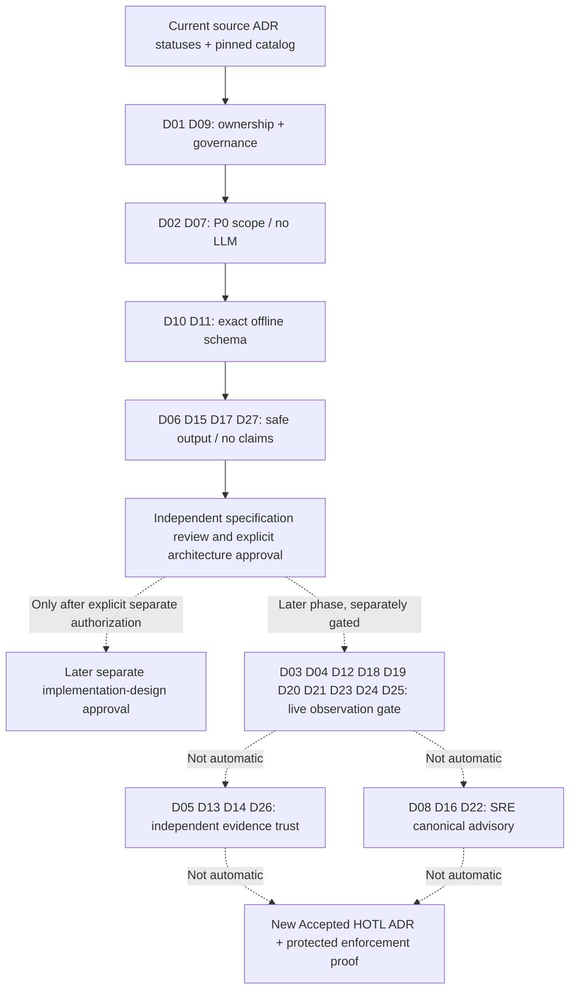

# AI Security Agent — Architecture Decision & Readiness Matrix v0.1

**Status:** Research Draft / review agenda. All 27 ASA decisions below are **OPEN**; none is Accepted, implemented, verified or approved by this table. This document does **not** supersede source ADRs or promote proposed rules to Accepted status.

**Inputs:** [Functional & Component Architecture v0.1](FUNCTIONAL-COMPONENT-ARCHITECTURE-v0.1.md) (ASA-D01…D09), [Data & Evidence Model v0.1](DATA-EVIDENCE-MODEL-v0.1.md) (D10…D17), [Integration & Trust Boundaries v0.1](INTEGRATION-TRUST-BOUNDARIES-v0.1.md) (D18…D27), [Spec v0.3](CAPABILITY-SPEC-v0.3.md), [Contract v0alpha3](ASSESSMENT-CONTRACT-v0alpha3.md), [Codex/Claude dispositions](INDEPENDENT-REVIEW-CONSOLIDATION-v0.3.md).

**Authority:** [ADR-Platform-000](../../decisions/ADR-Platform-000-security-first.md) **Accepted architectural principles, not implementation proof**. [ADR-Platform-021](../../decisions/ADR-Platform-021-read-only-platform-diagnostics-contract.md) **Draft**; [ADR-Platform-035](../../decisions/ADR-Platform-035-hybrid-intent-and-control-plane-execution.md) **Proposed**. [Discovery v0.2](../discovery/v0.2/README.md) and its B/F/T candidates are research, not executed production evidence. The accepted CAPI ADRs remain architecture contracts, not proof of live deployment.

> **Readiness is decision readiness, not deployment readiness.** A design question may be deferred intentionally; a requirement for a phase cannot be treated as satisfied merely because it is on a roadmap.

## 1. Decision status model

- **OPEN:** Source authors identified the unresolved decision; the matrix does not select an answer.
- **PROPOSED DIRECTION:** An alternative for reviewers to evaluate, not an approved implementation choice.
- **DECIDED:** Only after a recorded authorized architecture decision with exact source and ownership; this document marks **none** DECIDED.
- **DEFERRED WITH GATE:** Explicitly documented as not necessary for an earlier phase; **must** be resolved before its listed later phase and *cannot* be silently imported into earlier scope.
- **BLOCKED:** A phase may not proceed to implementation approval while a required decision or evidence owner remains open.

Here, `P0-ENTRY` means necessary **before P0 implementation design sign-off**. `P1-LIVE`, `P2`, `P3` and `P4` denote **separate future integration/authority gates**, not automatic promotions after P0. Some disclosure/export decisions apply across phases and must be resolved **before that functionality** regardless of phase number.

## 2. Master register — all 27 source decisions

| ID | Source question (short form) | Earliest gate | P0 treatment | Status | Proposed disposition for reviewers |
| --- | --- | --- | --- | --- | --- |
| **ASA-D01** | Who accepts and versions the control catalog? | **P0-ENTRY** | **Blocking** | OPEN | Designate accountable catalog owner and independent source-mapping reviewer; pin exact B/F/T sources |
| **ASA-D02** | Is first delivery strictly synthetic/offline? | **P0-ENTRY** | **Blocking** | OPEN | Confirm isolated synthetic B-01 only; exclude cluster/network/agent/LLM |
| **ASA-D03** | Which consumer needs which live observation? | **P1-LIVE** | Deferred | OPEN | Require named forcing consumer and approved observation class |
| **ASA-D04** | Separate security observation contract or provider beyond ADR-021? | **P1-LIVE** | Deferred | OPEN | Compare choices without expanding ADR-021 ServiceAccount or operations |
| **ASA-D05** | How verify independent evidence provenance and freshness? | **P2** | Deferred | OPEN | Evaluate independent trust sources; no assessor-owned competing authority |
| **ASA-D06** | Who enforces finding privacy, retention and disclosure? | **P0-ENTRY** for output safety; later exports separately | **Blocking for P0 data handling** | OPEN | Assign responsible owner and minimal safe P0 output; full retention/disclosure policy gated by exports |
| **ASA-D07** | Is an LLM needed and when can it see data? | **P0-ENTRY** to define exclusion; later LLM adoption separately | **Blocking for P0 exclusion rule** | OPEN | P0 no LLM; later only optional explanation of sanitized, attributed evidence |
| **ASA-D08** | Who produces trusted canonical SRE review projection? | **P3** | Deferred | OPEN | Protected review owner, not assessor; exact canonical/rendering bindings |
| **ASA-D09** | Does assessor boundary need a normative ADR? | **P0-ENTRY** governance routing | **Blocking** | OPEN | Decide whether to author a new ADR or record an explicitly approved contract governance path |
| **ASA-D10** | What is the exact P0 output/input ID and error schema? | **P0-ENTRY** | **Blocking** | OPEN | Fix machine semantics, deterministic ordering, explicit uncertainty/rejection codes |
| **ASA-D11** | How trust fixture completeness and reject unknown data? | **P0-ENTRY** | **Blocking** | OPEN | Specify fixture owner, allowed schema, partial inventory and safe rejection |
| **ASA-D12** | What binds caller, provider, target and recipient? | **P1-LIVE** | Deferred | OPEN | Per-hop actual identity and delegated audience/tenant/target scope |
| **ASA-D13** | Which external anchor/producer/reviewer/retention protects evidence? | **P2** | Deferred | OPEN | Independent tamper-evidence and replay/restore threat model; no SHA-only PASS |
| **ASA-D14** | Which changes invalidate current applicability? | **P2** (P3 extension) | Deferred | OPEN | Version/identity/profile/revocation dependency invalidation without rewriting historical outcomes |
| **ASA-D15** | Who owns privacy classification, retention and disclosure? | **P0-ENTRY** for data classification; export gate for publication | **Blocking for P0 safe fields** | OPEN | Coordinate with D06/D27; decide no raw sensitive evidence, safe projection owner |
| **ASA-D16** | How bind findings to immutable SRE canonical review? | **P3** | Deferred | OPEN | Advisor digest separate from exact approved review and its authority |
| **ASA-D17** | Who governs severity, risk rubric and production maturity? | **P0-ENTRY** to forbid false authority; later rubric gate | **Blocking for P0 `UNASSESSED` rule** | OPEN | P0 no severity score/PASS/profile approval; independent governance before claims |
| **ASA-D18** | Console backend or separate service ingress? | **P1-LIVE** | Deferred | OPEN | Compare backend authorization ownership; no UI-only permission checking |
| **ASA-D19** | How propagate original-principal delegation and revocation? | **P1-LIVE** | Deferred | OPEN | Audience/purpose/target/class scoped authorization at each hop |
| **ASA-D20** | Which consumer needs live effective-RBAC observation? | **P1-LIVE** | Deferred | OPEN | Name actual consumer, no blanket SAR/impersonation |
| **ASA-D21** | How share Diagnostic and Security observations safely? | **P1-LIVE** | Deferred | OPEN | Typed authorized projection; raw Diagnostic evidence retains owner |
| **ASA-D22** | How present SRE advice outside protected WYSIWYS review? | **P3** | Deferred | OPEN | Separate advisory presentation; canonical review remains immutable |
| **ASA-D23** | Who owns cross-tenant evidence cache and reauthorization? | **P1-LIVE** for cache; P0 no shared cache | Deferred | OPEN | Scope-bound cache, new authorization at lookup/delivery/export |
| **ASA-D24** | Who inventories actual runtime identities and privileges? | **P1-LIVE** | Deferred | OPEN | Independent inventory of true workload/service principals |
| **ASA-D25** | Who owns security observation contract versions and swap tests? | **P1-LIVE** | Deferred | OPEN | OpenKubes owns normative semantic contract; interchangeable providers |
| **ASA-D26** | How consume current revocation/DR facts without duplicating authority? | **P2** (P4 recovery interpretation) | Deferred | OPEN | Authorized read projection from independent current authority owner |
| **ASA-D27** | Who approves restricted disclosure and public projection? | **P0-ENTRY** for P0 no-publication boundary; first external export | **Blocking for P0 disclosure exclusion** | OPEN | Restrict P0 synthetic report; require named maintainer before any future publication |

**Count:** **27** source decision IDs; **P0-ENTRY: 10** (D01, D02, D06, D07, D09, D10, D11, D15, D17, D27); **P1-LIVE: 10** (D03, D04, D12, D18, D19, D20, D21, D23, D24, D25); **P2: 4** (D05, D13, D14, D26); **P3: 3** (D08, D16, D22; D14 also informs the P3 gate); **P4: 0 standalone** D01–D27 decision IDs, but requires a separately Accepted normative HOTL ADR. Earlier-phase disclosure constraints also apply to later phases. These counts classify the **earliest gate only**, not the number of substantive obligations.

## 3. P0 decision closure package

**Specification-first principle:** Nothing in this package calls for executing tests or creating code while the architecture PR remains Draft.

| P0 closure group | Decisions | Required review artifact before implementation sign-off |
| --- | --- | --- |
| **Control governance** | D01, D09 | Catalog owner and source review role; accepted decision process or explicitly designated ADR route; exact catalog baseline/revision |
| **Bounded functional scope** | D02, D07 | Explicit synthetic B-01 only; no live access, LLM, external data sources, hidden authority or dependencies |
| **Machine-readable contract** | D10, D11 | Strict fixture and result schema, accepted input classes/bounds, completeness trust, deterministic outputs and safe failure semantics |
| **Privacy, disclosure and claim discipline** | D06, D15, D17, D27 | Restrict P0 to synthetic sanitized data, define redaction/output responsibility, forbid severity/PASS/profile approval/public release without separate owner |

**Cross-cutting pre-implementation obligations** (not additional ASA IDs): P0 threat model; OS isolation architecture; malformed/injection/oversize/privacy negative test *plan*; immutable source pin; no-network/credential declaration; a future evidence plan with required test case references. These must be **specified**, not executed, before implementation authorization.

### Candidate P0 readiness checklist — currently not signed off

- [ ] Owners and independent architecture reviewers named (D01/D09).
- [ ] P0 input/output, provenance pins and fixture completeness rules agreed (D02/D10/D11).
- [ ] No-LLM/no-Kubernetes/no-network, safe projection and no false PASS defined (D06/D07/D15/D17/D27).
- [ ] Failure modes, isolation controls and future acceptance plan reviewed.
- [ ] Explicit documented architecture approval followed by separate implementation-design approval.

**P0 architecture readiness: NOT APPROVED.** No recorded closure is asserted by this matrix.

## 4. Phase-by-phase readiness and separation

| Phase | What can be reviewed now | What must remain unresolved/blocked until its own gate | Readiness today |
| --- | --- | --- | --- |
| **P0 — synthetic offline foundation** | Requirements, catalog mapping, strict input/output, no-authority contract and isolation design | D01/D02/D06/D07/D09/D10/D11/D15/D17/D27 and explicit architecture sign-off | **DRAFT / NOT_APPROVED** |
| **P1 — offline expansion / separately approved live observation** | High-level narrow provider options and identity chain | D03/D04/D12/D18/D19/D20/D21/D23/D24/D25; negative backend authorization and actual-principal evidence later | **DEFERRED** |
| **P2 — continuous evidence/assurance** | Historical/current/provenance distinctions | D05/D13/D14/D26; independent anchor, detector/alert owner, restore/replay model | **DEFERRED** |
| **P3 — SRE proposal and canonical-review advisory** | Candidate vs trusted canonical binding | D08/D16/D22 and P3-specific D14 extension; accepted governing human-approval/Policy rules | **DEFERRED** |
| **P4 — HOTL research only** | Scope/risk questions and prohibited-authority boundary | A **new Accepted normative HOTL ADR**, independently bounded mandates/revocations/stop/recovery and profile E2E; no automatic upgrade from P3 | **RESEARCH ONLY / BLOCKED FOR MUTATION** |

The P0 gate remains open irrespective of how many documents have been drafted; P1/P2/P3 cannot inherit a P0 pass as proof for their own trust boundaries.

## 5. Decision dependencies and critical path

This depicts **review dependencies only**, not deployment sequencing or permission to implement. The assessor is not a required approval predicate for SRE, Policy, Executor or recovery.

## 6. Governance and change-control record template (not yet populated)

Each future approved decision needs at minimum:

| Field | Required meaning |
| --- | --- |
| `decision_id` | One ASA-Dnn or distinct normative ADR, never silently renumbered |
| `status` | Proposed / Deferred with gate / Accepted / Rejected / Superseded with date and scope |
| `owner` and `independent_reviewer` | Actual accountable people/roles, not an AI self-approval |
| `source_revision` and `related_adrs` | Exact reviewed sources and unchanged source maturity |
| `selected_alternative` | Explicit choice, rejected alternatives and rationale |
| `phase_scope` | P0, P1-live, P2, P3, or P4; no blanket production approval |
| `threats_and_non_goals` | Boundary, negative-space guarantees and residual risk |
| `contract_impacts` | Changed schemas, controls, evidence and integration references |
| `future_verification_plan` | What **later** actual tests must demonstrate, with required owners |
| `recorded_approval` | Formal architecture sign-off independent of this draft's commit or PR status |

**Governance rule:** Merging a research PR, a reviewer saying “LGTM,” a green CI run, an Accepted principle ADR, or an earlier source-based review **must not automatically mark any ASA decision Accepted or any security profile production-approved**.

## 7. Review preparation: targeted questions

1. Does the P0 scope provide enough semantic value to justify an assessor contract **without** prematurely building a live agent? Decide D02 and D07.
2. Who owns the B/F/T catalog and what source revision is pinned for P0? Decide D01 and D09.
3. What does an incomplete synthetic RBAC inventory guarantee, and what must remain `INDETERMINATE`? Decide D10 and D11.
4. Who controls redaction and disclosure of assessments, even if all P0 examples are synthetic? Decide D06, D15, D17 and D27.
5. Which concrete live consumer would justify extra Kubernetes observation privileges **without** extending ADR-021 by implication? Defer D03/D04/D12/D18…D25 until that consumer exists.
6. Who owns an independent replay-/restore-resistant evidence anchor **without** turning the assessor into an authority? Defer D05/D13/D14/D26 to P2.
7. How will agent-originated SRE advice be visible yet excluded from immutable human-approval semantics? Defer D08/D16/D22 to P3.
8. Will P4 remain research until a separate Accepted HOTL ADR and robust evidence exist? **Yes as existing phase boundary**; acceptance still remains a future decision.

## 8. Integrity and limitations of this matrix

- Direct B↔F/T mapping stays in [Control Catalog v0.2](CONTROL-CATALOG-v0.2.md); no new source mappings invented here.
- Every `ASA-Dnn` item above must be reconciled to the exact question in its owning specification before approval; shortened phrases are not replacements for source text.
- **All 27 are currently OPEN** in this draft; the “proposed disposition” column records a *recommendation*, not a decision.
- No code, unit tests, platform E2E, cluster access, Jira modifications, release or merge have been performed for this artifact.

**Next architecture step, if authorized:** reviewers resolve the P0 closure package and assign explicit decision owners. Only then propose a separately reviewable implementation blueprint. Keep this PR Draft until explicitly instructed otherwise.
