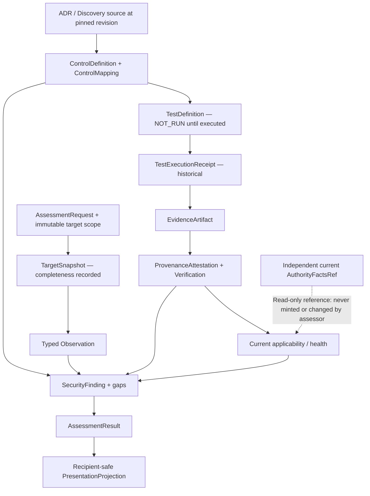

# AI Security Agent — Security Assessment Data & Evidence Model v0.1

- **Status:** Research Draft — conceptual model for architecture review only; **not** an Accepted ADR, implemented schema, security finding, completed test or production certification.
- **Source hierarchy:** [ADR-Platform-000](../../decisions/ADR-Platform-000-security-first.md) (Accepted governing principles), [Discovery v0.2](../discovery/v0.2/README.md) (working B/F/T registers, not accepted implementation), [Control Catalog v0.2](CONTROL-CATALOG-v0.2.md) (source-reconciled *draft projection*), [Assessment Contract v0alpha3](ASSESSMENT-CONTRACT-v0alpha3.md) (candidate interface), [Functional & Component Architecture](FUNCTIONAL-COMPONENT-ARCHITECTURE-v0.1.md) (candidate ownership).
- **Scope:** Define concepts, relationships, trust boundaries, lifecycle and error semantics. This file **does not select a database, ledger, PKI, agent framework, storage vendor, transport, or executable implementation**.

> **A declaration is not an observation; an observation is not a verified test; a verified historical test is not current security; current security is not permission to mutate.**

## 1. Modeling objectives and invariants

The model must answer: **what** was assessed, **against which exact control revision**, **in which target/profile and time window**, **from whose evidence**, **under which independent trust**, **with which limitations**, and **what a particular recipient may see**.

The following invariants are proposed for any implementation:

- **I-01 Source status cannot be upgraded by an assessment.** Accepted ADR principles, Proposed/Draft ADRs, Discovery B/F/T candidates, historical tests and runtime controls occupy different maturity dimensions.
- **I-02 Controls, observations, evidence and findings have separate identities.** Do not use a human-facing report as a security-authority record.
- **I-03 Every material claim is source- and scope-bound.** Unknown source revision, profile, principal or target identity means the relevant claim is unsupported.
- **I-04 Historical test outcome and current applicability are distinct.** PASS from yesterday can be genuine and nevertheless STALE today.
- **I-05 Trusted provenance is stronger than a hash.** A digest validates content identity, not source ownership, reviewer authorization, completeness or freshness.
- **I-06 Negative evidence is first-class.** A claimed denied operation needs a real expected/observed result under the correct authenticated principal, not just a YAML policy or a subject-access simulation.
- **I-07 Missing, contradictory or inaccessible evidence cannot become PASS or an approval.** Failures remain typed and visible, with recipient-safe explanations.
- **I-08 Current revocation, grant consumption and ownership facts remain with independent platform authority.** Neither restored cluster snapshots nor historical assessor receipts can reinstate them.
- **I-09 Agent output is advisory, never actionable authority.** Findings cannot issue Policy grants, stop/revoke, admission decisions, reconciliation triggers or required recovery gates.
- **I-10 Public and recipient-specific reports derive from safe projections, never raw evidence.** The recipient must be authorized independently at request, lookup, cache and delivery.

## 2. Conceptual entities and authority ownership

| Entity | Primary identity and minimum fields | Responsible owner | Trust / maturity caveat |
| --- | --- | --- | --- |
| **ControlDefinition** | `control_id`, exact statement, source path/revision/status, applicable profiles, version | Catalog maintainer | B-01…B-19 remain candidate Discovery IDs; source status recorded verbatim |
| **ControlMapping** | control ID, direct F/T links, gate dependencies, mapping-source revision, review disposition | Catalog maintainer / independent reviewer | Direct mapping ≠ gate dependency; no LLM-generated edges |
| **AssessmentRequest** | unique request, authenticated requester reference, bounded target/profile/control set, declared purpose | Trusted assessor ingress, *not* model | P0 synthetic input has **no authenticated live principal** |
| **TargetSnapshot** | immutable target identity or synthetic fixture ID, inventory coverage, profile, source/data revision, observation window | Authorized observation provider / P0 fixture owner | Incomplete inventory cannot prove absence of grant or effective access |
| **Observation** | observation ID, typed assertion, actual collector identity, exact resource/operation, time window, snapshot reference | Observation source and trusted collector | Source data can be compromised, incomplete or attacker-written |
| **TestDefinition** | source T ID, control and gate links, expected positive/negative behavior, required evidence | Discovery/test owner | T-01…T-42 are proposed tests; definitions are not successful executions |
| **TestExecutionReceipt** | run ID, test ID, expected and observed results, actor, versions, source + rendered hashes, time, artifact references | Independent test producer | Recorded PASS/FAIL belongs to a *real run*, not P0 or prose |
| **EvidenceArtifact** | immutable, non-redeemable artifact ref, content digest, storage scope/classification, producer/source identity | Evidence origin / protected storage | Content digest alone doesn't prove authenticity; no arbitrary URI fetch |
| **ProvenanceAttestation** | bound artifact/run/source/target, authorized producer, trust anchor, reviewer reference, chronology/completeness evidence | Separate trust/provenance owner | This is a future conceptual requirement; **no key/store currently selected** |
| **EvidenceVerification** | artifact/run ID, independent verification disposition, reason, checked revision and time, trust-anchor scope | Evidence verifier | Verification of record origin is not proof of current enforcement |
| **ApplicabilityAssessment** | evidence ID, current target & dependency versions, freshness policy, comparison timestamp, applicability and reason | Assessor over authorized current metadata | May be UNKNOWN when current trusted data absent; never imports authority |
| **SecurityFinding** | finding ID, control IDs, specific supported facts, inferred risk, confidence, evidence/gap links, scope and status | Deterministic evaluator; optional LLM only explains | A finding is advisory; Discovery F IDs are **source links**, not new confirmed exploits |
| **AssessmentResult** | request/result IDs, normalized findings and gaps, completion/disposition, catalog & subject binding | Assessor, schema validator | No `approved`, `authorization`, `grant`, `allow`, `deny` authority field |
| **ReviewRecord** | reviewer identity, reviewed artifact digest, scope, review time, decision on *evidence quality* | Independent human evidence reviewer | Different from protected **human mutation approval** in ADR-035 |
| **PresentationProjection** | recipient, allowed fields, redaction version, release decision, rendered report digest | Backend authorization + security disclosure owner | Raw evidence IDs, private endpoints or Secret values never assumed public |
| **AuthorityFactsRef** | optional protected reference to current epoch/revocation/consumption status, independent source and freshness | Platform security/management authority | **Reference only**; Security Agent neither authors nor adjudicates authority |

**Ownership rule:** These are logical records, not necessarily separate services or stores. Operational authorities must remain independent even if a future implementation shares physical infrastructure. A read-only Evidence Verifier cannot become an Authority Store simply by using signed records.

## 3. Relationships and traceability graph



**Cardinality (proposed):** one control may reference many source findings and test definitions; one test may serve several controls and gates; one observation may support or contradict multiple findings; a finding may need multiple evidence items and counter-evidence. Every material finding must be resolvable to its exact source, target and underlying observations **without** mixing research IDs with independently generated finding-instance IDs.

**ID namespaces:** `B-xx` (candidate baseline), `F-xx` (Discovery finding), `T-xx` (proposed evidence test) are **source-controlled**; `assessment_id`, `observation_id`, `finding_instance_id`, `run_id` and `artifact_id` represent **individual records**. No generated output may create a source-owned B/F/T definition or convert a source finding into a live incident.

## 4. Source truth, test truth, current applicability and severity

| Dimension | Proposed vocabulary | What it answers | Must not imply |
| --- | --- | --- | --- |
| **Source classification** | `SOURCE_CONFIRMED`, `REPORTED_LAB`, `DESIGN_RISK`, `UNVERIFIED` | How the original claim was supported | That the current cluster is affected or exploit verified |
| **Record verification** | `UNREVIEWED`, `SOURCE_LINK_CHECKED`, `INDEPENDENTLY_VERIFIED`, `REJECTED` | Whether origin, scope and integrity checks support this receipt | Current healthy enforcement |
| **Recorded test outcome** | `NOT_RUN`, `PASS`, `FAIL`, `INDETERMINATE` | What one actual test run recorded (or no run) | Production approval |
| **Current applicability** | `UNKNOWN`, `APPLICABLE`, `STALE`, `CONTRADICTED` | Is a historical observation applicable to the exact current target? | Mutation permission |
| **Implementation maturity** | `PROPOSED`, `SOURCE_COMMITTED`, `UNIT_TESTED`, `ISOLATED_E2E`, `REAL_HOST_E2E`, `PRODUCTION_APPROVED_PROFILE` | Scope of reviewed implementation/evidence | Equivalent maturity in any other profile |
| **Profile approval** | `NOT_APPROVED`, `SCOPED_APPROVAL` | Independently approved deployment profile, if any | Assessor itself decided acceptance |
| **Finding severity** | `UNASSESSED` in P0; later rubric separate | Independently governed impact/priority assessment | Discovery triage priority equals CVSS |

**Do not reduce these columns to a single green `security_status`.** An application may derive a display summary only when it preserves every uncertainty and attaches a policy-independent evidence reference. It cannot use the visual summary as an admission/mutation predicate.

### Evidence-gap taxonomy (draft)

| Code | Trigger | Intended handling |
| --- | --- | --- |
| `MISSING_SOURCE` | Unknown or unpinned control/source revision | Reject requested mapping; no inferred default |
| `INCOMPLETE_INVENTORY` | Missing parts of a declared grant/target graph | `INSUFFICIENT_EVIDENCE`; do not infer denied access |
| `NOT_EXECUTED` | No real matching run artifact for a TestDefinition | Recorded test `NOT_RUN` |
| `UNTRUSTED_PRODUCER` | Producer/reviewer authorization or independent anchor missing | `REJECTED` or `INDETERMINATE`; no trusted PASS |
| `STALE_DEPENDENCY` | Changed profile, manifest, identity, controller, policy or key/material version | Historical result remains, current applicability `STALE` |
| `CONFLICTING_OBSERVATIONS` | Authorized independent sources disagree | `CONTRADICTED` / review; do not pick favorable source |
| `UNAVAILABLE_SOURCE` | Data source or authority not reachable | `UNKNOWN` with missing proof; assessor does not alter operations |
| `UNAUTHORIZED_SCOPE` | Caller or recipient lacks requested access | Deny lookup and disclosure without revealing private object existence |
| `SENSITIVE_INPUT` | Secret/raw token/private endpoint or unclassifiable field | Fail-closed redaction/rejection prior to model/telemetry |
| `CORRUPT_OR_REPLAYED_EVIDENCE` | Hash, trust anchor, sequence, chronology or rollback checks fail | Reject trust; preserve history without current assurance |

The distinction between `INDETERMINATE`, `INSUFFICIENT_EVIDENCE` and `REJECTED` remains to be finalized in a **schema decision**. The values above describe failure reasons, not a new operational authorizer.

## 5. Provenance: what an independent evidence verifier must check

**For a historical test receipt** (future phases only), model all of:

1. `test_id`, expected and actual operation/result, authenticated **real** principal (or explicitly synthetic test principal), identity generation, observed API outcome, timestamp/window;
2. exact repository revision, manifests/rendered digest, component/provider/Kubernetes versions, supported profile and target resource/cluster identity;
3. artifact content digest **and** separately authenticated producer identity, source attestation, independently trusted anchor and reviewer scope/authorization;
4. immutable reference to a known sequence/checkpoint, retention/completeness policy and replay/rollback detection appropriate to the threat model;
5. independent comparison to current versions and runtime health, keeping historical proof intact while marking stale applicability;
6. explicit negative tests and scope limitations; absence of expected evidence is an open gate, never success.

**No implementation selection:** A signed object with an untrusted self-managed key cannot by itself be considered independently authoritative. The correct trust boundary for an evidence sink, signer, log, restore profile and reviewer still requires a separate decision. Do **not** assume ADR-CAPI-003's ownership epoch store is automatically a general-purpose evidence ledger.

### The restore distinction

- **Historical test receipts** prove a recorded event under the trust assumptions of their producer/anchor.
- **Current operational health** describes the state at a sufficiently recent, authorized observation.
- **Current security authority** defines active/revoked identities, consumed grants and current management ownership, governed outside an older protected-cluster restore domain per ADR-Platform-000.

The Security Agent may **read an authorized projection** of these categories and identify gaps. It does not decide when restored non-recovery API traffic is permitted, issue a new epoch, un-revoke a credential or fence a disconnected host. A valid historic receipt cannot serve as a current revocation ledger.

## 6. Conceptual findings and examples

### Example A — P0 synthetic declared RBAC, no platform PASS

```yaml
kind: SecurityAssessmentExample # illustrative only; not a defined API resource
version: conceptual-v0.1
request_scope:
  environment: synthetic-offline
  profile: SYNTHETIC_BYOH
catalog:
  control_id: B-01
  referenced_discovery_findings: [F-01, F-25]
  required_discovery_tests: [T-01, T-02, T-03, T-04]
observation:
  class: DECLARED_RBAC_BINDING
  resource: synthetic RoleBinding
  inventory_complete: false
finding:
  class: DECLARED_SCOPE_REVIEW
  observed_fact: "Synthetic binding declares a subject -> Role relationship"
  inference: "Effective host access is not determined by this fixture"
  severity: UNASSESSED
assessment_disposition: INSUFFICIENT_EVIDENCE
verification_disposition: UNREVIEWED
recorded_platform_test_outcome: NOT_RUN
current_applicability: UNKNOWN
profile_approval: NOT_APPROVED
```

The example must not be read as a verified OpenKubes vulnerability, successful admission test, actual agent response or Kubernetes CustomResource definition.

### Example B — Historical PASS, current target changed

An authorized, version-pinned test receipt may record `PASS` for one control and one profile at a historical run. If the target policy artifact, principal or Kubernetes version subsequently changes, retain the historical `PASS` **as recorded**, but mark `current_applicability: STALE` and reopen the corresponding evidence gate. Current enforcement is **not** approved by that historical receipt. This is the role of Discovery B-14/T-32.

### Example C — Restored snapshot with missing current authority

An old snapshot may contain a grant that appears valid inside the restored data. Without current independent monotonic facts or their independently proven invalidation/reissue, the assessor reports an evidence/authority gap and cannot claim the grant is safely revoked. Actual quarantine, mutation denial and recovery sequencing remain with trusted platform components per ADR-000, B-11/B-17 and Accepted CAPI ownership contracts.

### Example D — Conflicting or compromised evidence sources

A source reports success while another independently trusted observation reports a denial or a differing target version. The assessment must preserve the conflicting observations as separate records, mark current applicability `CONTRADICTED` or verification `REJECTED` as warranted and request independent resolution. It must not select the more favorable signal, invent a confidence percentage or claim a passed test.

## 7. Assessment record lifecycle (logical, non-operational)

1. **Declare scope:** trusted ingress determines authorized recipient/tenant/profile and requested control IDs; P0 uses synthetic scope only.
2. **Resolve source definitions:** load exact catalog, ADR/Discovery status and reviewed mappings; reject unknown/unpinned controls.
3. **Acquire authorized observations:** P0 from one supplied bounded synthetic bundle; later live data only via separately approved, capability-limited providers.
4. **Check provenance:** verify allowed sources, target binding, provenance, current applicability and observation completeness. Missing trust produces gaps.
5. **Evaluate controls deterministically:** derive declared facts and required evidence without LLM-authored ID changes or arbitrary policy claims.
6. **Classify finding and uncertainty:** distinguish observation from inference; attach both confirming and contradicting facts.
7. **Project safely:** redact and enforce recipient authorization **before** output/log/export/model use; classify sensitive information under restricted disclosure.
8. **Retain separately:** record invocation audit, provider traces, normalized result and raw evidence references under separate access/retention owners (ADR-021 inspiration).
9. **Reassess on material change:** new versions, trust revocation, profile change, lost collector or restored authority trigger reassessment of applicability, **not a rewrite of historic receipts**.

**Non-blocking rule:** If the assessor fails or cannot access evidence, return an explicit advisory gap. Existing independently protected Policy/Executor/recovery paths do not begin to depend on its availability.

## 8. Privacy, retention and public disclosure

Proposed data categories:

| Category | Example | Intended exposure |
| --- | --- | --- |
| `PUBLIC_ARCHITECTURE` | Accepted ADR principles, generic control descriptions | Public after review |
| `INTERNAL_ASSESSMENT` | Tenant- and target-scoped results, non-sensitive evidence status | Only authorized operations/security users |
| `SENSITIVE_SECURITY` | Nonpublic vulnerability preconditions, topology, private evidence references | Security-maintainer access; restricted disclosure |
| `SECRET_EQUIVALENT` | Secrets, kubeconfigs, bootstrap credentials, backups, recovery keys | **Not a normal assessor input/output**; protected at source |

A display or export cannot be authorized merely because the original source repository is public. Conversely, an intentionally public repository does not itself imply an exposure incident. Reviewer-approved safe projections must remove private tracker identifiers, sensitive payloads, operational endpoints, customer identities, hidden topology, reusable handles and sensitive reproduction steps. Where a field cannot be safely classified, reject or withhold rather than echo it.

**Not yet selected:** retention duration, deletion semantics, cross-boundary audit correlation, encryption/key ownership, data-subject handling, disclosure SLA, or jurisdiction-specific compliance mappings. These require governance decisions, not guesses.

## 9. Relationship to existing and future contracts

- **ADR-Platform-000:** governing architecture principle; requires negative, version-bound evidence, lifecycle durability, monotonic authority and independently detectable enforcement.
- **ADR-Platform-021 (Draft):** its three diagnostic functions are **not** general security evidence, SAR or impersonation endpoints. Four data/audit classes (invocation audit, provider tool trace, result, raw evidence) may inform *future* separation, without extending its existing provider's credentials.
- **ADR-Platform-035 (Proposed):** a SecurityFinding is never a protected human approval. Future SRE advice references an immutable review projection without modifying its digest, target or exact transition; protected approvals remain with trusted human/Policy systems.
- **Discovery v0.2:** B/F/T source mappings and proposed evidence template remain Research. The Data Model must not treat `NOT_RUN` as a historical PASS or claim a profile approved.
- **P0 contract v0alpha3:** minimal offline-synthetic declared RBAC input/output is the only immediate design target. Wider schema fields in this document are **future conceptual entities**, not P0 runtime requirements.

## 10. Open decisions for architecture review

| ID | Decision needed before | Question |
| --- | --- | --- |
| **ASA-D10** | P0 schema sign-off | What is the exact machine schema for source/observation/gap IDs, stable deterministic ordering and rejection reasons? |
| **ASA-D11** | P0 sign-off | Which fixture completeness declaration is trusted and how are unknown/unclassifiable fields rejected without disclosure? |
| **ASA-D12** | P1 live | What is the independently authorized binding of caller, actual provider identity, target, observation class, and recipient? |
| **ASA-D13** | P2 evidence verification | What independent producer/reviewer, tamper-evident anchor, retention and rollback/completeness policy satisfies the evidence threat model? |
| **ASA-D14** | P2/P3 | What changes invalidate *current applicability* without deleting historical run outcomes? |
| **ASA-D15** | Before exporting findings | Who owns privacy classification, evidence-handling retention and coordinated vulnerability disclosure approval? |
| **ASA-D16** | P3 | How are SecurityFinding instances bound to immutable canonical review projections while remaining outside protected approval artifacts? |
| **ASA-D17** | Before any compliance claims | How do risk/severity rubrics, model-specific maturity and approval decisions receive independent governance? |

**Review gate:** This conceptual model requires an independent architecture pass, reconciliation with the exact source ADRs, acceptance of ownership and phase-specific boundaries, and an explicit subsequent implementation-design decision. **No code, tests, repositories outside this draft, website publication, merge, or deployment are authorized by this document.**
