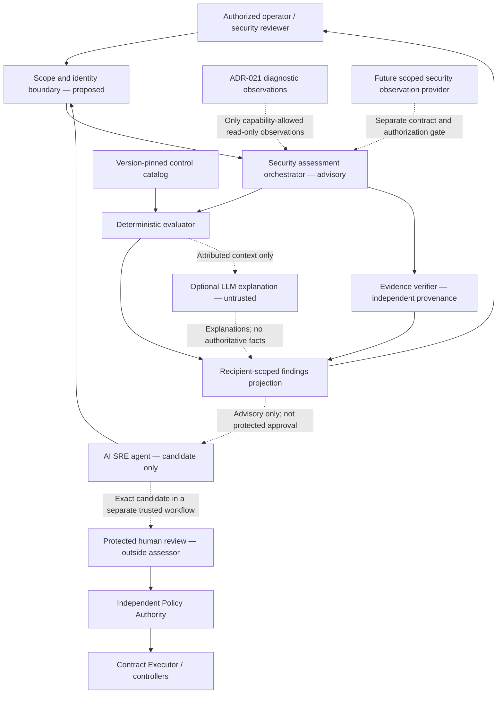

# OpenKubes AI Security Agent — Functional & Component Architecture v0.1

- **Status:** Research draft for architecture review — not an Accepted ADR, implementation design approval, operational interface or deployment claim.
- **Companions:** [Capability Specification v0.3](CAPABILITY-SPEC-v0.3.md), [Assessment Contract v0alpha3](ASSESSMENT-CONTRACT-v0alpha3.md), [Control Catalog v0.2](CONTROL-CATALOG-v0.2.md), [Claude/Codex dispositions](INDEPENDENT-REVIEW-CONSOLIDATION-v0.3.md).
- **Governing principle:** [ADR-Platform-000](../../decisions/ADR-Platform-000-security-first.md) Accepted *architectural principles*. [ADR-Platform-021](../../decisions/ADR-Platform-021-read-only-platform-diagnostics-contract.md) is **Draft**. [ADR-Platform-035](../../decisions/ADR-Platform-035-hybrid-intent-and-control-plane-execution.md) is **Proposed**. No implementation or production validation follows from these statuses.

> **Design objective:** The Security Agent explains what the system can demonstrate, what remains unverified, and which independent tests are required — without acquiring authority over Kubernetes or agentic operations.

## 1. Bounded context and responsibilities

| Role | Owns | Must not do |
| --- | --- | --- |
| **Security Agent / Assessment Orchestrator** | Scope selection from authorized context; invoking approved read-only assessment capabilities; assembling citations and explaining evidence gaps | Approve mutations, mint grants, access Secrets, bypass backend authorization, modify enforcement |
| **Deterministic Control Evaluator** | Evaluating named, version-pinned catalog controls over explicitly permitted typed observations; predictable machine-readable dispositions | Claim runtime PASS from manifest declarations; fetch arbitrary resources; accept LLM-written control definitions |
| **Control Catalog Maintainer** | Source-reviewed B/F/T mappings, catalog version, applicability, deprecation and review status | Infer Accepted status for Discovery candidates or rewrite source ADRs automatically |
| **Evidence Trust Verifier** | Checking immutable evidence identifiers, source hashes, producer/reviewer authorization, historical result, scope and freshness against independently established trust | Mint current revocation/ownership authority, accept self-signed receipts as production proof |
| **Platform Diagnostic Capability** | Its own ADR-021 scoped health/workload/evidence interface, when separately available and authorized | Provide arbitrary SAR, impersonation, CSR or Secret read via its current get/list/watch provider identity |
| **Security Observation Provider (future)** | Explicit, typed, capability-declared, backend-authorized observations for an approved security consumer | Become an arbitrary Kubernetes API/SAR proxy or a shared privileged tool server |
| **AI SRE / intent author** | Propose bounded lifecycle intent; request explanations; show candidate advice to an authorized person | Treat agent output as protected human approval, Policy decision, one-use grant or executable accepted revision |
| **Independent Policy Authority / Contract Executor** | Authorization and execution, each within its own protected contract | Delegate mutation authority to Security Agent findings or LLM confidence |
| **Human security owner/reviewer** | Catalog acceptance, evidence review, vulnerability disclosure and scoped release approval | Assume a historical signed test receipt proves present control health |

A **Diagnostic Agent** collects or explains platform operational observations under its own contract. A **Security Agent** evaluates independently sourced observations against explicit security-control obligations and evidence maturity. An **AI SRE Agent** prepares *untrusted candidate changes*; it can request advisory risk analysis but cannot elevate that answer to authority. These are *capability boundaries*, not a requirement for three different model instances or vendors.

## 2. Component-level reference architecture

**No arrow from Security Agent, LLM, evidence verifier or findings projection to Policy Authority, Executor, admission, stop/revoke controllers or the authoritative desired-state path.** Diagram arrows indicate intended logical data flow, **not** existing services or an approved transport.

### Component trust placement

- **Trusted specification/configuration plane:** reviewed catalog, schema validators, deterministic controls and allowed observation classes, all version-bound.
- **Lower-trust data plane:** YAML/JSON manifests, logs, annotations, runtime descriptions, vulnerability context, external links and candidate proposals; content is never interpreted as developer instructions.
- **Protected operation authority plane:** authenticated human approval, Policy Authority, Contract Executor, grants, claims, atomic acceptance and fencing. The assessor has no credentials or write route into it.
- **Evidence and confidentiality plane:** independent verification and safe projection for an authorized recipient, with raw artifacts remaining at their owner; security receipts are not a replacement for monotonic security authority.

**P0 reduction:** only a synthetic supplied bundle, fixed catalog projection and deterministic report are in scope. All other components are **future logical design** and must not be created merely because shown.

## 3. Functional capabilities and explicit non-capabilities

| Capability ID | Function / question answered | Allowed data | Output | Earliest phase |
| --- | --- | --- | --- | --- |
| **SEC-FUNC-01** | Which declared principal and binding scope is visible in a complete or incomplete manifest bundle? | Synthetic, bounded declared RBAC fixture | `DECLARED` observation, source refs, missing inventory, no effective permission claim | P0 (one B-01 case) |
| **SEC-FUNC-02** | Which evidence is missing for a requested control and named profile? | Trusted control catalog and pre-supplied references | Requirement/test gap list and `NOT_RUN` where appropriate | P0 |
| **SEC-FUNC-03** | Is declared RBAC structurally overbroad or ambiguous in a supplied offline inventory? | Sanitized bounded Role/Binding graph | Declared risk and limitations | P1 offline |
| **SEC-FUNC-04** | What actual scoped access was observed from an authorized principal? | Later typed identity-specific API observations | Direct positive/negative evidence, `INDETERMINATE` when incomplete | P1 live gate |
| **SEC-FUNC-05** | Are policy deployment, installation and drift controls evidenced across lifecycle versions? | Pinned rendered manifests, health reports, reviewed run receipts | Freshness and completeness gaps; never unilateral production PASS | P2 |
| **SEC-FUNC-06** | Can a reviewed artifact and its historical outcome be authenticated and matched to this target? | Independently authorized receipts and trust-anchor verification | Verification disposition and current applicability **separately** | P2 |
| **SEC-FUNC-07** | Which risks are present in an SRE candidate or exact canonical review projection? | Candidate digest or separately verified immutable review reference | Non-authoritative advisory finding bound to exact reviewed subject | P3 |
| **SEC-FUNC-08** | What evidence is missing for mandate scope, revocation, budget or stop ordering? | Read-only records of an independently governed HOTL profile | Research-only evidence gap and risk explanation | P4 research |

A planned *capability* is not a promise that a backend already implements it. An enabled implementation must publish its own supported control IDs, observation classes, scope and evidence completeness.

### Explicit prohibited functions in every phase

`approve_operation`, `authorize_mutation`, `create_grant`, `apply_remediation`, `revoke_identity`, `pause_cluster`, `perform_break_glass`, `cluster_admin_proxy`, unrestricted `subject_access_review`, arbitrary `kubectl`, arbitrary log/Secret fetch and any output treated automatically as a release gate.

An analyst may discuss remediation ideas in prose after authorization and review, but generated commands, YAML changes and SRE recommendations are never executable intents within the Security Agent contract.

## 4. Data ownership and evidence life cycle

An assessment must connect four different records, **without merging their truth claims**:

1. **Requirement provenance:** the exact catalog version, source ADR/Discovery status and reviewed B/F/T mapping.
2. **Observation provenance:** the specific supplied or separately authorized observation, collection identity, time, scope, target and completeness.
3. **Verification provenance:** an independently authorized producer/reviewer, protected source and integrity proof for historical runs, plus a separate decision about current applicability.
4. **Presentation provenance:** authenticated audience, permitted fields, redaction/projection version and optional model/explanation version.

For each finding, the conceptual output is: `assessment_id`, `scope`, `control_ids`, `observed_fact`, `inferred_risk`, `source_refs`, `finding_class`, `verification_disposition`, `recorded_test_outcome`, `current_applicability`, `profile_maturity`, `evidence_gaps`, `recipient_scope`. No grant, allow/deny decision, operational stop or executable target state.

**Evidence unavailable, contradictory, stale or outside a recipient's authorization** yields an explicit `INSUFFICIENT_EVIDENCE`, `REJECTED` or `INDETERMINATE` as applicable. Absence of a control in an incomplete inventory must not be stated as absence in a cluster. A historical PASS, even if cryptographically authentic, is not a current green deployment status.

### Example conceptual assessment narrative

> “A synthetic binding declares `get` on `secrets` for a named subject in the provided namespace. Catalog B-01 is relevant. The supplied bundle is incomplete; no actual-principal Kubernetes requests or independent enforcement evidence were provided. Therefore effective permissions, foreign-secret denial and production maturity are undetermined. Required Discovery tests remain NOT_RUN.”

This example is *not* a security finding on a real OpenKubes cluster.

## 5. End-to-end interaction scenarios (proposed)

### Use case UC-01 — Offline declared RBAC review

An authorized researcher supplies a fixed, synthetic B-01 bundle to a standalone, non-networked evaluator. The catalog maps B-01 to its reviewed direct findings and tests. The evaluator identifies the declared binding but produces a missing-evidence result. All source bytes are rejected or safely projected before optional later model use. **No model, cluster or authority-plane call exists in P0.**

**Acceptance discussion:** Define exact fixture ownership, schema completeness, rejection behavior and success/error semantics *before implementation*. Unit tests and OS isolation proofs are *post-approval activities*.

### Use case UC-02 — Scoped live security observation (future)

An authenticated operator requests evidence for one named target and control. The platform resolves audience-bound authorization and only exposes a typed observation class. Backend permissions are independently enforced; no general SAR/impersonation is borrowed from ADR-021. The result states whether evidence is direct, insufficient, stale or unavailable. A denied request must not reveal object existence or cross-tenant cache contents.

**No implementation selection:** whether a distinct provider or a separate security-diagnostics OpenAPI interface owns the observation remains open.

### Use case UC-03 — Security advisory for AI SRE (future)

AI SRE submits an untrusted candidate digest; Security Agent returns preliminary advice **only for that candidate**. When a trusted canonical review projection exists, an entirely separate read-only request can bind assessment to `canonicalization_profile`, renderer/version, predecessor, target identity, operation, review digest and transition ID. Findings are displayed separately from the protected human-reviewed semantic artifact and **cannot change its bytes or approval correlation**.

An absent or adverse Security Agent result does not block a separately valid human/Policy/Executor path. A changed proposal invalidates advisory applicability rather than allowing approve-A/execute-B.

### Use case UC-04 — Audit evidence and recovery (future)

The assessor compares an authenticated historic receipt against the target's exact version and separately checks available current health/freshness. It must **not** decide whether revocations, consumed grants or owner epochs are current, nor activate traffic after DR restore: those remain enforced by independent security/management authorities. It explains the gap when current facts cannot be verified.

## 6. Deterministic engine vs LLM responsibilities

| Deterministic, independently governed | Optional LLM-assisted |
| --- | --- |
| Strict schema parsing, bounds, allowed observation classes and scope checks | Explain findings in operator-friendly language |
| B/F/T ID validation and pinned-control resolution | Summarize relevant (authorized) evidence gaps |
| Identity/provenance and evidence-verification dispositions | Suggest possible follow-up investigations as **untrusted proposals** |
| Exact version/digest/freshness comparison | Compare trade-offs using attributed, sanitized references |
| Forbidden field/output validation and safe projection | Translate explanation for console/API consumers without changing underlying facts |
| Final machine-readable outcome and uncertainty vocabulary | Never set severity, PASS, authorization, control acceptance or profile approval |

The LLM receives **only a recipient-safe, verified projection**. Its text is untrusted, attributed, potentially inaccurate, and never changes machine-readable controls or authority. Whether an LLM is needed at all is a **later architecture/design decision**, not a prerequisite for the initial contract.

## 7. Interface boundaries, not implementation choices

- **Offline P0:** bounded, synthetically supplied byte bundle and fixed result schema; no network transport.
- **Future security observation:** separate OpenKubes-owned, versioned capability and access contract; proposed HTTP/OpenAPI normative surface if a service is approved; MCP/CMCP may be optional projections, not schema authority.
- **ADR-021:** read-only platform diagnostic observations **only within its existing three functions**; explicit unavailable evidence instead of privilege escalation.
- **AI SRE:** candidate digest or trusted read-only review projection; never return approval-/grant-shaped fields.
- **Public UI/API:** safe recipient-specific projection; raw evidence not stored with general chat transcripts or public website assets.
- **Control source governance:** catalog changes require human source review and version increment; an assessment cannot rewrite its own evaluation criteria.
- **Tenancy:** no cross-tenant observation, cache reuse or detailed finding links without backend authorization at both resolution and delivery.

## 8. Failure semantics and risk ownership

| Failure mode | Intended behavior | Independent owner |
| --- | --- | --- |
| Catalog source mismatch / stale mapping | Reject or return explicit unresolved mapping; no PASS | Catalog maintainer |
| Observation incomplete / missing | `INSUFFICIENT_EVIDENCE`; do not infer effective denial | Observation provider |
| Provider unavailable | Read-only service unavailable with precise gap; core reconciliation unaffected | Provider operations |
| Evidence producer compromised / log rollback | Reject affected trust, preserve historical claim label, requalification required | Evidence/trust owner |
| Security Agent outage | No assessment, alert if monitoring configured; no implicit policy deny or permission broaden | Agent operations |
| Unauthorized tenant request | Deny without revealing private details, including via cache or UI | Backend authorization owner |
| Suspected exploitable finding | Restricted intake, owner review, coordinated disclosure | Security maintainer |
| Model hallucination / prompt injection | Reject authority-shaped output; machine result unchanged | Assessment contract owner |
| DR restored stale authority | Platform quarantines or invalidates per ADR-000; assessor reports only evidence gap | Independent security/management authority |

The agent is **not a replacement** for admission controls, Kubernetes RBAC, a Security Operations Center, an IDS, the immutable audit ledger, an incident responder or the independent Policy Authority.

## 9. ADR dependencies and phase gates

**Existing Accepted:** ADR-Platform-000 (principles); ADR-CAPI-001–007 architectural contracts. Neither acceptance is a runtime proof.

**Draft/Proposed:** ADR-Platform-021 Draft diagnostics, ADR-Platform-035 Proposed human approval and candidate binding, related lifecycle/platform ADRs retain their actual statuses.

**Research only:** Security Discovery v0.2 B/F/T, this document, Security Assessment Contract v0alpha3 and the HOTL research paper.

**P0 ready for implementation review only when:** use case UC-01, fixture schema, catalog ownership, machine result type, threat model, failure semantics, no-network/ambient-access requirements, redaction gates and acceptance tests have been *specified and approved*. **Do not execute those tests or develop code within this specification PR.**

**P1+ gated separately:** a named consumer and per-hop authorization model; no implicit privilege expansion through ADR-021. P2 requires independently protected evidence; P3 requires trusted canonical review; P4 requires a new Accepted HOTL ADR and independently proven authorization ordering and recovery.

## 10. Decisions required from architecture reviewers

| Decision ID | Question | Suggested direction (not accepted) |
| --- | --- | --- |
| **ASA-D01** | Who is accountable for catalog acceptance and controlled updates? | Security architecture maintainer plus independent source reviewer |
| **ASA-D02** | Is the first delivery strictly offline and synthetic, or should it have any runtime observation? | Strict offline/synthetic P0 |
| **ASA-D03** | Which future consumer requires which live security observation? | Require explicit named consumer and allowed observation class before P1 design |
| **ASA-D04** | Security-observation extension or distinct provider, beyond ADR-021's present functions? | Compare against ADR-021 governance; no early selection |
| **ASA-D05** | What independently verifies evidence provenance and freshness without creating a competing authority store? | Reuse existing independent trust architecture where it satisfies threat model; decide after P0 |
| **ASA-D06** | Where are finding privacy, retention, disclosure and owner approvals enforced? | Recipient-scope backend and a dedicated security-maintainer process |
| **ASA-D07** | Is an LLM ever needed for the minimal contract and when may it receive data? | Optional explanation after deterministic evidence projection, never for control truth |
| **ASA-D08** | Where does exact canonical SRE review projection originate? | Trusted review owner from ADR-034/035 profile, not assessor |
| **ASA-D09** | Is a new normative ADR needed for the assessor boundary? | Architecture review to decide; this research doc does not adopt a new ADR |

**Review outcome is intentionally pending.** This file specifies capability and component boundaries only. No code, fixture execution, test artifacts, policy/authority changes, merge or website release are authorized.
