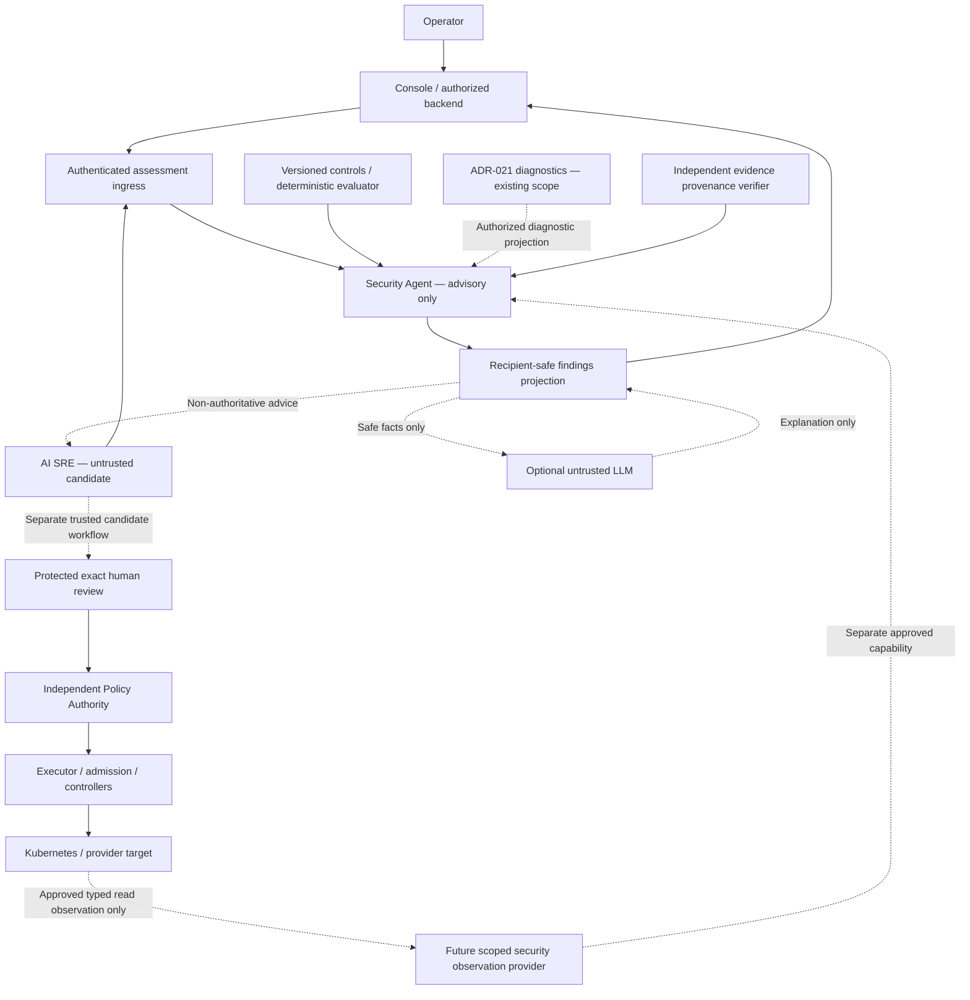

# OpenKubes AI Security Agent — Integration & Trust Boundary Specification v0.1

- **Status:** Research Draft — architecture review only. Not an Accepted ADR, selected implementation, deployed integration or evidence of platform controls.
- **Related:** [Functional & Component Architecture](FUNCTIONAL-COMPONENT-ARCHITECTURE-v0.1.md), [Data & Evidence Model](DATA-EVIDENCE-MODEL-v0.1.md), [Capability Specification v0.3](CAPABILITY-SPEC-v0.3.md), [Assessment Contract v0alpha3](ASSESSMENT-CONTRACT-v0alpha3.md), [Control Catalog v0.2](CONTROL-CATALOG-v0.2.md).
- **Normative hierarchy:** [ADR-Platform-000](../../decisions/ADR-Platform-000-security-first.md) **Accepted principles**; [ADR-Platform-021](../../decisions/ADR-Platform-021-read-only-platform-diagnostics-contract.md) **Draft**; [ADR-Platform-035](../../decisions/ADR-Platform-035-hybrid-intent-and-control-plane-execution.md) **Proposed**; Discovery v0.2 is working research, not production proof.

> Findings, tool calls, diagnostic results, model explanations and assessment receipts must never become approvals, mutation authorizations, operational stops or recovery authority.

## 1. Integration principles

1. **OpenKubes owns the capability contract.** The semantic contract must be versioned, provider-neutral and testable without an agent runtime. For a future network API, normative HTTP/OpenAPI is proposed; MCP/CMCP may project a thin optional adapter.
2. **Separate user, agent, provider and recipient identities.** A Console login, an agent process and a Kubernetes ServiceAccount are different principals. A user-supplied principal string is not authentication.
3. **Authorize at every hop.** Request ingress, workload delegation, provider reads, evidence-handle dereference, caches and final delivery must each enforce caller, tenant, immutable target, observation class and recipient scope.
4. **Read-only intent is not read-only privilege.** SAR creation, impersonation, Secret reads, broad list/watch, host/BMC access and generic `kubectl` are not made safe by an advisory prompt.
5. **No findings-as-authority.** A SecurityFinding must not enter Policy decision predicates, protected approvals, grants/claims/acceptance, admission, GitOps reconciliation, cluster stop/pause/revoke, break-glass or DR activation.
6. **Advisory availability is not a lifecycle dependency.** Outage of the assessor must not block separately authorized cluster work or recovery. This does not weaken the protected Policy/Executor fail-closed behavior.
7. **Evidence has independent provenance and currency.** Hash, producer/reviewer authentication, historical outcome, current applicability and independent monotonic authority are distinct.
8. **Privacy before disclosure.** Restrict and project evidence before LLM context, exceptions, telemetry, caches, exports, public documentation and recipient delivery.

## 2. Roles, identities and trust domains

| Logical domain | Allowed responsibility | Forbidden privilege or implicit trust |
| --- | --- | --- |
| **Console user/operator** | Request a bounded assessment; view authorized results | Console login by itself grants no cluster or evidence permission |
| **Console backend / trusted ingress** | Authenticate and derive real principal, tenant, target and delegation context; enforce recipient authorization | Trust caller-provided tenant/principal strings as authority |
| **Security Agent orchestrator** | Call approved bounded assessment operations; assemble read-only findings | Kubernetes admin credentials, Policy grant, mutation, stop/revoke, unrestricted tool invocation |
| **Deterministic evaluator** | Resolve version-pinned controls and typed permitted observations; emit structured uncertainty | Invent B/F/T IDs, production PASS, security epochs or approvals |
| **Optional LLM explanation** | Summarize recipient-safe facts and gaps, with explicit attribution | Change machine truth, fetch raw Secrets or approve operations |
| **ADR-021 diagnostics** | Use the currently declared `get_platform_health`, `investigate_workload`, `collect_diagnostic_evidence` where authorized | General RBAC/CSR/SAR/impersonation, arbitrary Secret-scope or new provider permissions |
| **Future Security Observation Provider** | Provide separately approved typed read observations for a named consumer/target | Generic Kubernetes API/SAR proxy, cross-tenant inventory or shared privileged tool identity |
| **Evidence verifier** | Read and validate provenance, run identity, freshness, sequence and independent trust | Mint grant consumption, ownership epoch, restoration permission or authorization |
| **AI SRE authoring runtime** | Propose untrusted lifecycle changes and request *advisory* assessment | Treat findings as approval/grants or commands to the Executor |
| **Protected human review** | Independently approve exact canonical semantic transition under the governing ADR | Accept chat prose or findings as an approval artifact |
| **Policy Authority** | Independently evaluate protected approval and exact transition binding | Delegate decision to LLM, Security Agent or risk score |
| **Executor, admission and controllers** | Perform their separately authorized state-changing operations | Accept Security Agent results as grants or desired-state updates |
| **Monotonic security/management authority** | Own current revocations, consumed grants, ownership and fences | Have authority created, replayed or changed by the assessor |

These are logical domains, not mandates for distinct products. No service-account mechanism, SPIFFE/JWT scheme, service mesh or identity provider is selected here. Privileged long-lived credentials must not be shared across Diagnostic, Security, AI SRE, Policy or Executor workloads.

## 3. Proposed integration topology

**Missing arrows are intentional:** No agent, evaluator, LLM, diagnostic provider, evidence verifier or finding projection writes to Policy, protected approval, Executor, controller watches or recovery. This is a *proposed logical diagram*, not a deployed topology.

**P0 exception:** P0 contains only a fixed synthetic offline bundle, pinned control projection, deterministic declaration assessment and evidence-gap output. No Console, agent runtime, network, LLM, live provider or Kubernetes access exists in its initial target.

## 4. Live request authorization and identity binding (future only)

The **effective backend-verified tuple** must include, as relevant: `original_principal`, `authn_issuer`, `delegating_workload`, `audience`, `purpose`, `tenant_id`, `immutable_cluster_id`, `immutable_target_id`, `profile`, `observation_class`, `resource_scope`, `permitted_evidence_handles`, `recipient_id`, `authorization_epoch_or_version`, `request_id`.

It need not all be transported in a single token; independently protected backend lookups may establish some fields. However, the entire effective binding must be checked independently of user-provided text.

| Boundary | Required control | Threat addressed |
| --- | --- | --- |
| User session → Console backend | Validate session, issuer, membership and current tenant/target entitlements | Treating Console login as cluster admin |
| AI SRE → assessment ingress | Authenticate agent workload and original user/delegation chain | Confused deputy or shared tool-server credentials |
| Backend → assessor | Audience-bound scope, purpose, current membership and immutable target | Replay, forged scope, stale delegation |
| Assessor → ADR-021 diagnostics | Check actual provider capability and authorized recipient | Silent privilege expansion |
| Assessor → future security observation | Typed allowlisted class; real provider identity, namespace/target and forbidden Secret/SAR paths | Arbitrary query or identity-impersonation proxy |
| Assessment → evidence lookup | Reauthorize opaque handle at dereference; no caller-directed URI | Cross-tenant evidence exfiltration |
| Evidence → trust verification | Producer/reviewer authentication, record/artifact binding and independent anchor | Forged/replayed historical PASS |
| Assessment → model/telemetry | Safe projection first; no raw evidence, secrets or authority-shaped output | Injection and confidential-data leakage |
| Projection → Console/SRE/export | Reauthorize **at delivery**, including cache/share links | Post-revocation data access |
| Canonical transition → protected review/Policy | Independently protected exact request and WYSIWYS digest | Approve-A/execute-B laundering |

Membership revocation, credentials rotation and expired handles must invalidate subsequent access even if an old projection or cache entry exists. Revocation-latency and cache-consistency limits require later explicit decisions.

## 5. Integration contract boundaries

### 5.1 Console (future)

A caller requests a bounded control/profile on an immutable authorized target. The Console displays facts separately from inferences, source status, recorded outcome, current applicability and evidence gaps. It must explicitly show `NOT_RUN` and `STALE` instead of a universal green security indicator.

Raw evidence, paging/search, exports and shared URLs need separately checked recipient permission. Neither the UI nor a session token may authorize Kubernetes impersonation or foreign tenant access. Endpoint names, Console ownership and UI details remain undecided.

### 5.2 Diagnostic Agent / ADR-021 (future)

The existing Draft ADR-021 interface has **three operational diagnostics functions** only. It does not establish RBAC effective permission, CSR host ownership, foreign Secret denial, protected provider writes or host fencing.

Open choices: (a) a new OpenKubes-owned capability-declared *security-observation* interface or (b) a separate narrowly scoped provider. Neither inherits privileged access from ADR-021. SAR/impersonation, if ever required to produce actual-principal evidence, need a dedicated authorized identity-specific path and positive/negative requests; SAR alone is insufficient.

Preserve the ADR-021 distinctions between invocation audit, provider tool trace, normalized result and raw evidence. Sharing authorized projections does not transfer raw-evidence ownership.

### 5.3 AI SRE / protected review (future P3)

Preliminary advice is bound to an **untrusted candidate digest only**. Canonical-review advice is permitted only against an independently verified immutable projection containing canonicalization profile/version, renderer version, review digest, canonical request digest, transition ID, original caller, target, predecessor, `toRevision | DESIRED_ABSENT`, semantic operation and applicable execution binding.

Assessment text is displayed separately from the exact human-reviewed artifact and cannot modify protected approval bytes. A changed transition makes old advice historical; a finding is never a Policy decision or an Executor claim. Under Proposed ADR-035, each agent-originated mutation requires exact protected human approval. HOTL mandates remain subject to a future Accepted ADR.

### 5.4 Kubernetes, CAPI/BYOH and other deployment profiles (future)

No direct Kubernetes access in P0. A live Security Observation Provider, if approved, gets only typed, purpose-specific observations under its actual least-privilege identity and direct-backend checks. Deny generic `kubectl`, unrestricted SAR, impersonation, cross-tenant fleet inventory, arbitrary logs, Secrets and host/BMC command channels.

Proof is scoped to exact target, component versions, real actor and deployment profile. CAPI/BYOH results must not be generalized to vCluster, VNC/KubeVirt or HCP. Discovery T-tests remain unexecuted in the reviewed research snapshot.

### 5.5 Policy, Executor, GitOps and recovery

No write path may connect the assessor to controller-watched CRDs, GitOps desired-state repositories, protected approval stores, one-use grants, Policy/Executor state, stop or break-glass. Agent findings may inform a **human** who then uses an independent approved workflow, but not automatically trigger one.

An assessor outage must not block independently authorized recovery. The governing protected authorization and current monotonic security authority remain fail-closed where independent trust is missing.

## 6. Future threat and contract scenarios — not executed

| ID | Scenario | Required future evidence |
| --- | --- | --- |
| **TB-01** | A foreign tenant guesses a valid evidence handle | Own-tenant authorized success; cross-tenant lookup/cache/export denial without revealing existence |
| **TB-02** | Agent supplies user name in prompt as delegation | Audience-bound actual identity required; text-only claim rejected |
| **TB-03** | ADR-021 provider gains SAR creation or impersonation | Effective backend credentials checked; unauthorized role drift denied |
| **TB-04** | Secret-bearing log/manifest feeds an assessment | Canary absent from model, errors, audit, cache, UI and export |
| **TB-05** | Model fabricates PASS, approval, STOP or grant | No authoritative field, Policy acceptance, stop action or downstream mutation |
| **TB-06** | Historical receipt replayed after version/restore | Genuine history retained, current applicability stale/unknown, independent anchor verified |
| **TB-07** | SRE changes canonical transition after advice | Binding mismatch; no approve-A/execute-B |
| **TB-08** | Assessor unavailable during legitimate upgrade or DR | Authorized operation/recovery unaffected; advisory reports unavailable |
| **TB-09** | Membership removed after evidence cached | Denied repeat lookup, share, download, cache retrieval |
| **TB-10** | Old manager returns after restore | Independent actual writer-boundary denial; not merely assessor report |
| **TB-11** | Caller bypasses Console for backend/provider | Direct backend tenant/target denial |
| **TB-12** | Agent chains apparently read-only tools for fleet enumeration | Bounded named target/class scope; unauthorized discovery denied |

These are **proposed eventual acceptance scenarios**, not new Discovery T IDs, completed tests or user authorization to execute live activity.

## 7. Information handling and operational failures

Classify public architecture, tenant-specific assessment results, restricted vulnerability evidence, and secret-equivalent information separately. The normal assessor must neither require nor expose raw secrets or reusable handles. Unknown or unclassifiable fields are withheld/rejected before model input, logs, caches or export.

| Failure | Intended advisory behavior | Authority that remains separate |
| --- | --- | --- |
| Forged caller or missing delegation | Reject without foreign tenant disclosure | Backend authentication/authorization |
| Provider outage or partial observation | Explicit `INSUFFICIENT_EVIDENCE` and reason | Protected lifecycle and recovery pathways |
| Catalog/source mismatch | Reject or record unresolved mapping, no PASS | Catalog maintainer |
| Evidence anchor compromise/unavailability | No independent PASS; mark missing trust | Independent evidence owner |
| LLM outage or injection | Machine assessment unchanged or unavailable | Policy and Executor |
| Access revoked after collection | Reauthorize lookup/delivery and deny outdated cache access | Tenant access authority |
| Restored stale grant/owner | Report gap only; never restore/activate authority | Monotonic independent security/management authority |
| Changed SRE candidate | Prior advice not applicable | Protected exact human/Policy review |

The assessor may fail open in the sense that its **advisory availability does not block ordinary workflows**, but protected mutation authorization and sensitive-data disclosure **must not** fail open.

## 8. Implementation-phase integration ceilings

| Phase | Allowed integration ceiling | Required new gate |
| --- | --- | --- |
| **P0** | Synthetic offline input → deterministic declared-state observation and gaps | Approve exact schema, catalog ownership, redaction/isolation acceptance criteria |
| **P1** | Extended offline; *optional* independently approved typed live security observation | Named consumer, identity and per-hop authorization, effective provider denial evidence |
| **P2** | Continuous read-only assurance | Provenance anchor, independent detector/retention owner, outage/recovery semantics |
| **P3** | Advisory on SRE candidate or immutable canonical projection | Protected exact-review interface and independent Policy/Executor integration proof |
| **P4** | HOTL evidence monitoring *research only* | New Accepted HOTL ADR and independent authority/recovery E2E |

No selection of token issuer, workload identity stack, SPIFFE, service mesh, database, signing infrastructure, runtime framework or tool provider is made by this research document.

## 9. Open integration decisions

| ID | Decision | Proposed direction — not accepted |
| --- | --- | --- |
| **ASA-D18** | Console backend or separate service owns assessment ingress? | Compare both backend trust models and choose explicitly |
| **ASA-D19** | How bind original caller, workload, provider, tenant and recipient across revocation? | Audience/target/class/purpose scoped delegated context with per-hop checks |
| **ASA-D20** | Which named consumer actually needs live effective-RBAC evidence? | No default SAR or impersonation; require forcing consumer |
| **ASA-D21** | How exchange safe Diagnostic observations with Security? | Typed recipient-scoped projections; raw evidence stays protected |
| **ASA-D22** | How present SRE advice without affecting protected WYSIWYS review? | Distinct advisory presentation plus immutable canonical reference |
| **ASA-D23** | Where is the evidence cache and how handle membership change? | Scope-bound cache and reauthorization at retrieval/export |
| **ASA-D24** | Who inventories actual runtimes and credential privileges? | Independent effective-principal inventory before P1 |
| **ASA-D25** | Who owns the security observation API/capability version and backend-swap tests? | OpenKubes contract owner, distinct provider implementations |
| **ASA-D26** | How represent authority revocation, compromise and DR without a parallel authority? | Authorized read projection of independently owned current facts |
| **ASA-D27** | Who approves restricted disclosure and public projection? | Security maintainer and recorded release decision |

**Specification-first:** These questions are unresolved. This document authorizes no source-code implementation, test execution, service connection, production approval, merge, Jira mutation or website publication.
