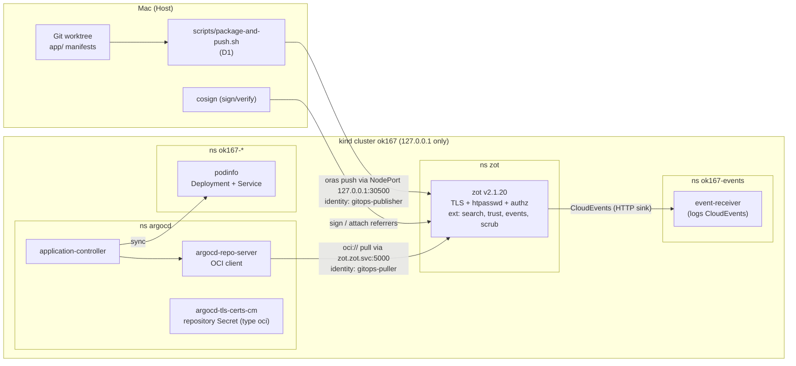

# OK-167 — Arbeitsauftrag für Claude Code: Gitless GitOps mit Argo CD und zot

| Feld | Wert |
|---|---|
| Ticket | [OK-167](https://kubernauts.atlassian.net/browse/OK-167) — SPIKE: Evaluierung von Gitless GitOps mit Argo CD und zot Registry |
| Status Jira | In Arbeit, zugewiesen an Daniel Santiago Gawenda |
| Auftraggeber | Daniel Santiago Gawenda |
| Rolle dieses Dokuments | Verbindliche Projekt- und Aufgabenbeschreibung (Solution Architecture) für die Umsetzung durch Claude Code |
| Stand | 2026-10-29, Version 1.0 |
| Ablage im Repo | `architecture/spikes/ADR-Platform-011/OK-167-gitless-gitops/BRIEF.md` |

Dieses Dokument hat zwei Teile:

- **Teil A** richtet sich an den Menschen. Er bereitet die Umgebung vor und startet Claude Code.
- **Teil B** richtet sich an Claude Code. Es ist der vollständige Arbeitsauftrag mit Kontext, Architektur, Phasenplan, Tests, Stopp-Bedingungen und Definition of Done.

Sprachregel: Dieses Dokument ist deutsch. **Alles, was Claude Code erzeugt, ist englisch**: Code, Kommentare, README, Report, Evidence, Commit-Messages, PR-Text und Entwürfe für Jira- und Confluence-Kommentare.

---

# Teil A — Vorbereitung durch den Menschen

Diese Schritte erledigst du selbst, bevor Claude Code startet. Sie dauern etwa 15 Minuten.

> **Stand 2026-10-29: A2, A3 und A4 sind bereits erledigt.** Im `ok/`-Ordner liegt `openkubes-ok-167/` bereit: ein eigener Clone von `openkubes` (statt einer Worktree, weil sich die Worktree aus der Cowork-Sandbox nicht mit korrekten Mac-Pfaden anlegen ließ), Branch `spike/OK-167-gitless-gitops` auf dem aktuellen `origin/main`, Remote `git@github-openkubes:openkubes/openkubes.git`. Darin liegen bereits: dieser Auftrag als `BRIEF.md`, die Spike-`.gitignore` mit `.local/`, der leere Ordner `.local/`, die lokale `CLAUDE.md` aus dem Haupt-Checkout, `.claude/settings.local.json` mit `KUBECONFIG` als Umgebungsvariable und `start-claude.sh`. Die drei letzten Dateien stehen in `.git/info/exclude` und werden nicht committet.
>
> Übrig für dich: A1 (Docker) und A5 (Berechtigungen prüfen). Dann statt A6 einfach `cd openkubes-ok-167 && ./start-claude.sh`. Das Skript setzt `KUBECONFIG`, prüft Branch und Werkzeuge und startet Claude Code mit dem Start-Prompt. Eine unterbrochene Session setzt du mit `./start-claude.sh --continue` fort.

## A1 — Docker-Runtime

kind braucht eine laufende Docker-kompatible Runtime: Docker Desktop, OrbStack oder Colima.

- Mindestens 4 CPUs und 6 GB RAM für die Runtime freigeben. kind mit Argo CD und zot braucht im Betrieb etwa 3–4 GB.
- Prüfen: `docker info` muss ohne Fehler laufen.

## A2 — Eigene Worktree für das Ticket

Wie bei den anderen Tickets eine eigene Worktree neben dem Haupt-Checkout. `OK_ROOT` ist dein `ok/`-Ordner, in dem `openkubes`, `ok-cluster` und `ok-linux` liegen.

```bash
cd "$OK_ROOT/openkubes"
git fetch origin
git worktree add ../openkubes-ok-167 -b spike/OK-167-gitless-gitops origin/main
cd ../openkubes-ok-167
```

Falls im Haupt-Checkout eine lokale, nicht versionierte `CLAUDE.md` mit Ground Rules liegt, kopiere sie in die Worktree. Sie wird nicht committet.

```bash
[ -f ../openkubes/CLAUDE.md ] && cp ../openkubes/CLAUDE.md . && echo "CLAUDE.md" >> "$(git rev-parse --git-path info/exclude)"
```

Falls du die AI-Pipeline (`.ai/`, `Makefile.ai`) nutzt: `4-scaffold.sh` für diese Worktree ausführen.

## A3 — Diesen Auftrag in die Worktree legen

```bash
SPIKE=architecture/spikes/ADR-Platform-011/OK-167-gitless-gitops
mkdir -p "$SPIKE/.local"
cp <Pfad-zu-dieser-Datei>/OK-167-BRIEF.md "$SPIKE/BRIEF.md"
```

## A4 — Cluster-Zugriff isolieren

Claude Code darf ausschließlich den lokalen kind-Cluster sehen. Deshalb startet die Session mit einer eigenen, noch leeren Kubeconfig im gitignorierten `.local/`-Ordner des Spikes. kind schreibt beim Anlegen des Clusters genau dorthin.

```bash
export KUBECONFIG="$PWD/$SPIKE/.local/kubeconfig"
unset KUBECONTEXT
kubectl config get-contexts   # muss leer sein oder "file does not exist" melden
```

Niemals `~/.kube/config` oder eine Datei aus `~/.kube/` in dieser Session verwenden.

Optional, als zweite Sicherung: `KUBECONFIG` zusätzlich in den projektlokalen Claude-Code-Einstellungen der Worktree als Umgebungsvariable setzen, damit auch eine neu initialisierte Shell darauf zeigt. Die genaue Syntax mit `/config` bzw. der Claude-Code-Doku prüfen; die Datei nicht committen.

## A5 — Berechtigungen in Claude Code

- Prüfe in der Session mit `/permissions`, was erlaubt ist.
- `make`, `docker`, `kind`, `oras`, `cosign`, `jq`, `yq`, `git` (ohne Force-Push, nicht auf `main`) sollten erlaubt sein oder einzeln bestätigt werden.
- **Wichtig:** Falls deine Einstellungen `helm install` oder `kubectl apply` verbieten, greift diese Sperre bei `make`-Targets nicht, weil der Permission-Matcher nur `make …` sieht. Genau deshalb ist der Kontext-Guard im Makefile (Teil B, Abschnitt B8) Pflicht. Er stellt sicher, dass jedes Target ausschließlich gegen den lokalen kind-Cluster läuft.
- `--dangerously-skip-permissions` nicht verwenden.

## A6 — Claude Code starten

```bash
claude
```

Start-Prompt zum Einfügen:

> Lies `architecture/spikes/ADR-Platform-011/OK-167-gitless-gitops/BRIEF.md` vollständig, Teil B ist dein verbindlicher Arbeitsauftrag. Bestätige mir zuerst in fünf Sätzen, was du verstanden hast, und führe dann Phase 0 aus. Halte an Checkpoint CP1 an und warte auf mein Go.

## A7 — Deine Checkpoints

Claude Code hält an drei Stellen an und wartet auf dich:

| Checkpoint | Wann | Was du entscheidest |
|---|---|---|
| CP1 | Nach Phase 0 | Fehlende Tools installieren (brew), Plan freigeben |
| CP2 | Vor `git push` und PR | Branch pushen, Draft-PR öffnen |
| CP3 | Bei jeder Stopp-Bedingung (B4) | Weiter, anders, oder abbrechen |

Jira, Confluence und PR-Kommentare veröffentlicht Claude Code nicht selbst. Es liefert englische Entwürfe, die du freigibst oder über Cowork veröffentlichen lässt.

---

# Teil B — Arbeitsauftrag an Claude Code

## B0 — Rolle und Arbeitsweise

Du bist der umsetzende Engineer für den Spike OK-167. Dieses Dokument ist dein verbindlicher Auftrag.

Arbeitsprinzipien:

1. **Evidenz vor Behauptung.** Ein Ergebnis gilt nur als PASS, wenn Datum, Umgebung, Versionen, ausgeführter Befehl und beobachtete Ausgabe festgehalten sind. Eine Erwartung ist kein Ergebnis.
2. **Nichts raten.** CLI-Flags, Chart-Values und Config-Keys prüfst du vor der Verwendung mit `--help`, `helm show values` oder der Doku der gepinnten Version. Die Befehle in diesem Dokument sind Leitlinien; die gepinnte Version gewinnt. Weicht etwas ab, dokumentiere die Abweichung.
3. **Hypothesen dürfen scheitern.** Ziel ist eine belastbare Entscheidungsgrundlage, kein Erfolgsnachweis. Ein sauber belegtes FAIL ist ein gutes Spike-Ergebnis.
4. **Alles über `make`.** Kein `kubectl apply` oder `helm install` direkt in der Shell, sondern über Targets im Spike-Makefile (Repo-Konvention aus `CONTRIBUTING.md`). Ad-hoc-Lesebefehle (`kubectl get`, `describe`, `logs`) sind erlaubt, immer mit Guard-Präfix und nie für Secrets (B4 Regeln 3 und 4).
5. **Kleine Commits.** Nach jeder abgeschlossenen Phase committen, Format siehe B14.
6. **Englisch** für alle Artefakte (siehe Sprachregel oben).
7. **Ehrliche Grenzen.** Jedes Evidence-Dokument und der Report enthalten einen Abschnitt „What this proves / What this does not prove“, im Stil von `docs/agentic-ai-poc-evidence-protocol.md` und `platform/registry/zot/README.md`.

Falls eine lokale `CLAUDE.md` existiert, gelten deren Regeln zusätzlich. Bei Konflikt gilt die strengere Regel. Bei echtem Widerspruch: STOP (B4).

## B1 — Kontext

### OpenKubes in einem Absatz

OpenKubes ist eine Kubernetes-Plattform-Distribution mit dem Leitprinzip „Contracts, not Components“ (ADR-Platform-001). Fähigkeiten werden als produktneutrale Contracts definiert, konkrete Produkte sind austauschbare Implementation Profiles. Constraint Envelopes (ADR-Platform-017) unterscheiden derzeit `datacenter` und `constrained-edge`; `air-gapped` ist ausdrücklich noch kein definiertes Envelope.

### Relevante ADRs (vor Phase 2 lesen)

| ADR | Status | Was für OK-167 zählt |
|---|---|---|
| `ADR-Platform-011-gitops.md` | Proposed | Argo CD ist das vorgeschlagene GitOps-Profil (App-of-Apps auf ok-mgmt). **Contract §1: Git ist Source of Truth.** Der **Secret Contract** (Amendment, Accepted/normativ): Git enthält nie Klartext-Secrets; Secret-Tool ist pro Envelope ein Implementation Profile (datacenter: Vault + VSO, ADR-025; constrained-edge: nur offline reconcilable, z. B. SOPS). |
| `ADR-Platform-028-artifact-registry-capability.md` | Draft | Produktneutraler Artifact Registry Contract, Profil `registry-default` = **zot** auf ok-shared. Digests sind kanonische Artefakt-Identität (§4.3), Tags nur zur Auffindbarkeit. Getrennte Maschinen-Identitäten (§4.5): build, publisher, cluster pull usw. Supply-Chain-Metadaten über die **OCI Referrers API** (§4.6). Offline-Portabilität als Contract-Thema (§4.9). |
| `ADR-Platform-017-constraint-envelopes.md` | Accepted | Envelope-Logik; relevant für die Edge-/Air-Gap-Bewertung im Report. |
| `ADR-Platform-012-air-gapped-image-mirroring.md` | Proposed | Bestehender Air-Gap-Pfad (Golden PVC für Talos-Images). Nur Kontext, nicht ändern. |
| `ADR-Platform-001-contracts-not-components.md` | Accepted | Bewertungsmaßstab: Darf zot- oder Argo-CD-Spezifisches in einen Contract wandern? |

### Bestehender Code, den du kennen musst

- `platform/registry/zot/` — das produktive `registry-default`-Profil. **Lesen, nicht ändern.** Insbesondere:
  - `values-ok-shared.yaml`: einzige Heimat der zot-Konfiguration; Chart `zot-0.1.122`, Image `ghcr.io/project-zot/zot:v2.1.20@sha256:542e25be4d32e7879c0cfad93492a93c81b1e059cbd2d30d485d4bd567318234`; htpasswd für Maschinen-Identitäten, OIDC für Menschen; Repository-Präfixe `openkubes/machine/**` und `openkubes/human/**`; Extensions nur `metrics` und `scrub`.
  - `README.md`: Credential-Modell (keine Secret-Werte im Git), Requirement-to-Test-Mapping, „What this does not prove“.
- `platform/gitops/` — Platzhalter. Die README empfiehlt noch Flux, ADR-011 schlägt Argo CD vor. Diesen Widerspruch **nicht auflösen**, sondern im Report erwähnen.
- `CONTRIBUTING.md` — make-basierter Workflow, Standard-Targets, Versions-Pins, Commit-Format.
- `docs/agentic-ai-poc-evidence-protocol.md` — Stil für harte Pass-Kriterien und „proves / does not prove“.

### Was „Gitless GitOps“ hier bedeutet

Manifeste werden aus Git gebaut, in CI als OCI-Artefakt verpackt, in zot abgelegt und von Argo CD direkt aus der Registry synchronisiert. Git bleibt Source of Truth (ADR-011 §1); die Registry wird zum Auslieferungskanal. Daraus folgt eine Kernanforderung für den Spike: **Jedes Artefakt muss nachweisbar auf einen Git-Commit zurückführbar sein** (OCI-Annotationen `org.opencontainers.image.source` und `.revision`), und gleiche Eingabe sollte idealerweise denselben Digest ergeben.

## B2 — Das Ticket (Originaltext, verbindlich)

**Beschreibung (Auszug):** Argo CD soll über seine nativen OCI-Schnittstellen direkt mit einer zot Registry gekoppelt werden. Kubernetes-Manifeste werden vorab per CI-Pipeline als OCI-Artefakte verpackt, in zot abgelegt und von dort via Argo CD synchronisiert. Relevant für Air-Gap-, Edge- und restriktive Netzwerkszenarien. Referenzen: [Argo CD OCI Support](https://argo-cd.readthedocs.io/en/latest/user-guide/oci/), [Harbor as a Universal OCI Hub](https://goharbor.io/blog/harbor-as-universal-oci-hub/).

**Akzeptanzkriterien:**

- AC1 **Infrastruktur-Setup (PoC):** Lokale Instanz oder Test-Instanz einer zot Registry bereitstellen.
- AC2 **Pipeline-Paketierung:** `oras` oder ein alternatives OCI-Tool einbinden, um ein einfaches Set an Kubernetes-Manifesten (z. B. Deployment + Service) als OCI-Artefakt (`tar+gzip`) zu verpacken und zu zot zu pushen.
- AC3 **Argo-CD-Integration:** Eine Argo CD `Application` konfigurieren, die das OCI-Repository auf zot als `repoURL` verwendet.
- AC4 **Synchronisationstest:** Nachweisen, dass Änderungen am OCI-Artefakt (neues Image-Tag bzw. neuer Digest) von Argo CD erkannt und im Cluster live abgeglichen werden.
- AC5 **Dokumentation:** Ergebnisse einschließlich Konfigurations-Snippets, Hürden und Performance-Eindrücken im internen Confluence-Wiki festhalten.

**Kernfragen:**

- Q1 **Authentifizierung:** Wie übergeben wir Argo CD die Zugangsdaten für die private zot Registry am elegantesten, z. B. über Kubernetes Secrets?
- Q2 **Artefakt-Struktur:** Welche Einschränkungen gelten aufgrund der Single-Layer-Vorgaben von Argo CD bei der Paketierung von rohen Manifesten oder Kustomize?
- Q3 **Caching & Webhooks:** Wie verhält sich die Erkennung neuer OCI-Digests im Vergleich zum klassischen Git-Polling? Können Push-Benachrichtigungen von zot an Argo CD gesendet werden?
- Q4 **Signierung (Ausblick):** Bietet die Kombination aus zot und Argo CD eine einfache Möglichkeit zur Verifizierung von Artefakt-Signaturen, z. B. mit Cosign?

**Deliverables:**

- D1 Funktionierendes Bash- oder GitHub-Actions-Skript zum Pushen des OCI-Artefakts
- D2 Beispielmanifest der Argo CD `Application` (YAML)
- D3 Kurzer Evaluierungsbericht in Confluence einschließlich finaler Go/No-Go-Empfehlung für den regulären Betrieb

## B3 — Ziel, Scope, Non-Goals

**Ziel:** Eine reproduzierbare, lokal laufende Referenzumgebung, die AC1–AC4 mit Evidenz belegt, Q1–Q4 mit Experimenten beantwortet und einen englischen Report mit begründeter Go/No-Go-Empfehlung liefert.

**Im Scope:**

- Lokaler kind-Cluster auf dem Mac des Auftraggebers
- zot mit TLS, htpasswd-Maschinen-Identitäten und Repository-Autorisierung, angelehnt an `registry-default`
- Argo CD v3.5.6 mit OCI-Quelle aus zot, ohne Insecure-Flags im Zielzustand
- Paketierungs-Skript (Bash) und ein GitHub-Actions-Beispiel (nicht aktiv)
- Experimente zu Auth, Artefakt-Struktur, Erkennung und Latenz, Events, Signaturen, Offline-Transfer
- Report, Evidence, Entwürfe für Jira-Kommentar und PR-Beschreibung

**Non-Goals (nicht tun):**

- Keine echten OpenKubes-Cluster (`ok-*`), kein VPN, keine Dateien aus `~/.kube/`
- Keine Änderung an ADRs, an `platform/registry/zot/`, an `platform/gitops/` oder an anderen Verzeichnissen außerhalb des Spike-Ordners
- Keine Datei unter `.github/workflows/` (sie würde in CI laufen)
- Kein OIDC/Keycloak, kein Vault/VSO (nur im Report als Produktionspfad beschreiben)
- Kein Image-Pull der Workloads aus zot (Containerd-Trust auf kind-Nodes ist Follow-up, siehe ADR-028 §4.11)
- Keine Argo-CD-Release-Candidates installieren
- Kein Merge, kein Push auf `main`, kein Force-Push
- Keine Jira-Transitions, keine Veröffentlichung in Jira, Confluence oder als PR-Kommentar ohne ausdrückliche Freigabe

## B4 — Sicherheitsleitplanken und Stopp-Bedingungen

### Harte Regeln

1. Jeder Befehl, der den Cluster verändert, läuft über ein `make`-Target mit Kontext-Guard (B8).
2. `KUBECONFIG` zeigt ausschließlich auf `<spike>/.local/kubeconfig`. Kein `--kubeconfig`, kein `--context`, kein `kubectl config use-context`.
3. Ad-hoc-Lesebefehle außerhalb von `make` immer als `scripts/guard.sh && kubectl …` ausführen, damit auch sie nur den lokalen Cluster treffen.
4. Secrets (Passwörter, htpasswd, private Schlüssel, Cosign-Keys, Kubeconfig) liegen nur in `<spike>/.local/` (gitignoriert, Dateirechte `600`). Sie erscheinen nie in getrackten Dateien, nie in Commit-Messages, nie in Evidence, nie in der Session-Ausgabe. Evidence wird vor dem Commit redigiert. Verboten sind deshalb `kubectl get secret … -o yaml|json`, `kubectl describe secret`, `kind get kubeconfig` und jedes `cat` auf Dateien in `.local/` mit Geheimnissen.
5. Passwörter nie als Kommandozeilen-Argument übergeben: `--password-stdin` oder Dateien verwenden; `curl` nur mit `--netrc-file .local/netrc-<identität>`, nie mit `-u`.
6. Werkzeug-Konfigurationen mit Zugangsdaten bleiben in `.local/`: Das Makefile exportiert `HELM_CONFIG_HOME`, `HELM_CACHE_HOME`, `HELM_DATA_HOME` und `HELM_REGISTRY_CONFIG` unter `.local/helm/`; oras bekommt pro Identität eine eigene Datei `--registry-config .local/registry-auth/<identität>.json`; `DOCKER_CONFIG=.local/docker` nur als Präfix vor cosign-Aufrufen, nie global exportieren (sonst verliert kind den Docker-Kontext). Nichts wird nach `~/.docker`, `~/Library/Preferences/helm` oder `~/.config` geschrieben.
7. CA-Vertrauen nur über explizite Flags (`--cacert`, `--ca-file`, `--registry-cacert`). Go-Werkzeuge ignorieren `SSL_CERT_FILE` unter macOS. Die lokale CA nie in den macOS-Schlüsselbund aufnehmen.
8. Registry-Ports nur an `127.0.0.1` binden, nie an `0.0.0.0` des Macs.
9. Kein `--insecure`, kein `insecure: true`, kein `insecureOCIForceHttp` im Zielzustand. Erlaubte Ausnahmen, jeweils nur im genannten Experiment: Q1.e (kurz, zur Risikodokumentation) und `cosign verify --insecure-ignore-tlog=true` in Q4 (Offline-Verifikation ohne öffentliches Transparency-Log; schaltet kein TLS ab).
10. Keine Uploads in öffentliche Dienste: kein Rekor/Transparency-Log, kein Push in öffentliche Registries.

### Stopp-Bedingungen (sofort anhalten, Zustand beschreiben, auf Entscheidung warten)

| # | Bedingung |
|---|---|
| S1 | Der aktuelle Kontext ist nicht `kind-ok167`, oder der API-Server ist nicht `https://127.0.0.1:<port>` |
| S2 | Eine Aufgabe würde einen echten Cluster, `~/.kube/`, VPN oder Zugangsdaten außerhalb von `.local/` berühren |
| S3 | Ein Secret würde in einer getrackten Datei landen, oder `make scan-secrets` schlägt an |
| S4 | Eine gepinnte Version oder ein Digest ist nicht verfügbar, stimmt nicht, oder das Image hat keine Variante für die Host-Architektur. Nicht still auf eine andere Version ausweichen. |
| S5 | Ein Ziel ist nur mit Insecure-Flags erreichbar (außerhalb der Ausnahmen aus Regel 9) |
| S6 | Derselbe Fehler tritt nach drei unterschiedlichen Lösungsversuchen weiter auf |
| S7 | Tool-Installation nötig (brew o. ä.) — nur nach Freigabe |
| S8 | Docker-Runtime hat weniger als 4 GB RAM frei, oder der Mac wird instabil |
| S9 | Eine Änderung außerhalb des Spike-Ordners scheint nötig |
| S10 | Ein Widerspruch zwischen diesem Auftrag, einer lokalen `CLAUDE.md` und der gepinnten Doku, der sich nicht durch die strengere Regel auflösen lässt |
| S11 | Ein optionales Experiment überschreitet seine Timebox |

Bei einem Stopp: Zustand, letzte Befehle, Fehlerausgabe und deine Optionen mit Empfehlung nennen. Nicht selbst eskalieren oder umgehen.

## B5 — Zielarchitektur



### Namen und Konventionen

| Element | Wert |
|---|---|
| kind-Cluster | `ok167`, Kontext `kind-ok167` |
| Namespaces | `zot`, `argocd`, `ok167-events`, Demo-Namespaces mit Präfix `ok167-` |
| zot im Cluster | `zot.zot.svc.cluster.local:5000` (HTTPS) |
| zot vom Host | `localhost:30500` über NodePort, `listenAddress: 127.0.0.1` |
| Repository-Präfix | `openkubes/machine/gitops/` (entspricht dem Maschinen-Präfix von `registry-default`) |
| Repositories | `openkubes/machine/gitops/podinfo-manifests`, `…/podinfo-kustomize`, `…/charts/podinfo`, `…/negative/<case>` |
| Maschinen-Identitäten (htpasswd) | `gitops-publisher` (read, create, update auf `openkubes/machine/gitops/**`), `gitops-puller` (nur read, für Argo CD), `ok167-admin` (adminPolicy, nur für Trust-Key-Upload und Aufräumen) |
| Argo CD AppProject | `ok167`, sourceRepos nur `oci://zot.zot.svc.cluster.local:5000/openkubes/machine/gitops/*`, Ziele nur Namespaces `ok167-*`, keine cluster-scoped Ressourcen |
| Demo-Workload | podinfo (`ghcr.io/stefanprodan/podinfo`), Start `6.16.0`, Update `6.17.0` |

Hostport 5000 nicht verwenden: macOS belegt ihn mit dem AirPlay Receiver.

## B6 — Versions-Pins

Alle Pins stehen in `versions.env` und werden nur dort gepflegt. Die Werte unten sind am 2026-10-29 recherchiert. In Phase 0 prüfst du jeden Pin; Abweichung ⇒ S4.

| Komponente | Pin | Herkunft / Prüfung |
|---|---|---|
| kind | v0.33.0 | Neueste stabile Version |
| kind-Node-Image | `kindest/node:v1.36.x@sha256:…` aus den Release Notes von kind v0.33.0 | **Nicht** das Default-Image `kindest/node:v1.37.0`: Argo CD 3.5 ist laut Doku nur gegen Kubernetes v1.33–v1.36 getestet. Exaktes Image und Digest aus den Release Notes übernehmen |
| Argo CD | v3.5.6 (Helm-Chart `argo-cd` 10.11.6 aus `https://argoproj.github.io/argo-helm`) | Neueste stabile Version; v3.6.0 ist nur als RC verfügbar und tabu. Images per `global.image.tag: v3.5.6@sha256:…` pinnen (Chart-Mechanik prüfen) |
| argocd CLI | v3.5.x (Minor muss zum Server passen) | Optional; Annotation-basierter Refresh geht auch ohne |
| zot Chart | `zot-0.1.122` aus `https://zotregistry.dev/helm-charts` | Identisch mit `registry-default` |
| zot Image | `ghcr.io/project-zot/zot:v2.1.20@sha256:542e25be4d32e7879c0cfad93492a93c81b1e059cbd2d30d485d4bd567318234` | Identisch mit `registry-default`. Prüfen, dass der Digest ein Multi-Arch-Index mit Variante für `uname -m` ist. Neuere zot-Versionen (v2.1.22) nicht verwenden |
| oras | v1.3.x (aktuell v1.3.6) | |
| cosign | v3.1.x (aktuell v3.1.4) | Major-Version 3: Signaturformat und Ablage gegen zot prüfen (Phase 8, Q4) |
| helm | ≥ 3.14 (laut `CONTRIBUTING.md`); falls Helm 4 installiert ist, Flags von `helm push` und `helm registry` prüfen | |
| kubectl | Minor ±1 zur Kubernetes-Version des kind-Node-Images | |
| jq, yq (mikefarah), GNU tar (`gtar`), openssl@3, shellcheck, yamllint | aktuelle brew-Versionen, in Evidence festhalten | macOS-`tar` (bsdtar) kann nicht deterministisch sortieren; LibreSSL weicht von OpenSSL ab |
| podinfo Images | `6.16.0` und `6.17.0`, jeweils mit Digest | Digests in Phase 0 auflösen und pinnen |
| podinfo Helm-Chart | `oci://ghcr.io/stefanprodan/charts/podinfo`, Version passend zu `6.17.0` | Wird für Test S-D nach zot gespiegelt |
| Event-Receiver | kleines, verbreitetes HTTP-Echo-Image, Multi-Arch, per Digest gepinnt (z. B. `mendhak/http-https-echo`) | Auswahl begründen; Multi-Arch in Phase 0 prüfen |
| curl-Image für `probe-version` | z. B. `curlimages/curl`, per Digest | Multi-Arch prüfen |
| metrics-server (optional, Phase 10) | Release-Manifest einer gepinnten Version | Nur wenn Ressourcenmessung gewünscht; sonst „not measured“ |
| Image für die optionale Brücke Q3.d | per Digest | Nur falls Q3.d durchgeführt wird |

Jedes Container-Image wird per Digest referenziert. Wo ein Chart das Image setzt, wird es per Values auf `tag@sha256:…` überschrieben. Ausnahme: Der Test-Hook des zot-Charts nutzt ein ungepinntes `alpine`-Image; er läuft nur bei `helm test`. `helm test` deshalb nicht ausführen und die Ausnahme in `zot/DEVIATIONS.md` vermerken.

## B7 — Verzeichnisstruktur

Alles liegt unter `architecture/spikes/ADR-Platform-011/OK-167-gitless-gitops/` (im Folgenden `<spike>`). Begründung der Ablage: Der Spike bewertet ein Implementation-Profil für ADR-011; Spikes im Repo sind nach ADR gruppiert.

```text
<spike>/
├── BRIEF.md                         # dieser Auftrag (unverändert committen)
├── README.md                        # Einstieg: Zweck, Reproduktion, Status, Links
├── REPORT.md                        # Evaluierungsbericht (Quelle für Confluence), englisch
├── Makefile                         # einziger Einstiegspunkt, mit Guard und help
├── versions.env                     # alle Pins
├── .gitignore                       # .local/ und temporäre Artefakte
├── .local/                          # NICHT committen: kubeconfig, pki/, credentials.env, cosign/, registry-auth/
├── kind/
│   └── cluster.yaml                 # 1 Node, extraPortMappings 30500 → 127.0.0.1:30500
├── zot/
│   ├── values-poc.yaml              # abgeleitet von values-ok-shared.yaml
│   └── DEVIATIONS.md                # jede Abweichung zu registry-default mit Grund
├── argocd/
│   ├── values-poc.yaml
│   ├── appproject.yaml
│   ├── repository-secret.template.yaml   # nur Platzhalter
│   ├── application-tag.yaml              # D2 (Hauptbeispiel)
│   ├── application-digest.yaml
│   ├── application-semver.yaml
│   ├── application-kustomize.yaml
│   └── application-helm.yaml
├── app/
│   ├── podinfo-plain/               # deployment.yaml, service.yaml (6.16.0, 1 Replica)
│   ├── podinfo-plain-update/        # dieselben Dateien mit 6.17.0, 2 Replicas
│   └── podinfo-kustomize/           # base/, overlays/poc/ und overlays/poc-update/
├── events/
│   ├── receiver.yaml
│   └── bridge/                      # nur für das optionale Experiment Q3.d
├── scripts/
│   ├── guard.sh                     # Kontext-Guard
│   ├── package-and-push.sh          # D1
│   ├── measure-sync.sh              # Latenzmessung
│   ├── scan-secrets.sh              # Secret-Scan über getrackte Dateien
│   └── lib.sh                       # gemeinsame Funktionen (Logging, Zeitstempel)
├── ci/
│   └── github-actions-example.yaml  # D1-Variante, NICHT unter .github/workflows/
├── drafts/
│   ├── jira-comment.md              # Entwurf, englisch
│   └── pr-description.md            # Entwurf, englisch
├── diagrams/
│   └── architecture.svg             # aus dem Mermaid-Diagramm exportiert (Confluence rendert kein Mermaid)
└── evidence/
    ├── 00-preflight.md … 11-offline-transfer.md
    └── raw/                         # redigierte JSON-/Log-Ausgaben
```

Jede Testvariante der Manifeste ist eine getrackte Datei. Damit zeigt die Annotation `org.opencontainers.image.revision` immer auf einen Commit, der genau diesen Inhalt enthält (Kriterium M3). Vor einem Push wird die Variante committet.

`.gitignore` im Spike-Ordner enthält mindestens `.local/`, `*.tar.gz`, `*.tgz`, `*.key`, `*.pem`. Auch der öffentliche Cosign-Key bleibt in `.local/`, weil das Schlüsselpaar nur für diesen lokalen Test existiert.

## B8 — Makefile-Spezifikation

Konventionen aus `CONTRIBUTING.md`: `.DEFAULT_GOAL := help`, jedes Target mit `## Beschreibung`, Versionen aus `versions.env` (`include versions.env` + `export`), JSON-Verarbeitung mit `jq`.

### Kontext-Guard (Pflicht)

`scripts/guard.sh` wird als erste Abhängigkeit jedes Targets ausgeführt, das den Cluster liest oder verändert (außer `up`, das den Cluster erst erzeugt, und dort direkt nach der Erzeugung). Er prüft und bricht mit Exit-Code ≠ 0 ab, wenn:

1. `KUBECONFIG` nicht gesetzt ist oder nicht auf `<spike>/.local/kubeconfig` (absoluter Pfad) zeigt
2. `kubectl config current-context` nicht `kind-ok167` ist
3. die Server-URL des aktuellen Kontexts nicht mit `https://127.0.0.1:` beginnt
4. die Kubeconfig mehr als einen Kontext enthält

Das Makefile setzt zusätzlich selbst `export KUBECONFIG := $(CURDIR)/.local/kubeconfig`, damit Targets auch bei falscher Session-Umgebung nur den lokalen Cluster treffen. Der Guard prüft trotzdem. Ebenso exportiert das Makefile die Helm-Verzeichnisse aus B4 Regel 6.

`scripts/guard.sh` liest den Pfad aus `KUBECONFIG`, damit er sich mit synthetischen Kubeconfigs testen lässt (Phase 1).

### Targets

| Target | Zweck |
|---|---|
| `help` | Alle Targets mit Beschreibung |
| `preflight` | Tools, Versionen, Architektur, Docker-Ressourcen, Ports, Digests prüfen; schreibt `evidence/00-preflight.md` |
| `up` | kind-Cluster anlegen (idempotent), Guard ausführen |
| `namespaces` | Alle Namespaces anlegen (idempotent): `zot`, `argocd`, `ok167-events`, `ok167-demo`, `ok167-digest`, `ok167-semver`, `ok167-kustomize`, `ok167-helm`, `ok167-neg`, `ok167-imported` |
| `pki` | Lokale CA und zot-Serverzertifikat erzeugen (`.local/pki/`) |
| `identities` | Zufallspasswörter und htpasswd erzeugen (`.local/credentials.env`, `.local/htpasswd`), Kubernetes-Secrets anlegen |
| `zot-install` | zot per Helm mit gepinntem Chart und Image installieren |
| `zot-verify` | TLS, Auth und Authz prüfen (Positiv- und Negativfälle) |
| `events-install` | Event-Receiver deployen |
| `argocd-install` | Argo CD per Helm installieren, CA in `argocd-tls-certs-cm` |
| `argocd-repo REPO=…` | Repository-Secret (`type: oci`) für das angegebene Repository aus `.local/credentials.env` anlegen; mehrfach aufrufbar |
| `argocd-repo-creds` | Credential-Template (`repo-creds`) für das Präfix `openkubes/machine/gitops` anlegen (Q1.b) |
| `argocd-project` | AppProject `ok167` anlegen |
| `push VARIANT=… TAG=…` | Artefakt bauen und pushen (ruft `scripts/package-and-push.sh`); `VARIANT` ∈ `plain`, `plain-update`, `kustomize` |
| `app-tag`, `app-digest DIGEST=…`, `app-semver`, `app-kustomize`, `app-helm` | Applications anlegen bzw. aktualisieren |
| `refresh APP=…` | Refresh per Annotation `argocd.argoproj.io/refresh=normal` |
| `measure APP=… DIGEST=… IMAGE=…` | Latenzmessung (`scripts/measure-sync.sh`) |
| `probe-version NS=…` | Kurzlebiger Pod (gepinntes curl-Image) ruft `http://podinfo:9898/version` auf und wird wieder entfernt |
| `drift NS=…` | Skaliert das Deployment manuell (für den Self-Heal-Test T7) |
| `zot-down`, `zot-up` | zot-StatefulSet auf 0 bzw. 1 Replica skalieren (Ausfalltest T8; mit `persistence: true` rendert das Chart ein StatefulSet, kein Deployment) |
| `repo-server-restart` | Rollout-Restart des Argo-CD-Repo-Servers (T8, Q3.a) |
| `reconcile REC=… JITTER=…` | Reconciliation-Einstellung per Helm-Upgrade ändern, Controller und Repo-Server neu starten (Q3.a); `reconcile-reset` stellt die Defaults wieder her |
| `exp-<ID>` | Je ein Target pro verändernden Experiment aus Phase 8 (z. B. `exp-q1c`, `exp-s-e`). Jedes stellt am Ende den Ausgangszustand wieder her oder hat ein passendes `exp-<ID>-restore` |
| `bridge-install`, `bridge-remove` | Nur für das optionale Experiment Q3.d |
| `sign DIGEST=…`, `verify-signature DIGEST=…` | Cosign-Experimente |
| `offline-transfer` | Export in OCI-Layout, Re-Import, Re-Sync |
| `verify` | Gesamtprüfung aller Pass-Kriterien, die ohne neue Pushes prüfbar sind |
| `lint` | `yamllint`, `shellcheck`, `kubectl kustomize`, `helm lint` |
| `scan-secrets` | Prüft getrackte und gestagte Dateien auf Passwörter, Keys, Token-Muster und die Werte aus `.local/credentials.env` |
| `debug` | Diagnose-Snapshot nach `evidence/raw/debug-<timestamp>/` (redigiert) |
| `install` | Alias in genau dieser Reihenfolge: `up namespaces pki identities events-install zot-install argocd-install argocd-repo argocd-project` |
| `down` / `clean` | kind-Cluster löschen; `.local/` bleibt erhalten |
| `diff`, `upgrade` | Als „not applicable for this spike“ mit Begründung ausgeben (Standard-Targets laut CONTRIBUTING) |

Jedes verändernde Target ist idempotent: Ein zweiter Lauf ändert nichts und endet mit Exit 0.

## B9 — Phasenplan

Jede Phase hat Ziel, Schritte, Pass-Kriterien, ein Evidence-Dokument und einen Commit. Eine Phase gilt erst als abgeschlossen, wenn ihre Pass-Kriterien belegt sind oder ein FAIL sauber dokumentiert ist. Grobe Zeitschätzung gesamt: 1,5–2,5 Arbeitstage.

### Phase 0 — Orientierung und Preflight (keine Cluster- oder Systemänderungen)

**Ziel:** Sicherstellen, dass Umgebung, Werkzeuge und Pins stimmen, bevor irgendetwas angelegt wird. In dieser Phase wird nur Evidence geschrieben. `make preflight` gibt es erst ab Phase 1; die Prüfungen hier laufen von Hand und werden in Phase 1 als Target automatisiert.

Schritte:

1. Lies die Dokumente aus B1 und dieses Dokument vollständig.
2. Repo-Zustand: Branch muss `spike/OK-167-gitless-gitops` sein, Basis `origin/main`. Erlaubt sind nur die vom Menschen vorbereiteten Dateien: im Spike-Ordner `BRIEF.md`, `.gitignore` und `.local/`; im Repo-Wurzelverzeichnis die über `.git/info/exclude` ausgeschlossenen `CLAUDE.md`, `start-claude.sh` und `.claude/settings.local.json`. Alles andere ⇒ S10.
3. Sicherheit: `KUBECONFIG` muss auf `<spike>/.local/kubeconfig` (absolut) zeigen; die Datei darf noch nicht existieren oder keinen Kontext enthalten. Sonst S1/S2.
4. Host: `uname -m`, `sw_vers`, `docker info` (CPUs, Speicher, Runtime). Port 30500 frei (`lsof -nP -iTCP:30500 -sTCP:LISTEN`).
5. Werkzeuge: Vorhandensein und Version von `docker`, `kind`, `kubectl`, `helm`, `oras`, `cosign`, `jq`, `yq`, `gtar`, `openssl` (brew `openssl@3`), `htpasswd` (muss bcrypt `-B` und Passwort über stdin `-i` können), `shellcheck`, `yamllint`, optional `argocd`, `actionlint`. Fehlendes als Liste mit brew-Befehl für CP1.
6. Pins prüfen (B6):
   - Charts ohne globales `helm repo add` (Helm-Verzeichnisse aus B4 Regel 6 in der Shell setzen): `helm show chart zot --repo https://zotregistry.dev/helm-charts --version 0.1.122` und `helm show chart argo-cd --repo https://argoproj.github.io/argo-helm --version 10.11.6`; `appVersion` von argo-cd muss `v3.5.6` sein.
   - Images: Für jedes Image Digest und Plattformliste auflösen (`oras manifest fetch --descriptor` bzw. `docker buildx imagetools inspect`). Variante für die Host-Architektur muss existieren.
   - kind: Node-Image für Kubernetes v1.36.x und Digest aus den Release Notes von v0.33.0 (siehe B6).
   - podinfo: Digests für `6.16.0` und `6.17.0`; Version des Helm-Charts zu `6.17.0`.
7. Referenzmaterial sichern: `helm show values` beider Charts nach `evidence/raw/` (enthält keine Secrets).
8. `evidence/00-preflight.md` schreiben (Host, Tools mit Versionen, Pins mit Digests, Prüfergebnisse).
9. Plan in maximal zehn Zeilen zusammenfassen, offene Fragen und nötige Installationen nennen.

**Pass:** Alle Pins auflösbar, Architektur unterstützt, Ressourcen ausreichend, `KUBECONFIG` isoliert.

**→ CP1: Anhalten und auf Freigabe warten.** Keine Installation und kein Cluster vor dem Go.

### Phase 1 — Gerüst

**Ziel:** Struktur, Guard, Makefile-Grundgerüst und Hilfsskripte stehen; nichts berührt einen Cluster.

Schritte:

1. **Zuerst** `<spike>/.gitignore` prüfen bzw. ergänzen; sie ist vorbereitet und enthält bereits `.local/`. Danach Verzeichnisstruktur aus B7, `versions.env`, `README.md` (Zweck, Status „in progress“, Reproduktion folgt). Im gesamten Spike nie `git add -A` oder `git add .`, sondern immer gezielte Pfade; vor jedem Commit `git status` prüfen.
2. `scripts/lib.sh` (Logging mit UTC-Zeitstempel, Fehlerbehandlung), `scripts/guard.sh`, `scripts/scan-secrets.sh`.
3. Makefile mit `help`, `preflight`, `lint`, `scan-secrets`, `debug`, `diff`, `upgrade` und Guard-Einbindung.
4. Guard-Negativtests: `scripts/guard.sh` direkt aufrufen (nicht über `make`, weil das Makefile `KUBECONFIG` selbst setzt). Dafür synthetische Kubeconfigs ohne echte Zugangsdaten unter `.local/test/` erzeugen. Fälle:
   - `KUBECONFIG` leer
   - Pfad außerhalb von `.local/`
   - Datei existiert nicht
   - Kontextname ist nicht `kind-ok167`
   - Server-URL ist nicht `https://127.0.0.1:…`
   - Zwei Kontexte in einer Datei

   Alle sechs müssen mit Exit ≠ 0 und klarer Meldung enden.
5. `make lint` und `make scan-secrets` grün. `scan-secrets` mit einer absichtlich präparierten, nicht gestagten Testdatei einmal anschlagen lassen und die Datei wieder entfernen.

**Pass:** Guard verweigert alle sechs Negativfälle; Lint grün; Secret-Scan schlägt beim Testfall an und ist danach grün.

**Evidence:** Abschnitt „Guard negative tests“ in `evidence/00-preflight.md`.

**Commit:** `docs(gitops): scaffold OK-167 gitless GitOps spike (OK-167)` (enthält `BRIEF.md`).

### Phase 2 — Lokaler kind-Cluster

**Ziel:** Ein isolierter Cluster, der nur über `127.0.0.1` erreichbar ist.

Schritte:

1. `kind/cluster.yaml`: ein Control-Plane-Node, Node-Image per Digest, `extraPortMappings` `containerPort: 30500`, `hostPort: 30500`, `listenAddress: "127.0.0.1"`, `protocol: TCP`.
2. `make up`: `kind create cluster --name ok167 --config kind/cluster.yaml` (idempotent: existiert der Cluster, nichts tun), danach Guard.
3. Kubernetes-Version, Node-Image-Digest (`docker inspect`), StorageClasses festhalten.

**Pass:** Node `Ready`; Kontext `kind-ok167`; Server `https://127.0.0.1:<port>`; genau ein Kontext in der Kubeconfig; Default-StorageClass vorhanden.

**Evidence:** `evidence/01-cluster.md`.

**Commit:** `feat(gitops): local kind cluster for OK-167 (OK-167)`.

### Phase 3 — zot-Registry (AC1)

**Ziel:** zot nah am `registry-default`-Profil, mit TLS, Maschinen-Identitäten, Autorisierung und den für die Kernfragen nötigen Extensions.

**3.0 Namespaces (`make namespaces`).** Vor allen Secrets, denn `pki` und `identities` legen Secrets im Namespace `zot` an.

**3.1 PKI (`make pki`).** Mit `openssl@3` erzeugen:

- CA: Schlüssel und selbstsigniertes Zertifikat, 30 Tage gültig, `CA:TRUE`.
- Server: Schlüssel und Zertifikat, signiert von der CA, `extendedKeyUsage = serverAuth`, SANs: `DNS:zot`, `DNS:zot.zot`, `DNS:zot.zot.svc`, `DNS:zot.zot.svc.cluster.local`, `DNS:localhost`, `IP:127.0.0.1`.
- Alles in `.local/pki/`, Dateirechte `600`. Idempotent: vorhandene Dateien nicht überschreiben.
- Kubernetes-Secret `zot-server-tls` in Namespace `zot` mit `tls.crt`, `tls.key`, `ca.crt` (gleicher Mount `/tls` wie in `registry-default`).

**3.2 Identitäten (`make identities`).**

- Zufallspasswörter (z. B. `openssl rand -base64 32`) für `gitops-publisher`, `gitops-puller`, `ok167-admin` in `.local/credentials.env` (`600`).
- Pro Identität zusätzlich `.local/netrc-<identität>` für `curl --netrc-file` (Host `localhost`).
- htpasswd mit bcrypt, Passwort über stdin (`htpasswd -niB <user>`), Datei `.local/htpasswd`.
- Secret `zot-htpasswd` (Key `htpasswd`) in Namespace `zot`, Mount `/auth`.
- Idempotent: vorhandene Passwörter nicht neu erzeugen.

**3.3 Event-Receiver (`make events-install`).** Namespace `ok167-events`, Deployment und Service (Port 8080) mit einem Echo-Image, das Header und Body jeder Anfrage loggt. Vor zot deployen, weil zot das Event-Ziel beim Start kennen soll.

**3.4 `zot/values-poc.yaml`.** Ausgangspunkt ist `platform/registry/zot/values-ok-shared.yaml`. Übernehmen: Image-Pin, `securityContext`, `podSecurityContext`, `mountConfig: true`, `httpGet.scheme: HTTPS`, `externalSecrets`-Muster. Die Verschachtelung der zot-JSON-Konfiguration folgt exakt dem Original (`accessControl` liegt unter `http`, `failDelay` unter `http.auth`). Konfiguration (`configFiles.config.json`):

- `distSpecVersion: "1.1.1"`; Storage wie im Original (`dedupe`, `gc`, `gcDelay: 1h`, `gcInterval: 1h`)
- `http`:
  - Port 5000, `realm`, `tls` mit `/tls/tls.crt` und `/tls/tls.key`
  - `auth.htpasswd.path: /auth/htpasswd`, `auth.failDelay: 2`. **Kein** OIDC, kein `apikey`, kein `externalUrl`, kein `sessionKeysFile`.
  - `accessControl`:
    - `repositories."openkubes/machine/gitops/**"`: `gitops-publisher` → `read`, `create`, `update`; `gitops-puller` → `read`; `defaultPolicy: []`
    - `repositories."**"`: `defaultPolicy: []`
    - `adminPolicy`: `ok167-admin` → `read`, `create`, `update`, `delete`
    - `metrics.users: ["ok167-admin"]`
- `extensions`:
  - `search`: `enable: true`, **ohne `cve`-Block** (das schaltet CVE-Scanning ab; sonst lädt zot eine Trivy-Datenbank aus dem Internet)
  - `trust`: `enable: true`, `cosign: true`, `notation: false` (setzt `search` voraus)
  - `events`: `enable: true`, eine Senke `type: http`, `address: http://event-receiver.ok167-events.svc.cluster.local:8080/`, `timeout: 5s`, ohne Credentials (nur für Q3.d nötig, siehe dort)
  - `metrics`: aktiviert (für die Lastmessung in Phase 10)
  - `scrub`: wie im Original
- Service: `type: NodePort`, Port 5000, `service.nodePort: 30500`
- `serviceAccount.create: true` (das Original setzt `false`, weil dort ein Template den ServiceAccount anlegt)
- Persistenz: `persistence: true`, `pvc.storage: 2Gi`, `pvc.storageClassName: standard` (die StorageClass von kind; das Original nutzt `local-path`, die PVC bliebe sonst `Pending`). Mit Persistenz rendert das Chart ein **StatefulSet** statt eines Deployments.
- **Chart-Default-htpasswd neutralisieren:** Das Chart enthält in `secretFiles.htpasswd` Beispielnutzer `admin:admin` und `user:user`. `mountSecret: false` und `secretFiles: null` setzen (Helm führt Maps zusammen; ein leeres Objekt würde den Default nicht entfernen). Mit `helm template` belegen, dass kein Chart-eigenes Secret mit diesen Hashes gerendert wird.

`zot/DEVIATIONS.md`: Tabelle jeder Abweichung gegenüber `values-ok-shared.yaml` mit Grund (z. B. kein OIDC, zusätzliche Extensions, NodePort statt TLS-Passthrough-Route, anderes Repository-Präfix, kleinere PVC).

**3.5 Installation (`make zot-install`).** Vorher `helm template` rendern und prüfen, dass das Image exakt dem Pin entspricht. Dann `helm upgrade --install zot zot --repo https://zotregistry.dev/helm-charts --version 0.1.122 -n zot --wait --timeout 5m`. Der Release-Name muss `zot` sein, nur dann entsteht der Service `zot.zot.svc`.

**3.6 Prüfung (`make zot-verify`).** Alle Aufrufe gegen `https://localhost:30500` mit `--cacert .local/pki/ca.crt` und `--netrc-file .local/netrc-<identität>`:

| ID | Prüfung | Erwartung |
|---|---|---|
| V1 | TLS mit CA; danach ohne CA | Mit CA erfolgreich; ohne CA Zertifikatsfehler (beweist echtes TLS) |
| V2 | Anonym `GET /v2/` | 401 |
| V3 | `gitops-publisher` `GET /v2/` | 200, Header `Docker-Distribution-API-Version: registry/2.0` |
| V4 | Publisher pusht Testartefakt nach `openkubes/machine/gitops/smoke`, Pull per Digest | Bytes hashen exakt auf den Digest |
| V5 | `gitops-puller` pullt; versucht zu pushen | Pull OK; Push verweigert (401/403) |
| V6 | Publisher pusht nach `openkubes/machine/other/smoke` | Verweigert |
| V7 | Extensions aktiv: zot-Logs; GraphQL `/v2/_zot/ext/search` mit Auth; Event-Receiver hat für V4 ein CloudEvent `zotregistry.image.updated` geloggt | Alle drei belegt. Ist eine Extension im Image nicht einkompiliert: dokumentieren und weitermachen (Befund für Q3/Q4), kein Stopp |
| V8 | `oras attach` eines kleinen SBOM an das Smoke-Artefakt, `oras discover` | Referrer sichtbar (Referrers API funktioniert) |

**Pass:** V1–V6 und V8 erfüllt; V7 belegt oder als Befund dokumentiert.

**Evidence:** `evidence/02-zot.md` (Ausgaben redigiert).

**Commit:** `feat(gitops): local zot registry with TLS and scoped identities (OK-167)`.

### Phase 4 — Paketierungs-Pipeline (AC2, D1)

**Ziel:** Ein robustes Bash-Skript, das Manifeste reproduzierbar als einlagiges `tar+gzip`-OCI-Artefakt mit Herkunftsangaben pusht.

**4.1 Demo-Manifeste.**

- `app/podinfo-plain/`: `deployment.yaml` (podinfo `6.16.0` per `tag@digest`, 1 Replica, kleine Requests/Limits, `securityContext` restriktiv, Probes auf `/readyz` und `/healthz`, Port 9898) und `service.yaml` (ClusterIP 9898). Kein `namespace`-Feld; der Ziel-Namespace kommt aus der Application.
- `app/podinfo-plain-update/`: dieselben Dateien mit podinfo `6.17.0` und 2 Replicas.
- `app/podinfo-kustomize/`: `base/` (dieselben Ressourcen), `overlays/poc/` (2 Replicas, zusätzliches Label `app.openkubes.io/variant: kustomize`) und `overlays/poc-update/` (wie `poc`, mit podinfo `6.17.0` über das Kustomize-`images`-Feld).
- Alle Varianten sind getrackte Dateien und werden vor dem ersten Push committet. Kein Build aus ungetrackten Verzeichnissen; sonst zeigt die Revision-Annotation auf einen Commit mit anderem Inhalt.

**4.2 `scripts/package-and-push.sh`.**

Aufruf:

```text
package-and-push.sh --source <dir> --repository <repo> --tag <tag>
                    [--registry localhost:30500] [--allow-dirty] [--dry-run]
```

Ablauf:

1. `set -euo pipefail`; Werkzeuge und `.local/credentials.env` prüfen; Quellverzeichnis muss existieren.
2. Herkunft: `GIT_SHA` aus `git rev-parse HEAD`; `SOURCE_DATE_EPOCH` aus dem letzten Commit, der das Quellverzeichnis betrifft; Quell-URL `https://github.com/openkubes/openkubes`. Ist das Quellverzeichnis nicht sauber: Abbruch, außer mit `--allow-dirty` (dann Annotation `io.openkubes.source.dirty=true`).
3. Validierung: `yamllint`; zusätzlich `kubectl kustomize` für jedes Verzeichnis im Artefakt, das eine `kustomization.yaml` enthält (bei der Kustomize-Variante also für `overlays/poc` und `overlays/poc-update`). `--dry-run` paketiert und berechnet den Layer-Digest, pusht aber nicht.
4. Deterministisches Archiv mit GNU tar und gzip ohne Zeitstempel, zum Beispiel:

   ```bash
   gtar --sort=name --mtime="@${SOURCE_DATE_EPOCH}" --owner=0 --group=0 --numeric-owner \
        --mode=go+u,go-w --exclude=.DS_Store \
        --format=posix --pax-option=exthdr.name=%d/PaxHeaders/%f,delete=atime,delete=ctime \
        -C "$SRC" -cf - . | gzip -n -9 > "$WORK/manifests.tar.gz"
   ```

   Flags mit `gtar --help` gegenprüfen. `SOURCE_DATE_EPOCH` darf nicht leer sein; sonst Abbruch.
5. Push mit `oras push`, ausgeführt **im Verzeichnis `$WORK`** (`cd "$WORK"`) mit relativem Dateinamen: oras lehnt absolute Pfade ab und übernimmt den Dateinamen als Layer-Titel, ein zufälliger Pfad würde den Digest verändern.
   - Layer `manifests.tar.gz:application/vnd.oci.image.layer.v1.tar+gzip`
   - `--artifact-type application/vnd.openkubes.gitops.manifests.v1+tar` (Kompatibilität mit Argo CD wird in Test S-G geprüft)
   - Annotationen: `org.opencontainers.image.source`, `.revision` (Git-SHA), `.created` (aus `SOURCE_DATE_EPOCH` im RFC-3339-Format, damit das Manifest deterministisch bleibt), `.version` (Tag), `.title`, `.description`
   - `--ca-file .local/pki/ca.crt`, `--username` aus der Datei, Passwort per `--password-stdin`, `--registry-config .local/registry-auth/gitops-publisher.json` (schreibt nichts nach `~/.docker`)
   - Ausgabe als JSON, Digest mit `jq` auslesen. Flags mit `oras push --help` gegenprüfen.
6. Ausgabe: Zeile `DIGEST=sha256:…` auf stdout und Protokoll nach `evidence/raw/push-<repo>-<tag>-<utc>.json` (ohne Secrets).
7. Definierte Exit-Codes (z. B. 2 = Validierung, 3 = Auth, 4 = Push). Kein Passwort in Ausgaben. `shellcheck` sauber.

**4.3 Determinismus-Test (P4-DET).** Gleiche Eingabe zweimal paketieren: identischer Layer-Digest? Zweimal pushen: identischer Manifest-Digest? Bei Abweichung Ursache finden und dokumentieren (z. B. automatisch gesetzte Annotationen).

**4.4 `ci/github-actions-example.yaml`.** Beispiel-Workflow, ausdrücklich nicht aktiv:

- Kopfkommentar: „EXAMPLE — not active. Lives outside .github/workflows on purpose.“
- Trigger auf Änderungen unter `app/**`; `permissions: contents: read` (für künftiges keyless Signing zusätzlich `id-token: write`, auskommentiert)
- `actions/checkout` und `oras-project/setup-oras` per Commit-SHA gepinnt (SHAs per `git ls-remote` ermitteln und festhalten)
- Credentials ausschließlich aus `${{ secrets.… }}`; ruft `package-and-push.sh` auf
- Validierung mit `actionlint`, falls verfügbar, sonst `yamllint`

**Pass:** Skript pusht, gibt den Digest aus; `oras manifest fetch` zeigt genau einen Layer mit `tar+gzip` und alle Annotationen; P4-DET dokumentiert; `shellcheck` grün.

**Evidence:** `evidence/03-pipeline.md`.

**Commit:** `feat(gitops): deterministic OCI packaging pipeline for manifests (OK-167)`.

### Phase 5 — Argo CD

**Ziel:** Argo CD v3.5.6, das zot vertraut und sich mit einer reinen Lese-Identität authentifiziert.

**5.1 `argocd/values-poc.yaml`.**

- Images per Digest pinnen, wo das Chart es erlaubt; sonst Tag `v3.5.6` und den aufgelösten Digest in `DEVIATIONS`-Abschnitt der README festhalten.
- Minimal halten: Dex, Notifications und ApplicationSet-Controller deaktivieren, sofern das Chart es ohne Seiteneffekte erlaubt.
- `configs.cm`: `timeout.reconciliation: 120s` und `timeout.reconciliation.jitter: 60s` explizit setzen (Chart-Defaults, für Transparenz der Messung).
- **Kein** `configs.repositories` und keine `credentialTemplates` in Values (würde Passwörter in Values legen).
- CA für zot: `configs.tls.certificates` mit Key `zot.zot.svc.cluster.local` (Hostname ohne Port). Das CA-Zertifikat liegt in `.local/` und wird im Make-Target per `--set-file 'configs.tls.certificates.zot\.zot\.svc\.cluster\.local=.local/pki/ca.crt'` übergeben (Punkte im Key escapen), nicht in die Values-Datei kopiert. Damit muss `pki` vor `argocd-install` gelaufen sein.

**5.2 `make argocd-install`.** `helm upgrade --install argocd argo-cd --repo https://argoproj.github.io/argo-helm --version 10.11.6 -n argocd --wait`. Danach prüfen: alle Pods `Ready`, Server-Image `v3.5.6`.

**5.3 `make argocd-repo REPO=podinfo-manifests`.** Secret `ok167-zot-<repo>` in Namespace `argocd` (Beispiel für `podinfo-manifests`):

- Label `argocd.argoproj.io/secret-type: repository`
- `type: oci`, `url: oci://zot.zot.svc.cluster.local:5000/openkubes/machine/gitops/podinfo-manifests`, `username: gitops-puller`, `password` aus `.local/credentials.env`
- Manifest im Speicher erzeugen (z. B. mit `jq -n --rawfile`) und per Pipe anwenden. Nie in eine getrackte Datei schreiben.
- `argocd/repository-secret.template.yaml` im Git enthält nur Platzhalter wie `<from-secret-store>` und einen Kommentar zum Produktionspfad (Vault + VSO, ADR-025).
- Jedes weitere Repository (Kustomize, Helm-Chart, Negativfälle, importiertes Repository) braucht entweder ein eigenes Secret (`make argocd-repo REPO=…`) oder das Credential-Template aus Q1.b. Solange Q1.b nicht belegt ist, exakte Secrets verwenden.

**5.4 `make argocd-project`.** Die Namespaces existieren bereits (`make namespaces`). AppProject `ok167`:

- `sourceRepos`: nur `oci://zot.zot.svc.cluster.local:5000/openkubes/machine/gitops/*`
- `destinations`: `https://kubernetes.default.svc`, Namespaces `ok167-*`
- `clusterResourceWhitelist: []`
- `namespaceResourceWhitelist`: nur die benötigten Kinds (`apps/Deployment`, `/Service`, bei Bedarf weitere für das Helm-Chart; jede Erweiterung begründen)

**Pass:** Argo CD gesund; Repo-Server-Log ohne TLS-Fehler für zot; AppProject angelegt.

**Evidence:** `evidence/04-argocd.md`.

**Commit:** `feat(gitops): Argo CD v3.5.6 with OCI repository from zot (OK-167)`.

### Phase 6 — Erste Application (AC3, D2)

**Ziel:** Eine Application mit zot als OCI-`repoURL` synchronisiert podinfo.

Schritte:

1. `make push VARIANT=plain TAG=v1.0.0` (podinfo `6.16.0`), Digest merken.
2. `argocd/application-tag.yaml` (Hauptbeispiel für D2, jedes Feld kommentiert):
   - `metadata.name: ok167-podinfo-tag`, Namespace `argocd`, `project: ok167`
   - `source.repoURL: oci://zot.zot.svc.cluster.local:5000/openkubes/machine/gitops/podinfo-manifests`
   - `source.targetRevision: v1.0.0`, `source.path: .`
   - `destination`: In-Cluster, Namespace `ok167-demo`
   - `syncPolicy.automated` mit `prune: true`, `selfHeal: true`
3. `make app-tag`; warten bis `Synced` und `Healthy`.
4. `make probe-version NS=ok167-demo`: kurzlebiger Pod (gepinntes curl-Image) ruft `http://podinfo:9898/version` auf.

**Pass:** `status.sync.status=Synced`, `status.health.status=Healthy`, `status.resources` enthält genau Deployment und Service (Argo CD meldet auch bei null gefundenen Ressourcen `Synced`, deshalb ist die Ressourcenzahl Teil jedes Sync-Pass-Kriteriums in diesem Spike), `status.sync.revision` ist exakt der gepushte Digest, Deployment-Image ist podinfo `6.16.0` (Digest), `/version` meldet `6.16.0`.

Optional am CP2: Der Mensch prüft per Port-Forward in der Argo-CD-UI, ob die OCI-Annotationen angezeigt werden.

**Evidence:** `evidence/05-application.md`.

**Commit:** `feat(gitops): Argo CD Application with zot OCI source (OK-167)`.

### Phase 7 — Synchronisationstests (AC4)

**Ziel:** Belegen, dass Änderungen am Artefakt erkannt und live abgeglichen werden, und wie schnell.

Messung immer mit `make measure` (Methodik B11). Jeder Test mit Ausgangszustand, Aktion, Erwartung, Beobachtung, Verdict.

| ID | Test | Erwartung |
|---|---|---|
| T1 | **Mutabler Tag:** `make push VARIANT=plain-update TAG=v1.0.0` (podinfo `6.17.0`, 2 Replicas) unter demselben Tag pushen; nichts weiter tun. Dreimal, abwechselnd `plain` und `plain-update` | Argo CD erkennt den neuen Digest ohne Eingriff innerhalb von Reconciliation-Timeout + Jitter (≤ 180 s, plus Messtoleranz) und erreicht `Synced`/`Healthy` mit dem neuen Image |
| T2 | **Refresh auf Anforderung:** pushen, sofort `make refresh APP=ok167-podinfo-tag`. Dreimal | Erkennung in Sekunden |
| T3 | **Exakter Tag:** Application auf `v1.1.0` setzen und synchronisieren; dann `v1.2.0` pushen | Application bleibt auf `v1.1.0`. Erst eine Änderung von `targetRevision` (im Git versionierte Änderung der Application) führt zu `v1.2.0` |
| T4 | **Digest-Pin** (`application-digest.yaml`, Namespace `ok167-digest`): `targetRevision: sha256:…`; danach mehrere Pushes auf Tags | Revision bleibt über mindestens zwei Polling-Zyklen unverändert |
| T5 | **SemVer-Bereich** (`application-semver.yaml`, Namespace `ok167-semver`): z. B. `>=1.0.0 <2.0.0` und separat `^1.0.0`; `v1.3.0` pushen, danach `v2.0.0` | Wechsel auf `v1.3.0` ohne Eingriff; `v2.0.0` wird ignoriert. Unterstützte Syntax in v3.5.6 festhalten. Erwartete Latenz: bis Timeout + Jitter plus Lebensdauer des Tag-Listen-Caches im Repo-Server (siehe Q3.e) |
| T6 | **Rollback:** vorherigen Digest per `oras tag` wieder auf den Tag setzen; zusätzlich Rückkehr per Digest-Pin | Argo CD stellt den vorherigen Zustand her; Digest-Rollback ist deterministisch |
| T7 | **Self-Heal:** Deployment per Make-Target manuell skalieren | Argo CD stellt den Soll-Zustand wieder her |
| T8 | **Registry-Ausfall:** zot auf 0 Replicas skalieren (Make-Target); Refresh auslösen; danach Repo-Server neu starten; zot wiederherstellen | Laufende Workloads laufen weiter; Application zeigt einen Vergleichsfehler; nach Repo-Server-Neustart ist ohne Registry kein Rendern möglich; nach Wiederherstellung erholt sich alles ohne Eingriff. Genaues Verhalten und Fehlermeldungen festhalten (Edge-relevant) |

Für T3–T6 genügt eine beliebige der getrackten Varianten; wichtig ist nur, dass sich der Digest unterscheidet.

**Pass für AC4:** T1 (automatische Erkennung ohne Eingriff), T3 und T4 bestanden und belegt. T2 ist ergänzend und zählt nicht als Nachweis der automatischen Erkennung.

**Evidence:** `evidence/06-sync.md` mit Messtabellen.

**Commit:** `test(gitops): OCI change detection and live reconciliation (OK-167)`.

### Phase 8 — Kernfragen Q1–Q4

#### Q1 — Authentifizierung und Vertrauen

| ID | Experiment | Festzuhalten |
|---|---|---|
| Q1.a | Exaktes Repository-Secret (aus Phase 5) | Funktioniert; Format des Secrets (ohne Werte) |
| Q1.b | **Credential-Template** (`argocd.argoproj.io/secret-type: repo-creds`) mit URL-Präfix `oci://zot.zot.svc.cluster.local:5000/openkubes/machine/gitops`; für die Kustomize-Application gibt es kein exaktes Secret | Ob Präfix-Matching für `type: oci` in v3.5.6 funktioniert |
| Q1.c | Falsches Passwort im Secret, danach korrigieren | Exakte Fehlermeldung in der Application-Condition; Erholung nach Korrektur |
| Q1.d | CA-Eintrag aus `argocd-tls-certs-cm` entfernen (Helm-Upgrade ohne `--set-file`), Refresh, danach wiederherstellen. ConfigMap-Änderungen erreichen den Pod verzögert; bei Bedarf `make repo-server-restart` | Ob `argocd-tls-certs-cm` für OCI-Repos greift; exakte x509-Fehlermeldung |
| Q1.e | **Optional, Ausnahme nach B4 Regel 9:** ohne CA kurz `insecure: "true"` im Repository-Secret, um zu zeigen, dass die TLS-Prüfung dann abgeschaltet ist; sofort zurücknehmen und Rücknahme belegen | Risiko dokumentieren, nicht als Lösung empfehlen |
| Q1.f | Least Privilege: `kubectl auth can-i get secrets -n argocd --as=system:serviceaccount:ok167-demo:default`; Puller kann nicht pushen (V5) | Nur Lesen für Argo CD, Repo-Secret nicht für Workloads lesbar |
| Q1.g | Nur Dokumentation: Produktionspfad nach Secret Contract (ADR-011) und ADR-025 — Vault + VSO erzeugen das Repository-Secret mit Label im Namespace `argocd`; Rotation; getrennte Identitäten nach ADR-028 §4.5; htpasswd-Maschinen-Identität vs. zot-API-Key | Empfehlung im Report |

**Evidence:** `evidence/07-q1-auth.md`. **Commit:** `test(gitops): registry authentication and trust for Argo CD (OK-167)`.

#### Q2 — Artefakt-Struktur

Jeder Fall bekommt ein eigenes Repository unter `openkubes/machine/gitops/negative/<fall>` bzw. die genannten Repositories und eine Application in `ok167-neg`, `ok167-kustomize` oder `ok167-helm`.

| ID | Fall | Erwartung (zu verifizieren) |
|---|---|---|
| S-A | Rohes Verzeichnis, von oras selbst gepackt: `cd app/podinfo-plain && oras push <ref> .` (oras lehnt absolute Pfade ab; aus dem Elternverzeichnis gepusht läge alles in einem Unterordner) | Sync erfolgreich **und** `status.resources` enthält Deployment und Service; Media-Type und Annotationen des automatisch gepackten Layers festhalten |
| S-B | `tar+gzip` über die Pipeline | = Hauptpfad, bereits belegt |
| S-C | Kustomize: `base/` + `overlays/poc/` in einem Artefakt, `path: overlays/poc` | Argo CD rendert Kustomize; 2 Replicas und Label vorhanden |
| S-D | Helm-Chart: podinfo-Chart mit `helm pull` von ghcr holen, mit `helm push` nach `oci://localhost:30500/openkubes/machine/gitops/charts` spiegeln; Application mit `repoURL: oci://zot…/openkubes/machine/gitops/charts/podinfo`, `path: .`, `helm.valuesObject` | Sync erfolgreich (zugleich Beispiel für Upstream-Spiegelung) |
| S-E | Zwei Content-Layer (`tar+gzip`) in einem Artefakt | Fehler, sinngemäß „expected only a single oci content layer, got 2“ — exakten Text festhalten |
| S-F | Layer, der kein Archiv ist (z. B. `deployment.yaml:application/yaml`) | Fehler, sinngemäß „expected only a single oci content layer, got 0“ — exakten Text festhalten |
| S-G | Mit und ohne `--artifact-type` | Beide synchronisieren, oder Unterschied dokumentieren |
| S-H | Referrer am Hauptartefakt: SBOM per `oras attach` jetzt; die Signatur aus Q4 wird nach Q4 ergänzt und der Test dann wiederholt | Application bleibt `Synced`, Revision unverändert |
| S-I | (1) Unkomprimierter Layer `application/vnd.oci.image.layer.v1.tar` — in v3.5.6 standardmäßig erlaubt, also Positivfall. (2) Eigener Media-Type `application/vnd.openkubes.manifests.layer.v1.tar+gzip`, danach per Helm-Value `configs.params."reposerver.oci.layer.media.types"` zur Allowlist hinzufügen und erneut | (1) Sync erfolgreich. (2) Erst „oci layer media type … is not in the list of allowed media types“, nach Konfiguration akzeptiert — belegt die Konfigurierbarkeit. Einstellung danach zurücksetzen |
| S-J | Nur Dokumentation: Kustomize mit Remote-Bases (`resources: - https://…`) | Im Report festhalten, dass Artefakte für Air-Gap hermetisch sein müssen |

**Evidence:** `evidence/08-q2-structure.md`. **Commit:** `test(gitops): OCI artifact structure constraints in Argo CD (OK-167)`.

#### Q3 — Erkennung, Caching und Webhooks

| ID | Experiment | Festzuhalten |
|---|---|---|
| Q3.a | Reconciliation auf `30s`, Jitter `0s` setzen (Helm-Upgrade per Make-Target; laut Doku Repo-Server und Controller danach neu starten), T1 dreimal wiederholen; anschließend 10 Minuten ohne Änderung laufen lassen und die zot-Request-Zähler (Metrics) mit der 120-s-Einstellung vergleichen; danach Defaults zurücksetzen | Latenz vs. Registry-Last |
| Q3.b | CloudEvent aus zot beim Push vollständig erfassen (Header `ce-*`, Body) und Verzögerung Push → Event messen | Ereignistypen und Nutzdaten (Repository, Referenz, Digest, Media-Type) |
| Q3.c | Erfasstes CloudEvent per Port-Forward an `argocd-server` `/api/webhook` senden | Antwort und Log; Erwartung: nicht unterstützt (v3.5.6 kennt für OCI nur GHCR-Webhooks) |
| Q3.d | **Optional, Timebox 90 Minuten:** Brücken-Prototyp, der `zotregistry.image.updated` empfängt und passende Applications mit `argocd.argoproj.io/refresh=normal` annotiert. Eigener ServiceAccount mit Role im Namespace `argocd`: nur `get`, `list`, `patch` auf `applications.argoproj.io`. Event-Authentifizierung über einen Bearer-Token der zot-Senke. Die HTTP-Senke liest den Token nur inline aus der zot-Konfiguration: Für dieses Experiment die Config aus einer Vorlage mit dem Token aus `.local/` rendern und per `--set-file` übergeben, nie in `values-poc.yaml`. Bevorzugt Shell-Werkzeuge in einem gepinnten Image; ist das nicht praktikabel, ein kleines Skript nur mit Standardbibliothek und die Abweichung von `CONTRIBUTING.md` begründen. Latenz Ende-zu-Ende messen | Machbarkeit, Aufwand, Sicherheitsfragen. Deutlich als Prototyp kennzeichnen |
| Q3.e | Caching bei SemVer-Constraints: Der Repo-Server cacht die Tag-Liste ungefähr für die Dauer des Reconciliation-Timeouts. Vergleich: periodisches Polling vs. Refresh `normal` vs. Refresh `hard` nach Push eines neuen passenden Tags | Ob und welcher Refresh den Cache umgeht; Auswirkung auf die Latenz in T5 |

Im Report einordnen: Git- und OCI-Quellen laufen über dieselbe Reconciliation-Schleife; Git-Webhooks sind breit unterstützt, OCI-Webhooks nur für einzelne Registries (v3.5.6: GHCR; v3.6 bringt laut Doku Harbor und Docker Hub, ist aber noch RC); zot liefert CloudEvents, die Argo CD nicht direkt versteht. Git-Werte nicht erfinden: Git-Polling wird nur konzeptionell verglichen, außer es wurde gemessen.

**Evidence:** `evidence/09-q3-detection.md`. **Commit:** `test(gitops): OCI change detection latency and registry events (OK-167)`.

#### Q4 — Signierung

| ID | Experiment | Festzuhalten |
|---|---|---|
| Q4.0 | **Reihenfolge:** Den Public Key **vor** dem Signieren als `ok167-admin` in zot hochladen (`POST /v2/_zot/ext/cosign`). zot prüft Signaturen beim Push und danach nur periodisch (etwa alle zwei Stunden); ein späterer Key-Upload löst keine neue Prüfung aus | Upload-Antwort |
| Q4.a | Cosign-Schlüsselpaar in `.local/cosign/` (Passwort aus `.local/`); `cosign login` mit `--password-stdin` als `gitops-publisher`, nur mit Präfix `DOCKER_CONFIG=.local/docker`. Hauptartefakt **per Digest** signieren mit `--use-signing-config=false --tlog-upload=false --registry-cacert .local/pki/ca.crt -y`. **Achtung cosign v3.1.4:** Standardmäßig holt `--use-signing-config=true` die Signing-Konfiguration per TUF aus dem Internet, `--tlog-upload=false` allein bricht ab, und `-y` bestätigt ohne die beiden ersten Flags einen **öffentlichen Upload nach Rekor**. `-y` deshalb nur zusammen mit beiden Flags verwenden. Flags vorher mit `cosign sign --help` gegen die installierte Version prüfen; Deprecation-Warnungen festhalten | Verwendete Flags, Version, Warnungen |
| Q4.b | Ablage der Signatur: `oras discover` und Tag-Liste | Referrer bzw. Sigstore-Bundle (OCI 1.1) oder Legacy-Tag `sha256-<digest>.sig` |
| Q4.c | `cosign verify --key … --insecure-ignore-tlog=true --registry-cacert …` erfolgreich (beim Legacy-Durchgang aus Q4.d auch hier `--new-bundle-format=false`); danach anderen Inhalt unter demselben Tag pushen und per Tag verifizieren | Verifikation schlägt für den neuen Digest fehl |
| Q4.d | GraphQL-Abfrage an zot: `IsSigned` und `SignatureInfo { Tool IsTrusted Author }`. Zweiter Durchgang mit Legacy-Format (`--new-bundle-format=false` zusätzlich beim Signieren, Key-Upload vorher) | Erwartung für das Bundle-Format: `IsSigned=true`, `IsTrusted=false` (zot kann Bundles erkennen, aber nicht verifizieren). Für das Legacy-Format: `IsTrusted=true`. Beobachtung gegen Erwartung festhalten |
| Q4.e | Unsigniertes Artefakt unter neuem Tag pushen, Application darauf zeigen | Argo CD synchronisiert ohne Einwand. Laut Doku unterstützt „Source Integrity“ in v3.5.6 nur Git-GPG — Lücke belegen |
| Q4.f | Nur Dokumentation: Durchsetzungsoptionen bewerten — (1) Promotion-Gate in CI: `cosign verify`, dann Promotion per Digest; (2) Config Management Plugin, das vor dem Rendern verifiziert; (3) Admission-Policies (Kyverno, Sigstore policy-controller) prüfen Container-Images, nicht das Manifest-Artefakt; (4) zot-Trust ist nur Information, keine Durchsetzung | Empfehlung im Report |

**Evidence:** `evidence/10-q4-signing.md`. **Commit:** `test(gitops): artifact signing with cosign and zot trust (OK-167)`.

### Phase 9 — Offline-Transfer (Air-Gap-Relevanz)

**Ziel:** Zeigen, dass ein GitOps-Artefakt samt Referrern (Signatur, SBOM) offline übertragen werden kann und Argo CD danach denselben Digest synchronisiert. Passt zu ADR-028 §4.9.

Schritte:

1. `oras cp` rekursiv (inkl. Referrer) vom zot-Repository in ein OCI-Layout unter `.local/offline/layout` (Flags mit `oras cp --help` prüfen).
2. Layout-Inhalt prüfen (Digests, Referrer vorhanden).
3. Aus dem Layout in ein neues Repository `openkubes/machine/gitops/imported/podinfo-manifests` importieren.
4. Application mit Digest-Pin auf das importierte Repository; Repository-Secret bzw. Credential-Template entsprechend.
5. `cosign verify` gegen die importierte Kopie.
6. Legacy-Signaturen (`sha256-<digest>.sig`-Tags) sind keine Referrer und werden von `oras cp -r` nicht mitkopiert. Falls in Q4 eine Legacy-Signatur verwendet wurde: den `.sig`-Tag separat kopieren und als Befund festhalten (relevant für ADR-028 §4.6, nach dem Subjekt-Referrer-Beziehungen beim Transfer erhalten bleiben müssen).

**Pass:** Gleicher Digest; Referrer vorhanden; Application `Synced`/`Healthy` mit Ressourcen; Signatur gültig.

**Was das nicht beweist:** Kein echtes Air-Gap-Envelope (ADR-017 definiert keins); kein Image-Pull der Workloads aus zot.

**Evidence:** `evidence/11-offline-transfer.md`. **Commit:** `test(gitops): offline transfer of GitOps artifacts with referrers (OK-167)`.

### Phase 10 — Performance-Eindrücke

Aus den bisherigen Messungen eine Tabelle zusammenstellen, ergänzt um:

- Artefaktgröße (Bytes), Paketierungs- und Push-Dauer (je drei Läufe)
- Erkennungslatenz: Polling (120 s + 60 s Jitter), Polling (30 s), Refresh auf Anforderung, optional Brücke
- Sync-Dauer und Rollout-Dauer
- zot-Requests pro Polling-Zyklus und Application (aus Q3.a)
- Optional: CPU und Speicher von Repo-Server und Controller (`kubectl top`; nur wenn metrics-server gepinnt nachinstalliert wird, sonst „not measured“)

Kontext angeben: Laptop, kind, ein Node; Werte sind Eindrücke, keine Benchmarks.

**Evidence:** Abschnitt in `REPORT.md` und `evidence/raw/measurements.json`. Kein eigener Commit; die Ergebnisse gehen in den Report-Commit von Phase 11.

### Phase 11 — Report und Entwürfe (AC5, D3)

1. `REPORT.md` nach Gliederung B13, englisch, Confluence-tauglich.
2. Architekturdiagramm zusätzlich als `diagrams/architecture.svg` exportieren (z. B. mit mermaid-cli; Installation nur nach Freigabe), weil Confluence kein Mermaid rendert. Geht das nicht, im Report als PENDING vermerken.
3. `README.md` finalisieren: Zweck, Architektur, Reproduktion in Make-Schritten, Evidence-Index, Status.
4. Entwürfe unter `<spike>/drafts/`:
   - `jira-comment.md`: Status, Ergebnis je AC, Antworten Q1–Q4 in je einem Satz, Empfehlung (als Vorschlag), Links, nächste Schritte
   - `pr-description.md`: Summary, Inhalt, Reproduktion, Evidence-Index, „What this does not prove“, vorgeschlagene Empfehlung, Checkliste
5. Go/No-Go-Kriterien (B13) Punkt für Punkt bewerten. Die Empfehlung ist ein Vorschlag; entscheiden werden Gawenda und Arash im Three-Way-Review.
6. AC5 im Report als **PENDING** führen: Es gilt erst als erfüllt, wenn der Mensch den Report in Confluence veröffentlicht hat.

**Commit:** `docs(gitops): OK-167 evaluation report and evidence (OK-167)`.

### Phase 12 — Abschluss

1. `make verify`, `make lint`, `make scan-secrets` grün.
2. Keine Änderungen außerhalb des Spike-Ordners: `git diff --stat origin/main...HEAD -- . ':(exclude)architecture/spikes/ADR-Platform-011/OK-167-gitless-gitops'` ist leer.
3. Optional, falls die AI-Pipeline in der Worktree eingerichtet ist: `make -f Makefile.ai review` (Codex-Review) und Befunde einarbeiten.
4. `make down` (Cluster löschen, `.local/` bleibt).
5. Abschluss-Commit, falls nötig.

**→ CP2: Anhalten.** Zusammenfassung nach B16 liefern und fragen, ob gepusht und ein Draft-PR geöffnet werden soll.

## B10 — Nachverfolgbarkeit: Anforderung → Test → Evidence

| Anforderung | Tests | Evidence |
|---|---|---|
| AC1 zot bereitstellen | V1–V8 | `02-zot.md` |
| AC2 Paketierung mit oras, `tar+gzip` | Phase 4, P4-DET, S-B | `03-pipeline.md` |
| AC3 Application mit zot als `repoURL` | Phase 6 | `05-application.md` |
| AC4 Änderungen erkennen und live abgleichen | T1–T8 | `06-sync.md` |
| AC5 Dokumentation inkl. Snippets, Hürden, Performance | Phase 10, 11 | `REPORT.md` |
| Q1 Authentifizierung | Q1.a–Q1.g, V2–V6 | `07-q1-auth.md` |
| Q2 Artefakt-Struktur | S-A–S-J | `08-q2-structure.md` |
| Q3 Caching und Webhooks | T1, T2, T5, Q3.a–Q3.e | `06-sync.md`, `09-q3-detection.md` |
| Q4 Signierung | Q4.0–Q4.f, S-H | `10-q4-signing.md` |
| D1 Push-Skript | `scripts/package-and-push.sh`, `ci/github-actions-example.yaml` | `03-pipeline.md` |
| D2 Application-YAML | `argocd/application-*.yaml` | `05-application.md` |
| D3 Bericht mit Go/No-Go | `REPORT.md` | — |
| Air-Gap-Relevanz (Ticketbeschreibung) | Phase 9, T8, S-J | `11-offline-transfer.md`, `06-sync.md` |

## B11 — Messmethodik

`scripts/measure-sync.sh APP DIGEST IMAGE [T0]` misst diese Zeitpunkte (UTC, Epoch-Sekunden, `date -u +%s`):

| Zeitpunkt | Definition |
|---|---|
| `t0` | `oras push` (bzw. Refresh-Auslösung) ist mit Exit 0 beendet |
| `t1` | `status.sync.revision` der Application entspricht dem neuen Digest (Erkennung) |
| `t2` | Sync-Operation `Succeeded` für diese Revision |
| `t3` | `status.health.status` ist `Healthy` |
| `t4` | Alle Pods des Deployments laufen mit dem erwarteten Image (Rollout abgeschlossen) |

- Abfrageintervall 1 s über `kubectl get … -o json | jq`. Auflösung 1 s reicht bei Polling-Intervallen von 120–180 s.
- Timeout pro Messung: 600 s, dann Ergebnis `TIMEOUT`.
- Mindestens drei Läufe pro Variante; Minimum, Median und Maximum berichten.
- Ausgabe als JSON-Zeile nach `evidence/raw/measurements.json` (anhängen) plus Tabelle im Evidence-Dokument.
- Zu jeder Messreihe die aktive Reconciliation-Einstellung festhalten.

## B12 — Evidence-Format

Jedes `evidence/NN-*.md` hat diesen Aufbau:

```markdown
# <NN> — <Title>

- Test IDs: …
- Date (UTC): …
- Worktree commit: <sha>
- Environment: see 00-preflight.md (kind ok167, Argo CD v3.5.6, zot v2.1.20, …)

## Steps
<exact commands; secrets shown as <redacted>>

## Observed
<trimmed output, or link to evidence/raw/…>

## Verdict
PASS | FAIL | PARTIAL | NOT RUN — reason

## What this proves / What this does not prove
| Proves | Does not prove |
|---|---|
```

Regeln: Keine Passwörter, Tokens, privaten Schlüssel, Kubeconfig-Inhalte, htpasswd-Hashes oder Authorization-Header. Vor jedem Commit `make scan-secrets`. Rohdaten unter `evidence/raw/` werden vor dem Speichern redigiert (Header `Authorization` entfernen).

## B13 — Report und Go/No-Go

### Gliederung von `REPORT.md` (englisch)

Erste Zeile: „Source of truth is the repo: `architecture/spikes/ADR-Platform-011/OK-167-gitless-gitops/` at commit `<sha>`.“ Vorgeschlagener Confluence-Titel: „OK-167 — Gitless GitOps with Argo CD and zot — Spike Report“ (Space `OpenKubes`).

1. **Summary** (5–8 Sätze) mit vorgeschlagener Empfehlung und Bedingungen
2. **Context and question** — Ticket, ADR-011, ADR-028, was „Gitless GitOps“ hier bedeutet
3. **Setup** — Architekturdiagramm, Versionstabelle, Abweichungen zu `registry-default` (Link auf `zot/DEVIATIONS.md`)
4. **Results per acceptance criterion** — Tabelle AC → Verdict → Evidence-Link
5. **Answers to the core questions** — Q1–Q4 jeweils: Befund, Evidence, Bedeutung für OpenKubes
6. **Performance impressions** — Tabelle aus Phase 10 mit Einordnung
7. **Hurdles and gotchas** — jedes Hindernis mit Ursache und Lösung (z. B. macOS-Port 5000, bsdtar, Chart-Default-htpasswd)
8. **Configuration snippets** — Application, Repository-Secret-Template, Credential-Template, zot-Accesscontrol, Push-Befehl
9. **Security and Secret Contract** — Identitäten, Least Privilege, TLS-Vertrauen, Produktionspfad Vault + VSO
10. **Fit with OpenKubes architecture** — ADR-001 (bleibt der Contract produktneutral?), ADR-011 §1 (Git als Source of Truth, Herkunft per Annotation), ADR-028 (Digests als Identität §4.3, Identitäten §4.5, Referrer §4.6, **Tag-Immutabilität §4.7**: der mutable Tag in T1 ist nur ein Testfall; für den Betrieb Digest-Pins oder unveränderliche Tags bewerten), ADR-017 (datacenter vs. constrained-edge, Offline-Transfer), Widerspruch `platform/gitops/README.md` (Flux) vs. ADR-011 (Argo CD) benennen
11. **What this proves / What this does not prove**
12. **Recommendation** — Bewertung der Kriterien unten, vorgeschlagenes Ergebnis, Bedingungen
13. **Proposed follow-ups** — nur Vorschläge, keine Tickets anlegen: Titel, Begründung, grobe Größe
14. **Reproduction** — Make-Schritte von null bis Teardown
15. **References**

### Entscheidungskriterien (vorab festgelegt, damit das Ergebnis nicht nachträglich passend gemacht wird)

| ID | Kriterium | Art |
|---|---|---|
| M1 | AC1–AC4 bestanden, mit TLS-Prüfung und authentifiziertem Pull, ohne Insecure-Flags | Muss |
| M2 | Kein Secret-Wert im Git; Argo CD bezieht Zugangsdaten aus einem Kubernetes-Secret, das mit dem Secret Contract (ADR-011) vereinbar ist | Muss |
| M3 | Jedes Artefakt ist über Annotationen auf einen Git-Commit zurückführbar | Muss |
| M4 | Änderungen werden ohne manuellen Eingriff innerhalb des konfigurierten Reconciliation-Fensters erkannt | Muss |
| K1 | Push-basierter Refresh ohne selbstgebaute Brücke | Kann |
| K2 | Signaturprüfung, die einen Sync verhindert | Kann |
| K3 | Deterministische Digests bei gleicher Eingabe | Kann |
| K4 | Offline-Transfer inklusive Referrer | Kann |

Ergebnislogik:

- **NO-GO**, wenn ein Muss-Kriterium nicht erfüllt ist.
- **CONDITIONAL GO**, wenn alle Muss-Kriterien erfüllt sind, aber K1 oder K2 fehlen. Jede Bedingung wird ein vorgeschlagenes Follow-up.
- **GO**, wenn alle Muss-Kriterien sowie K1 und K2 erfüllt sind.

Geltungsbereich der Empfehlung: OCI-Artefakte aus `registry-default` als Argo-CD-Quelle im GitOps-Profil von ADR-011, zunächst im Envelope `datacenter`; `constrained-edge` als Ausblick.

## B14 — Git, PR, Jira, Confluence

**Git:**

- Branch `spike/OK-167-gitless-gitops`, Commits im Format `<type>(gitops): <summary> (OK-167)` mit `type` aus `feat`, `test`, `docs`, `chore`.
- Kleine Commits pro Phase. Nie `--force`, nie auf `main`, nie `--no-verify`.
- Vor jedem Commit `make scan-secrets`.
- Push erst nach CP2.

**PR (nach Freigabe in CP2):**

- Draft-PR gegen `main`, Titel `docs(gitops): OK-167 spike — gitless GitOps with Argo CD and zot (OK-167)`, Body aus `drafts/pr-description.md`, englisch.
- Keine Reviewer anfragen, keine Labels setzen, nicht mergen. Das entscheidet der Mensch.
- Den Status vorhandener Checks berichten, aber nicht reparieren, wenn sie den Spike-Ordner nicht betreffen (z. B. Cloudflare-Pages-Preview).

**Jira:** Keine Transitions, keine Kommentare. Nur der Entwurf `drafts/jira-comment.md`. Lesen des Tickets über einen konfigurierten Atlassian-MCP ist erlaubt.

**Confluence:** Nichts veröffentlichen. `REPORT.md` ist die Quelle; die Veröffentlichung übernimmt der Mensch bzw. Cowork.

## B15 — Definition of Done

- [ ] Phasen 0–12 abgeschlossen oder begründet als NOT RUN markiert
- [ ] AC1–AC4 mit Evidence belegt; `REPORT.md` fertig, AC5 als PENDING bis zur Confluence-Veröffentlichung durch den Menschen
- [ ] Q1–Q4 im Report beantwortet, jeweils mit Evidence-Link
- [ ] D1: `scripts/package-and-push.sh` funktioniert, `shellcheck` sauber; `ci/github-actions-example.yaml` validiert
- [ ] D2: `argocd/application-tag.yaml` kommentiert, plus Varianten Digest, SemVer, Kustomize, Helm
- [ ] D3: `REPORT.md` mit vorgeschlagener Go/No-Go-Empfehlung nach B13
- [ ] `zot/DEVIATIONS.md` vollständig
- [ ] `README.md` erlaubt Reproduktion von null mit Make-Targets
- [ ] `make verify`, `make lint`, `make scan-secrets` grün
- [ ] Keine Änderungen außerhalb des Spike-Ordners; keine Datei unter `.github/workflows/`
- [ ] Keine Secrets in Git-Historie des Branches (`git log -p` mit Secret-Scan geprüft)
- [ ] Entwürfe `drafts/jira-comment.md` und `drafts/pr-description.md` vorhanden
- [ ] Cluster gelöscht (`make down`), `.local/` erhalten
- [ ] Übergabe nach B16 an CP2

## B16 — Übergabe an den Menschen

Am Ende (CP2) lieferst du genau diese Zusammenfassung in der Session:

1. Drei Sätze Gesamtergebnis und vorgeschlagene Empfehlung (GO / CONDITIONAL GO / NO-GO) mit Bedingungen
2. Tabelle AC1–AC5 mit Verdict
3. Q1–Q4 je ein Satz
4. Die drei wichtigsten Hürden
5. Offene Punkte und Abweichungen von diesem Auftrag
6. Liste der Commits
7. Frage: „Soll ich den Branch pushen und einen Draft-PR öffnen?“

---

# Anhang A — Recherchierte Fakten (Stand 2026-10-29)

Diese Fakten wurden vor dem Schreiben des Auftrags aus den Quellrepositories und der Doku ermittelt. Sie sind Ausgangshypothesen: Im Spike gegen die gepinnten Versionen verifizieren und Abweichungen dokumentieren.

**Argo CD**

- OCI als Application-Quelle gibt es seit v3.1.0. Aktuell stabil ist v3.5.6 (Helm-Chart `argo-cd` 10.11.6). v3.6.0 liegt als RC vor.
- `repoURL` mit `oci://`-Schema; `targetRevision` nimmt Tag, Digest oder SemVer-Constraint; `path: .` für die Wurzel des entpackten Artefakts; bei Helm-OCI-Charts immer `.`.
- Argo CD erwartet genau einen Content-Layer (Media-Type endet auf `tar`, `tar+gzip` oder `tar.gzip`; andere Layer, z. B. Provenance, werden übersprungen). Allowlist in v3.5.6 standardmäßig (`reposerver.oci.layer.media.types` in `argocd-cmd-params-cm`): `application/vnd.oci.image.layer.v1.tar`, `application/vnd.oci.image.layer.v1.tar+gzip`, `application/vnd.cncf.helm.chart.content.v1.tar+gzip`. Die User-Doku nennt nur die beiden letzten; der Parameter gilt. Artefakte mit mehr als 10 Layern werden abgelehnt. Fehlermeldungen im Code: „expected only a single oci content layer, got N“, „expected no more than 10 oci layers, got N“, „oci layer media type … is not in the list of allowed media types“.
- Argo CD 3.5 ist laut Doku gegen Kubernetes v1.33–v1.36 getestet. kind v0.33.0 nutzt standardmäßig `kindest/node:v1.37.0`, deshalb ein v1.36-Image pinnen.
- Bei SemVer-Constraints cacht der Repo-Server die Tag-Liste ungefähr für die Dauer des Reconciliation-Timeouts.
- Argo CD meldet `Synced` auch, wenn im Artefakt keine Ressourcen gefunden wurden (z. B. falscher `path` oder Dateien in einem Unterordner ohne `directory.recurse`).
- Repository-Secrets haben `type: oci`. Für Registries ohne TLS gibt es `insecureOCIForceHttp` (hier nicht verwenden). TLS-Vertrauen für Repository-Server über `argocd-tls-certs-cm` mit dem Hostnamen ohne Port als Key; laut Code gilt das auch für OCI-Repos, Q1.d bestätigt es live.
- Polling: `timeout.reconciliation` 120 s plus `timeout.reconciliation.jitter` 60 s (Chart-Defaults); die Doku spricht von etwa drei Minuten. Repo-Server und Controller müssen nach Änderung neu gestartet werden.
- OCI-Registry-Webhooks: In v3.5.6 dokumentiert nur für GHCR. In main bzw. v3.6.0-RC zusätzlich Harbor und Docker Hub. zot ist nicht aufgeführt.
- Signaturen: „Source Integrity“ unterstützt in v3.5.6 nur Git-GPG. Keine native Prüfung von OCI-Quellen.
- Argo CD zeigt die Standard-OCI-Annotationen `org.opencontainers.image.{title,description,version,revision,url,source,authors,created}` in der UI.

**zot**

- `registry-default` pinnt Chart `zot-0.1.122` (appVersion v2.1.18) und Image v2.1.20 per Digest; neueste zot-Version ist v2.1.22 (hier nicht verwenden).
- Das Chart setzt in `secretFiles.htpasswd` Beispielnutzer `admin:admin` und `user:user`. Neutralisieren.
- Probes: `/livez`, `/readyz`, `/startupz`; bei TLS `httpGet.scheme: HTTPS`.
- Events-Extension (in v2.1.20 vorhanden): Senken `http` und `nats`, CloudEvents mit Typen `zotregistry.image.updated`, `zotregistry.image.deleted`, `zotregistry.image.lint_failed`, `zotregistry.image.scanned`, `zotregistry.repository.created`. HTTP-Senke unterstützt Basic- oder Bearer-Credentials, eigene Header und TLS.
- Trust-Extension: `extensions.trust` mit `cosign`/`notation`; benötigt `search`; Public Key per `POST /v2/_zot/ext/cosign` (nur Admin); Ergebnis als `IsSigned` und `SignatureInfo` über die Search-GraphQL-API. Informativ, keine Durchsetzung. Verifikation beim Push und danach periodisch (etwa alle zwei Stunden); Sigstore-Bundles werden als signiert erkannt, aber nicht verifiziert.
- Mit `persistence: true` rendert das zot-Chart ein StatefulSet. `storageClassName` ist im Chart standardmäßig `null`; kind heißt seine StorageClass `standard`.
- Die HTTP-Event-Senke liest Credentials nur inline aus der Konfiguration (eine Datei-Option gibt es nur für NATS).
- Der volle zot-Build enthält laut Makefile die Extensions `sync, search, scrub, metrics, lint, ui, mgmt, profile, userprefs, imagetrust, events`; im Image verifizieren (V7).

**Werkzeuge**

- oras v1.3.6, cosign v3.1.4, kind v0.33.0, podinfo 6.16.0 und 6.17.0.
- cosign v3.1.4: `--use-signing-config` (Default `true`, lädt per TUF aus dem Internet), `--tlog-upload` und `--new-bundle-format` (Default `true`) sind als deprecated markiert, funktionieren aber noch. `--use-signing-config` und `--signing-config` schließen sich aus. Für Offline-Signieren beide Flags `--use-signing-config=false --tlog-upload=false` setzen.
- oras lehnt absolute Dateipfade beim Push ab und übernimmt den angegebenen Dateinamen als Layer-Titel.
- macOS: Port 5000 ist durch den AirPlay Receiver belegt; das mitgelieferte `tar` (bsdtar) kann nicht nach Namen sortieren, daher `gtar`; mitgeliefertes `openssl` ist LibreSSL, daher `openssl@3`; Go-Werkzeuge ignorieren `SSL_CERT_FILE` und nutzen den Systemspeicher, daher explizite CA-Flags.

**OpenKubes-Repo**

- `CONTRIBUTING.md`: make-basierter Workflow, kein direktes `kubectl apply`/`helm install`, Versionen in `.env`, JSON mit `jq`, Commit-Format `<type>(<scope>): <summary>`.
- Spikes liegen unter `architecture/spikes/ADR-Platform-0NN/`.
- CI-Workflows reagieren nicht auf Änderungen unter `architecture/spikes/`; der Cloudflare-Pages-Check läuft auf PRs unabhängig davon.

# Anhang B — Referenzen

- Ticket: <https://kubernauts.atlassian.net/browse/OK-167>
- Argo CD OCI: <https://argo-cd.readthedocs.io/en/latest/user-guide/oci/> (für v3.5.6 die Doku im Tag `v3.5.6` des Repos `argoproj/argo-cd` unter `docs/` lesen)
- Argo CD Webhooks: `docs/operator-manual/webhook.md` im Tag `v3.5.6`
- Argo CD Declarative Setup: `docs/operator-manual/declarative-setup.md` im Tag `v3.5.6`
- Argo CD Source Integrity: `docs/user-guide/source-integrity.md` im Tag `v3.5.6`
- Argo CD Helm-Chart: <https://github.com/argoproj/argo-helm>, Tag `argo-cd-10.11.6`
- zot Helm-Chart: <https://github.com/project-zot/helm-charts>, Tag `zot-0.1.122`
- zot Quellcode und Beispiele: <https://github.com/project-zot/zot>, Tag `v2.1.20` (`examples/config-events.json`, `pkg/extensions/README_imagetrust.md`)
- Harbor als OCI-Hub (Vergleich): <https://goharbor.io/blog/harbor-as-universal-oci-hub/>
- Im Repo: ADR-Platform-001, -011, -012, -017, -028; `platform/registry/zot/`; `CONTRIBUTING.md`; `docs/agentic-ai-poc-evidence-protocol.md`
