Source of truth is the repo: `architecture/spikes/ADR-Platform-011/OK-167-gitless-gitops/` on branch `spike/OK-167-gitless-gitops`.

Runtime implementation baseline: `689f1b073aad8f3c1b640d3604e3c82d78c35577`; final packaging/regression update: `537bdb6c17bfadb9cfc84c21dee793bc8dc70e29`. Later documentation and guard-usage comments do not alter the measured workload bytes. Review: [PR #462](https://github.com/openkubes/openkubes/pull/462#pullrequestreview-5711390080). This report supersedes the original recommendation at `a41d913`.

# OK-167 — Gitless GitOps with Argo CD and zot

## 1. Summary

Argo CD v3.5.6 can reconcile Kubernetes manifests directly from a private zot OCI repository.
The original spike demonstrated that functional path, but overstated several security and
evidence guarantees. In particular, its API server disabled TLS, its context guard accepted a
remote URL disguised as loopback, its packager could include content absent from the annotated
commit, and its scanner did not inspect staged blobs. Those defects have been corrected and
covered by adversarial regression tests. The revised local run verifies registry and API TLS,
authentication failures and recovery, populated Applications, provenance, change detection,
signing behavior and offline transfer with retained raw output.

**Proposed decision: NO-GO under the unchanged B13 criteria.** Fresh unattended detection
was 141 / 144 / 184 seconds at 120s reconciliation plus 60s jitter. The last run exceeds
the configured window beyond the measured sampling uncertainty. AC4 and therefore M1/M4
are not met. Functional convergence still occurred in all three trials. This local spike
does not establish production readiness or an air-gapped operating envelope.

## 2. Context and question

[OK-167](https://kubernauts.atlassian.net/browse/OK-167) asks whether CI can package manifests as
OCI artifacts, store them in zot and let Argo CD synchronize them without a Git checkout in the
reconciler. Git remains the source of truth under ADR-011; OCI is the delivery channel.

ADR-011's GitOps implementation profile is Proposed. Its Secret Contract is accepted, and
ADR-025 selects Vault plus VSO for the datacenter envelope. ADR-028 defines artifact identity,
separate machine identities, referrers and retention requirements. ADR-017 does not define an
air-gapped envelope. This spike changes none of those contracts or production profiles.

## 3. Setup



| Component | Pin |
|---|---|
| kind | v0.33.0 |
| Kubernetes | v1.36.4, node image pinned by digest |
| Argo CD | v3.5.6, Helm chart 10.11.6 |
| zot | v2.1.20, Helm chart 0.1.122; same pins as `registry-default` |
| oras / cosign | 1.3.6 / 3.1.4 |
| Workloads | podinfo 6.16.0 and 6.17.0, both pinned by digest |

The cluster is `kind-ok167`; its API and the registry NodePort bind to IPv4 loopback.
The pre-existing `wjax-demo` cluster is outside this spike and was not modified. Differences
from production remain listed in [zot/DEVIATIONS.md](zot/DEVIATIONS.md). The PoC omits production
OIDC/API-key integration and adds search, trust and events; it does not deploy an identical
production authentication configuration.

## 4. Results per acceptance criterion

| AC | Current assessment | Evidence |
|---|---|---|
| AC1 — local zot | MET: TLS/auth/authz and referrers; V7 extension caveat retained | V1–V8 output: search/trust active, no fresh smoke event seen in final rerun |
| AC2 — oras `tar+gzip` packaging | Retested: one layer; package bytes independently rebuilt from Git | `retest-provenance-*`, push records and 39 regression cases |
| AC3 — OCI Application | Retested: exact digest, Deployment plus Service, Healthy | Fresh Application snapshots |
| AC4 — change detection and reconciliation | NOT MET under B9: unattended convergence worked, but the third T1 exceeded the window | Three `retest-T1-*` rows; T3/T4 retained for 560s |
| AC5 — internal documentation | MET by the revised published report | Confluence page linked below |

[12-review-remediation.md](evidence/12-review-remediation.md) is the current evidence index.
The `00`–`11` documents retain the original dated observations, with explicit corrections;
their old PASS labels are not certificates for the revised implementation.

## 5. Answers to the core questions

### Q1 — Authentication and trust

A Kubernetes Secret labelled `argocd.argoproj.io/secret-type: repository`, containing `type: oci`,
the repository URL and a read-only identity works. A `repo-creds` template also covers OCI
repositories under a URL prefix. The new Q1.b record includes the populated Kustomize
Application and the names of exact repository Secrets, demonstrating that no exact Kustomize
credential was needed.

The private registry CA is injected into `argocd-tls-certs-cm` under its hostname without port.
Removing it produces an x509 error; restoring it recovers synchronization. Incorrect credentials
produce 401 and recover after restoration. These recovery tests use a repo-server restart;
they do not establish that restart is the only supported propagation mechanism.

Production Vault/VSO integration and zero-downtime rotation remain untested. The local helper
reads credentials literally and feeds the password through stdin to jq. It neither evaluates
credential-file contents nor places password values in process arguments.

### Q2 — Artifact structure

The tested workload format has one content layer with an allowed media type. Both plain
manifests and the tracked Kustomize overlays synchronize. The guarded negative tests capture
Argo CD's actual rejection of two content layers and a non-archive layer.

This is not the entire set of constraints. The pinned implementation also limits total layers
to ten, bounds extraction size and rejects out-of-bounds symlinks. Artifact type, layer type and
referrers are distinct concepts. Additional original format variants were observed in the first
run; the report does not claim that every one was replayed in the revision. Helm chart mirroring
(S-D) remains NOT RUN.

### Q3 — Detection, caching and webhooks

Git and OCI sources use the same configured reconciliation loop. That is a structural
comparison; no Git-source latency was measured. The new series records three unattended pushes
at `120s` reconciliation plus `60s` jitter, and three explicit refreshes separately. An explicit
refresh is not evidence of unattended detection.

The retained zot CloudEvent is replayed to the TLS-protected Argo CD API. It returns HTTP 400,
`Unknown webhook event`. The pinned webhook parser list has GHCR support and no zot CloudEvent
handler. **K1 remains NOT MET.** A custom bridge would require its own authentication, RBAC,
delivery and failure analysis. Alternative polling settings, registry-load scaling and SemVer
cache timing remain unmeasured.

### Q4 — Signatures

The signing target uses a local key, verified registry TLS,
`--use-signing-config=false --tlog-upload=false`, and no public transparency-log upload.
Those cosign 3.1.4 flags are deprecated; a future version needs a new pinned procedure.
The only insecure-named verification option is `--insecure-ignore-tlog=true`, explicitly allowed
by B4 for offline signature verification; it does not disable transport TLS.

A signature binds a digest, not a mutable tag. The unsigned-source test checks both absence of
referrers and absence of the corresponding legacy `.sig` tag, requires verification to fail,
and then records that Argo CD still synchronizes two resources from that exact digest.
The native OCI execution path has no signature gate. **K2 remains NOT MET.**

A proposed CI promotion gate should verify the signature before committing an approved digest
to an Application, restrict who can alter that digest and preserve its artifact. That gate has
not been built here. A custom rendering plugin is another untested option. Container-image
admission policies do not by themselves verify this manifest artifact.

## 6. Performance impressions

One laptop, one kind node, one registry; these are local observations, not benchmarks.

The revised push records contain `timings_ms.package_validate`, `authentication`, `push` and
`total`, together with size, digests, source revision and push time. The revised reconciliation
records retain absolute t0–t4 timestamps, sampling interval, maximum polling work time and the
last nonmatching/first matching request timestamps. Timeouts return nonzero and remain recorded.
The retained results are:

| Measurement | Revised local result | Raw record |
|---|---|---|
| T1 unattended detection | 141 / 144 / 184s | `measurements.json`, `retest-T1-run1..3` |
| T1 Healthy / rollout | 159 / 151 / 196s; 163 / 154 / 201s | Same three records, t0–t4 |
| T2 requested refresh detection | 0 / 0 / 1s at whole-second resolution | `retest-T2-run1..3` |
| T2 Healthy / rollout | 7 / 13 / 7s; 11 / 17 / 11s | Same three records |
| T3/T4 retained exact tag and digest | Both remained populated and Healthy over 560s | `retest-latency-20261030T120040Z.json` |
| T7 self-heal | 1.079s after scale returned | `retest-self-heal-20261030T115531Z.json` |
| T8 cache-cold outage recovery | 168.400s from registry-ready return; no refresh after restore | `retest-recovery-20261030T121327Z.json` |
| Package and validate, n=3 | 168 / 130 / 133ms; 1,036-byte layers | `push-*-perf-review-1..3-20261030*.json` |
| Authentication / push, n=3 | 31 / 30 / 30ms; 41 / 34 / 35ms | Same three push records |
| Total package/authenticate/push | 240 / 194 / 198ms | Same three push records |

In T1 run 3, the last nonmatching request began at t0+183.299s and the first matching
request at t0+184.374s. Maximum polling work was 157ms; sleep interval was 1s and t0/t1
use whole seconds. Even allowing that observation resolution, this record does not
support detection within 180s. Controller/queue latency is part of the observed system,
not an unmeasured tolerance to subtract. No larger tolerance was invented after the run.
T2's zero values mean detection within the same recorded second, not zero elapsed time.

The original 83/119/182 s polling values are retained as historical observations. The 182 s
sample was openly recorded, but the statement that every sample was inside 180 s was wrong.
B9 permits measurement tolerance; the original records did not quantify it, and push duration
cannot explain excess latency when t0 is defined after push completion. The original
168/174/264 ms package timings and 77 s recovery number had no committed raw timing records and
are no longer presented as verified measurements. Aggregate 401/200 counters do not establish
an exact two-requests-per-poll capacity rule; that claim is withdrawn.

## 7. Hurdles and corrections

| Issue | Correction |
|---|---|
| Loopback prefix accepted URL user information | Require an exact HTTPS loopback authority and a valid port; reject proxies, credential plugins and external key/CA paths |
| Argo CD API used `server.insecure: true` | Enable API TLS; verify with its certificate and prove an untrusted client fails |
| Clean Git status hid packaged bytes | Compare the complete source against an extracted Git tree and package that tree |
| Owner permissions changed archive digest | Normalize committed files/executables/directories explicitly; test read-only working files |
| Scanner inspected cleaned working files instead of staged secrets | Scan immutable index blobs independently, including staged files missing from disk |
| Any `$` value was treated as a placeholder | Restrict documented references and detect literal dollar/bracket-prefixed credentials |
| Password was a jq argument; admin-printing target existed | Use stdin and remove the terminal-printing target |
| Required experiments lacked Make targets | Commit guarded mutation/restoration targets and capture their results |
| CI checked `tar`, script required `gtar` | Set `GTAR=tar` in the inactive Ubuntu example |
| Git-diff check was presented as archive proof | Fetch the registry layer and compare its bytes with an independent Git-tree reconstruction |

macOS requires GNU tar and bash 3.2-compatible scripts. Chart 10.11.6 has no
`applicationSet.enabled` gate; replicas zero is verified in rendered output. The AppProject
uses `**` to admit nested test repositories. The chart's example htpasswd remains disabled.

## 8. Configuration snippets

```yaml
spec:
  project: ok167
  source:
    repoURL: oci://zot.zot.svc.cluster.local:5000/openkubes/machine/gitops/podinfo-manifests
    targetRevision: sha256:<approved-and-retained-digest>
    path: .
  destination:
    server: https://kubernetes.default.svc
    namespace: ok167-demo
  syncPolicy:
    automated: {prune: true, selfHeal: true}
```

```yaml
metadata:
  labels:
    argocd.argoproj.io/secret-type: repo-creds
stringData:
  type: oci
  url: oci://zot.zot.svc.cluster.local:5000/openkubes/machine/gitops
  username: gitops-puller
  password: <from Vault via VSO>
```

```sh
make push VARIANT=plain TAG=release-review
make verify-artifact TAG=release-review
make app-digest DIGEST=sha256:<approved-and-retained-digest>
```

```yaml
accessControl:
  repositories:
    openkubes/machine/gitops/**:
      policies:
        - users: [gitops-publisher]
          actions: [read, create, update]
        - users: [gitops-puller]
          actions: [read]
      defaultPolicy: []
    '**':
      defaultPolicy: []
```

The push helper authenticates from protected local input, builds the Git snapshot and calls
`oras push` with `manifests.tar.gz:application/vnd.oci.image.layer.v1.tar+gzip`, explicit
source/revision annotations, `--ca-file` and a protected `--registry-config`. The Make command
above is the reproducible entry point; there is no password argument.

`argocd/values-poc.yaml` explicitly sets `server.insecure: false`. Registry credentials never
belong in Helm values. The CI example remains under `ci/`, outside `.github/workflows/`, and
has not been run against a production registry.

## 9. Security and the Secret Contract

Publisher, puller and administrator identities remain separate. The registry enforces publisher
repository scope and read-only puller access. Workload-source credentials are assembled from
protected `.local/` input. Git contains templates and reconciliation configuration, not values.
The revised scan checks staged and working contents; a clean scan is a bounded check, not a
mathematical proof that no secret of any possible shape exists.

Registry TLS and Argo CD API TLS are verified independently. This does not claim that every
internal protocol in the cluster is encrypted. The guard is a tested local-access boundary;
it is not a retrospective audit of the original agent session. The user-supplied German brief
is retained unchanged; generated code, comments, evidence and publications are English.

## 10. Fit with OpenKubes architecture

**ADR-001 remains product-neutral.** These Argo CD/zot details belong to the proposed
implementation profile; the Secret Contract does not mandate either product.

**Git remains the source of truth.** Clean workload artifacts are built from the named commit;
the fetched layer is independently reconstructed and compared. `--allow-dirty` is an explicit
diagnostic override labelled `io.openkubes.source.dirty=true`, not an approved release path.
Nothing in Argo CD verifies the provenance annotations or signatures at pull time.

**Digest identity requires artifact retention.** Both PoC and production values enable GC and
omit explicit retention policies. Pinned zot source deletes untagged manifests by default.
An external Application digest pin is not a registry retention reference. The original GC
narrative incorrectly attributed a 12:36:58 GC run to a 12:40:24 Q4.c push; T6 had already moved
the tag earlier. Generic GC lines did not prove physical deletion of that specific blob.
The general retention risk remains valid. The new T3/T4 test keeps `release-review` on the
pinned digest and records both identity and availability over at least two polling cycles.
That convention is not a tested production retention policy or server-enforced tag immutability.

**Referrers and legacy tags differ.** Bundle signatures are OCI referrers and recursive transfer
preserves their relationships. Legacy cosign signatures use `.sig` tags, which are not part of
that graph and need explicit copying. The pinned zot trust extension's legacy/bundle verification
difference was observed in the original run; it is informational, not a deployment gate.

**Health probes do not need an auth header in the pinned version.** zot registers `/livez`,
`/readyz` and `/startupz` before its authenticated distribution router. The chart's optional
`authHeader` is therefore unnecessary for this specific health-auth issue. This conclusion is
based on pinned source and local probes, not a health check of the production instance.

`platform/gitops/README.md` still recommends Flux while Proposed ADR-011 names Argo CD.
The registry namespace wording also differs between ADR-028 and the deployed profile. Those
inconsistencies are reported without changing production or contract files.

## 11. What this proves / What this does not prove

| Supported scope | Limit |
|---|---|
| A local OCI delivery path with verified TLS and scoped registry identities | Production deployment, scale or failure rates |
| Adversarial regression cases for the repaired guard, scanner and packager | Every conceivable malformed input or retrospective session behavior |
| Workload artifact bytes match an annotated Git tree | Pull-time enforcement of provenance or signatures |
| Explicit registry failure and restoration observations | Disconnected convergence or availability beyond tested cases |
| Artifact/referrer transfer in a local OCI layout | An air-gapped envelope or offline workload-image availability |

S-D, Q1.e, Q3.a, Q3.d and Q3.e remain NOT RUN. The revision adds guarded entry points but does
not convert unexecuted cases into passes. No throughput or registry-load model, metrics-server
resource measurements, production Vault/VSO integration or custom refresh bridge is claimed.
The absence of historical `~/.kube/` reads, terminal disclosure or public uploads cannot be
certified from Git history. The revised run also had one isolation-process violation: an ad-hoc
read after `make guard` did not inherit Make's KUBECONFIG and failed with an authentication
error. No mutation followed. This is recorded explicitly in the remediation index; it is not
claimed as an isolation pass. A dedicated `make zot-status` target and corrected guard comments
now keep the diagnostic in the same exported environment as its guard. All cluster mutations
used guarded Make targets.

## 12. Recommendation

| Criterion | Current assessment |
|---|---|
| M1 — AC1–AC4, TLS/authenticated pull, no forbidden insecure flags | NOT MET: transport/authentication corrected, but AC4 timing requirement failed |
| M2 — no secret in Git, compatible Secret contract | No known leak found; staged/worktree scan and stdin handling repaired |
| M3 — workload artifact traceability | Repaired and verified by fetched-byte comparison; diagnostic dirty artifacts are labelled |
| M4 — unattended detection within configured window | NOT MET: 184s exceeds 180s beyond recorded sampling uncertainty |
| K1 — native push refresh | NOT MET |
| K2 — signature verification prevents sync | NOT MET |
| K3 — deterministic digests | Same pinned input and tools; regression includes changed working-file permissions |
| K4 — offline transfer including referrers | MET locally: same digest, bundle referrer, valid signature and two synchronized resources |

The unchanged decision rule is NO-GO if a Must fails; CONDITIONAL GO if all Musts pass but K1 or
K2 is missing; GO requires all Musts plus K1 and K2. **NO-GO follows because M1/M4 are not met.** The decision belongs to the independent
three-way review. A changed acceptance window must be agreed explicitly; rerunning until
three favorable samples appear would not resolve this failed observation.

Before any later CONDITIONAL GO, resolve and retest the detection-window failure. Further
conditions remain: an implemented signature-verifying promotion
gate with restricted digest changes, digest pins plus a tested retention/immutability procedure,
and an explicit decision whether polling latency is acceptable or a refresh bridge will be owned.

### Review handoff — 2026-10-30

The current spike deliverables are ready for review: D1 is the push script and inactive CI
example, D2 is the commented Application configuration, and D3 is this report with retained
runtime evidence and a proposed NO-GO. Review remediation and documentation are complete for
this evaluation. No further implementation is pending from Daniel Santiago Gawenda before
this review; review feedback or an agreed follow-up may create new work.

**Next action owner: Arash Kaffamanesh**, the issue reporter and designated reviewer.
Please review [PR #462](https://github.com/openkubes/openkubes/pull/462), this report and the
[remediation evidence](evidence/12-review-remediation.md), then decide:

1. Whether to accept the documented spike outcome and complete the human review.
2. Whether the detection-window failure needs investigation and a retest, or whether a
   different service target should be explicitly agreed for a future evaluation.
3. Which proposed signature-enforcement, retention and refresh follow-ups should be scoped
   and assigned. They have not been created or approved by this handoff.

AC4 and M1/M4 remain NOT MET. The original observations and criteria are retained; this
handoff grants no adoption approval. Jira remains open for review, and the PR remains a draft.

## 13. Proposed follow-ups

| Proposed follow-up | Reason | Rough size |
|---|---|---|
| Investigate detection-window overrun | Explain controller/queue latency and agree a defensible service target before retest | M |
| Signature-verifying promotion gate | Reject unsigned manifests and restrict approved digest changes | M |
| Production retention and immutability test | Keep deployed digests and signature metadata through GC | M |
| Polling versus CloudEvent bridge | Decide the supported refresh path, including authentication and failure handling | M |
| Resolve profile documentation conflicts | Align Flux/Argo CD and registry namespace wording through normal ADR review | S |
| Chart mirroring, SemVer caching and load study | Cover the explicitly unexecuted and scale-sensitive cases | M |
| Disconnected reconciliation evaluation | Test `constrained-edge` with workload images and node trust before extrapolating | L |

These are proposals, not newly created Jira issues.

## 14. Reproduction

From this directory, with Docker available and the pinned toolchain installed:

```sh
export KUBECONFIG="$PWD/.local/kubeconfig"
make lint scan-secrets test-review
make install
make push VARIANT=plain TAG=v1.0.0
make app-tag app-wait APP=ok167-podinfo-tag
make probe-argocd-tls exp-webhook zot-verify verify-artifact
make exp-q1b exp-q1c exp-q1d exp-structure exp-self-heal
make exp-latency
make exp-signing                    # reports SIGNED_DIGEST for the next target
make offline-transfer DIGEST=sha256:<signed-digest>
make exp-recovery verify
make down                          # preserves ignored local credentials
```

Targets that contact the cluster run the guard first. Never bypass it, select another context
or use another kubeconfig. New evidence belongs under `evidence/raw/`; retain it before teardown.

## 15. References

- [Jira OK-167](https://kubernauts.atlassian.net/browse/OK-167)
- [Pull request #462](https://github.com/openkubes/openkubes/pull/462)
- [Published Confluence report](https://kubernauts.atlassian.net/wiki/spaces/OpenKubes/pages/3179446273)
- [Argo CD v3.5.6 OCI client](https://github.com/argoproj/argo-cd/blob/v3.5.6/util/oci/client.go)
- [Argo CD v3.5.6 OCI execution path](https://github.com/argoproj/argo-cd/blob/v3.5.6/reposerver/repository/repository.go)
- [Argo CD v3.5.6 webhook parsers](https://github.com/argoproj/argo-cd/blob/v3.5.6/util/webhook/webhook.go)
- [zot v2.1.20 routes](https://github.com/project-zot/zot/blob/v2.1.20/pkg/api/routes.go)
- [zot v2.1.20 retention defaults](https://github.com/project-zot/zot/blob/v2.1.20/pkg/retention/retention.go)
- [cosign v3.1.4 signature tags](https://github.com/sigstore/cosign/blob/v3.1.4/pkg/oci/remote/remote.go)
