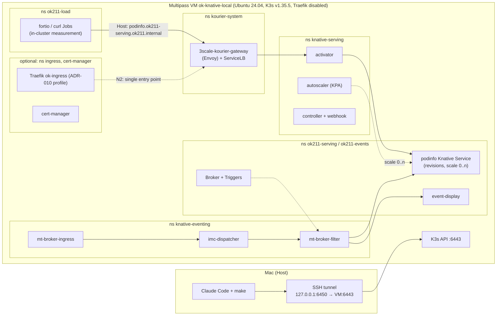

# OK-211 — Arbeitsauftrag für Claude Code: Knative als optionale Serverless- und Event-Fähigkeit

| Feld | Wert |
|---|---|
| Ticket | [OK-211](https://kubernauts.atlassian.net/browse/OK-211) — [Spike] Evaluate Knative as optional OpenKubes Serverless & Event-Driven Capability |
| Status Jira | In Arbeit, zugewiesen an Daniel Santiago Gawenda |
| Auftraggeber | Daniel Santiago Gawenda |
| Rolle dieses Dokuments | Verbindliche Projekt- und Aufgabenbeschreibung (Solution Architecture) für die Umsetzung durch Claude Code |
| Stand | 2026-10-30, Version 1.0 |
| Ablage im Repo | `architecture/spikes/OK-211-knative-serverless/BRIEF.md` |
| Vorgänger-Spike | OK-167 (Gitless GitOps), Branch `spike/OK-167-gitless-gitops`, lokal unter `../openkubes-ok-167/` |

Dieses Dokument hat zwei Teile:

- **Teil A** richtet sich an den Menschen. Er bereitet die Umgebung vor und startet Claude Code.
- **Teil B** richtet sich an Claude Code. Es ist der vollständige Arbeitsauftrag mit Kontext, Architektur, Phasenplan, Tests, Stopp-Bedingungen und Definition of Done.

Sprachregel: Dieses Dokument ist deutsch. **Alles, was Claude Code erzeugt, ist englisch**: Code, Kommentare, README, Report, Evidence, Commit-Messages, PR-Text und Entwürfe für Jira- und Confluence-Kommentare.

---

# Teil A — Vorbereitung durch den Menschen

> **Stand 2026-10-30: Der Startordner ist vorbereitet.** Im `ok/`-Ordner liegt `openkubes-ok-211/`: ein eigener Clone von `openkubes` (wie bei OK-167), Branch `spike/OK-211-knative-serverless` auf dem aktuellen `origin/main`, Remote `git@github-openkubes:openkubes/openkubes.git`. Darin liegen bereits: dieser Auftrag als `BRIEF.md`, die Spike-`.gitignore` mit `.local/`, der leere Ordner `.local/`, die lokale `CLAUDE.md` aus dem Haupt-Checkout, `.claude/settings.local.json` mit `KUBECONFIG` und `KUBECACHEDIR` als Umgebungsvariablen und `start-claude.sh`. Die drei letzten Dateien stehen in `.git/info/exclude` und werden nicht committet.
>
> Übrig für dich: A1 (Multipass und Speicher), A2 (Berechtigungen prüfen), dann `cd openkubes-ok-211 && ./start-claude.sh`. Eine unterbrochene Session setzt du mit `./start-claude.sh --continue` fort.

## A1 — Multipass und Speicher

Der Spike läuft **nicht** in kind, sondern in einer eigenen Multipass-VM, die das ok-local-Profil nachbaut (Ubuntu 24.04, K3s `v1.35.5+k3s1`, Traefik deaktiviert, 4 CPUs, 8 GB RAM, 40 GB Disk). Grund: Das Ticket verlangt den PoC auf ok-local, und Knative verhält sich auf K3s (ServiceLB, eingebauter metrics-server, local-path) anders als auf kind. Deine bestehenden ok-local-VMs `ok-mgmt-local` und `ok-infra-local` werden nicht angefasst; die Spike-VM heißt `ok-knative-local`.

- Multipass muss installiert sein (`brew install multipass`, Prüfung mit `multipass version`).
- Die VM braucht 8 GB RAM. Docker Desktop wird für diesen Spike nicht gebraucht; wenn der Mac knapp ist, Docker Desktop vorher beenden. Laufen `ok-mgmt-local` und `ok-infra-local`, belegen sie zusammen weitere 16 GB. Reicht der Speicher nicht (STOP-8), entscheidest du in CP1, ob du sie selbst stoppst. Claude Code stoppt sie nie.
- Dein öffentlicher SSH-Schlüssel (`~/.ssh/id_ed25519.pub` oder `~/.ssh/id_rsa.pub`) wird wie bei ok-local per cloud-init in die VM gelegt. Claude Code liest nur die `.pub`-Datei; `ssh` bekommt den Pfad des passenden privaten Schlüssels übergeben, der Inhalt wird nie gelesen. Ist der Schlüssel mit Passphrase geschützt, muss er im `ssh-agent` geladen sein.
- Wie in ok-local laufen alle Befehle in der VM über direktes SSH, weil `multipass shell` und `multipass exec` auf aktuellen macOS-Versionen mit „No route to host“ scheitern können (ok-local `docs/tutorial-prerequisites.md`).

## A2 — Berechtigungen in Claude Code

- Prüfe in der Session mit `/permissions`, was erlaubt ist.
- `make`, `multipass`, `ssh` und `scp` (nur zur Spike-VM), `curl`, `jq`, `yq`, `git` (ohne Force-Push, nicht auf `main`) sollten erlaubt sein oder einzeln bestätigt werden.
- Wie bei OK-167: Sperren für `kubectl apply` oder `helm install` greifen bei `make`-Targets nicht. Deshalb ist der Kontext-Guard (B8) Pflicht.
- `--dangerously-skip-permissions` nicht verwenden.

## A3 — Claude Code starten

```bash
cd ~/temp/kubernauts/ok/openkubes-ok-211
./start-claude.sh
```

Das Skript prüft Branch und Werkzeuge, setzt `KUBECONFIG` auf `architecture/spikes/OK-211-knative-serverless/.local/kubeconfig` und `KUBECACHEDIR` auf `.local/kube-cache` (damit nichts nach `~/.kube/` geschrieben wird) und startet Claude Code mit diesem Start-Prompt:

> Lies `architecture/spikes/OK-211-knative-serverless/BRIEF.md` vollständig, Teil B ist dein verbindlicher Arbeitsauftrag. Bestätige mir zuerst in fünf Sätzen, was du verstanden hast, und führe dann Phase 0 aus. Halte an Checkpoint CP1 an und warte auf mein Go.

## A4 — Deine Checkpoints

| Checkpoint | Wann | Was du entscheidest |
|---|---|---|
| CP1 | Nach Phase 0 | Fehlende Tools installieren (brew), Plan freigeben, ggf. Docker Desktop beenden oder `ok-mgmt-local`/`ok-infra-local` selbst stoppen |
| CP2 | Vor `git push` und PR | Branch pushen, Draft-PR öffnen |
| CP3 | Bei jeder Stopp-Bedingung STOP-1 … STOP-11 (B4) | Weiter, anders, oder abbrechen |

Jira, Confluence und PR-Kommentare veröffentlicht Claude Code nicht selbst. Es liefert englische Entwürfe, die du freigibst oder über Cowork veröffentlichen lässt.

---

# Teil B — Arbeitsauftrag an Claude Code

## B0 — Rolle und Arbeitsweise

Du bist der umsetzende Engineer für den Spike OK-211. Dieses Dokument ist dein verbindlicher Auftrag.

Arbeitsprinzipien:

1. **Evidenz vor Behauptung.** Ein Ergebnis gilt nur als PASS, wenn Datum, Umgebung, Versionen, ausgeführter Befehl und beobachtete Ausgabe festgehalten sind. Eine Erwartung ist kein Ergebnis.
2. **Nichts raten.** CLI-Flags, Manifest-Felder, ConfigMap-Keys und Chart-Values prüfst du vor der Verwendung mit `--help`, `kubectl explain`, den Release-Manifests oder der Doku der gepinnten Version. Die Befehle hier sind Leitlinien; die gepinnte Version gewinnt. Abweichungen dokumentieren.
3. **Hypothesen dürfen scheitern.** Ziel ist eine belastbare Entscheidungsgrundlage für ein optionales Capability, kein Werbeprospekt für Knative. Ein sauber belegtes FAIL ist ein gutes Spike-Ergebnis.
4. **Alles über `make`.** Kein `kubectl apply`, `helm install` oder `multipass delete` direkt in der Shell, sondern über Targets im Spike-Makefile (Repo-Konvention aus `CONTRIBUTING.md`), immer als `make -C architecture/spikes/OK-211-knative-serverless <target>`. Das `Makefile` im Repo-Wurzelverzeichnis (Website-Targets) wird nie aufgerufen. Ad-hoc-Lesebefehle sind erlaubt, nur über `scripts/kc.sh` und nie für Secrets (B4).
5. **Kleine Commits.** Nach jeder abgeschlossenen Phase committen, Format siehe B14. Nach jeder Phase den Status in `README.md` aktualisieren, damit eine unterbrochene Session mit `--continue` sauber weitermachen kann.
6. **Englisch** für alle Artefakte.
7. **Ehrliche Grenzen.** Jedes Evidence-Dokument und der Report enthalten „What this proves / What this does not prove“, im Stil von `docs/agentic-ai-poc-evidence-protocol.md` und des OK-167-Reports.
8. **Wiederverwenden statt neu erfinden.** Der OK-167-Spike hat erprobte Bausteine: Guard, `lib.sh`, `scan-secrets.sh`, Evidence-Format, Mess-Skripte, Report-Gliederung. Lies sie unter `../openkubes-ok-167/architecture/spikes/ADR-Platform-011/OK-167-gitless-gitops/` (nur lesen, dort nichts ändern) und übernimm, was passt, angepasst an diesen Spike. Die Hürden aus dessen Report §7 gelten hier ebenfalls (Anhang C).

Falls eine lokale `CLAUDE.md` existiert, gelten deren Regeln zusätzlich. Bei Konflikt gilt die strengere Regel. Bei echtem Widerspruch: STOP-10 (B4).

## B1 — Kontext

### OpenKubes in einem Absatz

OpenKubes ist eine Kubernetes-Plattform-Distribution mit dem Leitprinzip „Contracts, not Components“ (ADR-Platform-001): Fähigkeiten werden als produktneutrale Contracts definiert, Produkte sind austauschbare Implementation Profiles. Optionale Fähigkeiten werden als **opt-in** installiert (eigenes `make install-…`-Target, nicht Teil des Bootstraps), siehe die Muster in ADR-010 und ADR-011. Constraint Envelopes (ADR-017) unterscheiden `datacenter` und `constrained-edge`.

### Relevante ADRs (unter `architecture/decisions/`, vor Phase 2 lesen)

| ADR | Status | Was für OK-211 zählt |
|---|---|---|
| `ADR-Platform-001-contracts-not-components.md` | Accepted | Knative darf kein Contract werden. Ein Serverless- bzw. Application-Delivery-Contract wäre produktneutral, Knative höchstens ein Implementation Profile. |
| `ADR-Platform-015-agentic-ai.md` | Proposed | Lehnt Epinio ab und nennt **Knative** als stärkeren Kandidaten für ein künftiges, separates **Application-Delivery-Capability** mit eigener ADR. Genau diese Einordnung prüft der Spike. |
| `ADR-Platform-010-ingress-contract.md` | Accepted | **Ein** Ingress-Einstiegspunkt pro Cluster (ein LoadBalancer), Ingress-API mit `ingressClassName: ok-ingress`, Hostnamen `<app>.<cluster>.internal`, TLS am Einstiegspunkt; Profil v1 ist Traefik als NodePort hinter einem Host-Proxy. Knative bringt eine eigene Netzwerkschicht (Kourier) mit — das ist die zentrale Architekturfrage für Networking. |
| `ADR-Platform-029-ok-messaging-capability.md` | Accepted | Broker-agnostisches Pub/Sub-Capability (MQTT zuerst, Kafka als Kandidat). Knative Eventing überschneidet sich: Ist Eventing ein Konsument von ok-messaging (z. B. als Channel-Implementierung) oder ein konkurrierender Contract? |
| `ADR-Platform-011-gitops.md` | Proposed | GitOps-Profil mit Argo CD; Secret Contract (keine Klartext-Secrets in Git). Maßstab für „GitOps-managed“. |
| `ADR-Platform-018-observability-capability.md` | Accepted | Per-Cluster-Observability. Maßstab dafür, wie Knative-Metriken eingebunden würden. |
| `ADR-Platform-028-artifact-registry-capability.md` | Draft (Three-Way-Review abgeschlossen) | `registry-default` (zot): Quelle für gespiegelte Knative-Images im Air-Gap-Betrieb (WP8) und für die OCI-Pipeline in G3. |
| `ADR-Platform-017-constraint-envelopes.md` | Accepted | Bewertung für `datacenter` vs. `constrained-edge` (Ressourcen-Overhead, Offline-Betrieb). |
| `ADR-Platform-004-runner-is-implementation-detail.md` | Accepted | Für Scope 5: Verhältnis zu Runner. |
| `ADR-Platform-030-control-plane-execution-model.md` | Proposed | Für Scope 5: Verhältnis zum Contract Executor und zur Control-Plane-Ausführung. |
| `ADR-Platform-035-hybrid-intent-and-control-plane-execution.md` | Proposed | Für Scope 5: Agentic Operations, menschliche Freigabe. |

Ergänzend: `docs/agentic-operations-reference-architecture.md` (Agentic Operations) und der OK-167-Report (Gitless GitOps, Argo CD v3.5.6, offene Lücke „push-basierter Refresh ohne eigene Brücke“).

### Bestehender Code, den du kennen musst

- `../ok-local/` bzw. `github.com/openkubes/ok-local` (Stand `main` = `60397cd`): **nur lesen.** Das `Makefile` zeigt das ok-local-Profil: `multipass launch 24.04 --cpus 4 --memory 8G --disk 40G --cloud-init cloud-init.yaml`, K3s per `curl -sfL https://get.k3s.io | INSTALL_K3S_VERSION=v1.35.5+k3s1 sh -s - --disable=traefik --tls-san=<ip>`, Kubeconfig per SSH, API-Zugriff über SSH-Tunnel auf `127.0.0.1:<port>` (die K3s-API auf Port 6443 ist vom Mac aus laut `docs/tutorial-prerequisites.md` nicht direkt erreichbar; SSH zur VM-IP funktioniert). ok-local arbeitet durchgehend mit direktem `ssh` statt `multipass exec`. Seine Targets `tunnel-stop` beenden Tunnel per `pkill -f "ssh -L 6443"` bzw. `"ssh -L 6444"`; dein Tunnel-Befehl darf diesen Mustern nicht entsprechen (er beginnt mit `ssh -F /dev/null`). Dieses Profil baust du in der eigenen VM `ok-knative-local` nach.
- `../openkubes-ok-167/…/OK-167-gitless-gitops/`: Bausteine zum Wiederverwenden (B0 Punkt 8).
- `CONTRIBUTING.md`: make-basierter Workflow, Standard-Targets, Versions-Pins, Commit-Format.

### Begriffe

- **Knative Serving:** Request-getriebene Workloads (`Service`, `Revision`, `Route`) mit Autoscaling bis auf null (KPA), Traffic-Splitting und Revisionen. Braucht eine Netzwerkschicht (hier Kourier).
- **Knative Eventing:** CloudEvents-Routing mit `Broker`, `Trigger`, Channels und Sources. Die Standard-Channel-Implementierung `InMemoryChannel` ist **nicht dauerhaft** und nur für Entwicklung gedacht.
- **Cold Start:** Zeit vom Request an einen auf null skalierten Service bis zur Antwort. Wird hier mit gecachtem und mit nicht gecachtem Image getrennt gemessen.

## B2 — Das Ticket (Originaltext, verbindlich)

**Objective:** Evaluate Knative Serving and Eventing as an optional, GitOps-managed OpenKubes Platform Capability, without changing the core platform or current Console.

**Scope:**

1. Review architecture, compatibility and prerequisites for ok-local and future target clusters.
2. PoC: install Knative Serving on ok-local; deploy HTTP service, test autoscaling and scale-to-zero, measure cold starts and resource overhead.
3. PoC: Knative Eventing with CloudEvents broker/trigger and event-driven service.
4. Evaluate GitOps lifecycle, networking/ingress, TLS, observability, multi-tenancy, security and policy integration.
5. Assess how Knative complements (does not replace) OpenKubes Runner, Crossplane and Agentic Operations; clarify limits for long-running or GPU-heavy AI workloads.
6. Document operating costs, bare-metal implications, upgrades and rollback.

**Deliverables / Acceptance Criteria:**

- AC1 Architecture and integration options documented, including dependencies and alternatives.
- AC2 Reproducible PoC and test results on ok-local (or documented blockers).
- AC3 Findings for scale-to-zero, cold starts, event delivery, security and operational complexity.
- AC4 Concise management summary with benefits, risks, effort estimate and Go/No-Go recommendation for OpenKubes.

**Constraints:** Backlog research only; no production rollout or modifications to the demo/production Console. No implementation commitment until the spike is reviewed.

## B3 — Ziel, Scope, Non-Goals

**Ziel:** Eine reproduzierbare, im ok-local-Profil laufende Referenzumgebung, die Serving und Eventing mit Messwerten belegt, die sechs Scope-Punkte mit Experimenten bzw. begründeter Analyse beantwortet und einen englischen Report mit Management-Summary, Aufwandsschätzung und Go/No-Go-Empfehlung liefert.

**Im Scope:**

- Eigene Multipass-VM `ok-knative-local` im ok-local-Profil, mit SSH-Tunnel auf `127.0.0.1:6450`
- Knative Serving, Kourier und Eventing, zuerst in Version 1.23, dann Upgrade auf 1.24 unter Last
- Serving-PoC: Deploy, Scale-to-Zero, Cold Starts, Autoscaling, Revisionen und Traffic-Split, Timeouts, Ressourcen-Overhead
- Eventing-PoC: Broker, Trigger, Event-getriebener Service, Retries und Dead-Letter-Sink, Verhalten bei Neustarts
- Networking (Kourier allein und hinter dem ADR-010-Einstiegspunkt), TLS mit cert-manager, Sicherheit, Mandantentrennung, Policy, Observability, GitOps-Verhalten
- Analyse: Fit mit den ADRs, Verhältnis zu Runner, Crossplane, Agentic Operations, Grenzen für lange und GPU-lastige KI-Workloads, Alternativen, Betriebskosten, Bare-Metal-Folgen, Upgrade und Rollback
- Report mit Management-Summary, Evidence, Entwürfe für Jira-Kommentar und PR-Beschreibung

**Non-Goals (nicht tun):**

- Die VMs `ok-mgmt-local` und `ok-infra-local` und ihre SSH-Tunnel (Ports 6443, 6444) nicht anfassen, nicht stoppen, nicht löschen
- Keine echten OpenKubes-Cluster (`ok-*` im Lab), kein VPN, keine Dateien aus `~/.kube/`
- Keine Änderung an ADRs, an `ok-local`, am OK-167-Spike oder an Verzeichnissen außerhalb des Spike-Ordners
- Keine Datei unter `.github/workflows/`
- Keine Änderungen an der OpenKubes Console (Ticket-Constraint)
- Kein KServe, keine GPU, kein Kafka- oder NATS-Cluster (nur als Analyse)
- Kein Merge, kein Push auf `main`, kein Force-Push; keine Jira-Transitions; nichts veröffentlichen ohne Freigabe

## B4 — Sicherheitsleitplanken und Stopp-Bedingungen

### Harte Regeln

1. Jeder Befehl, der die VM oder den Cluster verändert, läuft über ein `make`-Target mit Kontext-Guard (B8).
2. `KUBECONFIG` zeigt ausschließlich auf `<spike>/.local/kubeconfig`. Kein `--kubeconfig`, kein `--context`, kein `kubectl config use-context`.
3. Ad-hoc-Lesebefehle außerhalb von `make` nur als `architecture/spikes/OK-211-knative-serverless/scripts/kc.sh <args>` (Guard, dann `.local/bin/kubectl`). Nie ein `kubectl` aus `PATH`.
4. **Multipass-Isolation:** Jedes `multipass`-Kommando nennt ausschließlich die Instanz `ok-knative-local` (Variable `VM_NAME`). Verboten sind Befehle ohne Instanzname (`stop`, `start`, `restart`, `shell` wirken sonst auf die Primary-Instanz), `--all`, `multipass purge` (global) und `multipass set` (globale Einstellungen wie `local.driver`), außerdem jedes Kommando auf `ok-mgmt-local`/`ok-infra-local`. Löschen nur als `multipass delete --purge ok-knative-local` über `make vm-delete CONFIRM=yes`.
5. **SSH-Isolation:** SSH und SCP nur zur IP von `ok-knative-local` und nur über `ok211::vm_ssh` bzw. `ok211::vm_scp` in `lib.sh`: `-F /dev/null`, `-i <privater Schlüssel zur verwendeten .pub>`, `-o IdentitiesOnly=yes -o BatchMode=yes -o StrictHostKeyChecking=accept-new -o UserKnownHostsFile=.local/known_hosts` (nie `~/.ssh/known_hosts` beschreiben). Der Tunnel nutzt den Control-Socket `.local/tun.sock` (relativ, siehe B8). Tunnel stoppen nur über diesen Socket (`ssh -S .local/tun.sock -O exit`), nie per `pkill`. Private Schlüssel nie lesen.
6. Secrets (Kubeconfig, Tokens, private Schlüssel) liegen nur in `<spike>/.local/` (gitignoriert, `600`). Nie in getrackten Dateien, Commit-Messages, Evidence oder der Session-Ausgabe. `/etc/rancher/k3s/k3s.yaml` wird per SSH direkt in eine Datei unter `.local/` umgeleitet, nie ausgegeben. Verboten: `kubectl get secret … -o yaml|json`, `kubectl describe secret`, `cat` auf Geheimnis-Dateien in `.local/`.
7. Werkzeug-Konfigurationen bleiben in `.local/`: Das Makefile exportiert `HELM_CONFIG_HOME`, `HELM_CACHE_HOME`, `HELM_DATA_HOME`, `HELM_REGISTRY_CONFIG` unter `.local/helm/`, `KUBECACHEDIR=<spike>/.local/kube-cache` (kubectl schreibt sonst seinen Discovery-Cache nach `~/.kube/cache`), `TUF_ROOT=<spike>/.local/sigstore` (cosign) und `PUPPETEER_CACHE_DIR=<spike>/.local/puppeteer` (mermaid-cli). `kn` und `argocd` nur mit `--config` unter `.local/`. Nichts nach `~/.config`, `~/Library/Preferences/helm` oder `~/.kube` schreiben.
8. Alle Ports auf dem Mac nur an `127.0.0.1` binden (`ssh -L 127.0.0.1:…`).
9. Kein `--insecure`/`-k`, kein `insecure-skip-tls-verify` — auch nicht in N3. Dort wird zusätzlich ein Aufruf ohne `--cacert` gezeigt, der scheitern muss.
10. Manifeste, die aus dem Internet geladen werden (Knative-Release-YAMLs, cert-manager), werden in `.local/manifests/` gespeichert, ihr SHA-256 in `versions.env` festgehalten und vor jedem Apply geprüft. Kein `kubectl apply -f https://…`.
11. Keine Uploads in öffentliche Dienste. Lesende Abfragen (Release-Downloads, `cosign verify` gegen öffentliche Transparency-Logs) sind erlaubt.

### Stopp-Bedingungen (sofort anhalten, Zustand beschreiben, auf Entscheidung warten)

| # | Bedingung |
|---|---|
| STOP-1 | Der aktuelle Kontext ist nicht `ok211`, oder der API-Server ist nicht `https://127.0.0.1:6450` |
| STOP-2 | Eine Aufgabe würde `ok-mgmt-local`, `ok-infra-local`, deren Tunnel, einen echten Cluster, `~/.kube/`, VPN oder Zugangsdaten außerhalb von `.local/` berühren |
| STOP-3 | Ein Secret würde in einer getrackten Datei landen, oder `make scan-secrets` schlägt an |
| STOP-4 | Eine gepinnte Version, ein Manifest-Checksum oder ein Image-Digest stimmt nicht, oder ein Image hat keine `linux/arm64`-Variante. Nicht still ausweichen. |
| STOP-5 | Ein Ziel ist nur mit Insecure-Flags erreichbar (B4 Regel 9) |
| STOP-6 | Derselbe Fehler tritt nach drei unterschiedlichen Lösungsversuchen weiter auf |
| STOP-7 | Tool-Installation nötig (brew o. ä.) — nur nach Freigabe |
| STOP-8 | Vor dem VM-Start weniger als 10 GiB verfügbarer Arbeitsspeicher auf dem Mac, gerechnet als (`Pages free` + `Pages inactive` + `Pages speculative` + `Pages purgeable`) × Seitengröße aus `vm_stat`; `memory_pressure -Q` zusätzlich festhalten. Oder der Mac wird instabil. |
| STOP-9 | Eine Änderung außerhalb des Spike-Ordners scheint nötig |
| STOP-10 | Widerspruch zwischen diesem Auftrag, einer lokalen `CLAUDE.md` und der gepinnten Doku, der sich nicht durch die strengere Regel auflösen lässt |
| STOP-11 | Ein Experiment überschreitet seine Timebox |

Bei einem Stopp: Zustand, letzte Befehle, Fehlerausgabe und deine Optionen mit Empfehlung nennen, dann auf die Entscheidung warten (→ CP3). Nicht selbst eskalieren oder umgehen. Die Kürzel STOP-1 … STOP-11 sind bewusst anders als die Test-IDs S1 … S10 der Serving-Tests.

## B5 — Zielarchitektur



### Namen und Konventionen

| Element | Wert |
|---|---|
| Multipass-Instanz | `ok-knative-local` (Variable `VM_NAME`) |
| Kubeconfig-Kontext | `ok211` (Cluster, User und Kontext in der Kubeconfig umbenannt) |
| API-Zugriff vom Mac | SSH-Tunnel `127.0.0.1:6450` → VM `127.0.0.1:6443`, Control-Socket `.local/ssh-tunnel.sock` |
| Knative-Domain | `ok211.internal`. Das Knative-Default-Template `{{.Name}}.{{.Namespace}}.{{.Domain}}` ergibt `<ksvc>.<ns>.ok211.internal` und weicht damit von ADR-010 (`<app>.<cluster>.internal`) ab — Befund für N2. Kein `sslip.io`, keine externe DNS-Abhängigkeit |
| Beispiel-URL | `http://podinfo.ok211-serving.ok211.internal`, angesprochen per `Host`-Header |
| Namespaces | `knative-serving`, `kourier-system`, `knative-eventing`, `ok211-serving`, `ok211-events`, `ok211-load`, `ok211-tenant-a`, `ok211-tenant-b`, optional `ingress`, `cert-manager`, `argocd` |
| Demo-Workload | podinfo (`ghcr.io/stefanprodan/podinfo`), `6.16.0` und `6.17.0`, Port 9898; hat `/delay/{seconds}` für Timeout-Tests und `/status/{code}` für Fehlerantworten. Je Experiment ein eigener Knative Service (B9 Phase 5) |
| Messung | Im Cluster aus dem Probe-Pod `ok211-probe` und mit gepinnten fortio- und curl-Images, damit Tunnel und Mac-Netz die Werte nicht verfälschen (B11) |

## B6 — Versions-Pins

Alle Pins stehen in `versions.env` und werden nur dort gepflegt. Die Werte sind am 2026-10-30 recherchiert. In Phase 0 prüfst du jeden Pin; Abweichung ⇒ STOP-4.

| Komponente | Pin | Herkunft / Prüfung |
|---|---|---|
| Multipass | installierte Version festhalten (≥ 1.16) | `multipass version` |
| VM-Image | Ubuntu `24.04` wie ok-local; Image-Release und Hash aus `multipass info` festhalten | |
| VM-Ressourcen | 4 CPUs, 8G RAM, 40G Disk | identisch mit ok-local |
| K3s | `v1.35.5+k3s1`, Flags `--disable=traefik --tls-san=<vm-ip>` | identisch mit ok-local `Makefile`; neuere 1.35-Patches nicht verwenden |
| kubectl | v1.35.x als Binärdatei in `.local/bin/` aus `dl.k8s.io` mit SHA-256-Prüfung | Homebrew-kubectl ist 1.37 und damit zwei Minor-Versionen vom Cluster entfernt (OK-167 Befund F2) |
| Knative Serving | Start `knative-v1.23.0`, Ziel `knative-v1.24.0` | 1.24.0 ist am 2026-10-26 erschienen und verlangt Kubernetes ≥ v1.35.0; 1.23 verlangt ≥ v1.34.0. Manifeste: `serving-crds.yaml`, `serving-core.yaml`, `serving-post-install-jobs.yaml`; `serving-default-domain.yaml` wird nicht verwendet |
| net-kourier | Start `knative-v1.23.0`, Ziel `knative-v1.24.0` | |
| Knative Eventing | Start `knative-v1.23.1`, Ziel `knative-v1.24.0` | Manifeste: `eventing-crds.yaml`, `eventing-core.yaml`, `in-memory-channel.yaml`, `mt-channel-broker.yaml`, `eventing-post-install.yaml` (Namen gegen die Release-Assets prüfen) |
| Knative-Manifeste | SHA-256 jeder heruntergeladenen Datei | B4 Regel 10 |
| Knative-Images | in den Release-Manifests bereits per Digest referenziert; für mindestens activator, controller, autoscaler, kourier-gateway, broker-ingress die `linux/arm64`-Variante prüfen | |
| cert-manager | `v1.21.3`, statisches Manifest `cert-manager.yaml` | nur für N3 |
| Traefik | Helm-Chart `traefik/traefik` `v42.1.3`, `appVersion` festhalten | nur für N2, entspricht ADR-010 Profil v1 |
| Argo CD | Chart `argo-cd` 10.11.6, Image `quay.io/argoproj/argocd:v3.5.6@sha256:8e5cc5bb008df8a09dba439462e58c94c55b7735888d3ebde0c25fc05e4e5335` | nur für das optionale G3; Pins aus OK-167 |
| podinfo | `6.16.0@sha256:2c88592f2b8f51a9428c8039486fc41abac53c95dbbb884d03bebee0876a6d4d`, `6.17.0@sha256:fa2f27c1a8561097e5144bfc0853eba6054d743b68b03de4cad4675616ddefb0` | aus OK-167, beide mit `linux/arm64` |
| fortio | `fortio/fortio` v1.76.0 per Digest | Lastgenerator im Cluster |
| curl | `curlimages/curl` per Digest | Cold-Start-Messung im Cluster |
| event-display | Digest aus dem Eventing-Release-Asset `event-display.yaml` (dort bereits per Digest und mit restriktivem `securityContext`) | Eventing-Senke |
| Helm | installierte Version (bei OK-167: v4.3.0) | Für Helm 4 die verwendeten Flags vorab prüfen |

Jedes Container-Image, das du selbst referenzierst, wird per Digest angegeben.

## B7 — Verzeichnisstruktur

Alles liegt unter `architecture/spikes/OK-211-knative-serverless/` (im Folgenden `<spike>`). Es gibt noch keine ADR für ein Serverless- oder Application-Delivery-Capability; deshalb liegt der Spike nicht unter einem ADR-Ordner. Der Report kann eine ADR vorschlagen, schreibt sie aber nicht.

```text
<spike>/
├── BRIEF.md                         # dieser Auftrag (unverändert committen)
├── README.md                        # Einstieg: Zweck, Reproduktion, Status, Links
├── REPORT.md                        # Evaluierungsbericht (Quelle für Confluence), englisch
├── MANAGEMENT-SUMMARY.md            # eine Seite für die Gründer (AC4), englisch
├── Makefile                         # einziger Einstiegspunkt, mit Guard und help
├── versions.env                     # alle Pins und Manifest-Checksums
├── .gitignore                       # .local/ (vorbereitet) und temporäre Artefakte
├── .local/                          # NICHT committen: kubeconfig, known_hosts, ssh-tunnel.sock, bin/, manifests/, helm/
├── vm/
│   └── cloud-init.template.yaml     # Platzhalter für den Public Key; gerenderte Datei nur in .local/
├── knative/
│   ├── patch-config-network.yaml    # Merge-Patch: ingress-class Kourier
│   ├── patch-config-domain.yaml     # Merge-Patch: ok211.internal
│   ├── patch-config-autoscaler.yaml # nur dokumentierte Abweichungen von den Defaults
│   └── patch-kourier-clusterip.yaml # Merge-Patch für N2
├── apps/
│   ├── serving/                     # podinfo-ksvc-Varianten (Basis, min-scale, Traffic-Split, Timeout)
│   └── eventing/                    # Broker, Trigger, event-display, Event-getriebener ksvc, Dead-Letter-Sink, PingSource
├── load/                            # fortio- und curl-Job-Vorlagen
├── ingress/                         # Traefik-Values (ok-ingress), Ingress auf Kourier (N2)
├── tls/                             # cert-manager Issuer, Knative-TLS-Konfiguration (N3)
├── security/                        # Namespaces mit Pod Security, Tenant-RBAC, NetworkPolicies
├── gitops/                          # nur für das optionale G3
├── scripts/
│   ├── guard.sh                     # Kontext-Guard (aus OK-167 angepasst)
│   ├── kc.sh                        # Guard, dann .local/bin/kubectl (Ad-hoc-Lesebefehle)
│   ├── lib.sh                       # Logging, Zeitstempel (aus OK-167), ok211::vm_guard, vm_ip, vm_ssh, vm_scp
│   ├── scan-secrets.sh              # Secret-Scan (aus OK-167)
│   ├── fetch-manifests.sh           # Release-YAMLs laden und Checksums prüfen
│   ├── tunnel.sh                    # Tunnel starten, prüfen, stoppen (Control-Socket)
│   ├── measure-coldstart.sh         # Cold-Start-Messreihen
│   ├── measure-autoscale.sh         # Lasttest und Pod-Zählung
│   └── snapshot-resources.sh        # CPU/RAM je Namespace über metrics-server
├── drafts/
│   ├── jira-comment.md
│   └── pr-description.md
├── diagrams/
│   ├── architecture.mmd
│   └── architecture.svg             # Confluence rendert kein Mermaid
└── evidence/
    ├── 00-preflight.md, 01-vm-k3s.md, 02-knative-install.md, 03-upgrade.md, 04-serving.md
    ├── 05-eventing.md, 06-networking-tls.md, 07-security.md, 08-gitops.md
    ├── 09-architecture-assessment.md
    └── raw/                         # redigierte JSON-/Log-Ausgaben
```

`.gitignore` enthält mindestens `.local/`, `*.tar.gz`, `*.key`, `*.pem`. Die gerenderte cloud-init-Datei enthält nur den öffentlichen Schlüssel, liegt aber trotzdem nur in `.local/`.

## B8 — Makefile-Spezifikation

Konventionen aus `CONTRIBUTING.md`: `.DEFAULT_GOAL := help`, jedes Target mit `## Beschreibung`, Versionen aus `versions.env` (`include` + `export`), JSON mit `jq`. Skripte laufen unter **bash 3.2** (macOS), also ohne `mapfile` und assoziative Arrays.

### Kontext-Guard (Pflicht)

`scripts/guard.sh` (aus OK-167 übernommen und angepasst) läuft als erste Abhängigkeit jedes Targets, das den Cluster liest oder verändert. Er bricht mit Exit-Code ≠ 0 ab, wenn:

1. `KUBECONFIG` nicht gesetzt ist oder nicht unter `<spike>/.local/` liegt
2. die Kubeconfig nicht genau einen Kontext enthält
3. der Kontext nicht `ok211` heißt
4. der Server nicht exakt `https://127.0.0.1:6450` ist
5. der verwendete kubectl nicht `<spike>/.local/bin/kubectl` ist oder dessen Minor-Version nicht der des Clusters entspricht
6. der einzige Node des Clusters nicht `ok-knative-local` heißt (ab Phase 2)

Zusätzlich gibt es die Funktion `ok211::vm_guard` in `scripts/lib.sh`: Jedes Target, das `multipass`, `ssh` oder `scp` aufruft, prüft, dass `VM_NAME` exakt `ok-knative-local` ist. Die IP liefert `ok211::vm_ip` als `multipass info ok-knative-local --format json | jq -r '.info["ok-knative-local"].ipv4[0]'`. Liegt sie in `10.42.0.0/16` oder `10.43.0.0/16` (flannel/CNI, nach der K3s-Installation zusätzlich gelistet), bricht die Funktion ab. Nicht auf ein festes Subnetz filtern: ok-local zeigt `192.168.2.x`, andere Macs `192.168.64.x`.

Das Makefile setzt `export KUBECONFIG := $(CURDIR)/.local/kubeconfig`, `export PATH := $(CURDIR)/.local/bin:$(PATH)`, `export KUBECACHEDIR := $(CURDIR)/.local/kube-cache` und die übrigen Verzeichnisse aus B4 Regel 7. Das Muster im `help`-Target aus `CONTRIBUTING.md` (`^[a-zA-Z_-]+:`) kennt keine Ziffern; erweitere es auf `^[a-zA-Z0-9_-]+:`, sonst fehlen Targets wie `exp-S4` (siehe auch Anhang C, C6).

### Release-Manifeste und eigene Overrides

Die Knative-ConfigMaps enthalten im Release nur `_example`. Würden eigene Werte als komplette ConfigMap per `kubectl apply` angewendet, löschte der nächste Apply des Release-Manifests sie wieder (beim Upgrade und in G1). Deshalb:

- Release-YAMLs mit `kubectl apply --server-side --field-manager=knative-release`. Konflikte nicht blind mit `--force-conflicts` überstimmen, sondern dokumentieren.
- Eigene Werte (`config-network`, `config-domain`, `config-autoscaler`, Serving- und Eventing-`config-features`, `config-observability`, N2-Patch des Service `kourier`) ausschließlich per `kubectl patch --type merge` aus den Patch-Dateien unter `knative/` bzw. `ingress/`.
- Nach jedem Release-Apply (Install, Upgrade, G1) prüft `knative-verify`, dass `config-domain` den Key `ok211.internal` und `config-network` `ingress-class: kourier.ingress.networking.knative.dev` enthält und alle aktiven Overrides noch gesetzt sind. Der Release-Apply setzt den Service `kourier` auf `LoadBalancer` zurück; ist N2 aktiv, wird der Patch danach erneut angewendet. Abweichung ⇒ STOP-6.
- Post-Install-Jobs haben `generateName`. Sie werden laut Upgrade-Doku mit `kubectl create -f` angelegt, nicht mit `apply`; die übrigen Objekte im selben Manifest (ServiceAccount, ClusterRole, Binding) per `apply`. Ein Job wird nur angelegt, wenn für die Zielversion noch kein Job mit Label `app.kubernetes.io/version=<ziel>` `Complete` ist; danach `kubectl wait --for=condition=Complete`.
- `VERSION` bzw. `TO` ist die Release-Linie (`1.23`, `1.24`). `versions.env` bildet sie je Repo ab: `SERVING_1_23=knative-v1.23.0`, `KOURIER_1_23=knative-v1.23.0`, `EVENTING_1_23=knative-v1.23.1`, `SERVING_1_24`, `KOURIER_1_24`, `EVENTING_1_24` jeweils `knative-v1.24.0`.

### Befehle in der VM und Tunnel

- Alle Befehle in der VM laufen über `ok211::vm_ssh` (B4 Regel 5), Dateien über `ok211::vm_scp`. `multipass` nur für `launch`, `info`, `list`, `stop`, `start`, `delete`, `snapshot`, `restore`, immer mit Instanzname. `multipass exec` darf ein Fallback sein; die genutzte Variante steht in `01-vm-k3s.md`.
- macOS begrenzt Pfade von Unix-Sockets auf 104 Byte, und `ssh -M` hängt beim Anlegen ein Suffix an. Der absolute Pfad zu `.local/` ist zu lang. Deshalb laufen alle Tunnel-Befehle im Spike-Ordner mit dem **relativen** Socket `.local/tun.sock`.
- `make tunnel`: Zuerst `ssh -S .local/tun.sock -O check ubuntu@<vm-ip>`. Antwortet kein Master, existiert die Datei aber, nur diese Datei entfernen. Dann:

```bash
ssh -F /dev/null -f -N -M -S .local/tun.sock \
  -i "$SSH_KEY" -o IdentitiesOnly=yes -o BatchMode=yes \
  -o StrictHostKeyChecking=accept-new -o UserKnownHostsFile=.local/known_hosts \
  -o ExitOnForwardFailure=yes -o ServerAliveInterval=30 -E .local/ssh-tunnel.log \
  -L 127.0.0.1:6450:127.0.0.1:6443 ubuntu@"$VM_IP" </dev/null >/dev/null 2>&1
```

`SSH_KEY` ist der private Schlüssel zur `.pub` aus cloud-init (nur der Pfad). Schlägt die Anmeldung fehl: anhalten und nachfragen (CP3), nicht auf andere Schlüssel ausweichen.

- `make tunnel-stop`: `ssh -S .local/tun.sock -O exit ubuntu@<vm-ip>`. Die IP wird bei jedem Aufruf neu ermittelt, weil sie sich nach `multipass stop/start` ändern kann.

### Targets

| Target | Zweck |
|---|---|
| `help` | Alle Targets mit Beschreibung |
| `preflight` | Tools, Versionen, Mac-Ressourcen, Multipass-Instanzen (nur lesen), Port 6450 frei, 6443/6444 nur notieren, Digests, Manifest-Checksums; schreibt `evidence/00-preflight.md` |
| `kubectl-pin` | kubectl v1.35.x nach `.local/bin/` laden und SHA-256 prüfen |
| `vm-up` | cloud-init aus Vorlage in `.local/` rendern, `multipass launch 24.04 --name ok-knative-local --cpus 4 --memory 8G --disk 40G --cloud-init .local/cloud-init.yaml` (idempotent), warten bis SSH antwortet |
| `vm-info`, `vm-stop`, `vm-start` | nur `ok-knative-local` |
| `vm-snapshot NAME=…`, `vm-restore NAME=…` | optional, für den Rollback-Test (Multipass-Snapshots brauchen eine gestoppte VM; Unterstützung prüfen) |
| `vm-delete CONFIRM=yes` | Tunnel stoppen, `multipass delete --purge ok-knative-local`, dann `.local/known_hosts`, `.local/kubeconfig` und `.local/tun.sock` entfernen |
| `k3s-install` | K3s `v1.35.5+k3s1` mit den ok-local-Flags per `ok211::vm_ssh` installieren (versioniertes Skript, B9 Phase 2), auf `Ready` warten |
| `kubeconfig` | `sudo cat /etc/rancher/k3s/k3s.yaml` per `ok211::vm_ssh` direkt in eine Datei unter `.local/` umleiten (nie ausgeben), Kontext/Cluster/User in `ok211` umbenennen, Server auf `https://127.0.0.1:6450`, Datei `600` |
| `tunnel`, `tunnel-status`, `tunnel-stop` | wie oben unter „Befehle in der VM und Tunnel“; Stopp nur über den Socket |
| `baseline` | Ressourcen-Snapshot des leeren Clusters (vor Knative) |
| `manifests-fetch VERSION=…` | Release-YAMLs nach `.local/manifests/<version>/` laden, Checksums mit `versions.env` vergleichen |
| `knative-install VERSION=…` | CRDs, Serving-Core, Kourier, Eventing-Core, InMemoryChannel, MT-Broker in der Reihenfolge aus B9 Phase 3, server-seitig mit Field-Manager `knative-release`; nach `serving-core.yaml` auf `deployment/webhook` und `controller` `Available` warten, bevor `config-*` gepatcht wird, nach `eventing-core.yaml` auf `eventing-webhook`; dann Overrides per Patch |
| `knative-verify` | Alle Deployments `Available`, Webhooks erreichbar, `kubectl get ksvc` funktioniert, Overrides gesetzt (siehe oben) |
| `knative-upgrade TO=…` | Upgrade laut Release Notes bei laufender Probe; schreibt vor und nach jedem Schritt eine UTC-Marke nach `evidence/raw/upgrade-steps.log`; Post-Install-Jobs wie oben |
| `apps-serving`, `apps-eventing`, `apps-upgrade-events` | Demo-Ressourcen anlegen bzw. aktualisieren; `apps-upgrade-events` für U2 (B9 Phase 4) |
| `probe-up`, `probe CMD=…` | Probe-Pod `ok211-probe` in `ok211-load` anlegen; Befehl darin per `kubectl exec` ausführen (B11) |
| `measure-coldstart`, `measure-autoscale`, `measure-overhead` | Messreihen (B11) |
| `ingress-install`, `kourier-clusterip`, `ingress-route` | N2 |
| `tls-install`, `tls-enable`, `tls-disable` | N3 |
| `argocd-install` | nur für G3 |
| `exp-<ID>` | je ein Target pro verändernden Experiment, mit Wiederherstellung oder `exp-<ID>-restore` |
| `verify` | Gesamtprüfung aller ohne neue Messung prüfbaren Pass-Kriterien |
| `lint` | `yamllint`, `shellcheck`; zusätzlich `kubeconform`, falls installiert (sonst als fehlend in CP1 melden, kein Pflichtwerkzeug); ohne Cluster |
| `lint-server` | ab Phase 3, mit Guard: `kubectl apply --dry-run=server` auf alle eigenen Manifeste |
| `scan-secrets` | wie OK-167 |
| `debug` | Diagnose-Snapshot nach `.local/debug/<timestamp>/`; nach `evidence/raw/` nur redigierte Auszüge |
| `install` | `preflight kubectl-pin vm-up k3s-install kubeconfig tunnel baseline manifests-fetch knative-install knative-verify` (mit `VERSION=1.23`) |
| `down` | `tunnel-stop vm-stop` |
| `clean` | `vm-delete` (verlangt `CONFIRM=yes`) |
| `diff`, `upgrade` | `upgrade` verweist auf `knative-upgrade`; `diff` als `kubectl diff --server-side` auf die eigenen Manifeste |

Jedes verändernde Target ist idempotent.

## B9 — Phasenplan

Jede Phase hat Ziel, Schritte, Pass-Kriterien, ein Evidence-Dokument und einen Commit. Eine Phase gilt erst als abgeschlossen, wenn ihre Pass-Kriterien belegt sind oder ein FAIL bzw. NOT RUN sauber begründet ist.

Für Messreihen (S2–S7, S10, E1, E2, U1) gilt: **PASS** = alle Läufe vollständig mit erwarteter Antwort (HTTP 200 bzw. zugestelltes Event) und Rohwerte in `measurements.json`. Schwellen gelten nur dort, wo B13 sie nennt (M3, K1, K4). **FAIL** = funktionales Versagen (kein Scale-to-Zero, Timeout, falsche Version, Event nicht zugestellt).

Grobe Zeitschätzung: 3–4 Arbeitstage plus Wartezeit an den Checkpoints. Reicht die Zeit nicht, entfallen in dieser Reihenfolge G3, X6, U3 (praktischer Teil) und X4, jeweils als NOT RUN mit Begründung.

### Phase 0 — Orientierung und Preflight (keine Cluster- oder VM-Änderungen)

**Ziel:** Umgebung, Werkzeuge, Pins und Manifeste stimmen, bevor eine VM entsteht. Es werden nur Evidence und Downloads nach `.local/` geschrieben.

Schritte:

1. Lies die Dokumente aus B1 (inklusive ok-local `Makefile` und `docs/tutorial-prerequisites.md`), dieses Dokument und im OK-167-Spike `scripts/guard.sh`, `scripts/lib.sh`, `scripts/scan-secrets.sh`, `REPORT.md` §7 und ein Evidence-Dokument als Formatvorlage.
2. Repo-Zustand: Branch `spike/OK-211-knative-serverless`, Basis `origin/main`. Erlaubt sind nur die vorbereiteten Dateien: im Spike-Ordner `BRIEF.md`, `.gitignore`, `.local/`; im Repo-Wurzelverzeichnis die per `.git/info/exclude` ausgeschlossenen `CLAUDE.md`, `start-claude.sh`, `.claude/settings.local.json`. Alles andere ⇒ STOP-10.
3. Sicherheit: `KUBECONFIG` zeigt auf `<spike>/.local/kubeconfig`; die Datei existiert noch nicht oder enthält keinen Kontext.
4. Host: `uname -m`, `sw_vers`, `sysctl -n hw.ncpu`, `sysctl -n hw.memsize`, verfügbarer Speicher nach der Formel in STOP-8 (`vm_stat`, `memory_pressure -Q`), freier Plattenplatz. Läuft Docker Desktop? Nur festhalten; bei Speicherknappheit ⇒ STOP-8.
5. Multipass (nur lesen): `multipass version`, `multipass get local.driver`, `multipass list` (Ausgabe vollständig in `00-preflight.md`, Vergleich in Phase 12). Existiert `ok-knative-local` schon ⇒ STOP-10. `ok-mgmt-local` und `ok-infra-local` nur notieren.
6. SSH: Existiert `~/.ssh/id_ed25519.pub` oder `~/.ssh/id_rsa.pub`? Nur Existenz prüfen, Inhalt nicht ausgeben. Port 6450 frei (`lsof -nP -iTCP:6450 -sTCP:LISTEN`); ob 6443/6444 belegt sind (ok-local-Tunnel), nur notieren.
7. Werkzeuge mit Version: `multipass`, `ssh`, `curl`, `jq`, `yq`, `helm`, `openssl` (brew `openssl@3`), `shellcheck`, `yamllint`, `oras` (für Digest-Prüfungen), optional `cosign`, `kn`, `argocd`, mermaid-cli. Fehlendes als Liste mit brew-Befehl für CP1.
8. Manifeste: `scripts/fetch-manifests.sh` (darf schon in Phase 0 als Skript entstehen) lädt die Release-YAMLs für 1.23 und 1.24 sowie cert-manager nach `.local/manifests/` und berechnet SHA-256. Prüfe die Asset-Namen gegen die GitHub-Releases. Halte fest, welche Post-Install- oder Migrations-Jobs die Release Notes für 1.24 verlangen.
9. Images: Aus den Manifests die Images extrahieren; für die in B6 genannten Kern-Images und für podinfo, fortio, curl, event-display die `linux/arm64`-Variante per `oras manifest fetch` prüfen.
10. Doku-Fakten mit Quelle sichern (Release Notes und Doku der gepinnten Versionen): Default-Werte in `config-autoscaler` und `config-defaults` (die ConfigMaps enthalten `_example`-Blöcke), Upgrade-Reihenfolge, Aussage zu Downgrades, unterstützte Kubernetes-Versionen.
11. `evidence/00-preflight.md` schreiben; Plan in höchstens zehn Zeilen, offene Fragen und nötige Installationen nennen.

**Pass:** Alle Pins und Checksums auflösbar, arm64 überall vorhanden, Ressourcen ausreichend, `KUBECONFIG` isoliert, keine Kollision mit bestehenden Multipass-Instanzen.

**→ CP1: Anhalten und auf Freigabe warten.**

### Phase 1 — Gerüst

**Ziel:** Struktur, Guard, Makefile-Grundgerüst und Hilfsskripte stehen; nichts berührt VM oder Cluster.

Schritte:

1. `<spike>/.gitignore` prüfen bzw. ergänzen (vorbereitet, enthält `.local/`). Verzeichnisstruktur aus B7, `versions.env`, `README.md` (Status „in progress“). Nie `git add -A` oder `git add .`; immer gezielte Pfade, vor jedem Commit `git status`.
2. `lib.sh`, `guard.sh`, `scan-secrets.sh` aus OK-167 übernehmen und anpassen (Kontext `ok211`, Server `https://127.0.0.1:6450`, kubectl ausschließlich aus `.local/bin/`). `lib.sh` bekommt `ok211::vm_guard`, `ok211::vm_ip`, `ok211::vm_ssh`, `ok211::vm_scp`; dazu `scripts/kc.sh`.
3. Makefile mit `help`, `preflight`, `kubectl-pin`, `lint`, `scan-secrets`, `debug`, Guard-Einbindung.
4. Guard-Negativtests direkt gegen `scripts/guard.sh` mit synthetischen Kubeconfigs unter `.local/test/`: `KUBECONFIG` leer; Pfad außerhalb `.local/`; Datei fehlt; falscher Kontextname; Server nicht `https://127.0.0.1:6450` (z. B. `:6443`, also ein ok-local-Tunnel); zwei Kontexte; Symlink in `.local/`, der nach außen zeigt (OK-167, Anhang C5); unlesbare Kubeconfig; kubectl aus `PATH` statt `.local/bin/`. Zusätzlich `ok211::vm_guard` mit `VM_NAME=ok-infra-local`. Alle zehn Fälle müssen mit Exit ≠ 0 und verständlicher Meldung enden.
5. `make lint` grün; `scan-secrets` einmal mit einer präparierten, nicht gestagten Testdatei anschlagen lassen, Datei entfernen.

**Pass:** Alle zehn Negativfälle verweigert; Lint grün; Secret-Scan schlägt beim Testfall an und ist danach grün.

**Evidence:** Abschnitt „Guard negative tests“ in `evidence/00-preflight.md`. **Commit:** `docs(serverless): scaffold OK-211 Knative spike (OK-211)` (enthält `BRIEF.md`).

### Phase 2 — VM im ok-local-Profil

**Ziel:** Eine isolierte K3s-Umgebung, die sich wie ok-local verhält.

Schritte:

1. `make kubectl-pin`: kubectl v1.35.x nach `.local/bin/`, SHA-256 gegen die offizielle Prüfsumme.
2. `make vm-up`: cloud-init aus `vm/cloud-init.template.yaml` mit dem Public Key nach `.local/cloud-init.yaml` rendern (Inhalt wie in ok-local: `package_update: true`, Nutzer `ubuntu` mit `sudo: ALL=(ALL) NOPASSWD:ALL`, `ssh_authorized_keys`). Dann `multipass launch 24.04 --name ok-knative-local --cpus 4 --memory 8G --disk 40G --cloud-init .local/cloud-init.yaml`.
3. `make k3s-install`: Installationsskript **versioniert** laden (`https://raw.githubusercontent.com/k3s-io/k3s/v1.35.5+k3s1/install.sh`), SHA-256 festhalten, per `ok211::vm_scp` in die VM kopieren, dort per `ok211::vm_ssh` mit `INSTALL_K3S_VERSION=v1.35.5+k3s1` und `--disable=traefik --tls-san=<vm-ip>` ausführen. Abweichung zu ok-local (das `get.k3s.io` unversioniert nutzt) in `README.md` unter „Deviations from ok-local“ festhalten.
4. `make kubeconfig`, `make tunnel`, Guard grün.
5. Bestandsaufnahme K3s: Node `Ready`; CoreDNS, metrics-server und local-path-provisioner als Pods; ServiceLB als aktivierte Funktion (Flags, k3s-Log; `svclb`-Pods erscheinen erst mit dem ersten LoadBalancer-Service in Phase 3); der eingebettete NetworkPolicy-Controller über `journalctl -u k3s` und die iptables-Ketten `KUBE-ROUTER-*` (er läuft im k3s-Prozess, nicht als Pod). Belege, nicht annehmen.
6. `make baseline`: `kubectl top nodes` und `kubectl top pods -A` des leeren Clusters, dreimal im Abstand von 60 s.

**Pass:** Node `Ready`; Kontext `ok211`; Server `https://127.0.0.1:6450`; genau ein Kontext; `kubectl top` liefert Werte; Baseline gespeichert.

**Evidence:** `evidence/01-vm-k3s.md`. **Commit:** `feat(serverless): ok-local profile VM with K3s for OK-211 (OK-211)`.

### Phase 3 — Knative 1.23 installieren

**Ziel:** Serving, Kourier und Eventing in der Ausgangsversion, deklarativ und mit geprüften Manifests.

Schritte:

1. `make knative-install VERSION=1.23` in dieser Reihenfolge, server-seitig und mit den Overrides als Patch (B8), jeweils mit Warten auf `Available`/`Established`:
   1. `serving-crds.yaml`, `serving-core.yaml`; warten auf `deployment/webhook` und `deployment/controller` in `knative-serving`
   2. `kourier.yaml`; Patch `knative/patch-config-network.yaml` (`ingress-class: kourier.ingress.networking.knative.dev`)
   3. Patch `knative/patch-config-domain.yaml` (`ok211.internal`); `serving-default-domain.yaml` (sslip.io) wird **nicht** angewendet
   4. `eventing-crds.yaml`, `eventing-core.yaml` (warten auf `eventing-webhook`), `in-memory-channel.yaml`, `mt-channel-broker.yaml`
2. `make knative-verify`: alle Deployments `Available`; laufende Images samt Digest und Requests/Limits je Komponente festhalten.
3. Kourier auf K3s: Service-Typ, `EXTERNAL-IP`, `svclb`-Pods und belegte Node-Ports 80/443 dokumentieren.
4. Smoke-Test: Knative Service `podinfo` (`6.16.0`) in `ok211-serving`; `Ready`; der Probe-Pod `ok211-probe` (vorher `make probe-up`) ruft `kourier.kourier-system.svc` mit `Host: podinfo.ok211-serving.ok211.internal` auf und bekommt `200` mit Version `6.16.0`.

5. Optional für U3: VM stoppen (`make down`), `make vm-snapshot NAME=knative-1-23`, `make vm-start tunnel`. Ein späteres Restore führt auf 1.23 zurück; danach muss erneut auf 1.24 aktualisiert werden.

**Pass:** Alle Komponenten `Available`; Overrides gesetzt; Smoke-Test `200`; Checksums aller Manifests entsprechen `versions.env`.

**Evidence:** `evidence/02-knative-install.md`. **Commit:** `feat(serverless): Knative 1.23 serving, kourier and eventing (OK-211)`.

### Phase 4 — Upgrade auf 1.24 unter Last, Rollback-Betrachtung (Scope 6)

**Ziel:** Belegen, wie sich ein Minor-Upgrade auf laufende Services auswirkt.

| ID | Experiment | Erwartung / festzuhalten |
|---|---|---|
| U1 | Eigener ksvc `podinfo-upgrade` mit `autoscaling.knative.dev/min-scale: "1"` (damit kein Cold Start mitgemessen wird). Probe im Probe-Pod: alle 200 ms `curl -sS -o /dev/null --max-time 5 -w '%{http_code} %{time_total}'` gegen `kourier.kourier-system.svc.cluster.local` mit `Host: podinfo-upgrade.ok211-serving.ok211.internal`, Ausgabe mit Zeitstempel. Dann `make knative-upgrade TO=1.24` nach Release Notes (CRDs zuerst, dann Serving-Core, Kourier, Eventing, Post-Install-Jobs). Fehler = HTTP ≠ 200 oder curl-Exit ≠ 0 | Fehlerquote = Fehler/Requests vom ersten Apply, bis alle Deployments auf 1.24 `Available` sind; danach 5 min Nachlauf. Maximale Latenz, Dauer je Schritt aus `upgrade-steps.log`; danach alle Komponenten auf 1.24 (Labels `app.kubernetes.io/version` prüfen). `podinfo-upgrade` danach löschen |
| U2 | Vor dem Upgrade legt `make apps-upgrade-events` in `ok211-events` an: event-display als Deployment (kein ksvc, damit kein Cold Start mitgemessen wird), Broker `default` mit Trigger darauf, PingSource `ok211-ping` (`schedule: "* * * * *"`) und einen Sender-Pod, der während des Upgrades 1 Event/s mit Sequenznummer an den Broker schickt | Gesendet vs. zugestellt, Duplikate und Lücken je Upgrade-Schritt; PingSource-Zyklen während des Upgrades |
| U3 | Rollback: Aussage der Knative-Doku zu Downgrades zitieren | Wenn nicht unterstützt: kein Downgrade versuchen; als Umgebungs-Rollback beschreiben, was eine Multipass-Snapshot-Wiederherstellung leisten würde. Praktisch optional (Timebox 45 min, nur mit dem Snapshot aus Phase 3 und wenn `multipass snapshot` mit dem Treiber geht) |

**Pass:** U1 und U2 gemessen und dokumentiert; U3 mit Quelle belegt.

**Evidence:** `evidence/03-upgrade.md`. **Commit:** `test(serverless): Knative 1.23 to 1.24 upgrade under load (OK-211)`.

Alle weiteren Phasen laufen auf 1.24.

### Phase 5 — Serving-PoC (Scope 2)

Messmethodik in B11. Jede Messreihe mit Konfigurationsstand (`config-autoscaler`, Annotations).

Je Experiment ein eigener Knative Service, damit sich Annotations nicht gegenseitig beeinflussen: `podinfo` für S1–S3 und S5, `podinfo-scale` für S6, `podinfo-min1` für S7, `podinfo-split` für S8, `podinfo-timeout` für S9. Nicht benötigte Services nach ihrem Experiment löschen oder auf 0 skalieren lassen.

| ID | Test | Erwartung / festzuhalten |
|---|---|---|
| S1 | Deploy `podinfo` `6.16.0` als Knative Service | `Ready`; entstandene Objekte (Configuration, Revision, Route, PodAutoscaler, ServerlessService, KIngress `ingresses.networking.internal.knative.dev`); `200` über Kourier |
| S2 | **Scale-to-Zero:** Last stoppen, Zeit bis 0 Pods messen (dreimal) | Gemessene Zeit gegen die tatsächlichen Werte von `stable-window`, `scale-to-zero-grace-period`, `scale-to-zero-pod-retention-period` |
| S3 | **Cold Start, Image gecacht:** aus 0 Pods ein Request, Zeit bis Antwort; zehnmal | min, Median, p90, max; zusätzlich die Aufteilung aus Events und Pod-Zeitstempeln (geplant, Container gestartet, ready, Antwort) |
| S4 | **Cold Start, Image nicht gecacht:** Vorher darf kein Pod in irgendeinem Namespace das Digest nutzen. Vor jedem Lauf das Image auf dem Node entfernen (`sudo k3s crictl rmi …` per `ok211::vm_ssh`, über ein Make-Target) und prüfen, dass `crictl images --digests` es nicht mehr listet; dreimal | Anteil des Image-Pulls am Cold Start; Pull-Dauer aus dem Kubelet-Event `Pulled` („Successfully pulled image … in …“). Das `queue-proxy`-Image bleibt gecacht (vermerken) |
| S5 | **Warm-Latenz:** fortio mit niedriger Rate, 200 Requests | p50, p90, p99 als Bezug |
| S6 | **Autoscaling:** `podinfo-scale` mit `autoscaling.knative.dev/target: "10"`; fortio mit 50 parallelen Verbindungen für 60 s. Bei `container-concurrency-target-percentage: "70"` (Default) ergibt das effektiv 7 gleichzeitige Requests pro Pod | maximale Pod-Zahl, Zeit bis zur Zielskalierung, Fehlerquote, Panic-Mode ja/nein, Verhalten nach Lastende |
| S7 | **min-scale=1:** `podinfo-min1`, gleicher Cold-Start-Test wie S3 | kein Cold Start; Preis ist ein dauerhaft laufender Pod |
| S8 | **Revisionen und Traffic-Split:** `podinfo-split` mit `6.16.0`, dann `6.17.0` als neue Revision, 80/20-Split, Tag-Route `candidate`; 200 Requests zählen; Rollback durch 100 % auf die alte Revision | Verteilung nahe 80/20; Tag-URL erreicht nur die neue Revision; Rollback ohne Neu-Deploy |
| S9 | **Timeouts:** `podinfo-timeout` mit `timeoutSeconds: 20`, Request auf `/delay/30`; Defaults `revision-timeout-seconds` und `max-revision-timeout-seconds` aus `config-defaults` festhalten | Abbruch mit welchem Status nach welcher Zeit; Obergrenze für lange Requests (Grundlage für Scope 5) |
| S10 | **Ressourcen-Overhead:** ohne Last, dreimal `kubectl top pods` für `knative-serving`, `kourier-system`, `knative-eventing`; Requests/Limits und Verbrauch des `queue-proxy`-Sidecars je Pod | Overhead gegenüber der Baseline aus Phase 2, getrennt nach Serving, Kourier, Eventing und pro Service |

**Pass:** S1–S3, S5, S6, S8, S10 gemessen. S4, S7, S9 gemessen oder begründet NOT RUN.

**Evidence:** `evidence/04-serving.md` und `evidence/raw/measurements.json`. **Commit:** `test(serverless): scale-to-zero, cold starts and autoscaling (OK-211)`.

### Phase 6 — Eventing-PoC (Scope 3)

| ID | Test | Erwartung / festzuhalten |
|---|---|---|
| E1 | Broker `default` (MTChannelBasedBroker mit InMemoryChannel) in `ok211-events` (aus U2 vorhanden); Trigger mit Filter `type=dev.openkubes.ok211.test` auf event-display; ein curl-Job sendet CloudEvents (binary und structured mode) an die Broker-Ingress-URL; 20 Events | Zustellung; Latenz Senden → Log der Senke |
| E2 | **Event-getriebener Service:** event-display als Knative Service mit Scale-to-Zero als Trigger-Ziel; Event bei 0 Pods | Zustellung inklusive Cold Start; Latenz |
| E3 | Filter: zwei Trigger mit unterschiedlichen `type`/`source`-Filtern | Jede Senke bekommt nur ihre Events |
| E4 | **Retries und Dead-Letter-Sink:** Eigener ksvc `podinfo-fail` in `ok211-events` mit `PODINFO_LEVEL=debug` (podinfo loggt Requests sonst nicht); Trigger-Subscriber `ref` auf diesen ksvc plus `uri: /status/500` (ein Subscriber-`ref` in einen fremden Namespace lehnt der Webhook ab); `delivery: {retry: 3, backoffPolicy: exponential, backoffDelay: PT0.5S, deadLetterSink: {ref: event-display-dls}}` | 1 + 3 = 4 Zustellversuche (podinfo-Logs), Event in der DLS mit Fehler-Extensions |
| E5 | **Dauerhaftigkeit:** 100 Events mit Sequenznummer in fester Rate senden. Damit Events im Dispatcher liegen, ist die Senke langsam oder kurz nicht erreichbar (Trigger mit `retry: 5` auf `podinfo-fail` oder Senke auf 0 Replicas). Währenddessen den `imc-dispatcher`-Pod hart beenden (`kubectl delete pod --grace-period=0 --force` über `make exp-E5`); zweiter Lauf ebenso mit `mt-broker-ingress`; `rollout restart` nur als Vergleichslauf | Gesendet vs. zugestellt, Duplikate, Reihenfolge. Erwartung laut Doku: InMemoryChannel verliert Events. Dauerhafte Alternativen (Kafka-Broker/Channel, NATS JetStream, RabbitMQ) und Bezug zu ADR-029 dokumentieren |
| E6 | PingSource `ok211-ping` aus Phase 4 auf 1.24 über mindestens fünf weitere Zyklen | Zustellung je Zyklus; das Verhalten während des Upgrades steht in U2 |
| E7 | Reihenfolge und Duplikate aus E5 auswerten | Aussage zu Ordering- und Delivery-Garantien |
| E8 | **Brücke zu OK-167:** das aufgezeichnete zot-Event `../openkubes-ok-167/…/evidence/raw/cloudevent-image-updated.json` an den Broker senden; Trigger filtert auf `type=zotregistry.image.updated` | Routing funktioniert. Das schließt die OK-167-Lücke (dort Kriterium K1, push-basierter Refresh) nicht selbst (Argo-CD-Refresh fehlt), zeigt aber, welcher Teil schon vorhanden wäre |

**Pass:** E1–E6 und E8 durchgeführt; E7 ausgewertet.

**Evidence:** `evidence/05-eventing.md`. **Commit:** `test(serverless): broker, triggers, retries and delivery semantics (OK-211)`.

### Phase 7 — Networking, Ingress und TLS (Scope 4)

| ID | Experiment | Erwartung / festzuhalten |
|---|---|---|
| N1 | Kourier wie installiert (LoadBalancer über K3s-ServiceLB) | Belegte Host-Ports 80/443 (`svclb`-Pods in `kube-system`) und NodePorts; Nachweis, dass ein zweiter LoadBalancer-Service auf 80/443 `Pending` bleibt. Der Konflikt mit ADR-010 ist der Grundsatz „ein Einstiegspunkt“, nicht die Ports |
| N2 | **ADR-010-Fit, Timebox 2 h:** Traefik nach ADR-010 Profil v1 (`ok-ingress`, NodePort 30080/30443, nicht Default-Klasse, Namespace `ingress`); Kourier-Service per Patch auf `ClusterIP`; Ingress in `kourier-system` mit `ingressClassName: ok-ingress` und Host `*.ok211-serving.ok211.internal` (ein Wildcard deckt laut Ingress-API genau ein DNS-Label ab) auf Service `kourier:80`. Request aus dem Probe-Pod an `http://<node-InternalIP>:30080` mit `Host`-Header. Variante `exp-N2b` mit `domain-template: "{{.Name}}-{{.Namespace}}.{{.Domain}}"` (ADR-010-konform, Host `*.ok211.internal`) inklusive Restore | `200` über genau einen Einstiegspunkt; zusätzliche Warm- und Cold-Start-Latenz durch den zweiten Hop; welches Hostname-Schema ADR-010 erfüllt. Alternative `net-gateway-api` dokumentieren |
| N3 | **TLS, Timebox 2 h:** cert-manager `v1.21.3`, selbstsignierte CA als `ClusterIssuer`; Knative für externe Domains auf TLS mit cert-manager umstellen (`external-domain-tls` in `config-network`, `issuerRef` in `config-certmanager`; gegen die 1.24-Doku prüfen). HTTPS nie per `Host`-Header gegen `kourier…`, sondern mit `curl --connect-to podinfo.ok211-serving.ok211.internal:443:kourier.kourier-system.svc.cluster.local:443 --cacert /ca/ca.crt https://podinfo.ok211-serving.ok211.internal/`, damit SNI und Hostname-Prüfung stimmen. Die CA kommt per Secret-Volume nur mit `items: [{key: ca.crt, path: ca.crt}]` in einen Probe-Job; `tls.key` wird nie gelesen | `https` mit gültiger Kette; ohne `--cacert` scheitert curl mit Exit 60 (B4 Regel 9). Einordnen gegen ADR-010 („TLS am Einstiegspunkt“): Terminierung bei Traefik oder bei Kourier? |
| N4 | **Label** (keine Annotation) `networking.knative.dev/visibility: cluster-local` am ksvc `podinfo-private` | Über `kourier` mit externem Host 404; aus dem Probe-Pod über `http://podinfo-private.ok211-serving.svc.cluster.local` (via `kourier-internal`) 200 |

**Pass:** N1, N4 belegt; N2 und N3 belegt oder mit konkretem Blocker dokumentiert.

**Evidence:** `evidence/06-networking-tls.md`. **Commit:** `test(serverless): ingress fit with ADR-010 and TLS (OK-211)`.

### Phase 8 — Sicherheit, Mandanten, Policy, Observability (Scope 4)

| ID | Experiment | Erwartung / festzuhalten |
|---|---|---|
| X1 | **Pod Security:** `ok211-tenant-a` mit `pod-security.kubernetes.io/enforce: restricted`; Knative Service mit restriktivem `securityContext` auf Container-Ebene inklusive numerischem `runAsUser` (podinfo setzt `USER app`; ohne numerische UID lehnt der Kubelet `runAsNonRoot` ab). Zwei Läufe: Serving-`config-features` `secure-pod-defaults` = `disabled` (Default) und `enabled` (`exp-X1` mit Restore) | Zugelassen oder abgelehnt (inkl. `queue-proxy`), welche Felder Knative setzt; Pod-Security-Labels der Knative-System-Namespaces |
| X2 | **Tenant-RBAC:** Tenant-Identität mit Namespace-Role; `kubectl auth can-i --as=…` für `ksvc` im eigenen Namespace, im fremden Namespace und auf `config-*` in `knative-serving`; welche Knative-ClusterRoles an `edit`/`admin` aggregiert werden; für Eventing `default-authorization-mode`, `authentication-oidc` und `transport-encryption` aus `config-features` sowie `EventPolicy` (Anhang A) | Mandanten brauchen nur Namespace-Rechte; welche Eventing-Isolation ohne Zusatzkonfiguration gilt |
| X3 | **Isolation:** Default-Deny-NetworkPolicy in `ok211-tenant-b`; danach gezielte Allows für activator und Kourier | Was bricht, welche Allow-Regeln Knative braucht (der K3s-Policy-Controller setzt sie durch) |
| X4 | **Control-Plane-Fußabdruck:** CRDs, ClusterRoles, Mutating/Validating-Webhooks mit `failurePolicy` (die `Fail`-Webhooks decken auch `autoscaling.internal` und `networking.internal` ab, bei der Validierung einschließlich DELETE). Optional (Timebox 30 min), als letztes Experiment der Phase und ohne laufende Messung oder PingSource: `kubectl scale deploy/webhook -n knative-serving --replicas=0` (die HPA skaliert von 0 nicht zurück), `ksvc` anlegen; Restore setzt `--replicas=1` und wartet auf `Available` | Sicherheitsbewertung, Auswirkung eines Webhook-Ausfalls |
| X5 | **Observability:** `config-observability` (Serving und Eventing) lesen. In 1.24 sind `metrics-protocol` und `request-metrics-protocol` standardmäßig `none`; Export per OpenTelemetry (`http/protobuf`, `grpc`) oder `prometheus`. Für die Abfrage per `exp-X5` beide auf `prometheus` setzen (Patch mit Restore), dann Endpunkte von activator, autoscaler, controller und queue-proxy per Job abfragen; Ports aus den Pod-Specs belegen | Welche Signale es gibt und wie sie in ADR-018 eingebunden würden (Doku, kein Monitoring-Stack) |
| X6 | **Supply Chain, optional, Timebox 30 min:** `cosign verify` für zwei Knative-Release-Images nach der offiziellen Anleitung | Ob die Signaturen prüfbar sind (nur lesend) |

**Pass:** X1–X5 belegt; X6 belegt oder NOT RUN.

**Evidence:** `evidence/07-security.md`. **Commit:** `test(serverless): pod security, tenancy, network policy, observability (OK-211)`.

### Phase 9 — GitOps-Lifecycle (Scope 4)

| ID | Experiment | Erwartung / festzuhalten |
|---|---|---|
| G1 | **Deklarative Installation:** alle Manifeste ein zweites Mal anwenden; `kubectl diff --server-side` auf alles Eigene | Kein Drift; nötige Reihenfolge (CRDs, Webhooks) als Vorschlag für Argo-CD-Sync-Waves |
| G2 | **Defaulting-Drift:** `ksvc`-Manifest anwenden, dann client-seitiges und server-seitiges Diff | Felder, die der Knative-Webhook ergänzt; Folgen für Argo CD (`ServerSideDiff`, `ignoreDifferences`) |
| G3 | **Optional, Timebox 2 h:** Argo CD v3.5.6 im Cluster, Application mit `ServerSideDiff=true` auf einen `ksvc`, Quelle über die OK-167-OCI-Pipeline (zot und `package-and-push.sh` aus OK-167 wiederverwenden) | Bleibt die Application `Synced` ohne `ignoreDifferences`? |
| G4 | Knative Operator als Alternative zur YAML-Installation (nur Doku; der Operator liegt bei 1.23.1 und damit hinter 1.24) | Vor- und Nachteile für GitOps |

**Pass:** G1, G2, G4 belegt; G3 belegt oder NOT RUN.

**Evidence:** `evidence/08-gitops.md`. **Commit:** `test(serverless): GitOps lifecycle and defaulting drift (OK-211)`.

### Phase 10 — Architektur-Bewertung (Scope 1, 5, 6; AC1)

Kein neues Experiment, sondern Auswertung mit Quellen. Ergebnis: `evidence/09-architecture-assessment.md`.

1. **Capability-Zuschnitt nach ADR-001/015:** Skizze eines produktneutralen Contracts (z. B. request-getriebene HTTP-Workloads mit Scale-to-Zero; Event-Routing) und was ausdrücklich nicht hineingehört; Knative als Kandidat für ein Implementation Profile.
2. **Fit mit den ADRs:** ADR-010 (aus N2), ADR-029 (Eventing als Konsument von ok-messaging? Im Eventing-Repo gibt es für MQTT nur ein `mqttsource`-Beispiel als ContainerSource unter `config/tools/mqttsource`, kein Release-Asset; MQTT-Channel bzw. -Source in `knative-extensions` prüfen), ADR-028 (Spiegelung der Knative-Images in `registry-default`), ADR-011 (aus G1–G3), ADR-018 (aus X5), ADR-017 (Overhead aus S10 für `datacenter` und `constrained-edge`; Offline: Knative-Images aus `registry-default` spiegeln).
3. **Runner, Crossplane, Agentic Operations (Scope 5):** Wo Knative ergänzt (z. B. Crossplane-Composition erzeugt `ksvc`; Event-getriebene, auf null skalierende Agent-Worker) und wo nicht (Contract Executor, ADR-035-Freigabe bleiben unberührt).
4. **Lange und GPU-lastige KI-Workloads:** Timeout-Obergrenzen (S9), Cold Start mit großen Images (S4 hochgerechnet, als Abschätzung gekennzeichnet), GPU-Scheduling und `min-scale`, KServe als Knative-basierter Inference-Layer und dessen Alternative ohne Knative.
5. **Alternativen (AC1):** KEDA mit HTTP-Add-on, Deployment plus HPA, OpenFaaS, Fission, Dapr, Argo Events, direkte ok-messaging-Clients. Tabelle: Scale-to-Zero, Eventing, Fußabdruck, Projektstatus, Fit mit ADR-001. Nur Doku-Vergleich, Quellen angeben, keine erfundenen Zahlen.
6. **Betriebskosten, Bare-Metal, Upgrade und Rollback (Scope 6):** gemessener Overhead, Anzahl Komponenten, Release-Takt und Support-Fenster (aus der Doku), LoadBalancer- und DNS-Bedarf (Wildcard), Zertifikate, Air-Gap, Ergebnisse aus Phase 4.

**Commit:** `docs(serverless): architecture assessment for OK-211 (OK-211)`.

### Phase 11 — Report, Management-Summary, Entwürfe (AC1–AC4)

1. `REPORT.md` nach B13, englisch, Confluence-tauglich; erste Zeile „Source of truth is the repo: `<spike>` at commit `<sha>`“. Ein Commit kann seinen eigenen SHA nicht enthalten: `<sha>` ist der letzte Evidence-Commit vor dem Report-Commit; ein abschließender `docs`-Commit setzt nur diesen Verweis, falls nötig.
2. `MANAGEMENT-SUMMARY.md`: höchstens eine Seite — was geprüft wurde, Nutzen, Risiken, Aufwand, Empfehlung.
3. Aufwandsschätzung: Tabelle der Arbeitspakete für ein Opt-in-Capability (Install-Target, GitOps-Manifeste, TLS, Observability, Doku, Tests, Air-Gap-Spiegelung) mit T-Shirt-Größe und Annahmen.
4. Diagramm als `diagrams/architecture.svg` exportieren (mermaid-cli nur nach Freigabe); sonst PENDING.
5. `README.md` finalisieren; Entwürfe `drafts/jira-comment.md` und `drafts/pr-description.md`.
6. Go/No-Go-Kriterien (B13) Punkt für Punkt bewerten. Die Empfehlung ist ein Vorschlag; entscheiden werden Gawenda und Arash im Three-Way-Review.

**Commit:** `docs(serverless): OK-211 report and management summary (OK-211)`.

### Phase 12 — Abschluss

1. `make verify`, `make lint`, `make lint-server`, `make scan-secrets` grün.
2. `multipass list` erneut erfassen und mit `00-preflight.md` vergleichen; Änderungen, die der Mensch verursacht hat (z. B. ein Stopp in CP1), kennzeichnen.
3. Keine Änderungen außerhalb des Spike-Ordners: `git diff --stat origin/main...HEAD -- . ':(exclude)architecture/spikes/OK-211-knative-serverless'` ist leer.
4. Optional: Codex-Review (`codex review --base origin/main`), Befunde einarbeiten.
5. `make down` (Tunnel stoppen, VM stoppen). Die VM bleibt für die Review erhalten.
6. Abschluss-Commit, falls nötig.

**→ CP2: Anhalten.** Zusammenfassung nach B16 liefern, fragen, ob gepusht und ein Draft-PR geöffnet werden soll und ob die VM gelöscht werden darf.

## B10 — Nachverfolgbarkeit: Anforderung → Test → Evidence

| Anforderung | Tests / Schritte | Evidence | REPORT.md |
|---|---|---|---|
| Scope 1 Architektur, Kompatibilität, Voraussetzungen | Phase 0 (Pins, Kubernetes-Mindestversionen, arm64), Phase 2 (K3s-Bestandsaufnahme), Phase 10.1, 10.2 | `00-preflight.md`, `01-vm-k3s.md`, `09-architecture-assessment.md` | §3, §4, §13 |
| Scope 2 Serving-PoC | Phase 3, S1–S10 | `02-knative-install.md`, `04-serving.md`, `raw/measurements.json` | §6 |
| Scope 3 Eventing-PoC | E1–E8 | `05-eventing.md` | §7 |
| Scope 4 GitOps, Networking, TLS, Observability, Mandanten, Sicherheit, Policy | N1–N4, X1–X6, G1–G4 | `06-networking-tls.md`, `07-security.md`, `08-gitops.md` | §8, §9, §10 |
| Scope 5 Runner, Crossplane, Agentic Operations, KI-Grenzen | Phase 10.3, 10.4, Messwerte aus S4 und S9 | `09-architecture-assessment.md` | §11 |
| Scope 6 Betriebskosten, Bare-Metal, Upgrade, Rollback | U1–U3, S10, Phase 10.6 | `03-upgrade.md`, `04-serving.md`, `09-architecture-assessment.md` | §12 |
| AC1 Architektur- und Integrationsoptionen inkl. Abhängigkeiten und Alternativen | Phase 10 | `09-architecture-assessment.md` | §4, §5, §13 |
| AC2 Reproduzierbarer PoC auf ok-local oder dokumentierte Blocker | Phasen 1–9, `make install` von null | `00`–`08`, `README.md` | §6–§10, §19 |
| AC3 Befunde zu Scale-to-Zero, Cold Start, Event Delivery, Sicherheit, Betriebskomplexität | S2–S7, E1–E7, X1–X5, U1–U3 | `03`, `04`, `05`, `07` | §14 |
| AC4 Management-Summary mit Nutzen, Risiken, Aufwand, Go/No-Go | Phase 11 | `MANAGEMENT-SUMMARY.md` | §1, §15–§17 |

Jede Test-ID aus B9 erscheint genau einmal mit Verdict in einem Evidence-Dokument und in der Ergebnistabelle des Reports.

## B11 — Messmethodik

Grundsätze:

- **Gemessen wird im Cluster.** Ein dauerhaft laufender Probe-Pod `ok211-probe` (curl-Image per Digest, `sleep`) in `ok211-load`; Messbefehle per `kubectl exec` (über ein Make-Target). Die Zeit misst curl im Pod, deshalb verfälschen Tunnel und Mac-Netz die Werte nicht. Ziel ist immer `http://kourier.kourier-system.svc.cluster.local` mit `Host: <svc>.<ns>.ok211.internal`; in N2 zusätzlich der Weg über Traefik.
- **Zeitquelle:** curl `-w '%{http_code} %{time_connect} %{time_starttransfer} %{time_total}'`, fortio-JSON-Ausgabe, `kubectl logs --timestamps` und Zeitstempel aus Pod-Conditions und Events. Der Cluster hat einen Node, alle Pods teilen dieselbe Uhr. Kubernetes-Zeitstempel in Conditions haben Sekundenauflösung; die Zerlegung eines Cold Starts ist deshalb grob und wird so gekennzeichnet.
- **Zustand vor jedem Cold-Start-Lauf:** keine Pods der Revision, auch nicht `Terminating`; `PodAutoscaler` mit `ActualScale` 0; ServerlessService (`sks`) im Modus `Proxy`; danach 10 s warten. Timeout pro Request `--max-time 120`.
- **Beschleunigtes Herunterskalieren:** Für S3, S4 und E2 darfst du per Annotation `autoscaling.knative.dev/window` (Minimum `6s`) das Herunterskalieren verkürzen. `scale-to-zero-grace-period` gibt es nur global; sie bleibt auf dem Default. Das wird je Messreihe festgehalten. S2 läuft mit den Defaults.
- **Wiederholungen:** S2 dreimal, S3 zehnmal, S4 dreimal, S5 200 Requests, S6 ein Lauf von 60 s plus Nachlauf bis 0 Pods. Berichtet werden min, Median, p90 und max; Perzentile nach Nearest-Rank. Bei n < 10 nur min, Median und max.
- **Warm-up:** Vor S5 und S6 30 s Warm-up, das nicht in die Auswertung eingeht.
- **Pod-Zählung in S6:** alle 2 s Pods der Revision zählen und `kubectl get podautoscaler` (Desired/Actual) festhalten; Panic-Mode aus den Autoscaler-Logs.
- **fortio:** als Job mit `fortio load -quiet -json - …` oder als `fortio server` mit Aufruf der REST-API `/fortio/rest/run` aus dem Probe-Pod. `kubectl logs` mischt stdout und stderr; das JSON vor dem Parsen herausschneiden. Das fortio-Image hat vermutlich keine Shell.
- **Event-Latenz (E1, E2):** Der Sender schreibt vor jedem Senden eine Logzeile mit Sequenznummer; die Senke loggt den Empfang. Latenz = Differenz der `kubectl logs --timestamps`-Zeitstempel beider Pods.
- **Ressourcen (Baseline, S10):** `kubectl top` über metrics-server, dreimal im Abstand von 60 s; Mittelwert und Maximum. Getrennt davon Requests und Limits aus den Specs, weil diese über die Einplanbarkeit entscheiden. Zusätzlich `free -m` in der VM vor und nach der Knative-Installation.
- **Störgrößen festhalten:** Last des Macs (`sysctl -n vm.loadavg`), `uptime` in der VM, welche anderen Multipass-Instanzen laufen und ob Docker Desktop läuft. Laufende ok-local-VMs nur notieren, nicht stoppen.
- **Konfiguration je Messreihe:** Knative-Version, relevante Werte aus `config-autoscaler` und `config-defaults`, alle Annotations des `ksvc`.

Ausgabe: je Messreihe ein JSON-Objekt in `evidence/raw/measurements.json` (JSON Lines, anhängen) mit mindestens `id`, `timestamp_utc`, `knative_version`, `config`, `runs` (Rohwerte in ms), `stats` und `notes`; dazu eine Tabelle im Evidence-Dokument. Hochrechnungen, etwa für große KI-Images, stehen nur im Report und sind als „estimate“ gekennzeichnet.

## B12 — Evidence-Format

Jedes `evidence/NN-*.md` hat diesen Aufbau (wie bei OK-167):

```markdown
# <NN> — <Title>

- Test IDs: …
- Date (UTC): …
- Commit: <sha>
- Environment: see 00-preflight.md (VM ok-knative-local, K3s v1.35.5+k3s1, Knative <version>, …)

## Steps
<make targets and exact commands; secrets shown as <redacted>>

## Observed
<trimmed output, or link to evidence/raw/…>

## Verdict
| ID | Verdict | Key value | Note |
|---|---|---|---|
PASS | FAIL | PARTIAL | NOT RUN | BLOCKED — always with a reason

## What this proves / What this does not prove
| Proves | Does not prove |
|---|---|

## Deviations from BRIEF
```

Regeln:

- Keine Tokens, privaten Schlüssel, Kubeconfig-Inhalte, Zertifikatsschlüssel oder Authorization-Header. Vor jedem Commit `make scan-secrets`.
- Home-Pfade als `~` schreiben. Die private VM-IP darf stehen (flüchtig, nur lokal erreichbar).
- Rohdaten unter `evidence/raw/` werden vor dem Speichern redigiert und gekürzt; keine kompletten `kubectl get … -o yaml`-Dumps von Namespaces mit Secrets.
- `00-preflight.md` enthält zusätzlich die Ausgabe von `multipass list` vor dem Spike. Am Ende von Phase 12 wird sie erneut erfasst, um zu belegen, dass `ok-mgmt-local` und `ok-infra-local` unverändert sind.

## B13 — Report, Management-Summary und Go/No-Go

### Gliederung von `REPORT.md` (englisch)

Erste Zeile: „Source of truth is the repo: `architecture/spikes/OK-211-knative-serverless/` at commit `<sha>`.“ Vorgeschlagener Confluence-Titel: „OK-211 — Knative as Optional Serverless & Event-Driven Capability — Spike Report“ (Space `OpenKubes`).

1. **Summary** (5–8 Sätze) mit vorgeschlagener Empfehlung und Bedingungen
2. **Context and question** — Ticket, ADR-015 (Knative als Kandidat für Application Delivery), was „optional capability“ hier heißt
3. **Setup** — Architekturdiagramm, Versionstabelle, Abweichungen zu ok-local
4. **Architecture and integration options** — Capability-Zuschnitt nach ADR-001, Knative als Implementation Profile, Abhängigkeiten (Netzwerkschicht, cert-manager, DNS, Channel-Implementierung)
5. **Alternatives** — Vergleichstabelle aus Phase 10.5
6. **Serving results** — S1–S10 mit Messwerten
7. **Eventing results** — E1–E8, Zustellgarantien
8. **Networking, ingress and TLS** — N1–N4
9. **Security, multi-tenancy, policy and observability** — X1–X6
10. **GitOps lifecycle** — G1–G4, Vorschlag für Sync-Waves
11. **Relationship to Runner, Crossplane and Agentic Operations; limits for long-running and GPU-heavy AI workloads**
12. **Operating costs, bare metal, upgrades and rollback** — U1–U3, S10, Release-Takt
13. **ADR fit matrix** — ADR-001, -004, -010, -011, -015, -017, -018, -028, -029, -030, -035: passt / passt mit Bedingung / Konflikt, jeweils mit Begründung
14. **Findings** — nummeriert `F1…`, je mit Schwere (high/medium/low), Evidence-Link und Bedeutung für OpenKubes (AC3)
15. **Risks**
16. **Effort estimate**
17. **Recommendation** — Bewertung der Kriterien unten, vorgeschlagenes Ergebnis, Bedingungen
18. **Proposed follow-ups** — nur Vorschläge, keine Tickets anlegen: Titel, Begründung, grobe Größe
19. **Reproduction** — Make-Schritte von null bis Teardown
20. **What this proves / What this does not prove**
21. **References**

Abschnitt „Hurdles and gotchas“ (wie OK-167 §7) gehört als Unterabschnitt in §19.

### `MANAGEMENT-SUMMARY.md` (AC4, englisch, höchstens eine Seite)

Für Gründer ohne Kubernetes-Detailwissen. Gliederung: Question · Answer (Empfehlung in einem Satz) · What we tested · Benefits (3–5 Punkte) · Risks (3–5 Punkte) · Effort (Summe aus der Aufwandstabelle mit Annahmen) · Conditions · Proposed next step. Keine Zahl ohne Quelle im Report.

### Entscheidungskriterien (vorab festgelegt, damit das Ergebnis nicht nachträglich passend gemacht wird)

| ID | Kriterium | Art |
|---|---|---|
| M1 | Serving auf dem ok-local-Profil: S1, S2, S3, S6 und S8 bestanden | Muss |
| M2 | Eventing: E1–E4 bestanden (Zustellung, event-getriebener Service, Filter, Retries mit Dead-Letter-Sink); E5 ehrlich ausgewertet | Muss |
| M3 | Upgrade 1.23 → 1.24 rein deklarativ (Manifeste plus dokumentierte Post-Install-Jobs), ohne Handeingriff in Ressourcen; nach dem Upgrade keine Fehler in U1; Fehlerquote während des Upgrades gemessen und ≤ 1 % (Vorschlag) | Muss |
| M4 | ADR-010: N2 bestanden **oder** ein konkreter, dokumentierter Weg mit genau einem Einstiegspunkt (z. B. `net-gateway-api`), der keinen zweiten LoadBalancer braucht | Muss |
| M5 | Sicherheit: Tenant-Workloads laufen unter Pod Security `restricted` (X1); Mandanten kommen mit Namespace-Rechten aus (X2) | Muss |
| M6 | ADR-001: Ein produktneutraler Capability-Zuschnitt ist möglich, Knative bleibt Implementation Profile (Phase 10.1) | Muss |
| K1 | Cold Start mit gecachtem Image: Median ≤ 5 s (S3, Vorschlag) | Kann |
| K2 | Es gibt einen dauerhaften Eventing-Pfad, der mit ADR-029 vereinbar ist (Doku-Ebene, Phase 10.2) | Kann |
| K3 | TLS über cert-manager funktioniert (N3) | Kann |
| K4 | Leerlauf-Verbrauch aller Knative-Systemkomponenten (Serving, Kourier, Eventing) ≤ 1 GiB RAM und ≤ 0,5 vCPU (gemessen, S10, Vorschlag) im Envelope `datacenter`; für `constrained-edge` eigene Einschätzung ohne Schwelle | Kann |
| K5 | Kein ungelöster GitOps-Drift mit server-seitigem Diff (G1, G2; G3 falls gelaufen) | Kann |

Die Schwellen in M3, K1 und K4 sind Vorschläge dieses Auftrags. Du wendest sie unverändert an; im Report darfst du begründet eine andere Schwelle empfehlen, aber das Verdict richtet sich nach der Schwelle hier.

Ergebnislogik:

- **NO-GO**, wenn mindestens ein Muss-Kriterium nicht erfüllt ist (M4 enthält den zulässigen Ausweg bereits selbst). Ein realistischer Ausweg wird als Bedingung für eine Neubewertung beschrieben.
- **CONDITIONAL GO**, wenn alle Muss-Kriterien erfüllt sind und mindestens ein Kann-Kriterium fehlt. Jede Bedingung wird ein vorgeschlagenes Follow-up.
- **GO**, wenn alle Muss- und Kann-Kriterien erfüllt sind.

Geltungsbereich der Empfehlung: ob für ein **opt-in** Serverless- bzw. Application-Delivery-Capability eine ADR entworfen werden soll, mit Knative als Kandidat für das erste Implementation Profile, zunächst im Envelope `datacenter`. GO heißt nicht Rollout und keine Implementierungszusage (Ticket-Constraint).

### Aufwandsschätzung (AC4)

Tabelle mit diesen Arbeitspaketen; du ergänzt T-Shirt-Größe (XS–XL), Personentage als Spanne, Annahmen und Abhängigkeiten:

| # | Arbeitspaket |
|---|---|
| WP1 | ADR-Entwurf mit produktneutralem Contract (Serverless/Application Delivery) |
| WP2 | Opt-in-Install-Target mit gepinnten, geprüften Manifests (`make install-…`) |
| WP3 | GitOps-Paketierung: Argo-CD-Application, Sync-Waves, Server-Side-Diff |
| WP4 | Integration in ADR-010 (Kourier hinter `ok-ingress` oder Gateway API) |
| WP5 | TLS mit cert-manager |
| WP6 | Dauerhaftes Eventing (abhängig von der Broker-Wahl in ADR-029) |
| WP7 | Observability-Anbindung nach ADR-018 |
| WP8 | Air-Gap: Images und Manifeste in `registry-default` spiegeln |
| WP9 | Tests (Smoke, Upgrade) und Upgrade-Runbook |
| WP10 | Doku und Tutorial |

## B14 — Git, PR, Jira, Confluence

**Git:**

- Branch `spike/OK-211-knative-serverless` (vorbereitet, ohne Upstream). Commits im Format `<type>(serverless): <summary> (OK-211)` mit `type` aus `feat`, `test`, `docs`, `chore`, `fix`.
- Kleine Commits pro Phase; die Commit-Texte stehen in B9. Nie `--force`, nie auf `main`, nie `--no-verify`, nie `git add -A` oder `git add .`.
- Nie committen: `.local/`, `CLAUDE.md`, `start-claude.sh`, `.claude/`.
- `BRIEF.md` wird unverändert committet (SHA-256 vor dem ersten Commit festhalten und am Ende vergleichen).
- Vor jedem Commit `make scan-secrets`.
- Push erst nach CP2: `git push -u origin spike/OK-211-knative-serverless`.

**PR (nach Freigabe in CP2):**

- Draft-PR gegen `main`, Titel `docs(serverless): OK-211 spike — Knative as optional serverless and event capability (OK-211)`, Body aus `drafts/pr-description.md`, englisch. Ist `gh` nicht angemeldet, übernimmt der Mensch das Öffnen.
- Keine Reviewer anfragen, keine Labels setzen, nicht mergen.
- Den Status vorhandener Checks berichten, aber nicht reparieren, wenn sie den Spike-Ordner nicht betreffen (z. B. Cloudflare-Pages-Preview).

**Jira:** Keine Transitions, keine Kommentare. Nur der englische Entwurf `drafts/jira-comment.md` (Ergebnis in drei Sätzen, Empfehlung, Links auf PR und Confluence als Platzhalter). Lesen des Tickets über einen konfigurierten Atlassian-MCP ist erlaubt.

**Confluence:** Nichts veröffentlichen. `REPORT.md` ist die Quelle, `diagrams/architecture.svg` das Diagramm; die Veröffentlichung übernimmt der Mensch bzw. Cowork.

## B15 — Definition of Done

- [ ] Phasen 0–12 abgeschlossen; jede Test-ID hat ein Verdict, NOT RUN und BLOCKED sind begründet
- [ ] Scope 1–6 und AC1–AC4 nach B10 nachverfolgbar
- [ ] `REPORT.md` nach B13, `MANAGEMENT-SUMMARY.md` (höchstens eine Seite), `README.md` mit Reproduktion von null, alles englisch
- [ ] Go/No-Go-Kriterien M1–M6 und K1–K5 einzeln bewertet; Aufwandstabelle WP1–WP10 ausgefüllt
- [ ] `evidence/raw/measurements.json` mit Rohwerten aller Messreihen
- [ ] `versions.env` vollständig: Pins, Image-Digests, Manifest-Checksums, Install-Skript-Checksum
- [ ] `make verify`, `make lint`, `make scan-secrets` grün
- [ ] Keine Änderungen außerhalb des Spike-Ordners; keine Datei unter `.github/workflows/`; `.local/` nicht getrackt
- [ ] Keine Secrets in der Git-Historie des Branches (`git log -p origin/main..HEAD` mit Secret-Scan geprüft)
- [ ] `BRIEF.md` unverändert (SHA-256 wie vorbereitet)
- [ ] Entwürfe `drafts/jira-comment.md` und `drafts/pr-description.md` vorhanden
- [ ] `multipass list` vorher und nachher belegt: `ok-mgmt-local` und `ok-infra-local` unverändert
- [ ] Tunnel gestoppt, VM `ok-knative-local` gestoppt (nicht gelöscht), Port 6450 frei
- [ ] Übergabe nach B16 an CP2

## B16 — Übergabe an den Menschen

Am Ende (CP2) lieferst du genau diese Zusammenfassung in der Session:

1. Drei Sätze Gesamtergebnis und vorgeschlagene Empfehlung (GO / CONDITIONAL GO / NO-GO) mit Bedingungen
2. Tabelle M1–M6 und K1–K5 mit Verdict
3. Tabelle AC1–AC4 mit Verdict und Evidence-Link
4. Die fünf wichtigsten Messwerte (Cold Start gecacht und ungecacht, Zeit bis Scale-to-Zero, Leerlauf-Overhead, Fehlerquote beim Upgrade)
5. Die drei wichtigsten Hürden
6. Offene Punkte und Abweichungen von diesem Auftrag
7. Liste der Commits (`git log --oneline origin/main..HEAD`)
8. Zustand der Umgebung: VM, Tunnel, Ports, Größe von `.local/`
9. Fragen: „Soll ich den Branch pushen und einen Draft-PR öffnen?“ und „Darf die VM `ok-knative-local` gelöscht werden (`make clean CONFIRM=yes`), oder bleibt sie für die Review?“

---

# Anhang A — Recherchierte Fakten (Stand 2026-10-30)

Diese Fakten wurden vor dem Schreiben des Auftrags aus den Quellrepositories und der Doku ermittelt. Sie sind Ausgangshypothesen: im Spike gegen die gepinnten Versionen verifizieren und Abweichungen dokumentieren.

**Knative Releases**

- Serving, Eventing und net-kourier `knative-v1.24.0` sind am 2026-10-26 erschienen; Mindestversion Kubernetes v1.35.0. Serving und Eventing tragen zusätzlich den Tag `v0.51.0`.
- Linie 1.23: Serving `knative-v1.23.0`, Eventing `knative-v1.23.1`, net-kourier `knative-v1.23.0`; Mindestversion Kubernetes v1.34.0.
- Der Knative Operator liegt bei 1.23.1 und kann 1.24 noch nicht installieren (relevant für G4).
- Release-Rhythmus nach den bisherigen Releases etwa vierteljährlich; Support-Fenster und Upgrade-Politik (eine Minor-Version pro Schritt) aus der Doku belegen.

**Knative Serving, Defaults in `knative-v1.24.0` (aus den `_example`-Blöcken)**

- `config-autoscaler`: `container-concurrency-target-default: "100"`, `container-concurrency-target-percentage: "70"`, `requests-per-second-target-default: "200"`, `target-burst-capacity: "211"`, `stable-window: "60s"`, `panic-window-percentage: "10.0"`, `panic-threshold-percentage: "200.0"`, `max-scale-up-rate: "1000.0"`, `max-scale-down-rate: "2.0"`, `enable-scale-to-zero: "true"`, `scale-to-zero-grace-period: "30s"`, `scale-to-zero-pod-retention-period: "0s"`, `scale-down-delay: "0s"`, `activator-capacity: "100.0"`, `initial-scale: "1"`, `allow-zero-initial-scale: "false"`, `min-scale: "0"`, `max-scale: "0"`, `max-scale-limit: "0"`, `pod-autoscaler-class: "kpa.autoscaling.knative.dev"`. Minimum für das Fenster pro Revision (`autoscaling.knative.dev/window`): 6 s.
- `config-defaults`: `revision-timeout-seconds: "300"`, `max-revision-timeout-seconds: "600"`, `revision-response-start-timeout-seconds: "300"`, `revision-idle-timeout-seconds: "0"` (unbegrenzt), `container-concurrency: "0"`.
- `config-deployment`: `queue-sidecar-cpu-request: "25m"`; Memory-Requests für `queue-proxy` nur mit `queueproxy.resource-defaults: enabled`. `revision-cpu-request` und Verwandte stehen nur im `_example` („By default, it is not set“).
- Serving-`config-features`: `secure-pod-defaults: "disabled"`, `kubernetes.podspec-securitycontext: "disabled"` (für X1).
- `config-observability`: `metrics-protocol` und `request-metrics-protocol` sind standardmäßig `none`; unterstützt werden `prometheus`, `http/protobuf` (OTLP HTTP) und `grpc` (OTLP gRPC).
- Der Webhook `config.webhook.serving.knative.dev` hat `failurePolicy: Fail`; deshalb vor dem Patchen von `config-*` auf den Webhook warten.
- Sichtbarkeit: `networking.knative.dev/visibility` ist ein **Label** (`VisibilityLabelKey`).
- `config-certmanager` gehört zu Serving Core und kennt `issuerRef`, `clusterLocalIssuerRef` und `systemInternalIssuerRef`. Der Schalter für externes TLS liegt in `config-network` (kommt aus `knative.dev/networking`; Key-Namen gegen die 1.24-Doku prüfen).
- Post-Install in Serving (`config/post-install/`): `storage-version-migration.yaml` und `cleanup.yaml` (Release-Asset `serving-post-install-jobs.yaml`, beide Jobs mit `generateName`) sowie `default-domain.yaml` (Asset `serving-default-domain.yaml`). Jobs laut Upgrade-Doku mit `kubectl create -f`, nicht `apply`. **`serving-default-domain.yaml` nicht anwenden**: Der Job setzt eine `sslip.io`-Domain, dieser Spike nutzt `ok211.internal`.
- Serving bringt unter `config/hpa-autoscaling/` eine HPA-basierte Autoscaling-Klasse mit (ohne Scale-to-Zero) — Teil des Alternativen-Vergleichs.

**Knative Eventing, Defaults in `knative-v1.24.0` (`config-features`)**

- `authentication-oidc: disabled`, `default-authorization-mode: allow-same-namespace`, `transport-encryption: disabled`, `cross-namespace-event-links: disabled`, `delivery-timeout: enabled`, `delivery-backoff-max: disabled`, `delivery-retryafter: disabled`, `eventtype-auto-create: disabled`.
- Die CRD `EventPolicy` existiert (Autorisierung von Event-Quellen) — für X2 als Mandantenaspekt dokumentieren.
- Post-Install in Eventing: Asset `eventing-post-install.yaml` mit ServiceAccount, ClusterRole, Binding und einem Storage-Version-Migrator-Job mit `generateName`. Ein zweites `kubectl create -f` auf die ganze Datei scheitert mit `AlreadyExists`; Nicht-Job-Objekte per `apply`, den Job per `create`.
- Das Eventing-Release liefert `event-display.yaml` mit aufgelöstem Digest und restriktivem `securityContext`.
- `InMemoryChannel` ist laut Doku nicht dauerhaft und nur für Entwicklung gedacht. Dauerhafte Varianten liegen in `knative-extensions` (Kafka-Broker und -Channel, NATS JetStream, RabbitMQ).

**K3s und ok-local**

- ok-local `main` = `60397cd`; VMs `ok-mgmt-local` und `ok-infra-local`; Tunnel auf `localhost:6443` und `:6444`; `multipass launch 24.04 --cpus 4 --memory 8G --disk 40G --cloud-init cloud-init.yaml`; K3s `v1.35.5+k3s1` mit `--disable=traefik --tls-san=<ip>`.
- K3s bringt mit: CoreDNS, ServiceLB (klipper-lb; bindet Host-Ports über `svclb`-Pods), local-path-provisioner, metrics-server, flannel und einen eingebetteten NetworkPolicy-Controller. Traefik ist im ok-local-Profil deaktiviert.
- Das API-Server-Zertifikat von K3s enthält `127.0.0.1`; deshalb funktioniert der Tunnel auf `127.0.0.1:6450` ohne zusätzliche SAN.

**Host (Befunde aus OK-167, am 2026-10-29)**

- macOS 27.0.1, arm64, bash 3.2.57, BSD-Werkzeuge (`awk` ohne PCRE, kein `readlink -f`, bsdtar).
- kubectl auf `PATH`: `/usr/local/bin/kubectl` v1.34.1 (Docker Desktop) vor Homebrew; Homebrew-kubectl 1.37. Für diesen Spike gilt ausschließlich `.local/bin/kubectl` v1.35.x.
- Helm v4.3.0, oras 1.3.6, cosign v3.1.4, `openssl@3` unter `/opt/homebrew/opt/openssl@3/bin/openssl`.
- Multipass: installierte Version in Phase 0 festhalten (zuletzt recherchiert: v1.17.1).

**OpenKubes-Repo**

- ADRs liegen unter `architecture/decisions/`, Spikes unter `architecture/spikes/`.
- `CONTRIBUTING.md`: make-basierter Workflow, kein direktes `kubectl apply`/`helm install`, Versionen zentral gepinnt, JSON mit `jq`, Commit-Format `<type>(<scope>): <summary>`.
- CI-Workflows reagieren nicht auf Änderungen unter `architecture/spikes/`; der Cloudflare-Pages-Check läuft auf PRs unabhängig davon.

# Anhang B — Referenzen

- Ticket: <https://kubernauts.atlassian.net/browse/OK-211>
- Knative Doku: <https://knative.dev/docs/> — Installation mit YAML (Serving und Eventing), Upgrade, Autoscaling, Eventing-Delivery, TLS mit cert-manager. Für die gepinnte Version zusätzlich die Dateien im Tag `knative-v1.24.0` der Repos lesen.
- Releases: <https://github.com/knative/serving/releases>, <https://github.com/knative/eventing/releases>, <https://github.com/knative-extensions/net-kourier/releases>
- Alternativen zur Netzwerkschicht: <https://github.com/knative-extensions/net-gateway-api>
- Dauerhaftes Eventing: <https://github.com/knative-extensions/eventing-kafka-broker>, <https://github.com/knative-extensions/eventing-natss>, <https://github.com/knative-extensions/eventing-rabbitmq>
- Knative Operator: <https://github.com/knative/operator>
- cert-manager v1.21.3: <https://github.com/cert-manager/cert-manager/releases/tag/v1.21.3>
- Traefik Helm-Chart v42.1.3: <https://github.com/traefik/traefik-helm-chart>
- K3s: <https://docs.k3s.io/> (Networking-Services, ServiceLB, NetworkPolicy), Installationsskript im Tag `v1.35.5+k3s1` von <https://github.com/k3s-io/k3s>
- Multipass: <https://canonical.com/multipass/docs>
- CloudEvents-Spezifikation: <https://github.com/cloudevents/spec>
- Workloads: <https://github.com/stefanprodan/podinfo>, <https://github.com/fortio/fortio>
- Alternativen (Phase 10.5): <https://github.com/kedacore/http-add-on>, <https://github.com/openfaas/faas>, <https://github.com/fission/fission>, <https://github.com/dapr/dapr>, <https://github.com/argoproj/argo-events>, <https://github.com/kserve/kserve>
- Im Repo: ADR-Platform-001, -004, -010, -011, -015, -017, -018, -028, -029, -030, -035; `CONTRIBUTING.md`; `docs/agentic-ai-poc-evidence-protocol.md`; `docs/agentic-operations-reference-architecture.md`
- OK-167-Spike: `../openkubes-ok-167/architecture/spikes/ADR-Platform-011/OK-167-gitless-gitops/` (`REPORT.md`, `scripts/`, `evidence/`), PR #462
- ok-local: <https://github.com/openkubes/ok-local> (`Makefile`, `cloud-init.yaml`, `docs/tutorial-prerequisites.md`)

# Anhang C — Hürden aus OK-167 und erwartete Stolpersteine

**Aus OK-167 (`REPORT.md` §7 und `evidence/00-preflight.md`), hier ebenfalls relevant:**

| # | Hürde | Lösung in OK-167 |
|---|---|---|
| C1 | macOS hat bash 3.2: kein `mapfile`, keine assoziativen Arrays | Alle Skripte bash-3.2-kompatibel |
| C2 | Zähler in `cmd \| while read`-Schleifen laufen in einer Subshell und gehen verloren; der Secret-Scan hätte Funde gemeldet und trotzdem mit 0 geendet | Schleife ohne Pipe (Umleitung aus Datei oder Process Substitution) |
| C3 | kubectl auf `PATH` passt nicht zum Cluster (F2) | Guard wählt den passenden kubectl; hier fest `.local/bin/kubectl` |
| C4 | Helm 4 statt Helm 3 (F3) | Flags vor der Verwendung mit `--help` prüfen |
| C5 | Guard-Lücke: Symlink in `.local/` zeigte nach außen; kaputte Kubeconfig führte zu stummem `exit 1` | Letzte Pfadkomponente von Hand auflösen (kein `readlink -f`), eigener Exit-Code für unlesbare Kubeconfig |
| C6 | `include versions.env` verändert `MAKEFILE_LIST`; der `help`-Target aus `CONTRIBUTING.md` nutzt einen PCRE-Quantor, den BSD-awk nicht kennt | Im Makefile kommentiert angepasst |
| C7 | Chart-Defaults rendern unerwartete Secrets (zot-htpasswd) | Gerenderte Charts auf `kind: Secret` prüfen, bevor installiert wird (Traefik, Argo CD) |
| C8 | Helm `--set-string` trennt an Kommas | Kommas escapen (`\,`) |
| C9 | Nur für G3: Port 5000 durch AirPlay belegt; `oras` spricht mit `localhost` Klartext-HTTP; AppProject-`*` überquert kein `/` | NodePort 30500, `127.0.0.1` statt `localhost`, `**` |
| C10 | macOS-Werkzeuge: kein `timeout`, `sha256sum` nicht garantiert, BSD-`date` ohne `%N`, `sed -i` braucht `''` | `kubectl wait --timeout` bzw. `curl --max-time`; `shasum -a 256`; Millisekunden nur im Cluster (`curl -w`, `kubectl logs --timestamps`); `yq` ist mikefarah v4 (prüfen) |

**Neu für OK-211 zu erwarten (Hypothesen, nicht belegt):**

- Die VM-IP kann sich nach `multipass stop/start` ändern. `make tunnel` ermittelt sie jedes Mal neu über `ok211::vm_ip`; nach der K3s-Installation listet `multipass info` zusätzlich Adressen aus `10.42.0.0/16`, die ignoriert werden müssen. `--tls-san=<vm-ip>` ist für den Tunnel nicht nötig, bleibt aber wegen ok-local-Parität gesetzt.
- Wird die VM neu erstellt, kann dieselbe IP mit neuem Host-Key zurückkommen. `.local/known_hosts` mit `StrictHostKeyChecking=accept-new` verwenden und bei `vm-delete` leeren; nie `~/.ssh/known_hosts` anfassen.
- `multipass snapshot` setzt eine gestoppte Instanz voraus und hängt vom Treiber ab (Phase 0, `local.driver`).
- Kourier belegt über ServiceLB die Host-Ports 80 und 443 der VM. Ein zweiter LoadBalancer-Service auf denselben Ports bleibt `Pending` — genau der Konflikt, den N1 und N2 belegen sollen.
- `kubectl top` liefert erst etwa eine Minute nach dem Start eines Pods Werte; Overhead-Messungen erst nach Stabilisierung starten.
