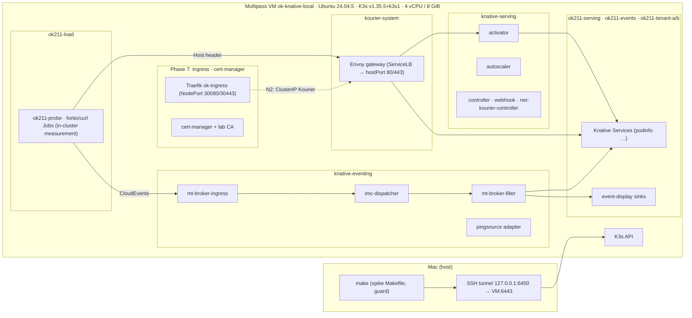

Source of truth is the repo: `architecture/spikes/OK-211-knative-serverless/` at commit `7e5aae0`.

# OK-211 — Knative as Optional Serverless & Event-Driven Capability — Spike Report

*Suggested Confluence title as above, space `OpenKubes`. Ticket: [OK-211](https://kubernauts.atlassian.net/browse/OK-211). All measurements were taken 2026-10-30/31 on a dedicated lab VM. Every number in this report links to its evidence file.*

## 1. Summary

Knative Serving, Kourier and Eventing were installed at 1.23, upgraded to 1.24 under load, and tested across serving, eventing, networking, security, GitOps and operations. The tests ran on a single-node K3s VM that mirrors the ok-local profile.

- **Serving does what OpenKubes would want from a request-driven capability.** Scale-to-zero takes ≈ 95 s with defaults. Cold starts with a cached image take a median of 1.35 s. Autoscaling went from 0 to 6 pods in 9 s with zero errors over 1.1 M requests, and traffic split, tag routes and rollback by traffic work.
- **Eventing routes, filters, retries and dead-letters correctly.** On the in-memory channel it is not durable: a dispatcher restart lost every event in flight, although the producer was told.
- **The upgrade 1.23 → 1.24 ran with 0 HTTP errors.** Plain release manifests cannot be re-applied server-side, though: three narrow derivation rules were needed, and one runtime-owned field still drifts after every sync.
- **ADR-010 fits** with Kourier behind Traefik as the only entry point. The domain template must change, and TLS must move to the entry point.
- **Two findings weigh most outside Knative itself.** On K3s' embedded kube-router, NetworkPolicy did not cover pods created after the policy for at least 10 minutes, and every cold start creates such a pod. Separately, Knative's idle footprint is small in usage but large in scheduling reservations (1750m CPU).

**Proposed recommendation: CONDITIONAL GO**, to draft an ADR for an opt-in request-driven-workload and event-routing capability, with Knative as the first Implementation Profile in the `datacenter` envelope. The conditions are listed in §17. This is not a rollout and not an implementation commitment.

## 2. Context and question

- **OK-211** asks whether Knative is a viable *optional* serverless and event-driven capability for OpenKubes. "Optional" means an opt-in, GitOps-managed platform capability that does not change the core platform or the Console.
- ADR-015 names Knative as a candidate for a separate *Application Delivery* capability ("Knative, kpack/Buildpacks, ArgoCD + templates").
- ADR-001 sets the frame: OpenKubes owns the contract, and Knative could at most be an Implementation Profile.

## 3. Setup



*`diagrams/architecture.svg`: **PENDING**. Exporting it needs mermaid-cli, which may only be installed after approval (BRIEF Phase 11.4). The Mermaid source above renders in Confluence and GitHub.*

| Component | Version / pin | Evidence |
|---|---|---|
| Multipass | 1.16.4+mac, driver qemu | [00](evidence/00-preflight.md) |
| VM image | Ubuntu 24.04.5 LTS, kernel 6.8.0-147 | [01](evidence/01-vm-k3s.md) |
| K3s | `v1.35.5+k3s1` (install script sha256 pinned), `--disable=traefik` | [01](evidence/01-vm-k3s.md) |
| kubectl | `v1.35.10` (sha256 pinned) | [00](evidence/00-preflight.md) |
| Knative Serving / net-kourier | `knative-v1.23.0` → `knative-v1.24.0` | [02](evidence/02-knative-install.md), [03](evidence/03-upgrade.md) |
| Knative Eventing | `knative-v1.23.1` → `knative-v1.24.0` | same |
| Kourier gateway (Envoy) | tag `v1.37-latest`, digest-checked `sha256:7765ad61…72a4` (= v1.37.11) | [02](evidence/02-knative-install.md) |
| cert-manager | `v1.21.3` (manifest sha256 pinned) | [06](evidence/06-networking-tls.md) |
| Traefik | chart `42.1.3` (sha256 = repo index digest), image `v3.7.16@sha256:1336e85a…` | [06](evidence/06-networking-tls.md) |
| Workloads | podinfo 6.16.0 / 6.17.0, fortio 1.76.0, curl 8.23.0, event_display (all by digest) | [versions.env](versions.env) |

Every pin is in [versions.env](versions.env). Release manifests are checksum-verified before every apply.

**Deviations from ok-local** (see [README.md](README.md#deviations-from-ok-local)):

- versioned K3s install script instead of `get.k3s.io`;
- isolated SSH options;
- tunnel port 6450 with a control socket;
- one VM instead of ok-local's VMs. The ok-local VMs were not touched.

## 4. Architecture and integration options

See [09 §10.1–10.2](evidence/09-architecture-assessment.md). Two product-neutral capabilities, each with its own contract:

- **Request-driven workloads:** an app reachable as `<app>.<cluster>.internal`, scale on concurrency (to zero opt-in), bounded requests (≤ 600 s by default), immutable revisions with traffic split, cluster-local option, PSA `restricted`, namespace-scoped rights.
- **Event routing:** CloudEvents in binary and structured mode, attribute filters, retries with a dead-letter destination, a schedule source, delivery to request-driven workloads including from zero. Durability is explicitly *not* part of it; it belongs to ok-messaging (ADR-029).

Knative is the Implementation Profile behind both, ideally behind a claim layer (Crossplane XRD or template), so that Knative's CRDs and webhook defaults (G2) do not become contract terms.

Dependencies of the profile:

- a networking layer: Kourier, or Gateway API via `net-gateway-api` (beta);
- the ADR-010 entry point, with a domain template so hosts match `<app>.<cluster>.internal` (N2b);
- cert-manager if TLS is per route (N3);
- one wildcard DNS name per cluster domain;
- a channel or broker implementation per envelope: InMemoryChannel is best effort; durable options are Kafka, NATS or RabbitMQ from `knative-extensions`, all released at 1.24.0.

## 5. Alternatives

Full table with sources: [09 §10.5](evidence/09-architecture-assessment.md#105-alternatives-ac1). In short:

| Option | Scale-to-zero (HTTP) | Event routing | Status | ADR-001 fit |
|---|---|---|---|---|
| Knative | yes (measured) | yes (measured) | CNCF Graduated | profile behind a claim |
| Knative with the HPA class (`serving-hpa.yaml`) | no (KPA only) | as Knative | as Knative | revisions without scale-to-zero |
| KEDA + HTTP add-on | yes; add-on beta | no | KEDA Graduated | good for scaling only |
| Deployment + HPA | object/external metrics only; `HPAScaleToZero` Beta from K8s 1.37 (ok-local runs 1.35) | no | core | most neutral, no HTTP buffering |
| OpenFaaS | Pro only | NATS async (CE) | not CNCF; CE not for commercial use | poor |
| Fission | yes | HTTP/MQ/timer triggers | not CNCF | own model would leak |
| Dapr | no (hosting layer) | pub/sub, bindings (sidecar) | Graduated | eventing profile at most |
| Argo Events | not stated | yes (EventBus) | part of Argo (Graduated) | routing only |
| ok-messaging clients | n/a | broker-native | platform contract | reference for durable flows |

## 6. Serving results

[04-serving.md](evidence/04-serving.md). All measured in-cluster. Percentiles are nearest-rank (fortio's histogram for S5/S6).

| ID | Result |
|---|---|
| S1 | ksvc → Configuration, Revision, Route, PodAutoscaler, ServerlessService, KIngress (owner chain); `200` |
| S2 | scale-to-zero with defaults: `desiredScale` 0 after **61–62 s**, pod gone after **94–97 s** (n = 3; stable-window 60 s + ≈ 33 s drain) |
| S3 | cold start, cached image: min **1028**, median **1347**, p90 **1981**, max **2108 ms** (n = 10, 0 errors) |
| S4 | cold start, image removed from the node: **7.2 / 7.9 / 9.1 s**, of which the pull is 5.7–6.8 s (**73–79 %**, 34 MB) |
| S5 | warm latency at 10 qps: p50 **1.89**, p90 **2.99**, p99 **5.0 ms** |
| S6 | target 10, 50 connections, 60 s: **0 → 6 pods in 9 s**, panic mode for one stable window, **1 112 313 × `200`**, back to 0 (6 pods instead of the expected ≈ 8, not explained) |
| S7 | `min-scale: 1`: no cold start, median **2 ms** |
| S8 | 80/20 split measured **78/22**; tag URL only the new revision; rollback by traffic, **no new revision**. Finding: named templates need `successThreshold: 1` for server-side re-apply |
| S9 | `timeoutSeconds: 20` → **`504` after 20.0 s**; defaults 300 s, ceiling 600 s |
| S10 | idle: Knative **32m CPU / 291 Mi** used, **1750m / 1338 Mi requested**; queue-proxy 1m / 6 Mi per pod (25m requested) |

## 7. Eventing results

[05-eventing.md](evidence/05-eventing.md). MT broker on InMemoryChannel.

| ID | Result |
|---|---|
| E1 | 20/20 delivered, binary and structured mode, median **5 ms** |
| E2 | trigger to a scaled-to-zero ksvc: 5/5 delivered, **758 / 1323 / 1722 ms** including the cold start |
| E3 | type and source filters: each sink got only its 5 events |
| E4 | **4 attempts** (1 + 3, exponential 0.5/1/2 s), then the dead-letter sink with `knativeerrorcode=500`, `knativeerrordest`, `knativeerrordata` |
| E5 | 100 events while the sink was down. Force-deleting `imc-dispatcher`: **48 lost**. `rollout restart`: **52 lost**. Force-deleting `mt-broker-ingress`: **60 not accepted**. Control without disruption: **100/100**. **0 lost after a `202`**: the producer got an error for every lost event |
| E6 | PingSource: 15/15 cycles, 0 duplicates |
| E7 | no ordering guarantee (retries reorder, even in the control run); no duplicates observed; **at-most-once** on the broker side, at-least-once only with producer retries |
| E8 | the recorded OK-167 zot event is routed by `type=zotregistry.image.updated`; this does not close OK-167 K1 |

The broker answers `202` only after delivery or final failure (E2, E4). Producer latency therefore includes retries. Durability needs a different backend, which makes Eventing a consumer of ok-messaging (ADR-029).

## 8. Networking, ingress and TLS

[06-networking-tls.md](evidence/06-networking-tls.md).

| ID | Result |
|---|---|
| N1 | Kourier's release LoadBalancer takes hostPorts 80/443 via ServiceLB; a second LoadBalancer stays `Pending`. That is a second entry point next to ADR-010's |
| N2 | Traefik as ADR-010 profile v1 (`ok-ingress`, NodePort 30080/30443) → ClusterIP Kourier: **`200` through one entry point**, +0.6 ms p50 warm, not measurable on cold starts. **N2b:** `domain-template {{.Name}}-{{.Namespace}}.{{.Domain}}` gives `<app>.<cluster>.internal` with one wildcard Ingress. The ClusterIP patch conflicts with a server-side release apply |
| N3 | cert-manager integration built into Serving 1.24; lab CA → per-route certificate, HTTPS `200` with a valid chain, curl exit 60 without the CA. Traefik presents its own default certificate, so TLS at Kourier is not TLS at the ADR-010 entry point |
| N4 | label `visibility: cluster-local`: external `404`, `svc.cluster.local` `200` |

## 9. Security, multi-tenancy, policy and observability

[07-security.md](evidence/07-security.md).

| ID | Result |
|---|---|
| X1 | PSA `restricted` works for a ksvc with a restrictive `securityContext` and a numeric UID. queue-proxy is compliant by itself. With `secure-pod-defaults: Enabled`, Knative adds everything but `runAsUser`. The Knative system namespaces have no PSA labels |
| X2 | namespace `edit` suffices (Knative roles aggregate into `edit`); no access to `config-*` or other namespaces. **No Eventing sender isolation without OIDC** |
| X3 | default deny isolated existing pods, but **pods created after the policy stayed reachable for ≥ 10 min** on K3s' kube-router. Every Knative cold start creates such a pod |
| X4 | 30 CRDs, 55 ClusterRoles (13 with `*`), 8 webhooks with `failurePolicy: Fail` including DELETE. With the Serving webhook down, **every Knative write is rejected** while the data path keeps serving |
| X5 | metrics are off by default (`none`). With `prometheus`, all components serve metrics **after a restart** (activator, autoscaler, controller, broker; queue-proxy on 9091) |
| X6 | cosign verifies the keyless signatures and SLSA v0.2 provenance (Prow) of two release images; a wrong identity fails |

## 10. GitOps lifecycle

[08-gitops.md](evidence/08-gitops.md).

| ID | Result |
|---|---|
| G1 | Everything re-applies without conflicts, given the derivation rules, and own manifests, cert-manager and Traefik diff clean. **`eventing-core` never diffs clean**: the ping controller rewrites `pingsource-mt-adapter`'s env (order, drops `POD_NAME`), so each release sync rolls the adapter twice |
| G2 | the webhook adds 8 fields and 2 annotations to a minimal ksvc; the server-side diff stays clean. Argo CD's Server-Side Diff is opt-in (`ServerSideDiff=true`) |
| G3 | NOT RUN (optional, first in the drop order) |
| G4 | Knative Operator `v1.24.0` appeared on 30 Oct. It would move order, jobs, rollback and most of the drift out of the GitOps diff, at the cost of an extra controller |

**Sync-wave proposal:**

| Wave | Content |
|---|---|
| −3 | CRDs |
| −2 | `serving-core`; wait for its webhooks |
| −1 | `kourier` and the `config-*` patches; `eventing-core`, IMC, broker; cert-manager and issuers |
| 0 | workloads |
| PostSync | post-install Jobs |

Argo CD also needs `ServerSideApply=true`, `ServerSideDiff=true`, and `ignoreDifferences` for the three runtime-owned field sets, the ping adapter env, and `kourier.spec.type` (if N2).

## 11. Relationship to Runner, Crossplane and Agentic Operations; limits for long-running and GPU-heavy AI workloads

[09 §10.3–10.4](evidence/09-architecture-assessment.md).

Where Knative complements the platform:

- a Crossplane claim can compose a `ksvc`;
- event-driven, scale-to-zero agent workers (E2–E4);
- routing of zot image-update events (E8).

It does **not** touch the Contract Executor and the approval chain (ADR-030/035), or the runner (ADR-004).

For AI workloads:

- Synchronous requests end at 600 s by default (S9), so long jobs belong in Jobs or async flows.
- Cold starts are dominated by image pulls (S4). **Estimate:** a 10 GB image takes ≈ 80 s at 1 Gbit/s, or ≈ 30 min at this lab's ≈ 5 MB/s. Scale-to-zero for large models therefore needs pre-pulled images.
- GPUs are plain resource requests (not tested). `min-scale: 1` keeps a whole GPU busy.
- KServe defaults to its Knative mode. Its documented matrix stops at Knative 1.20, so **support for 1.24 is unverified**. Without Knative, KServe has no HTTP scale-from-zero.

## 12. Operating costs, bare metal, upgrades and rollback

[03-upgrade.md](evidence/03-upgrade.md), [04 S10](evidence/04-serving.md), [09 §10.6](evidence/09-architecture-assessment.md).

**Footprint:** 15 Deployments plus a StatefulSet (Serving, Kourier, Eventing). Idle use is 32m / 291 Mi, the reservation 1750m / 1338 Mi.

**Release cadence:** quarterly (January, April, July, October), EOL at the release of n+2 (≈ 6 months). Upgrades go one minor at a time, which means **4 upgrades per year** to stay supported.

**Upgrade 1.23 → 1.24 under load (run 3):**

- 99 s window;
- **0 / 476** HTTP errors (max 7.2 ms), 0 errors in the 5 min after-run;
- **389 / 389** accepted events delivered, 1 send refused during the broker-ingress swap.

Runs 1 and 2 stopped at server-side-apply conflicts, which the three derivation rules resolved (CP3 decisions B, B2, B3). `make knative-dry-run` found the third conflict and two script defects before run 3.

**Rollback:** the YAML path has no documented downgrade; the Operator uses `spec.version`. In the lab a VM snapshot restore took ≈ 2 min. After every restart there were **40–80 s of `503`** although all deployments were Available (3 observations).

**Bare metal:**

- Behind `ok-ingress` a NodePort is enough, so no MetalLB is needed.
- DNS: one wildcard per cluster with the N2b template.
- Certificates: per route at Kourier, or one wildcard at the entry point (§17 condition 2).

**Air gap:** every image is referenced by digest and signed (X6). There is no official mirroring procedure for YAML installs; the Operator has `spec.registry`.

## 13. ADR fit matrix

| ADR | Fit | Reason |
|---|---|---|
| ADR-001 contracts, not components | **fits** | two product-neutral contracts; Knative as Implementation Profile (09 §10.1) |
| ADR-004 runner | **fits (not touched)** | Knative runs workloads, not platform operations |
| ADR-010 ingress | **fits with condition** | single entry point via Traefik works (N2); conditions: domain template (N2b), declarative ClusterIP Kourier (SSA), TLS at the entry point (N3) |
| ADR-011 GitOps | **fits with condition** | declarative with derivation rules; server-side diff; perpetual ping adapter drift needs `ignoreDifferences` or a fourth rule (G1/G2) |
| ADR-015 agentic AI | **fits** | named candidate for Application Delivery; event-driven agent workers (10.3) |
| ADR-017 envelopes | **fits `datacenter`; `constrained-edge` open** | 1750m CPU reservation, registry-dependent cold starts (S4, S10) |
| ADR-018 observability | **fits with condition** | Prometheus endpoints after configuration and restart (X5) |
| ADR-028 artifact registry | **fits** | digest-pinned, signed images; mirroring by host rewrite (X6, 10.2) |
| ADR-029 ok-messaging | **fits as a consumer, with condition** | in-memory is not durable (E5); a durable path needs the Kafka (or NATS/RabbitMQ) backend, and ADR-029's `durable-stream-v1` is only a candidate; no MQTT integration exists |
| ADR-030 control-plane execution | **fits (not touched)** | no Contract Executor role |
| ADR-035 hybrid intent | **fits (not touched)** | approval chain unchanged; a ksvc is at most a client |

## 14. Findings

| # | Severity | Finding | Evidence | Meaning for OpenKubes |
|---|---|---|---|---|
| F1 | high | Re-applying the unmodified release YAMLs server-side conflicts with fields that controllers own at runtime: Serving webhook rules, aggregated ClusterRole rules, `pingsource-mt-adapter` replicas/env. Three narrow, checked derivation rules resolve it without `--force-conflicts`; forcing #3 would stop every PingSource | [03](evidence/03-upgrade.md) | An install profile needs the rules (or Argo CD `ignoreDifferences`) and a dry run per release |
| F2 | high | On K3s' embedded kube-router, a default-deny NetworkPolicy did not cover pods created after it for ≥ 10 min | [07 X3](evidence/07-security.md) | NetworkPolicy is not a reliable tenant boundary for Knative on this profile; re-test on the target CNI |
| F3 | high | InMemoryChannel loses every event in flight on a dispatcher or ingress restart. The producer is told (`500` / cut connection), because the `202` only comes after delivery | [05 E5](evidence/05-eventing.md) | Durable flows need an ok-messaging backend; producers must retry and consumers must be idempotent |
| F4 | medium | Perpetual drift: the ping controller rewrites the adapter's env list; every release sync rolls it twice | [08 G1](evidence/08-gitops.md) | Argo CD with self-heal would flap the adapter; needs `ignoreDifferences` or a fourth rule |
| F5 | medium | Knative's cert-manager TLS terminates at Kourier; the ADR-010 entry point presents its own certificate | [06 N3](evidence/06-networking-tls.md) | Choose TLS at the entry point (wildcard) or a Gateway API layer |
| F6 | medium | Kourier's default `LoadBalancer` is a second entry point, and patching it to `ClusterIP` conflicts with the server-side release apply | [06 N1/N2](evidence/06-networking-tls.md) | The profile must own `kourier.spec.type` (overlay or rule) |
| F7 | medium | The single-replica Serving webhook (`Fail`) gates every Knative write, including deletes and controller status updates | [07 X4](evidence/07-security.md) | Run ≥ 2 webhook replicas or accept write outages |
| F8 | medium | Idle reservation 1750m CPU / 1338 Mi (44 % of a 4-CPU node) despite 32m / 291 Mi usage | [04 S10](evidence/04-serving.md) | Small clusters and `constrained-edge` need tuned requests |
| F9 | medium | 40–80 s of `503` after a node restart while every deployment is Available (stale activator endpoints) | [02](evidence/02-knative-install.md), [03 U3](evidence/03-upgrade.md) | Readiness of the data path ≠ readiness of the deployments; affects maintenance windows |
| F10 | low | The single-replica broker ingress refuses connections for ≈ 1 s during its rollout | [03 U2](evidence/03-upgrade.md) | Producers need retries; consider 2 replicas |
| F11 | low | Server-side re-apply of a ksvc with a named revision fails unless `readinessProbe.successThreshold: 1` is in the manifest | [04 S8](evidence/04-serving.md) | GitOps manifests must state it |
| F12 | low | Metrics protocol changes need a component restart | [07 X5](evidence/07-security.md) | The install target must restart after setting Provider Values |
| F13 | low | Knative system namespaces carry no Pod Security labels; 13 ClusterRoles have `*` rules | [07 X1/X4](evidence/07-security.md) | Add PSA labels in the profile; review RBAC scope |
| F14 | low | No Eventing sender isolation without OIDC (`allow-same-namespace` needs authenticated senders) | [07 X2](evidence/07-security.md), [05](evidence/05-eventing.md) | Multi-tenant eventing needs `authentication-oidc` (not tested) |
| F15 | low | Autoscaling reached 6 pods where ≈ 8 were expected | [04 S6](evidence/04-serving.md) | Tune or re-measure on multi-node clusters |

## 15. Risks

| Risk | Likelihood / impact | Mitigation |
|---|---|---|
| Four minor upgrades per year, each possibly bringing a new runtime-owned field (F1, F4) | high / medium | `knative-dry-run` per release; evaluate the Operator (G4) |
| Tenants assume NetworkPolicy isolation that the CNI does not deliver for new pods (F2) | medium / high | re-test X3 on the target CNI before offering multi-tenant Knative |
| Event loss on the in-memory channel if used in production (F3) | high (if used) / high | no InMemoryChannel outside dev; durable backend via ADR-029 |
| TLS and entry-point mismatch leads to double termination or a second entry point (F5, F6) | medium / medium | decide TLS at Traefik or Gateway API in the ADR |
| KServe compatibility with current Knative unverified | medium / medium | test KServe on 1.24 before promising AI inference |
| Release lag of the Operator, if chosen | low / low | pin and test as for YAML |

## 16. Effort estimate

T-shirt sizes and person-day ranges are **estimates** by the spike author, assuming the lab results carry over to `datacenter` clusters (RKE2/Talos) and one engineer familiar with the platform.

| # | Work package | Size | Person-days | Assumptions / dependencies |
|---|---|---|---|---|
| WP1 | ADR draft with product-neutral contracts (request-driven workloads, event routing) | M | 3–5 | 09 §10.1 as the starting point; three-way review |
| WP2 | Opt-in install target with pinned, checked manifests (`make install-serverless`), derivation rules, dry run | M | 3–5 | reuse `knative.sh`/`knative-dry-run`; decide YAML vs Operator first |
| WP3 | GitOps packaging: Argo CD Applications, sync waves, Server-Side Diff, `ignoreDifferences` (F1, F4) | M–L | 5–8 | includes the open G3; Argo CD per ADR-011 |
| WP4 | ADR-010 integration: Kourier `ClusterIP` behind `ok-ingress` + domain template, or a `net-gateway-api` evaluation | M | 3–6 | Traefik profile v1; RKE2 host proxy not yet tested |
| WP5 | TLS with cert-manager at the entry point (wildcard) | S–M | 2–4 | issuer per envelope; DNS-01 if public |
| WP6 | Durable eventing (Kafka/NATS/RabbitMQ broker) | L | 8–15 | **depends on the ADR-029 broker choice**; not before a forcing consumer |
| WP7 | Observability per ADR-018 (Prometheus scrape, restart step, dashboards) | S | 1–3 | ADR-018 v1 stack present |
| WP8 | Air gap: mirror images and manifests into `registry-default` | S–M | 2–4 | digest rewrite; zot per ADR-028 |
| WP9 | Tests (smoke, upgrade, the contract-test subset) and upgrade runbook | M | 4–6 | reuse the spike's make targets |
| WP10 | Documentation and tutorial | S | 2–3 | — |
| | **Total** | | **33–59** | **25–44 without WP6** |

Not included: the X3 re-test on the target CNI (proposed follow-up, S, 1–2 days) and KServe validation (M).

## 17. Recommendation

Criteria as fixed in the brief (B13), applied unchanged:

| ID | Criterion | Result | Evidence |
|---|---|---|---|
| M1 | Serving on the ok-local profile: S1, S2, S3, S6, S8 | **met** | §6 |
| M2 | Eventing E1–E4 passed; E5 honestly evaluated | **met** | §7 |
| M3 | Upgrade purely declarative (manifests plus documented post-install Jobs), no manual intervention in resources; no U1 errors after the upgrade; error rate measured and ≤ 1 % | **met**, with F1: run 3 had 0 % errors (0/476) and 0 after-run errors, declaratively. It used derived manifests: three documented rules, decided at CP3, no `--force-conflicts`, no manual edits of resources. With the unmodified release YAMLs and server-side apply, the upgrade fails | §12, [03](evidence/03-upgrade.md) |
| M4 | ADR-010: N2 passed, or a concrete single-entry-point path | **met** (N2) | §8 |
| M5 | Tenant workloads under PSA `restricted` (X1); tenants with namespace rights (X2) | **met** | §9 |
| M6 | A product-neutral capability cut; Knative remains an Implementation Profile | **met** | §4 |
| K1 | Cold start, cached image, median ≤ 5 s | **met**: 1347 ms | S3 |
| K2 | A durable eventing path compatible with ADR-029 (documentation level) | **partly met**: the Knative Kafka/NATS/RabbitMQ backends are active at 1.24.0, but ADR-029's matching `durable-stream-v1` profile is only a candidate, and no MQTT integration exists | 09 §10.2 |
| K3 | TLS via cert-manager works | **met** (N3), at Kourier; see F5 for the ADR-010 placement | §8 |
| K4 | Idle use of all Knative system components ≤ 1 GiB RAM and ≤ 0.5 vCPU (`datacenter`) | **met**: 291 Mi, 32m (usage). Requests are 1750m / 1338 Mi (F8) | S10 |
| K5 | No unresolved GitOps drift with server-side diff | **not met**: perpetual `pingsource-mt-adapter` drift (F4); G3 not run | §10 |

**Proposed result: CONDITIONAL GO.** All must criteria are met, and K5 (plus K2 in part) is not. In scope: draft an ADR for an **opt-in** request-driven-workload and event-routing capability, with Knative as the candidate first Implementation Profile in the `datacenter` envelope. Conditions, each a proposed follow-up:

1. Resolve the GitOps drift (F4) and decide how runtime-owned fields are handled (F1): derivation rules vs Argo CD `ignoreDifferences` vs the Knative Operator (G4). Close G3.
2. Decide TLS placement and the entry point for ADR-010 (F5, F6): Kourier `ClusterIP` + Traefik with a wildcard certificate, or `net-gateway-api`.
3. Re-test NetworkPolicy isolation of new pods on the target CNI (F2) before multi-tenant use.
4. Keep Eventing durability out of the first profile: InMemoryChannel for dev only, a durable backend only together with an accepted ADR-029 profile (F3, K2).
5. Measure KServe on the chosen Knative version before any AI-inference promise.

Gawenda and Arash decide in the three-way review. This proposal is not a decision.

## 18. Proposed follow-ups

Suggestions only; no tickets were created.

| Title | Reason | Size |
|---|---|---|
| ADR draft: request-driven workloads and event routing capabilities | CONDITIONAL GO scope (WP1) | M |
| Knative GitOps profile: Operator vs YAML with derivation rules, Argo CD Server-Side Diff (G3) | F1, F4, K5 | M |
| NetworkPolicy and new pods: kube-router vs Cilium on ok-infra/ok-ai | F2 | S |
| Knative behind `ok-ingress` with TLS at the entry point, or `net-gateway-api` | F5, F6 | M |
| KServe on Knative 1.24: compatibility and cold start of a real model image | 10.4 | M |
| Durable Knative Eventing on an ok-messaging Kafka profile | F3, K2; only with a forcing consumer | L |
| OK-167 K1: subscriber that turns `zotregistry.image.updated` into an Argo CD refresh | E8 | S |

## 19. Reproduction

From zero to teardown, all through the spike Makefile (`make -C architecture/spikes/OK-211-knative-serverless <target>`).

**Setup and Phase 4:**

```bash
make preflight kubectl-pin                      # read-only checks; kubectl v1.35.10 into .local/bin
make test-guard lint scan-secrets
make install                                    # vm-up k3s-install kubeconfig tunnel baseline manifests-fetch (1.23, 1.24) knative-install 1.23 knative-verify
make probe-up apps-serving smoke
make down vm-snapshot NAME=knative-1-23 vm-start tunnel     # optional, for U3
make apps-upgrade apps-upgrade-events
make knative-dry-run TO=1.24 && make knative-upgrade TO=1.24
make upgrade-collect                            # after 5 min; U1/U2 into evidence/raw/measurements.json
make apps-upgrade-down
```

**Phase 5:**

```bash
make measure-s1 measure-scale-to-zero apps-serving-fastdown
make measure-coldstart ID=S3 KSVC=podinfo N=10
make measure-coldstart ID=S4 KSVC=podinfo N=3
make measure-latency apps-serving-exp measure-autoscale
make measure-coldstart ID=S7 KSVC=podinfo-min1 N=10
make exp-s8 exp-s9 measure-overhead apps-serving-down
```

**Phase 6:**

```bash
make apps-eventing
make measure-events TEST=e1                     # likewise e2, e3, e4, e6, e8
make exp-E5 SCENARIO=dispatcher                 # likewise ingress, restart, none
```

**Phase 7:**

```bash
make exp-N1 exp-N4 ingress-render ingress-install kourier-clusterip ingress-route
make exp-N2b exp-N2b-restore
make tls-install tls-enable tls-disable exp-N2-restore
```

**Phases 8 and 9:**

```bash
make exp-X1 exp-X1-plain exp-X2 exp-X3 exp-X3-samepod footprint exp-X6
make exp-X5 RESTART=1
make exp-X4                                     # last: webhook to 0 and back
make diff LABEL=before gitops-reapply diff LABEL=after exp-G2
```

**Teardown:**

```bash
make down                                       # stop tunnel and VM, keep it
make clean CONFIRM=yes                          # delete the VM and its local state
```

### Hurdles and gotchas

**Downloads and the network:**

- Downloads from `dl.k8s.io` and the Multipass image ran at ≈ 150 KB/s, so `kubectl-pin` resumes with `curl -C -`.
- `lsof` exits 1 when a port is free. Under `set -e -o pipefail` that aborted `make tunnel` silently.

**Server-side apply:**

- Server-side apply of Knative release YAMLs conflicts on runtime-owned fields (F1). Never "fix" it with `--force-conflicts`: rule 3 would stop every PingSource.
- `kubectl diff` reports several fields of one object as "conflicts with …", not "conflict with". The first dry-run parser missed one conflict because of it.

**yq, jq and bash 3.2:**

- `yq -N` drops document separators, which merged objects. `yq` without `ea` evaluates per document.
- macOS bash 3.2 brace-expands `{a, b}` inside double quotes in nested `$(...)`. jq programs belong in single-quoted variables.
- `render.sh` appends `---`, so `yq` then sees two documents.
- `grep -v` on empty input ends a pipe with exit 1 under `pipefail`.
- Editing a script while bash runs it breaks the run.

**Measurement tooling:**

- fortio writes a stderr line into its JSON on `kubectl logs`.
- 64 Mi was too little for 100 concurrent curls (OOMKilled).

**Behaviour that looked like a bug:**

- With MT broker + InMemoryChannel, a `202` means "delivered". Producers must allow long requests (E2/E4/E5).
- Default-deny NetworkPolicy appeared to work and did not, for new pods (F2).
- Knative components need a restart after a metrics protocol change (F12).

## 20. What this proves / What this does not prove

| Proves | Does not prove |
|---|---|
| Knative 1.24 Serving and Eventing work as specified on the ok-local K3s profile, with measured scale-to-zero, cold starts, autoscaling, revisions, timeouts, filters, retries and dead-letter sinks | Behaviour on multi-node RKE2/Talos clusters, at scale, or under production traffic |
| A 1.23 → 1.24 upgrade under load keeps a `min-scale: 1` service fully available, declaratively, with three derivation rules | That the rules suffice for later releases, or behaviour for scaled-to-zero services during an upgrade |
| Knative fits behind ADR-010 profile v1 as one route, with a host schema matching `<app>.<cluster>.internal` | TLS at the entry point for Knative hosts, or behaviour behind the RKE2 host proxy |
| The in-memory channel is not durable, and the producer learns about each loss | Durability of Kafka/NATS/RabbitMQ backends (not installed) |
| Tenants need only namespace rights; PSA `restricted` works with explicit security contexts | Eventing authorization with OIDC; NetworkPolicy on other CNIs |
| The release can be re-applied declaratively, and ksvc defaulting does not show in server-side diffs | That Argo CD keeps a Knative Application `Synced` (G3 not run) |
| A product-neutral two-contract cut is possible, and alternatives cover parts of it | Any measured comparison with the alternatives |

## 21. References

**Evidence:**

- [00-preflight](evidence/00-preflight.md), [01-vm-k3s](evidence/01-vm-k3s.md), [02-knative-install](evidence/02-knative-install.md)
- [03-upgrade](evidence/03-upgrade.md), [04-serving](evidence/04-serving.md), [05-eventing](evidence/05-eventing.md)
- [06-networking-tls](evidence/06-networking-tls.md), [07-security](evidence/07-security.md), [08-gitops](evidence/08-gitops.md)
- [09-architecture-assessment](evidence/09-architecture-assessment.md)
- Raw data: [evidence/raw/](evidence/raw/), series in [measurements.json](evidence/raw/measurements.json)

**ADRs:** 001, 004, 010, 011, 015, 017, 018, 028, 029, 030, 035 in [architecture/decisions/](../../decisions/)

**Knative docs (read 2026-10-30/31):**

- [upgrade](https://knative.dev/docs/install/upgrade/), [upgrade with kubectl](https://knative.dev/docs/install/upgrade/upgrade-installation/), [Operator upgrade/rollback](https://knative.dev/docs/install/upgrade/upgrade-installation-with-operator/)
- [external-domain TLS](https://knative.dev/docs/serving/encryption/external-domain-tls/), [cert-manager integration](https://knative.dev/docs/serving/encryption/configure-certmanager-integration/)
- [available channels](https://knative.dev/docs/eventing/channels/channels-crds/), [broker types](https://knative.dev/docs/eventing/brokers/broker-types/)
- [install Serving with YAML](https://knative.dev/docs/install/yaml-install/serving/install-serving-with-yaml/), [config-defaults](https://knative.dev/docs/serving/configuration/config-defaults/)
- [verifying images](https://knative.dev/docs/reference/security/verifying-images/), [release schedule](https://github.com/knative/community/blob/main/mechanics/RELEASE-SCHEDULE.md)

**Other:**

- [Argo CD diff strategies](https://argo-cd.readthedocs.io/en/stable/user-guide/diff-strategies/)
- [KServe Kubernetes deployment](https://kserve.github.io/website/docs/admin-guide/kubernetes-deployment)
- [Kubernetes HPA](https://kubernetes.io/docs/concepts/workloads/autoscaling/horizontal-pod-autoscale/)
- the alternatives' docs as listed in 09 §10.5
- OK-167 evidence: `cloudevent-image-updated.json` at commit `95e176d`
