# Agentic Operations Hands-on Lab: AI Thinks. OpenKubes Executes. Evidence Proves.

**W-JAX 2026 · A local Kubernetes recovery lab for developers**

A Deployment configured with zero desired replicas can be correctly reconciled at `0/0`; this does not necessarily indicate a Kubernetes failure. In this educational lab, **two replicas are the predefined expectation**. Start with two nginx replicas, deliberately scale to zero, then use a local model to help investigate and propose a repair—with policy, human approval and Kubernetes observations deciding what happens next.

You will build and inspect the whole path yourself. The interesting moment is not when the model says “fixed.” It is when you can show what was approved, what ran and what Kubernetes actually reports.

<figure aria-label="OpenKubes mascot animation" style="margin: 1.5rem 0;">
  <div style="aspect-ratio: 16 / 9; width: 100%; background: #082c66;">
    
  </div>
  <figcaption id="wjax-mascot-description">The OpenKubes OK mascot hops beside platform icons. This decorative animation has no audio or lab instructions. Use the visible playback controls to pause or replay; with reduced motion enabled, press Play to start.</figcaption>
</figure>

<template id="wjax-mascot-player">
  <video controls muted playsinline loop autoplay preload="none" poster="/ai/assets/wjax-2026/ok-mascot-hop.jpg" width="1672" height="942" aria-label="OpenKubes OK mascot hopping animation" aria-describedby="wjax-mascot-description" style="display: block; width: 100%; height: 100%; object-fit: contain;">
    <source src="/ai/assets/wjax-2026/ok-mascot-hop.mp4" type="video/mp4">
    Your browser does not support HTML5 video. <a href="/ai/assets/wjax-2026/ok-mascot-hop.mp4">Watch or download the OpenKubes mascot animation (MP4).</a>
  </video>
</template>
<script>
(function () {
  var poster = document.getElementById("wjax-mascot-poster");
  var template = document.getElementById("wjax-mascot-player");
  if (!poster || !template || !template.content) return;
  var motion = window.matchMedia ? window.matchMedia("(prefers-reduced-motion: reduce)") : null;
  var video = template.content.querySelector("video").cloneNode(true);
  video.muted = true;
  // The template is inert: disable autoplay BEFORE inserting a reduced-motion player.
  if (!motion || motion.matches) video.removeAttribute("autoplay");
  poster.replaceWith(video);
  if (motion) {
    var stopForReducedMotion = function () {
      if (motion.matches) {
        video.removeAttribute("autoplay");
        video.pause();
      }
    };
    if (motion.addEventListener) motion.addEventListener("change", stopForReducedMotion);
    else if (motion.addListener) motion.addListener(stopForReducedMotion);
  }
})();
</script>

[Watch or download the mascot animation (MP4)](/ai/assets/wjax-2026/ok-mascot-hop.mp4). If scripting or video playback is unavailable, the static poster above remains a visual fallback.

**[Start the complete hands-on tutorial](https://github.com/openkubes/ok-console/blob/main/demos/wjax-2026/TUTORIAL.md)** · **[Explore the lab implementation](https://github.com/openkubes/ok-console/tree/main/demos/wjax-2026)**

!!! info "Local educational demonstration"

    This lab demonstrates a human-governed recovery workflow on a disposable kind cluster. It is not a production-ready autonomous remediation system or proof that the full OpenKubes Agentic Operations reference architecture is implemented.

## What you will learn

- Distinguish reconciliation of the configured replica count from the lab’s predefined expectation of two replicas: `0/0` can correctly satisfy a zero-replica spec.
- Investigate through a separate read-only identity, and distinguish observed facts from an advisory model assessment.
- Review an untrusted, structured operation proposal against deterministic policy before approving its exact digest.
- Inspect the Executor's positive and negative RBAC checks, including the limits of namespace isolation.
- Verify recovery from Kubernetes UID, generation, replica and image observations rather than trusting a successful apply or an AI response.

## Beyond GitOps: From Desired State to Governed Operations

GitOps tools such as **Argo CD and Flux already provide declarative reconciliation** and can correct configuration drift when appropriately configured. For example, [Argo CD automated sync with self-healing](https://argo-cd.readthedocs.io/en/stable/user-guide/auto_sync/) can restore live state to the declared configuration, while [Flux Kustomizations](https://fluxcd.io/flux/components/kustomize/kustomizations/) periodically reconcile resources and correct drift. Recovering a declared replica count uses these established capabilities; it is not an OpenKubes innovation.

OpenKubes Agentic Operations **aims to complement GitOps** with contextual diagnostics, AI-assisted proposals, deterministic policy evaluation, human approval, bounded execution and independent verification. The production-oriented architecture is a direction for governed operations around existing reconciliation owners, not a delivered integration demonstrated by this lab.

In a GitOps-managed production environment, remediation should normally follow the **authorized GitOps workflow**—for example, reviewing and approving a change to the Git source of truth, then letting Argo CD or Flux reconcile it. Directly patching Git-managed resources can bypass that workflow and may be reverted by reconciliation. The lab’s direct apply is an educational path on its disposable cluster, not a production remediation pattern.

The implemented W-JAX demo uses a **local Python diagnostics provider**, a **manual assessment-to-proposal handoff**, a **demo executor** and **unsigned local JSONL evidence**. It illustrates selected boundaries; it does not implement the future production-oriented Agentic Operations architecture or the production OK-147 Lifecycle Executor.

## Before you start

Allow **45–60 minutes plus installation and image/model downloads**. Familiarity with a terminal, Git and basic Kubernetes Deployments is enough; no production cluster is needed.

| Requirement | Lab environment |
| --- | --- |
| Development environment covered by the guide | macOS 14 or later; Apple Silicon with native ARM Colima, or Docker Desktop. Intel Macs use the guide's architecture adjustment. |
| Local Kubernetes | Docker-compatible runtime, kind and kubectl; a disposable cluster named `wjax-demo` with context `kind-wjax-demo`. |
| Developer tools | Homebrew, Git, Python 3.10+, Node.js 22.12+ and pnpm 10.17.1, as specified by the tutorial. |
| Local AI | Ollama on the Mac host with `llama3.2:latest`; roughly 2 GB for the model download. |
| Resources | Space for Kubernetes/container images and memory for both the VM and Ollama; the Colima example assigns four CPUs and 6 GiB to the VM. |

The published walkthrough covers macOS. Linux and Windows/WSL are not documented as supported walkthroughs here. All lab HTTP services listen on loopback; keep the lab local.

### Start from main

```bash
git clone https://github.com/openkubes/ok-console.git
cd ok-console
git switch main
```

These commands obtain the lab from the maintained branch. Continue with the **[complete tutorial](https://github.com/openkubes/ok-console/blob/main/demos/wjax-2026/TUTORIAL.md)** for dependencies and every setup, approval and verification step. The Reader is included in this clone; no external Reader repository is required.

There is no automatic bootstrap. You explicitly create the kind cluster, namespace and initial Deployment, provision Reader and Executor permissions separately, start Ollama, and then launch the four local services: Console preview, Reader, Diagnostics and Agentic demo. Ollama is an additional prerequisite service. `make wjax-demo` launches the prepared stack; it does not provision the cluster.

## The architecture you will run



*Figure 1. Implemented local demo architecture. The assessment-to-proposal handoff is manual.*

The components make the trust boundaries visible:

| Component | Responsibility and boundary |
| --- | --- |
| Reader | Uses its own ServiceAccount to get/list pods and Deployments in `wjax-demo`. It cannot mutate workloads or read secrets, Events or logs. |
| Diagnostics | A local **Python provider, not kagent**. It consumes Reader snapshots and reports intent drift and unavailable evidence. It has no Kubernetes credentials or remediation capability. |
| Ollama | Produces an advisory assessment and, on a separate human request, a candidate proposal. Its output is untrusted; it receives no Executor credentials and cannot authorize a repair. |
| Policy and human gate | Trusted demo code checks an exact schema and allowlist. A person approves the exact candidate digest, then deliberately triggers a single execution attempt. Local browser approval is not enterprise IAM. |
| Demo Executor | Trusted Python code supplies a fixed nginx manifest and applies it with a separate, bounded ServiceAccount. This is **not the production OK-147 Lifecycle Executor**. |
| Recovery verifier | Performs read-only Kubernetes GETs with the demo Executor credential and correlates observations with the approved apply. It is independent of the model's claim and HTTP apply result, but shares the local demo trust boundary. |

The setup scripts compare the selected context's API endpoint and CA with kind's kubeconfig for the exact local cluster before provisioning identities. Credentials are temporary, exclusively created and protected by restrictive permissions. Existing credentials are preserved. This is a disposable-demo safety guard, not production cluster attestation. Setup may update its existing demo ServiceAccount, Role and RoleBinding through `kubectl apply`; it must never reset the application Deployment.

## From healthy workload to verified recovery


*Figure 2. Policy eligibility and human authorization are separate gates.*

1. **Establish `2/2`.** Create `wjax-nginx` in `wjax-demo` and observe two ready replicas. Run drift only in a fresh, disposable lab; leave an existing healthy rehearsal workload alone unless you deliberately choose a new exercise.
2. **Introduce `0/0` intent drift.** Explicitly scale to zero. Kubernetes can correctly reconcile that zero-replica spec. The difference is against the lab’s predefined expectation of two replicas; `0/0` alone does not establish a Kubernetes failure.
3. **Investigate read-only.** Request diagnostics. Expect `INTENT_DRIFT`, `MANUAL_REVIEW_REQUIRED` and `execution_allowed: false`; unavailable evidence stays unavailable.
4. **Ask Ollama for an advisory assessment.** The assessment may suggest human checks. It cannot authorize or execute anything, and it does not automatically launch a recovery proposal.
5. **Initiate a proposal separately.** Enter `Deploy nginx with two replicas to the demo cluster` in the demo UI. Ollama proposes a structured candidate; deterministic policy validates its fields and exact allowed operation.
6. **Approve, then execute.** Inspect the candidate and digest, click **Approve exact proposal**, then separately click **Execute authorized operation**. The bounded Executor submits the fixed manifest. `APPLY_SUBMITTED_NOT_READY` means submission only.
7. **Observe `2/2`, then verify.** Check rollout and Deployment readiness independently. Run `make wjax-demo-verify` to correlate approval/apply evidence with actual Kubernetes observations and record `READY_VERIFIED` when the checks pass.

The recovery path is **`0/0 → Ollama → Policy → Human Approval → Executor → 2/2 → READY_VERIFIED`**. Also try the tutorial's forbidden production request: policy must deny it without offering execution.

## What counts as evidence?



*Figure 3. An accepted apply is a checkpoint, not a readiness verdict.*

The verifier checks the Deployment UID, reconciled generation, two desired/ready/available replicas and expected `nginx:1.27.5-alpine` template image. A successful new verification appends `RECOVERY_VERIFIED` with result `READY_VERIFIED` to local JSONL evidence. If a successful terminal verification already exists for the latest apply, `ALREADY_VERIFIED` reports that historical record; it does not perform a fresh health check.

**Local JSONL evidence is not cryptographically signed or tamper-proof.** These checks establish observed Deployment readiness within the local demo, not HTTP application health, pod image-digest provenance or independently signed production attestation. Diagnostics uses current snapshots and pod-name matching rather than historical telemetry or owner-reference proof. Missing Events, logs, Cilium and host data must not become invented explanations.

## Understand the limits before extending it

The Executor can get/patch/update the named `wjax-nginx` Deployment and get/list pods. It can also **create Deployments anywhere within `wjax-demo`**: Kubernetes RBAC cannot constrain create by resource name. Patch/update permissions do not restrict which fields can change; the fixed manifest and exact allowlist are enforced by the trusted application. A stolen token has the broader permissions of its Role. The identities have no delete or secrets permissions, assuming no additional external bindings grant more access.

This lab does not implement production OK-147 lifecycle execution, signed grants, durable authorization claims, atomic desired-state acceptance, enterprise authentication or independently signed evidence. Read the [Agentic Operations reference architecture](../agentic-operations-reference-architecture.md) for those proposed responsibilities, and the [OK AI Agentic Operations overview](agentic-operations.md) for the wider context. For Kubernetes-native diagnostics work beyond this Python demo, see [kagent & Platform Diagnostics](kagent-platform-diagnostics.md).

## Try the lab, then inspect the code

**[Follow the complete tutorial on main](https://github.com/openkubes/ok-console/blob/main/demos/wjax-2026/TUTORIAL.md)** for commands, expected results, credential expiry and troubleshooting. **[Browse the implementation on main](https://github.com/openkubes/ok-console/tree/main/demos/wjax-2026)** to inspect the policy, separate identities and execution path.

Return to the [OK AI overview](index.md) or explore the [reference architecture](../agentic-operations-reference-architecture.md) after your first verified recovery.
