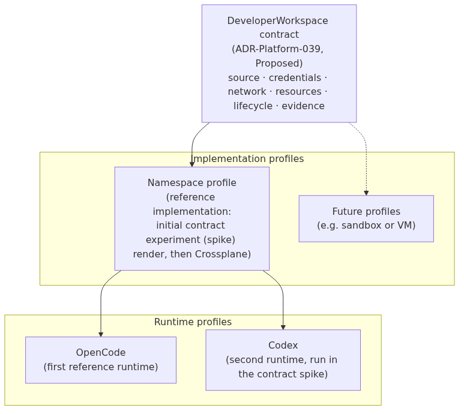
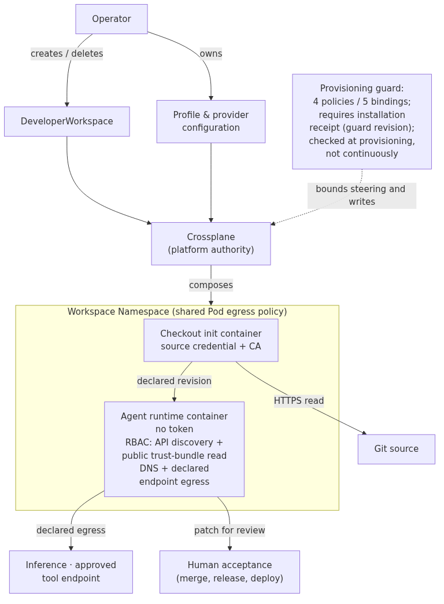
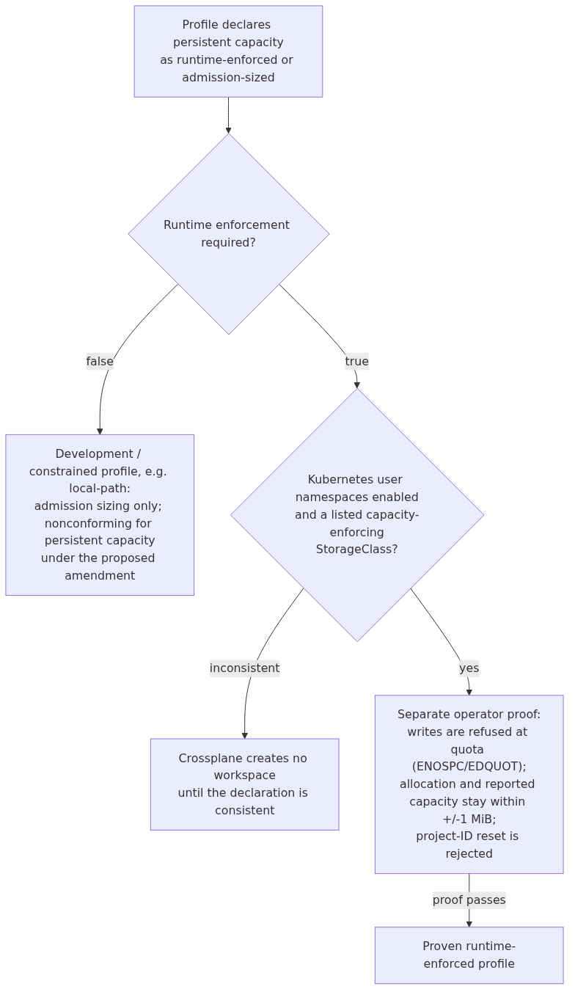

# Developer Workspaces: Bounded Authority for Coding Agents

*How the OpenKubes reference implementation turns a workspace contract into measured boundaries*

*By Suchit Thakkar*

> **Status:** ADR-Platform-039 is **Proposed**. The Crossplane reference implementation is merged on `main` and has been exercised only on disposable test clusters, after an initial contract experiment on a long-lived verification cluster. It is a reference implementation, not production-ready: there is no production offering, general availability or requester self-service.

Running a coding agent on Kubernetes is easy. A Deployment, an image and an API key are enough to start one. The interesting questions come next, and they are the ones an operator has to answer for: which repository the agent may read, which credentials it holds, where it may connect, how much it may write, and what happens to its work when the environment is gone.

A coding agent edits source, runs shell commands and calls external tools. Those are exactly the actions a platform wants to bound. The OpenKubes Developer Workspace states that boundary as a contract first, and then implements it.

The contract is [ADR-Platform-039](https://github.com/openkubes/openkubes/blob/main/architecture/decisions/ADR-Platform-039-developer-workspace-contract.md). This post describes its boundaries and the evidence gathered so far, distinguishing the initial contract experiment on a long-lived verification cluster from the later reconciler tests on disposable clusters.

> **Update — 2026-10-20:** On 2026-10-19 the architecture decision-holder recorded a [conditional GO to develop and test](https://github.com/openkubes/openkubes/blob/main/architecture/decisions/ADR-Platform-039-conditional-acceptance-record.md) against this contract. That approves the direction, not readiness: ADR-Platform-039 is still **Proposed, not Accepted**.
>
> [Nine readiness gates](https://github.com/openkubes/openkubes/blob/main/architecture/decisions/ADR-Platform-039-readiness-gates.md) must be met before the Namespace profile can be called fully conforming. They are listed in plain words on the [status page](https://openkubes.org/developer-workspace/status/). Declaring storage capacity is not proof of it: each storage backend needs its own runtime evidence, and the development `local-path` profile does not qualify. There is still no production offering.

## The contract: one declaration for the whole boundary

A `DeveloperWorkspace` describes a bounded execution environment for a developer, a coding agent, or both. It brings source, filesystem, identity, credentials, connectivity, resources, lifecycle and evidence into a single reviewable declaration:

- **Source** names a repository and a revision.
- **Inference** selects an approved model service.
- **Network access** is deny-by-default: declared capability endpoints are allowed, plus DNS through kube-dns when a capability names an in-cluster Service, as the shipped profiles do.
- **Kubernetes access** has no mounted ServiceAccount token; the effective RBAC scope is described below.

Two design choices shape everything else.

**Each workspace has its own identity.** The contract lets one developer run separate workspaces for implementation, review and short-lived tasks; the reference implementation currently gives every workspace on a cluster the same reviewed source, model and capability references, and only operators create them. Processes inside a workspace receive bounded credentials and network access. Effective Kubernetes role-based access control (RBAC) permits only API discovery, plus reading public certificate trust bundles (ClusterTrustBundle) for authenticated identities; the runtime has no mounted ServiceAccount token. The `approvedTools` field records intent but is not enforced at tool level: the current proof covers reachability of an approved Model Context Protocol (MCP) endpoint, a service through which agents access tools.

**Execution and acceptance are separate steps.** Inside the workspace an agent edits files, runs verification and produces a patch. Merging, releasing, deploying and changing platform state remain human and organisational decisions, taken outside the workspace.

Writing these rules into a contract makes the intended access reviewable. Network evidence has a stated boundary: Kubernetes API unreachability was sampled at `kubernetes.default.svc`; node and control-plane addresses were not probed.

## Contract, implementation profile, runtime profile

The contract is designed to stay stable while the implementation underneath it and the agent inside it change.

### The Namespace profile: the reference implementation

The reference implementation maps each workspace to a dedicated Kubernetes Namespace and composes a ServiceAccount, restrictive NetworkPolicies, a ResourceQuota and LimitRange, lifecycle-appropriate storage and the runtime Deployment.

Consumers depend on workspace semantics rather than on Namespace names, Pod topology or container layout. That leaves room for a sandbox or VM profile to implement the same contract with different mechanics later.

The profile provides Namespace-level isolation: workloads share the node kernel, and the profile trusts the cluster, nodes, network implementation, storage provisioner and reviewed runtime images. Within that trust model its policies restrict resources, credentials and connectivity. Stronger isolation for mutually untrusted tenants is the role of a future sandbox or VM profile.

### OpenCode and Codex: interchangeable runtimes

OpenCode is the first runtime because it exercises the demanding parts of the contract: source checkout, filesystem mutation, shell execution, inference, tools and verification. Its configuration and commands are runtime details that sit behind the workspace API.

To test that separation, the initial contract experiment (the “spike”) ran workspace documents that differed only in their runtime profile: OpenCode, then Codex, against the same volume. Each agent edited the source fixture and ran the declared verification command through its own shell tool, and the test driver (the “harness”) then ran the verification again independently.

Both runtimes worked against the reviewed workspace semantics with no change to the contract. The intended validation method for further agents and models is the same paired execution and independent verification; those additional runtimes have not yet been validated. In that run Codex had its built-in sandbox switched off, because that sandbox cannot nest inside the unprivileged Pod, so the Kubernetes profile provided the execution boundary.

## Who holds which authority

The reference implementation uses Crossplane. Crossplane's provider holds the platform authority, and workspaces never inherit it. Creating workspaces and changing anything that steers the provider are therefore operator actions; self-service creation for requesters is a later step.

*Open any diagram to view it at full size.*

## What the live evidence shows

The original contract spike passed **all 18 required effects** on a live cluster: declared source checkout, agent execution, independently checked verification, selected network restrictions, ServiceAccount token controls, resource configuration, storage behaviour, credential checks and controlled cleanup.

Two practices run through that evidence.

**The harness verifies the outcome.** Rather than relying on the agent's own report, the harness checks the declared result itself, and execution transcripts are bound to the Pods where the commands ran.

**Seven spike probes were exercised against broken preconditions.** Seven negative controls each broke one probe's precondition (runtime credential, ServiceAccount token, discovery-only RBAC (permissions to list available API types), denied egress, undeclared port, storage quota and credential scan), required that probe to fail, then required it to pass after restoration. The other spike effects had no dedicated negative control; the later reconciler proof pairs each of its checks with its own control.

The Crossplane reconciler adds evidence on disposable clusters. The composed resources match the reference rendering. A deleted rendered policy is recreated and a modified quota is restored. The run also exercises workspace identity, operator authority, admission controls, resource pressure, persistence across Pod replacement, and cleanup. Where the spike applied rendered resources itself, the reconciler now owns them.

A [rerun at openkubes `8a5123b` recorded on 2026-10-18](https://github.com/openkubes/openkubes/blob/main/platform/workspace/developer-workspace/crossplane/evidence/live-ok-178-ws-933f69ab290b2fd0.json) passed **39/39 checks**. Separately, [one hands-on OpenCode run at openkubes `8a5123b`](https://github.com/openkubes/openkubes/blob/main/platform/workspace/developer-workspace/crossplane/evidence/hands-on-ok-178-ws-2026-10-18/README.md) exercised inference and tool execution under Kubernetes user namespaces: one task on one disposable cluster, using a manual model alias and two scripted tool calls. `live-run` itself does not rerun inference. These results do not establish general agent capability, performance or production readiness.

`Ready` has a precise meaning: the workspace Deployment has an available replica and the checkout succeeded. Task completion and change acceptance are tracked separately.

## Storage: from requested capacity to enforced capacity

Storage is where the contract gained the most from measurement.

A PVC request and a storage quota constrain allocation at admission. Holding a workload to that size while it writes needs the storage backend's cooperation: on the local-path provisioner, a workspace declaring **1 GiB was able to write 1280 MiB**. We recorded that measurement as it stands, and it shaped the next step.

The proposed persistent-capacity amendment asks every persistent profile that claims enforced capacity to prove it at runtime:

The current enforcing profile uses XFS project quotas under Kubernetes user namespaces. Its proof checks total allocation and reported capacity within **±1 MiB** of the declaration using **1 MiB writes with a forced flush to storage (`fsync`)**, and checks that the workspace runtime cannot reset a file's project ID to zero to move outside the quota. A deliberately false enforcement declaration on local-path runs as a negative control, and certification is correctly refused.

The gates check configuration; the operator's runtime proof establishes capacity enforcement only for the tested profile and deployment conditions. The Crossplane Composition, the template that defines workspace resources, rejects inconsistent declarations. Neither a declaration nor a passing fixture certifies a backend across all deployments.

Separately, a [storage fixture proof](https://github.com/openkubes/ok-storage/blob/main/tests/c3-quota-preflight/evidence/2026-10-02-persistence/README.md) in ok-storage re-validates the captures from one run on one disposable cluster: across one provisioner restart and one worker reboot, the XFS project-quota hard limits and the checked payload were retained. It is a standalone storage fixture proof, not part of the Developer Workspace proof, and does not establish general recovery behaviour.

## Scope of the evidence so far

| Area | Covered today | Next to cover |
|---|---|---|
| CPU and memory | Limit configuration (spike); CPU throttling and memory exhaustion on disposable clusters (reconciler) | Behaviour under production load |
| Storage | Workspace proof: enforced capacity and project-ID protection on the enforcing profile; ephemeral-storage overflow. Separate storage fixture: one provisioner restart and one worker reboot, retaining XFS hard limits and payload | Workspace-integrated restart/reboot recovery; broader recovery and adversarial filesystem operations |
| Tools | Reachability of the approved MCP endpoint | Tool-level enforcement of `approvedTools` |
| Credentials | Bounded credential scans of manifests, logs, arguments and evidence | Exfiltration resistance through allowed endpoints |
| Images | Recorded image digests | Build attestations linking images to reviewed source |
| Runtimes | OpenCode and Codex in the spike; declared source checkout under the reconciler; one hands-on OpenCode task under Kubernetes user namespaces at openkubes `8a5123b` (manual model alias, two scripted tool calls) | Additional runtime profiles and production usage |
| Drift | Rendered fields restored after modification or deletion | Fields added outside the rendered set by other privileged actors |
| Lifecycle | Idle timeout, retention, deferred deletion and evidence-export settings validated | Reconciler acting on those settings; evidence that survives ephemeral cleanup |

## Why the contract comes first

A founding OpenKubes architecture decision, [ADR-Platform-001](https://github.com/openkubes/openkubes/blob/main/architecture/decisions/ADR-Platform-001-contracts-not-components.md), states that OpenKubes owns the contracts and treats implementations as interchangeable as long as they honour them. Storage, GitOps and the edge profile are built the same way.

The Developer Workspace applies that decision to coding agents. The platform commits to the meaning of a workspace: what it may access, which bounds apply, how its lifecycle works and what evidence it leaves. OpenCode, Codex, Crossplane and the Namespace profile are the implementations that test that meaning, and they have already sharpened it. The step from requested to enforced storage capacity came directly from those tests.

The next step is a decision on ADR-Platform-039: whether the candidate contract and its stated boundaries are the right ones. Production readiness of each implementation then follows from its own evidence.

The contract and its evidence boundaries are documented in the [public Developer Workspace docs](https://openkubes.org/developer-workspace/). The [hands-on OpenCode quickstart](https://github.com/openkubes/openkubes/blob/main/platform/workspace/developer-workspace/crossplane/README.md#hands-on-opencode-quickstart) lists the exact steps. It is currently written for the project's own disposable test clusters: the harness accepts only allowlisted cluster contexts, expects pre-published runtime image digests, and its example profiles route inference to a project-internal model endpoint. Running it elsewhere means adapting those inputs, and reports on what that took are exactly the feedback we are asking for. For a guided first evaluation, try [Your First AI Coding Workspace](https://openkubes.org/developer-workspace/tutorial/).

`make live-up` refuses to start if a DeveloperWorkspace, either target Namespace or the shared profile already exists, and never adopts pre-existing objects. `make live-down` deletes only objects whose live UID and ownership marker match its persistent ledger (resource UIDs, a per-run nonce and cluster identity), using API deletes with UID and resourceVersion preconditions. It refuses and exits non-zero on foreign, unmarked or ambiguous objects, a missing ledger, or other DeveloperWorkspaces still present. Keep the ledger on storage that survives a reboot: losing it means manual cleanup by UID after inspection, never by name. Export any data you want first. Offline tests cover these refusals; the live ownership cycle ran once, on one disposable cluster.

Here a UID is Kubernetes' unique object identifier, a nonce is a per-run random marker, and a resourceVersion precondition prevents deletion if an object changed after inspection.

## Help shape the next iteration

Feedback on the Proposed contract, reproducible boundary tests and runtime-profile contributions are welcome. Open an [issue in openkubes/openkubes](https://github.com/openkubes/openkubes/issues) with the profile you tested, what you expected and what you observed. Reports that expose a limit are useful: they help decide what the contract should promise and what further proof an implementation needs.

## References

- [ADR-Platform-039: Developer Workspace contract](https://github.com/openkubes/openkubes/blob/main/architecture/decisions/ADR-Platform-039-developer-workspace-contract.md)
- [ADR-Platform-001: Contracts, not components](https://github.com/openkubes/openkubes/blob/main/architecture/decisions/ADR-Platform-001-contracts-not-components.md)
- [Crossplane reference implementation and quickstart](https://github.com/openkubes/openkubes/blob/main/platform/workspace/developer-workspace/crossplane/README.md)
- [Public Developer Workspace docs](https://openkubes.org/developer-workspace/)
- [Final-main 39-check reconciler evidence](https://github.com/openkubes/openkubes/blob/main/platform/workspace/developer-workspace/crossplane/evidence/live-ok-178-ws-933f69ab290b2fd0.json)
- [Final-main hands-on OpenCode evidence](https://github.com/openkubes/openkubes/blob/main/platform/workspace/developer-workspace/crossplane/evidence/hands-on-ok-178-ws-2026-10-18/README.md)
- [Separate storage fixture evidence](https://github.com/openkubes/ok-storage/blob/main/tests/c3-quota-preflight/evidence/2026-10-02-persistence/README.md)
