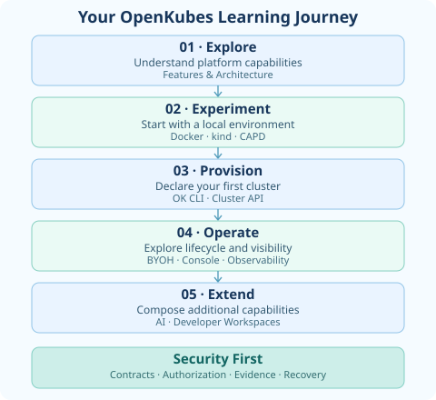

# Getting Started with OpenKubes

START YOUR OPENKUBES JOURNEY

<h2>Your first step towards sovereign Kubernetes.</h2>

Explore OpenKubes on your local machine, provision Kubernetes clusters, connect your own infrastructure or discover AI-powered platform capabilities.

<strong>Start small. Build with confidence. Scale on your own terms.</strong>

## Choose your path

<article class="ok-feature-card"><svg viewBox="0 0 24 24" width="28" height="28" fill="none" stroke="currentColor" stroke-width="1.7" stroke-linecap="round" stroke-linejoin="round" aria-hidden="true" focusable="false"><rect x="4" y="3" width="16" height="13" rx="2"/><path d="m4 16-2 4h20l-2-4M9 20h6"/></svg><h3>Explore OpenKubes Locally</h3>
Start with Docker, kind and Cluster API on your workstation. No bare-metal infrastructure required. CAPD creates disposable clusters; it does not install the BYOH controller.
<a href="/tutorials/capd-local-dev-environment/">Local CAPD Tutorial →</a></article>
<article class="ok-feature-card"><svg viewBox="0 0 24 24" width="28" height="28" fill="none" stroke="currentColor" stroke-width="1.7" stroke-linecap="round" stroke-linejoin="round" aria-hidden="true" focusable="false"><rect x="2" y="4" width="20" height="16" rx="3"/><path d="m6 9 4 3-4 3m7 0h5"/></svg><h3>Provision Your First Cluster</h3>
Install the OK CLI community preview, declare a cluster configuration and explore the supported provisioning workflow on a prepared management cluster.
<a href="/tutorials/ok-cli-v1.0.1-getting-started/">OK CLI Getting Started →</a></article>
<article class="ok-feature-card"><svg viewBox="0 0 24 24" width="28" height="28" fill="none" stroke="currentColor" stroke-width="1.7" stroke-linecap="round" stroke-linejoin="round" aria-hidden="true" focusable="false"><rect x="3" y="3" width="18" height="8" rx="2"/><rect x="3" y="13" width="18" height="8" rx="2"/><path d="M7 7h.01M7 17h.01M11 7h6M11 17h6"/></svg><h3>Bring Your Own Hosts</h3>
Explore native Cluster API integration for existing bare-metal servers and virtual machines. Review the Alpha maturity and security limitations before live operations.
<a href="/docs/byoh/advanced-guide/">BYOH Advanced Guide →</a></article>
<article class="ok-feature-card"><svg viewBox="0 0 24 24" width="28" height="28" fill="none" stroke="currentColor" stroke-width="1.7" stroke-linecap="round" stroke-linejoin="round" aria-hidden="true" focusable="false"><rect x="2" y="3" width="20" height="15" rx="2"/><path d="M8 22h8m-4-4v4M6 14l4-4 3 2 5-5"/></svg><h3>Explore the Platform Console</h3>
Run the local Console evaluation and discover platform visibility and rehearsals of guarded operations using fixture data.
<a href="/console/">OK Console →</a></article>
<article class="ok-feature-card"><svg viewBox="0 0 24 24" width="28" height="28" fill="none" stroke="currentColor" stroke-width="1.7" stroke-linecap="round" stroke-linejoin="round" aria-hidden="true" focusable="false"><rect x="7" y="7" width="10" height="10" rx="2"/><path d="M9 3v4m6-4v4M9 17v4m6-4v4M3 9h4m-4 6h4m10-6h4m-4 6h4"/><circle cx="12" cy="12" r="2"/></svg><h3>Discover AI &amp; Agentic Operations</h3>
Explore self-hosted AI services, read-only diagnostics and policy-bounded agents. Autonomous production operations are not approved.
<a href="/ai/">OK AI →</a></article>
<article class="ok-feature-card"><svg viewBox="0 0 24 24" width="28" height="28" fill="none" stroke="currentColor" stroke-width="1.7" stroke-linecap="round" stroke-linejoin="round" aria-hidden="true" focusable="false"><path d="m8 6-6 6 6 6m8-12 6 6-6 6m-2-15-4 18"/></svg><h3>Your First AI Coding Workspace</h3>
Explore Kubernetes-native developer workspaces with OpenCode and explicit resource, identity and lifecycle boundaries in disposable environments.
<a href="/developer-workspace/tutorial/">Developer Workspace Tutorial →</a></article>

## Your learning journey

*Illustrative learning path — each capability can also be explored independently. Progress between stages requires the prerequisites and authorization of the selected environment.*

## Recommended starting points

| Your goal | Recommended path |
| --- | --- |
| Understand OpenKubes | [Features](/features/) and [Architecture](/architecture/) |
| Learn Cluster API | [Local CAPD Tutorial](/tutorials/capd-local-dev-environment/) |
| Create a Kubernetes cluster | [OK CLI Community Preview](/tutorials/ok-cli-v1.0.1-getting-started/) |
| Use existing physical servers or VMs | [BYOH Advanced Guide](/docs/byoh/advanced-guide/) |
| Monitor Kubernetes | [OK Observability](/observability/) |
| Explore platform management | [OK Console](/console/) |
| Run self-hosted AI | [OK AI](/ai/) |
| Develop with coding agents | [Developer Workspace](/developer-workspace/tutorial/) |

## Start with the right environment

<article class="ok-feature-card"><svg viewBox="0 0 24 24" width="28" height="28" fill="none" stroke="currentColor" stroke-width="1.7" stroke-linecap="round" stroke-linejoin="round" aria-hidden="true" focusable="false"><rect x="4" y="3" width="16" height="13" rx="2"/><path d="m4 16-2 4h20l-2-4M9 20h6"/></svg><h3>Local development</h3>
Docker, kind, kubectl, clusterctl and tutorial-specific prerequisites. Use an isolated development environment; check the documented operating system and architecture scope.

For learning and disposable development clusters.
<a href="/tutorials/capd-local-dev-environment/">Review CAPD prerequisites →</a></article>
<article class="ok-feature-card"><svg viewBox="0 0 24 24" width="28" height="28" fill="none" stroke="currentColor" stroke-width="1.7" stroke-linecap="round" stroke-linejoin="round" aria-hidden="true" focusable="false"><rect x="3" y="3" width="18" height="8" rx="2"/><rect x="3" y="13" width="18" height="8" rx="2"/><path d="M7 7h.01M7 17h.01M11 7h6M11 17h6"/></svg><h3>Infrastructure environments</h3>
A prepared management cluster, supported infrastructure, networking and authorized access. The OK CLI community preview does not bootstrap its management infrastructure.

For controlled cluster lifecycle evaluation.
<a href="/tutorials/ok-cli-v1.0.1-getting-started/">Review CLI prerequisites →</a></article>

The older Multipass/K3s-based [OpenKubes Local repository](https://github.com/openkubes/ok-local) remains available as a separate exploration path. CAPD is the recommended local entry point for learning Cluster API and contributing to the BYOH provider. The two workflows are not interchangeable.

## Understand before you operate

<article class="ok-feature-card"><svg viewBox="0 0 24 24" width="28" height="28" fill="none" stroke="currentColor" stroke-width="1.7" stroke-linecap="round" stroke-linejoin="round" aria-hidden="true" focusable="false"><path d="M12 2 3 6v6c0 5 4 8 9 10 5-2 9-5 9-10V6zM8 12l3 3 5-6"/></svg>
<h3><a href="/architecture/security-first/">Security First</a></h3>
Infrastructure access does not imply operational authorization.

</article>
<article class="ok-feature-card"><svg viewBox="0 0 24 24" width="28" height="28" fill="none" stroke="currentColor" stroke-width="1.7" stroke-linecap="round" stroke-linejoin="round" aria-hidden="true" focusable="false"><path d="M2 12h5l3-8 4 16 3-8h5"/></svg>
<h3><a href="/docs/byoh/advanced-guide/12-validation-limitations/">Evidence over claims</a></h3>
Review prerequisites, validation results and known limitations. A successful development proof is not production approval.

</article>
<article class="ok-feature-card"><svg viewBox="0 0 24 24" width="28" height="28" fill="none" stroke="currentColor" stroke-width="1.7" stroke-linecap="round" stroke-linejoin="round" aria-hidden="true" focusable="false"><path d="m8 6-6 6 6 6m8-12 6 6-6 6m-2-15-4 18"/></svg>
<h3><a href="/community/how-to-update-docs/">Open Source</a></h3>
Explore the source repositories and participate in development.

</article>

**Your Kubernetes Framework. Built for the Age of AI.**

[Explore all Tutorials](/tutorials/) · [Platform Features](/features/) · [GitHub organization](https://github.com/openkubes)

Component-specific commands and prerequisites remain in the maintained tutorials and source repositories. This page is an orientation guide, not a production installation procedure.

## Alternative local walkthrough

The older Multipass/K3s OpenKubes Local workflow has a [video walkthrough on YouTube](https://youtu.be/_LJ8tCLHrO0) and [source-owned video tutorials](https://github.com/openkubes/ok-local#video-tutorials--getting-started-with-openkubes-local). These are separate from CAPD; opening the video leaves this site.
