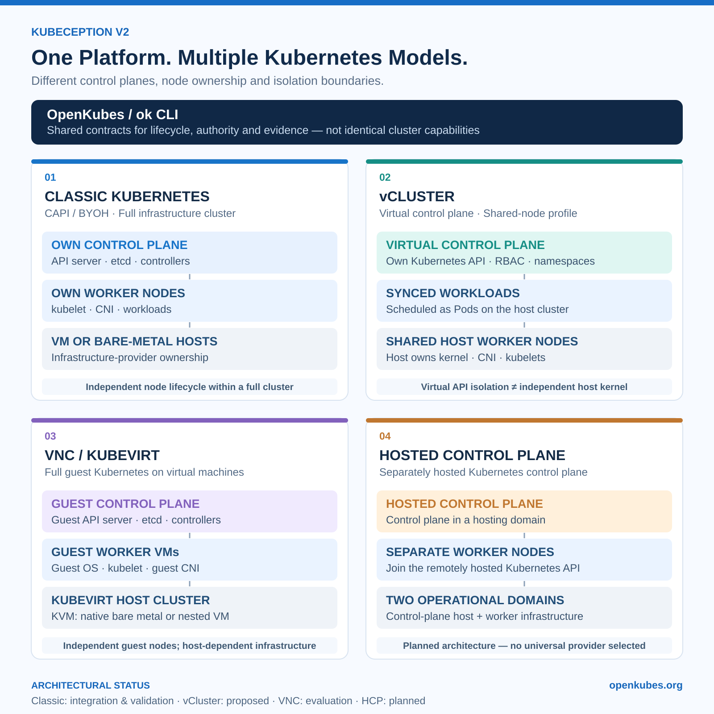

# Kubeception V2: From Kubernetes-in-Kubernetes to Virtual Cluster Lifecycle Management

*From our 2020 Kubernauts experiment to a provider-neutral architecture for classic, virtual, nested and hosted Kubernetes models.*

*Figure: Four distinct Kubernetes operating models. The common OpenKubes contract is an architectural direction, not a claim that every adapter is implemented.*

## From KiK in 2020 to Kubeception V2

On **December 17, 2020**, we hosted a Kubernauts online meetup, **“KiK: Kubernetes in Kubernetes with K3s.”** Together with Alexander Giesa, I explored an intriguing question: *Could we run Kubernetes environments inside an existing Kubernetes cluster?*

The discussion covered K3s running inside Kubernetes namespaces, Loft and K8Spin, cost efficiency, agility and security concerns. We were exploring what we now like to call **Kubeception**.

[Watch the original Kubernauts KiK recording](https://www.youtube.com/watch?v=FLkRp7R9_-c). Our presentation is also publicly available; its URL will be added when the shareable link is confirmed.

Six years later the question has evolved:

> **Kubeception V1 was about running Kubernetes inside Kubernetes. Kubeception V2 is about managing the different ways Kubernetes runs.**

Kubeception V2 is **not** a new Kubernetes distribution or a new version of the vCluster project. It is our name for the architectural direction behind making distinct cluster models manageable through explicit contracts.

## One platform, multiple Kubernetes models

Traditional full Kubernetes clusters remain first-class citizens in OpenKubes. The vision extends beyond nested clusters to four complementary deployment models.

### 1. Classic Kubernetes: bare metal and virtual machines

Cluster API (**CAPI**) brings a declarative model for cluster and Machine lifecycle. **Bring Your Own Host (BYOH)** connects that model to existing Linux hosts, whether backed by physical servers or appropriately prepared VMs. The infrastructure lifecycle remains the responsibility of the appropriate provider.

Our ambition is **batteries included, not everything installed everywhere**: on suitable profiles, OpenKubes can compose Cilium networking, storage, ingress, GitOps, observability and security capabilities without making each component a mandatory dependency for every cluster.

This is an active integration and validation track—not a claim that every deployment profile and failure scenario is production-certified.

**Try the current workflow:** [Getting Started with the OpenKubes OK CLI v1.0.1](https://openkubes.org/tutorials/ok-cli-v1.0.1-getting-started/) covers release verification, local exploration, read-only cluster planning and optional authorized provisioning of a supported Talos/KubeVirt workload cluster on a previously prepared compatible management plane. The v1.0.1 release is a **community preview**, not a universal Kubernetes installer.

### 2. vCluster: virtual Kubernetes control planes

The open-source [vCluster](https://github.com/loft-sh/vcluster) project, originally developed by Loft Labs, provides virtual Kubernetes API environments. In its **shared-node** model, each virtual cluster has a logically distinct API, RBAC and namespace view while synchronized workloads run on shared host-cluster nodes.

That can reduce cost and startup overhead for development, CI and selected multi-tenant environments. But **separate Kubernetes API access does not imply separate worker kernels, a host-independent CNI, or full infrastructure isolation**. Other upstream vCluster operating modes may have different node ownership and capabilities.

For OpenKubes, vCluster lifecycle integration is **proposed** rather than generally available; it must respect host-cluster ownership, tenancy, credential and cleanup boundaries.

### 3. Virtual Nested Clusters (VNC): full Kubernetes on KubeVirt VMs

**Virtual Nested Cluster (VNC)** is our OpenKubes term for a complete Kubernetes cluster running on guest VMs managed by **KubeVirt** inside an existing Kubernetes host cluster.

The guest has its own control plane, worker VMs, operating systems, kubelets and guest CNI. The host still owns KubeVirt infrastructure and its availability. The KubeVirt host can run on bare metal with native KVM or on compatible VMs exposing **nested KVM**.

This is different from shared-node vCluster: a VNC can exercise full guest-node lifecycle, cluster upgrade and networking scenarios. It is also different from deploying Kubernetes directly on bare metal: **nesting** requires a host Kubernetes/KubeVirt layer.

VNC is an architectural model, not another name for the upstream vCluster technology. OpenKubes already has KubeVirt/CAPI groundwork, while a generic VNC adapter remains a separate evaluation track.

### 4. Hosted Control Planes: a future direction

**Hosted Control Plane (HCP)** architectures place a Kubernetes control plane in a hosting domain separate from the cluster's workers. Worker ownership, connectivity and failure domains must be defined independently.

We plan to evaluate HCP technologies, but have **not** selected a universal HCP implementation or declared HCP support available in OpenKubes. Nor is HCP automatically the same architecture as shared-node vCluster.

| Cluster model | Control plane | Worker ownership | OpenKubes status |
| --- | --- | --- | --- |
| Classic Kubernetes | Dedicated cluster control plane | Infrastructure / CAPI provider | CAPI/BYOH integration and E2E validation |
| vCluster (shared nodes) | Virtual API/control plane in host | Shared host Kubernetes | Proposed: ADR-050 / OK-235 |
| VNC / KubeVirt | Full guest Kubernetes control plane | Guest VMs managed through host KubeVirt | KubeVirt groundwork; generic VNC evaluation |
| Hosted Control Plane | Hosted separately from workers | Separately managed workers | Future evaluation |

*“Batteries included” is an optional composition of platform capabilities, not a fifth cluster type.*

## The hard part is lifecycle—not installation

A cluster creation command is only the start. A reliable platform must be explicit about:

- **Identity and ownership:** Who is authorized to create, update, register, recover or delete this specific cluster?
- **Capabilities:** Does an operation affect virtual APIs, guest nodes, host nodes or actual infrastructure?
- **Isolation:** What separates Kubernetes APIs, host namespaces, workloads, networks, kernels and tenant privileges?
- **GitOps and reconstruction:** Can desired configuration and transition history be recovered without an operator's laptop?
- **Evidence:** What proves a transition was authorized, executed and independently verified—especially after cleanup?
- **Failure domains:** What remains available when the management or hosting cluster fails?

This is why the OpenKubes principle is **“Own the contracts, not the components.”** We aim to use CAPI, BYOH, KubeVirt and vCluster for their respective strengths, not rebuild them or pretend their boundaries are identical.

## Managing the managers: our CAPI Architecture Blueprint

The recently published **[Managing the Managers: A Resilient CAPI Architecture for OpenKubes](https://openkubes.org/architecture/capi/blueprint/)** addresses the management problem behind Kubernetes clusters.

It explores **self-managed CAPI** and **centralized CAPI with BYOH shadow management**, separating workload continuity from management authority. It establishes a critical rule: *at most one effective lifecycle writer*. It also distinguishes planned Blue/Green management handover from cold disaster recovery, and Git-stored declarations from independently authorized operations.

The blueprint contains **accepted architecture decisions**, but its full Blue/Green handover, fencing and full-loss recovery design is **not yet integrated production E2E proof**. We make that boundary explicit.

These management principles become more—not less—important when virtual and nested cluster types are added.

## Learn and experiment today

Two practical starting points complement the blueprint:

**[OpenKubes OK CLI v1.0.1 — Getting Started](https://openkubes.org/tutorials/ok-cli-v1.0.1-getting-started/)**  
Install and verify the community-preview CLI, inspect a cluster request, generate a read-only plan, and optionally run the supported Same-Plane lifecycle on a compatible, authorized environment. The tutorial records a bounded successful lifecycle test without generalizing it to production certification.

**[Build a Local OpenKubes BYOH Development Environment with CAPD](https://openkubes.org/tutorials/capd-local-dev-environment/)**  
Explore kind, Cluster API and the Docker infrastructure provider (CAPD). The tutorial explains CAPI Machines vs Kubernetes Nodes, isolated management/workload contexts, and repeatable local development. Its documented macOS/Colima success does not imply that all cross-platform or teardown tests are complete; CAPD is a test substrate, **not a replacement for BYOH**.

These examples show the value of a clear lifecycle abstraction, even before virtual-cluster adapters are part of the supported product surface.

## What comes next: ADR-050 and OK-235

Our **[ADR-Platform-050 — Virtual Cluster Models and Provider-Neutral Lifecycle Boundaries](https://github.com/openkubes/openkubes/pull/527)** is currently **Proposed**. It defines the taxonomy of full infrastructure clusters, virtual control planes and KubeVirt-based VNCs, and evaluates three vCluster integration approaches: a direct `ok` adapter, a Kubernetes Operator/CRD approach, and an optional add-on.

The companion **[OK-235 vCluster Integration Spike](https://kubernauts.atlassian.net/browse/OK-235)** plans measured E2E evaluation in eligible **LAB Stack B / C** environments after prerequisites and explicit authorization. Tests will cover virtual kubeconfig/API access, RBAC, workload and CRD behavior, two-cluster isolation, quota, resource consumption, status, update, deletion and cleanup.

The architecture deliberately remains **infrastructure-provider-neutral**. Neither vCluster support nor the proposed VNC/HCP models should be mistaken for completed production-ready integrations.

## From an experiment to an operating model

In 2020 we wondered what happens when Kubernetes runs inside Kubernetes. Today we are asking how to responsibly manage many distinct Kubernetes models without erasing their differences.

Classic bare-metal and VM clusters, shared-node virtual control planes, complete KubeVirt guests and future hosted control planes each have a place. OpenKubes aims to tie them together with the same **intent, ownership, policy and evidence discipline**—not with unsupported assumptions about equivalent isolation or lifecycle behavior.

**One Platform. Multiple Kubernetes Models. Consistent Lifecycle Contracts.**

That is the idea behind **Kubeception V2**.

---

### Further reading

- [Kubernauts KiK recording (December 17, 2020)](https://www.youtube.com/watch?v=FLkRp7R9_-c)
- [OpenKubes CAPI Architecture Blueprint](https://openkubes.org/architecture/capi/blueprint/)
- [OK CLI v1.0.1 Getting Started](https://openkubes.org/tutorials/ok-cli-v1.0.1-getting-started/)
- [Local CAPD Developer Environment](https://openkubes.org/tutorials/capd-local-dev-environment/)
- [ADR-Platform-050 (Proposed)](https://github.com/openkubes/openkubes/pull/527)
- [OK-235 vCluster Spike](https://kubernauts.atlassian.net/browse/OK-235)
- [vCluster](https://github.com/loft-sh/vcluster) · [KubeVirt](https://kubevirt.io/) · [Cluster API](https://cluster-api.sigs.k8s.io/)
