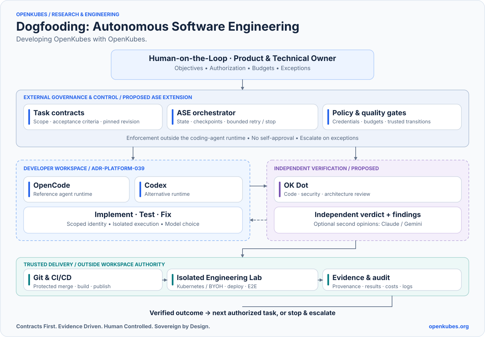

# Dogfooding: Autonomous Software Engineering

*Developing OpenKubes with OpenKubes.*

*Research & Engineering — unpublished working draft; results pending Experiment 001.*

## What if a software platform could help build itself?

At OpenKubes, we are exploring how Agentic AI, Kubernetes, security, governance and Human-on-the-Loop principles can enable a new generation of autonomous infrastructure operations.

But what if we applied these same principles to our own software engineering process?

What if AI engineering agents could independently implement features, review code, fix defects, build container images, deploy infrastructure, execute end-to-end tests and produce verifiable evidence — without requiring human approval at every individual step?

This is the motivation behind **OpenKubes Autonomous Software Engineering (ASE)**.

**Develop OpenKubes using the principles of OpenKubes.**

## Beyond AI-assisted coding

AI coding assistants have changed how developers write software. However, generating code is only one part of the software engineering lifecycle.

Building reliable software requires understanding requirements and architectural constraints, implementing and testing changes, performing independent code and security reviews, resolving review findings, building and publishing artifacts, deploying and validating real infrastructure, and collecting evidence.

Our ambition is to connect these activities into a governed, increasingly autonomous engineering lifecycle. We are not trying to remove humans from software engineering. We want to change where human expertise and decision-making are applied.

## From Human-in-the-Loop to Human-on-the-Loop

Humans define objectives, boundaries and rules under which engineering agents operate. They remain responsible for product direction, architecture, risk acceptance and authorization.

Agents operate autonomously within those boundaries. Human intervention becomes necessary when an agent encounters a situation outside its authorization, exceeds its budget, violates a security policy or cannot satisfy a quality gate.

**Autonomy is not the absence of control. It is the ability to operate independently within explicitly enforced boundaries.**

## From Developer Workspaces to Autonomous Engineering Workspaces

We envision the OpenKubes Developer Workspace evolving beyond a traditional development environment into a governed execution environment for both human developers and autonomous engineering agents.

Rather than building another coding agent, we intend to evaluate and integrate existing agent runtimes, including OpenCode and Codex. OpenCode is a candidate reference runtime; Codex provides an alternative native execution path. Our objective is to make autonomous engineering runtime-independent, model-agnostic, secure and evidence-driven.

The proposed ASE extension must preserve the Developer Workspace authority boundary (ADR-Platform-039): merge, release and deployment authority remain outside the coding-agent workspace. Trusted external controls govern transitions.

**Any Model. Any Agent. Any Infrastructure. Governed by OpenKubes.**

## An autonomous engineering team

- **Human:** Product and Technical Owner.
- **ChatGPT:** Architecture, specifications and acceptance criteria.
- **Codex / OpenCode:** Implementation, testing and correction through interchangeable runtimes.
- **OK Dot:** Proposed independent code, security and architecture reviewer.
- **Claude and Gemini:** Optional additional independent perspectives.

Implementation and verification should remain independent. Review findings should automatically return to the implementation agent, triggering a bounded correction and validation cycle.

## The Autonomous Engineering Loop

**Requirements → Implement → Test → Review → Fix → Commit → Push → Build → Deploy → Validate → Evidence → Next Task**

Every transition should be governed by explicit quality gates. Every engineering outcome should be traceable. Every autonomous action should remain within an authorized scope.

Trusted external delivery systems, rather than the coding agent itself, control protected merges, publishing and deployments. Persistent checkpoints and recovery mechanisms should enable safe continuation after interruptions, without blindly repeating side effects.

## Security and governance by design

Long-running agents must not rely on prompt-based restrictions alone. We intend to investigate technically enforced mechanisms for:

- Least-privilege credentials and isolated engineering and infrastructure environments.
- Time, token and infrastructure budgets.
- Protected branches and controlled merge policies.
- Machine-readable acceptance criteria and independent security verification.
- Persistent audit trails, evidence and automatic stop conditions.
- Protection against unauthorized destructive operations and production access.

An agent must not be able to weaken the policies or acceptance criteria used to evaluate its work.

Security and governance are prerequisites for meaningful autonomy, not obstacles to it.

## Dogfooding our own architecture

OpenKubes ASE is an experiment in dogfooding. We want to investigate how our Agentic AI, Security Contracts, Human-on-the-Loop governance, capability-based authorization and evidence-driven execution concepts can be applied to the development of OpenKubes itself.

Our existing Kubernetes lifecycle automation and isolated bare-metal lab environments provide a practical foundation for these experiments. Rather than evaluating autonomous agents exclusively through synthetic coding benchmarks, we want to challenge them with real engineering problems involving real infrastructure.

## Adopt First. Extend Second. Build Last.

We do not intend to build another agent engine simply because we can. Our first step is to evaluate existing technologies, including OpenCode's execution interfaces, Codex CLI/SDK, persistent engineering workspaces, GitHub Actions, GitLab CI/CD and our existing OpenKubes lifecycle automation.

Only where existing capabilities are insufficient will we introduce additional orchestration or governance components.

The objective is not another framework. The objective is reliable, secure and measurable autonomous software engineering.

## From hours to days

| Level | Target autonomy | Scope |
|---|---|---|
| Level 1 | 2–4 hours | Implementation and testing |
| Level 2 | 8–12 hours | Independent reviews, corrections and builds |
| Level 3 | 24 hours | Infrastructure deployment and E2E validation |
| Level 4 | 48 hours | Multiple engineering milestones |
| Level 5 | Continuous | Governed, backlog-driven engineering |

These are research milestones, not claims of currently achieved capabilities. Progression will depend on demonstrated reliability, security, engineering quality and operational evidence, not simply on how long an agent can run.

## Our first experiment

Following completion of our Bring Your Own Host (BYOH) ClusterClass MVP, we plan to conduct our first autonomous engineering experiment.

A real OpenKubes development task will be assigned to an engineering agent within an explicitly authorized environment. For approximately two to three hours, the agent will attempt to implement, test and validate the task without routine human intervention.

We will evaluate engineering quality, acceptance criteria compliance, autonomous task completion, human interventions, error recovery, security and policy compliance, execution costs, resource consumption, and completeness and reproducibility of evidence.

A comparative OpenCode/Codex run with identical task contracts and starting revisions is a candidate follow-up, subject to discovery and model availability.

*Experimental results and lessons learned will be added following the initial qualification run. No autonomous engineering capability is claimed as validated by this article.*

## An invitation to the community

Autonomous software engineering is not simply about making AI agents more powerful. It is about making autonomy trustworthy, observable, governable and useful.

OpenKubes ASE explores how these principles can be brought together in a real-world, open-source engineering environment. We are starting small, learning from actual engineering work and increasing autonomy only when the evidence supports it.

**The future of software engineering may not be human-free. It may be human-governed, agent-executed and evidence-verified.**

And we want to explore that future openly, together with the community.

---

*OpenKubes Research & Engineering*

*Develop OpenKubes using the principles of OpenKubes.*
