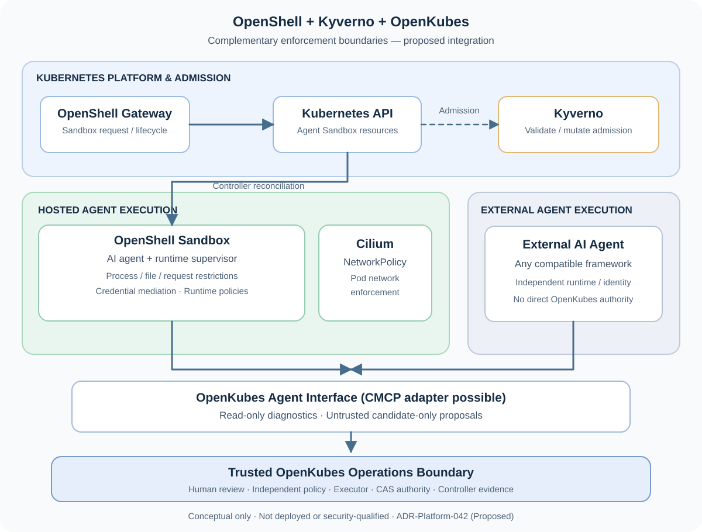

# Securing Agentic Operations: OpenShell Meets OpenKubes

*Secure execution is necessary. Governed Kubernetes operations and independent verification make it trustworthy.*

*OpenKubes Architecture · November 11, 2026 · Architecture exploration*

> **Status: Architecture proposal — not an integration announcement.** OpenKubes has not integrated or production-qualified OpenShell. [ADR-Platform-042](https://github.com/openkubes/openkubes/blob/main/architecture/decisions/ADR-Platform-042-openshell-hosted-external-agentic-operations.md) is **Proposed** and technical validation is still pending. This article describes a target architecture and its required proofs, not a deployed end-to-end operation path.

## Two problems, two different trust boundaries

AI agents can read files, execute tools, call APIs and make useful recommendations. These capabilities also make them risky infrastructure clients. Prompt instructions are not a sufficient security boundary: access to credentials, networks, processes and platform APIs needs enforcement outside the agent.

**OpenShell** addresses the *execution environment*: sandbox isolation, runtime policy enforcement and controlled access to approved endpoints and credentials. Its maintainers describe these mechanisms in the [upstream OpenShell repository](https://github.com/NVIDIA/OpenShell). Its Kubernetes deployment and operational maturity still need assessment for our environment.

**OpenKubes Agentic Operations** addresses a different question: *What may an agent ask the Kubernetes platform to change, who authorizes that change, and how is the outcome independently proven?*

These concerns complement each other, but **runtime isolation does not confer operational authority**. A safely sandboxed agent can still propose an unsafe or incorrect change.

## Our direction: hosted and external AI agents

We want OpenKubes to support **both**, without creating two governance models.

### Hosted agents: a managed secure execution runtime

An OpenKubes-hosted agent could execute inside an OpenShell sandbox. OpenShell is our **preferred candidate for the default hosted-agent runtime**, subject to successful technical and security validation.

A hosted agent should be able to inspect *approved* read-only diagnostics, reason over platform context and submit a **non-authoritative operation candidate**. It must not inherit direct write privileges over Kubernetes, protected Git references, approvals, grants or the authoritative desired-state API.

### External agents: bring your own framework

Organizations already run agents in many frameworks and trust domains. We do **not** want to require OpenShell for every external agent.

Instead, external agents should use authenticated, explicitly scoped OpenKubes interfaces and pass through the **same** candidate, review, authorization, execution and evidence path as hosted agents.

This keeps a useful design promise: **any compatible agent can propose; only the trusted platform can authorize and execute.**

## The OpenKubes boundary: an agent proposes, a human approves

The proposed sequence is intentionally stricter than a generic agent-to-`kubectl` integration:

1. An agent uses bounded, read-only diagnostics to understand the situation.
2. It submits an **untrusted candidate** with authenticated, server-attested provenance.
3. Trusted OpenKubes mechanisms validate and canonicalize the proposal against the authoritative predecessor revision.
4. An authenticated human reviews and approves the **exact semantic transition**, not an AI-generated summary.
5. An independent policy authority issues a transition-bound, single-use grant.
6. A deterministic Contract Executor verifies the grant; the authoritative desired state is accepted through compare-and-swap semantics.
7. Existing Kubernetes, CAPI and GitOps controllers reconcile the accepted state.
8. **Independent evidence** establishes the historical transition outcome. Current health is tracked separately.

These are **proposed end-to-end requirements**, not a claim that all steps are implemented and proven today. Our [Agentic Operations Reference Architecture](https://openkubes.org/agentic-operations-reference-architecture/) documents the rationale and the current evidence gaps.

**AI thinks. OpenKubes executes. Evidence proves.**

## Where CMCP fits — and where it must not

We are exploring CMCP/MCP as a bounded, replaceable way to make diagnostics and candidate operations accessible to agents. It is **not** a back door to Kubernetes mutation, a second policy authority, or an independent source of execution truth.

OpenKubes-owned versioned contracts remain authoritative; MCP can present those contracts to agents as an adapter. The choice between centralized and federated MCP architectures remains an open design question.

We also keep our existing [Developer Workspace contract](https://github.com/openkubes/openkubes/blob/main/architecture/decisions/ADR-Platform-039-developer-workspace-contract.md) separate: a coding workspace and an operations agent may share isolation concepts but must not silently share privileges or lifecycle semantics.

## OpenShell + Kyverno: defense in depth on Kubernetes

A [CNCF platform-engineering guide published on November 11, 2026](https://www.cncf.io/blog/2026/11/11/openshell-on-kubernetes-a-guide-for-platform-engineers/) describes another useful boundary: OpenShell runs its sandboxes through the Kubernetes **Agent Sandbox** API, while Kubernetes-native admission and network policies can independently constrain the resources used to run them.

In the [Nirmata demonstration](https://github.com/nirmata/demo-openshell), **Kyverno** uses six validating policies and one mutating policy, written in CEL, to check Sandbox definitions and selected Kubernetes resources. These controls include non-privileged execution, restrictive OpenShell RBAC, limited workload egress, digest-pinned images, default resource requests, resource ceilings, and restrictions on injecting Kubernetes Secrets into Sandbox environment variables. **Cilium** enforces the Kubernetes NetworkPolicies; **OpenShell's supervisor** enforces finer-grained runtime restrictions such as permitted requests and credential handling.

*Conceptual OpenKubes architecture, adapted to the responsibilities discussed in the [CNCF platform-engineering guide](https://www.cncf.io/blog/2026/11/11/openshell-on-kubernetes-a-guide-for-platform-engineers/). It is not the KarsSandbox implementation shown in other community diagrams, nor a claim that this OpenShell/Kyverno/OpenKubes combination is running today.*

These controls address distinct questions:

| Boundary | What it controls | What it does *not* prove |
| --- | --- | --- |
| **OpenShell** | Agent execution, per-request runtime policies and credential mediation | Authorization to change OpenKubes desired state |
| **Kyverno** | Kubernetes resource admission, validation and mutation | That an agent-originated platform operation is approved |
| **Cilium / NetworkPolicy** | Pod network reachability | Application-level authorization or operation outcome |
| **OpenKubes** | Trusted proposal review, policy authorization, deterministic execution and independent evidence | The security of a runtime merely because it has passed admission |

The example is **not a production security guarantee**. The CNCF article explicitly notes that the gateway's ServiceAccount can still create Pods and NetworkPolicies directly; production hardening would need admission coverage for those objects too. Policy gaps involving credentials, tenant isolation and alternate network paths must be assessed rather than assumed closed. Kyverno is therefore a **candidate reference admission-policy profile** for OpenKubes-hosted agents, not a mandatory dependency or a replacement for other policy engines.

Our technical evaluation will include reproducing these policies in an isolated Kubernetes test environment, checking both expected admits and deliberate denials, testing bypass paths, and preserving the same candidate-only OpenKubes interface for external agents. Whether we adopt Kyverno alongside OpenShell will follow the evidence—not precede it.

## What we need to prove before adopting OpenShell

Our planned technical feasibility assessment has explicit acceptance gates, including:

- Can OpenShell be deployed and operated reproducibly on a disposable Kubernetes environment, with documented prerequisites, rollback and upgrade behavior?
- Can a hosted agent access **only** approved diagnostics and candidate submission, with deny-by-default network and credential access?
- Are direct Kubernetes mutations, protected authority/Executor/Git APIs, forbidden egress and cross-tenant access demonstrably denied?
- Does an independently operated external agent traverse the same proposal and approval boundary **without** using OpenShell?
- Are provenance, policy decisions and independent evidence correlated without trusting the agent's own success message?
- What do operational costs, runtime alternatives, upstream maturity, portability and residual security risks look like?

Until these gates are measured and reviewed, we will **not** describe OpenShell as integrated, production-ready or mandatory for OpenKubes. Core OpenKubes must remain fully functional without any agent runtime.

## Why publish an ADR before the implementation?

Because OpenKubes is built around **contracts over components**. We want the community to inspect our intended trust boundaries *before* implementation details make them harder to change.

[ADR-Platform-042: Hosted and External Agentic Operations with OpenShell](https://github.com/openkubes/openkubes/blob/main/architecture/decisions/ADR-Platform-042-openshell-hosted-external-agentic-operations.md) is now publicly available with **Proposed** status. It describes the architectural alternatives, consequences and the evidence required to accept a decision.

As we prepare OpenKubes for a **potential future CNCF Sandbox application**, we see this as an opportunity to collaborate openly with the cloud-native community rather than claim a completed integration.

We look forward to presenting OpenKubes at **KubeCon + CloudNativeCon Europe 2027 in Barcelona**; the exact format of our participation is not yet announced.

## Join the discussion

We would welcome feedback from the OpenShell and CNCF communities, especially on agent runtime isolation, tenancy, policy enforcement, secure credential access and independently verifiable operations.

**How autonomous should AI agents really be in production?**

Our answer starts with a boundary: **agents propose; platforms govern; evidence proves.**

---

**Explore the work:** [OpenKubes](https://openkubes.org/) · [ADR-Platform-042](https://github.com/openkubes/openkubes/blob/main/architecture/decisions/ADR-Platform-042-openshell-hosted-external-agentic-operations.md) · [OpenShell upstream](https://github.com/NVIDIA/OpenShell) · [OpenKubes Agentic Operations](https://openkubes.org/agentic-operations-reference-architecture/)
