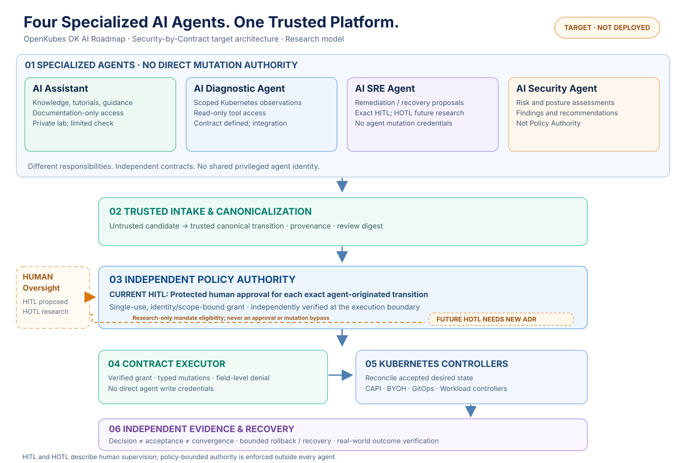

# OK AI Roadmap — Four Specialized Agents, One Trusted Platform

**From trusted answers to supervised, evidence-driven Kubernetes operations.**

OpenKubes is developing four **distinct, optional agent capability tracks**. They can evolve independently and share a provider-neutral, security-by-contract foundation. This roadmap is **not** a sequential autonomy ladder or a release announcement: greater diagnostic intelligence does not imply greater infrastructure authority.

  <article class="ok-ai-roadmap__card ok-ai-roadmap__card--docs">
    
📖Private lab: limited check

    
Knowledge · Assist

    <h2>AI Assistant</h2>
    
Answers OpenKubes documentation and architecture questions from allowlisted public sources; guides users to tutorials and specialized diagnostics. Can route a request without acquiring the destination agent's privileges.

    
Authority boundary: documentation only. No cluster access, commands or mutations.

    
<strong>Next evidence:</strong> grounded answers, safe command handling, evaluation and public-beta security gates.

    <a href="/ai/chat-preview/">Explore the chat UI prototype →</a>
  </article>
  <article class="ok-ai-roadmap__card ok-ai-roadmap__card--diagnostics">
    
🔎Contract defined · integration ongoing

    
Observe · Investigate

    <h2>AI Diagnostic Agent</h2>
    
Investigates scoped Kubernetes workloads, cluster health, Cilium, logs, events and observability signals. Correlates evidence and produces transparent, reproducible diagnostic findings.

    
Authority boundary: explicitly scoped read-only tools; Secrets excluded; no write privilege inherited from a tool server.

    
<strong>Next evidence:</strong> backend isolation, negative RBAC tests, redaction and runtime-specific integration validation.

    <a href="/ai/kagent-platform-diagnostics/">Explore the diagnostics contract →</a>
  </article>
  <article class="ok-ai-roadmap__card ok-ai-roadmap__card--operations">
    
🛠️HITL proposed · HOTL research

    
Propose · Remediate · Recover

    <h2>AI SRE Agent</h2>
    
Plans workload remediation, Kubernetes/BYOH upgrades, availability recovery and lifecycle operations. Designed to support <strong>both exact Human-in-the-Loop (HITL)</strong> and, subject to a new approved authorization contract, <strong>bounded Human-on-the-Loop (HOTL)</strong>.

    
Authority boundary: no direct agent mutation credentials. The current proposed path requires protected human approval per exact agent-originated transition; standing mandates are future research, never permanent agent RBAC.

    
<strong>Next evidence:</strong> canonical proposal binding, revocation/acceptance ordering, bounded grants, risk budgets, fencing, recovery and E2E negative tests.

    <a href="/research/security/hitl-hotl-policy-bounded-autonomy/">Research HITL, HOTL & policy-bounded autonomy →</a>
  </article>
  <article class="ok-ai-roadmap__card ok-ai-roadmap__card--security">
    
🛡️Architecture research

    
Assess · Detect · Recommend

    <h2>AI Security Agent</h2>
    
Investigates RBAC, privilege escalation paths, policy drift, Kubernetes workload security and security findings. Produces evidence-linked risk assessments and proposed controls for human and platform review.

    
Authority boundary: the Security Agent is <strong>not</strong> the independent Policy Authority. It cannot waive policies, grant itself credentials, approve its own changes or mutate protected resources.

    
<strong>Next evidence:</strong> read-only security assessment contract, finding provenance, false-positive evaluations and controlled remediation handoff.

    <a href="/architecture/security-first/">Read the Security First foundation →</a>
  </article>

!!! info "Transparent maturity — not four released products"
    The AI Assistant has only passed a **limited private-lab format/source-ID check for one question**, not public-beta or semantic-grounding certification. The Diagnostic Agent has a documented provider-neutral read-only contract and implementation components, but production deployment readiness is not established. The SRE Agent's exact HITL execution protocol is proposed; general agent-initiated HOTL requires a **new accepted normative ADR and tested enforcement**. The Security Agent is an architectural research direction. No claim here certifies a production four-agent deployment.

## One shared security-by-contract architecture

The roles differ in purpose and capability. **None of them is an authorization authority simply because it is an AI agent.**

*Conceptual target architecture — not a deployed topology. Select the native SVG to enlarge it without leaving this page.*

An AI Assistant may help an operator describe an incident; the Diagnostic Agent may establish scoped observations; the Security Agent may assess the proposed risk; and the AI SRE Agent may submit a canonical remediation proposal. **The independent enforcement path** must still validate identity, scope and the exact transition before any mutating operation can be accepted.

### Operational authority is independent of agent intelligence

- **Trusted intake and canonicalization** authenticate the original principal and derive one exact, reviewable proposed change from untrusted agent input.
- **HITL (current proposed agentic path)** requires protected human review bound to the exact canonical transition and its effective effects, before a bounded single-use grant can authorize execution.
- **HOTL (future SRE research)** could use revocable, human-approved standing mandates to define narrow *eligibility envelopes*. A mandate is not permanent agent RBAC, and every allowed transition still needs independent authorization and bounded execution. General agent-originated HOTL remains unapproved under current ADR-035.
- **Independent Policy Authority and Contract Executor** must prevent direct or indirect tool-server bypass, check the operation at the trusted acceptance point and handle revocation/acceptance races. A grant cannot justify a different action, such as replacing a machine after a failed upgrade.
- **Kubernetes controllers and independent evidence** distinguish a decision, acceptance, reconciliation and observed outcome. Fail-closed control must retain separately authorized recovery routes.

## Where HITL and HOTL belong

| Task or operational class | Intended oversight | Boundaries and current maturity |
| --- | --- | --- |
| Documentation question | User-facing assistance | Read-only; limited assistant private-lab check |
| Cluster/workload investigation | Scoped diagnostic read | Provider-neutral contract; production integration not proven |
| Security posture / policy assessment | Read-only security analysis | New research track; no enforcement authority |
| Specific BYOH upgrade, management handover or destruction | **Exact HITL** | Protected transition approval required; additional lifecycle evidence gates |
| Narrow routine workload remediation | **Potential HOTL** with human supervision and revocation | Research only; new normative ADR and proven mandate, budget, fencing and recovery semantics required |
| Deterministic controller recovery under pre-approved platform policy | Separate deterministic platform automation | Not an agent-HOTL shortcut; requires independently trusted trigger, bounds and evidence |

**Human oversight (HITL/HOTL) and technical policy boundaries are orthogonal.** A human can approve each exact operation while Policy-Bounded Execution still limits the executor. A future HOTL mandate could permit narrower automatic execution, but only after its enforcement guarantees are accepted and proven.

## Roadmap priorities and proof obligations

| Agent track | Near-term milestone | Before any expanded authority |
| --- | --- | --- |
| Assistant | Source-grounded answers and evaluated safety | No hidden command execution or privileged tool forwarding |
| Diagnostic | Complete read-only provider integration and negative tests | Demonstrated tool-SA isolation, scoping and redaction |
| SRE | Exact HITL proposal/approval/grant/acceptance validation | For HOTL: new ADR, mandate lifecycle, atomic risk budgets, race-safe revocation, owner fencing, independent evidence and restore-safe authority |
| Security | Read-only posture analysis with traceable findings | Remain separate from the trusted policy decision and mutation path |

The AI SRE and AI Security Agents may **collaborate on proposals**, but the Security Agent cannot self-certify an SRE action, and neither can bypass the independent protected human/policy boundary.

## Explore the architecture

- [Security First — common security principles](../architecture/security-first.md)
- [Research Paper 001 — Beyond Human-in-the-Loop](../research/security/hitl-hotl-policy-bounded-autonomy.md)
- [Agentic Operations — execution responsibility model](agentic-operations.md)
- [kagent & Read-only Platform Diagnostics](kagent-platform-diagnostics.md)
- [OK AI Chat — visual prototype](chat-preview.md)

**Guiding principle: Humans govern. Policies constrain. Machines execute. Evidence verifies.**

[← Back to OK AI overview](index.md)
