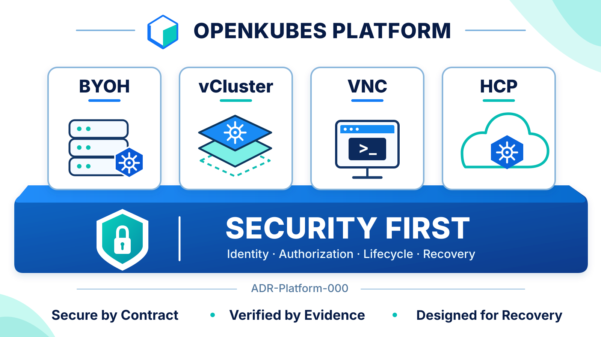

# OpenKubes Architecture

**Contracts over components. Evidence over claims.**

OpenKubes is a framework for building Kubernetes platform distributions. The platform defines stable capability boundaries while underlying tools and providers remain replaceable.

## Security First — our foundation

**Security is where OpenKubes architecture begins.** [Read the short Security First introduction](security-first.md) to see how our platform models share the same security principles, even as their implementations differ.

## Architecture principles

### Contracts over components

The framework specifies what a capability must provide, independently of how it is implemented. Different infrastructure, cluster-management and platform-service profiles can satisfy the same published contracts.

### Clear authority boundaries

Desired state, transition decisions and runtime reconciliation are separate responsibilities. Tooling and intelligent assistants can propose operations, but authoritative changes require trusted control paths.

### Evidence-based operations

Platform acceptance relies on inspectable evidence and clearly defined outcomes rather than informal success signals.

## Cluster lifecycle and CAPI architecture

The [OpenKubes CAPI Architecture Blueprint](capi/blueprint.md) describes the independent self-managed and centralized management topologies, BYOH shadow management, explicit ownership and fencing, Git-first configuration, planned Blue/Green management handover, and cold disaster recovery.

The [seven standalone CAPI architecture decisions](capi/decisions/index.md) are maintained in the `ok-cluster` repository and imported here from a pinned revision. They are **accepted architecture decisions**, not blanket claims of completed implementation or production-grade E2E validation.

## Further reading

- [Agentic Operations Reference Architecture](/agentic-operations-reference-architecture/)
- [The Contract Is the Guardrail](/the-contract-is-the-guardrail-blog-post/)
- [Vault Secret Contract](/vault-secret-contract-blog-post/)
- [Source architecture decisions](https://github.com/openkubes/openkubes/tree/main/architecture/decisions)
- [Developer documentation](/docs/)

*This is an introduction; normative architecture decisions remain in the Git repository.*
