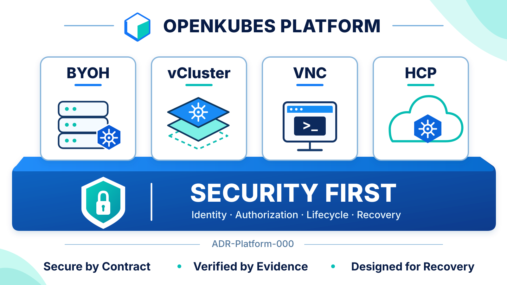

# Security First: Why OpenKubes Starts with Security

*Security is not something we add after building a Kubernetes platform. It is something the platform must preserve throughout its entire lifecycle.*

## Why security comes first

Building a Kubernetes platform means combining technologies: Kubernetes, Cluster API, infrastructure providers, controllers, agents and automation tools. Each component comes with its own permissions and assumptions. Inherited permissions, however, are not inherited trust.

That is why our first foundational architecture decision is deliberately numbered **[ADR-Platform-000](https://github.com/openkubes/openkubes/blob/main/architecture/decisions/ADR-Platform-000-security-first.md)**. The number is intentional: **security comes before everything else.**

## What this means in practice

**Only the permissions that are needed.** A host working on one cluster must not automatically gain access to another cluster's secrets. The same principle applies to controllers, operators and AI agents.

**Possible does not mean authorized.** A software upgrade is not permission to replace an entire machine. Significant changes require explicit, verifiable authority — even when the requesting component is otherwise trusted.

**Security must survive the lifecycle.** A revoked credential must not become valid again just because someone restores an older backup. Protection must hold across installation, upgrades, reconciliation and disaster recovery.

**Recovery should be safe, not impossible.** Systems fail, and operators need tested, controlled ways to repair them. Emergency access should not mean permanently disabling the security boundary.

**Evidence matters more than claims.** A policy that looks correct is not proof it works. We test both permitted and forbidden operations, and we keep evidence linked to the exact software and environment we tested.

For AI-assisted operations, the [four-agent OK AI Roadmap](../ai/ai-roadmap.md) shows how Assistant, Diagnostic, SRE and Security responsibilities stay separate from independent execution authority. General agent-initiated HOTL remains research, not a production exception to these principles.

## One foundation, different cluster models

OpenKubes brings together physical hosts (**BYOH**), virtual clusters (**vCluster**), virtual nested clusters (**VNC**) and hosted control planes (**HCP**). These environments have different security boundaries, but they share the same expectations for identity, authorization, lifecycle protection and recovery.

  
  
<small>Four models, different control-plane and worker boundaries. Select the diagram to view it at full size.</small>

[Explore the Kubeception V2 architecture in detail](https://openkubes.org/kubeception-v2/).

Different architectures. **The same foundational principles.**

## Secure by Contract. Verified by Evidence. Designed for Recovery.

**Secure by Contract** means defining authority and boundaries before components act.

**Verified by Evidence** means confirming that those boundaries actually hold.

**Designed for Recovery** means restoring service without restoring revoked authority.

Our accepted ADR establishes the direction. The accompanying [Security Discovery v0.2](https://github.com/openkubes/openkubes/tree/main/architecture/security/discovery/v0.2) documents the requirements, findings and proposed evidence tests that guide engineering. **Acceptance of the ADR does not mean that every control is already implemented or every deployment model is production-approved.**

Security should not make Kubernetes impossible to operate. It should make Kubernetes safer to operate — including when things go wrong.

> **Security is not an addition to OpenKubes architecture. Security is where OpenKubes architecture begins.**

**Further reading:** [ADR-Platform-000 — Security First](https://github.com/openkubes/openkubes/blob/main/architecture/decisions/ADR-Platform-000-security-first.md)
