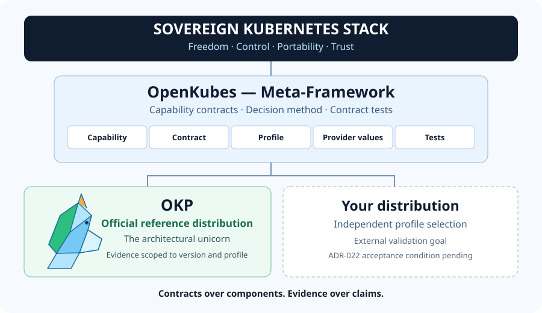

# The Sovereign Kubernetes Stack

*OpenKubes, the Meta-Framework — and OKP, the Architectural Unicorn.*

[OpenKubes Architecture Series](index.md) · Chapter 01 · Architecture perspective

Kubernetes gave us an extraordinary foundation for building platforms. It did not decide which infrastructure we must own, which storage systems we must trust, which AI models may reason about our workloads, or who may authorize changes.

Those choices belong to the people building and operating the platform.

Digital sovereignty is not achieved simply by installing Kubernetes on a server in a particular country. Location matters, but so do the ability to recover, to change suppliers, to understand the system, and to retain meaningful control over its operations.

**Sovereignty is not about owning every component. It is about retaining the freedom to replace components without losing control, knowledge or trust.**

That freedom is an architectural goal, not a claim that any replacement is effortless.

## Beyond traditional distributions

A distribution makes a valuable set of technology and integration choices on behalf of its users. But what happens when their requirements change? A storage implementation may no longer meet an edge deployment's constraints. An infrastructure provider may become unsuitable. An AI runtime may need to change.

The question is not whether a distribution contains enough components. It is whether the guarantees that consumers rely on can survive a change of implementation.

OpenKubes approaches this problem one level above individual tools: it is a framework for building sovereign Kubernetes platform distributions. We use *meta-framework* here as an explanatory term for that architecture, not as a new product or runtime.

## OpenKubes defines the framework. OKP proves it can run.

**OpenKubes** defines capability contracts, the decision method and contract tests. **OpenKubes Platform (OKP)** is the official reference distribution built with those principles. A custom distribution built with OpenKubes is not another OKP.

The analogy is Yocto and Poky: a framework provides the means to construct distributions; a reference distribution demonstrates a concrete assembly. This is the structural analogy recorded in [ADR-Platform-022](https://github.com/openkubes/openkubes/blob/main/architecture/decisions/ADR-Platform-022-distribution-framework-not-a-distribution.md).

An important qualification: ADR-022 remains Draft, with its acceptance condition requiring a first independently assembled external distribution. The framework thesis is therefore not yet independently established by a second distribution. Conformance must always identify the contract version and applicable profile. See the [canonical naming rules](https://github.com/openkubes/openkubes/blob/main/NAMING.md).

## From capabilities to evidence

**Capability → Contract → Implementation Profile → Provider Values → Contract Tests**

Imagine a platform that needs persistent storage. The capability describes that need. The contract states the behavior consumers may depend on. An implementation profile chooses a technology that can satisfy it. Provider values configure that choice for a particular environment. Contract tests examine the applicable guarantees.

The accepted [ADR-Platform-001](https://github.com/openkubes/openkubes/blob/main/architecture/decisions/ADR-Platform-001-contracts-not-components.md) captures the central principle: OpenKubes owns the contracts, not the components.

Different environments need different guarantees. A constrained edge site is not a datacenter in miniature. [Constraint Envelopes](https://github.com/openkubes/openkubes/blob/main/architecture/decisions/ADR-Platform-017-constraint-envelopes.md) explicitly scope guarantees to the operating environment. Replaceability is conditional on satisfying those guarantees; it does not imply automatic migration of state or unrestricted interoperability.

## Eight dimensions of sovereignty

The following dimensions are a proposed editorial lens for examining a platform, not a new contract taxonomy or certification scheme.

| Dimension | The question a sovereign platform should answer |
| --- | --- |
| Infrastructure | Can we choose where our workloads run and validate the applicable lifecycle operations? |
| Technology | Can we replace a component while preserving its contract? |
| Operations | Can we control upgrades, recovery and desired-state transitions? |
| Data | Can we control data location, access, retention, backup and restoration? |
| AI | Can we choose inference providers and bound agent access and authority? |
| Knowledge | Can we preserve the reasons behind decisions and recover that knowledge? |
| Governance | Can accountable humans define, review and revoke operational authority? |
| Verification | Can we demonstrate which guarantees actually held in a named environment? |

These are complementary questions, not eight independent products. A locally hosted AI model does not establish data sovereignty by itself. A successful deployment does not establish recoverability. An open-source license does not alone establish operational independence.

## OKP — the architectural unicorn

Why a unicorn? Not a valuation, not a claim of being the only platform of its kind, and not a promise that every capability is ready today.

It is a metaphor for an unusual architectural ambition: combine infrastructure choice, replaceable technology, controlled operations, durable knowledge and evidence-based governance in one coherent reference distribution.

The value of OKP is that this ambition has a concrete place to be tested. Explore the [BYOH Advanced Guide](/docs/byoh/advanced-guide/) for scoped real-host lifecycle work, [OK Observability](/observability/contract/) for capability guarantees, and the [Living Knowledge Graph](/knowledge-graph/) for Git-derived architecture relationships.

The graph is already an accessible engineering knowledge projection, not a certified ontology. The [AI roadmap](/ai/ai-roadmap/) and [experiment registry](/research/experiments/) deliberately distinguish proposed agent capabilities from local lab outcomes. General autonomous production remediation is not established by those experiments. The [contracts inventory](https://github.com/openkubes/openkubes/blob/main/architecture/contracts-inventory.md) records the different maturity levels of platform contracts.

## Security first, not sovereignty by assertion

Control has to survive the lifecycle. A recovered system must not silently recover revoked authority. An agent that understands an operation must not thereby gain the right to execute it.

[Security First](../security-first.md) is the architectural foundation. Human governance, policy enforcement, authorized execution and evidence are separate responsibilities. Sovereign operation requires more than possession of infrastructure: it requires meaningful, testable control of those boundaries.

## From infrastructure to intelligence

[The Immortal Platform](/openkubes-self-healing-blog-post/) explores infrastructure continuity. [The Immortal Mind](/openkubes-ai-immortal-mind-manifesto/) extends that ambition to engineering knowledge. The Living Knowledge Graph makes some of that knowledge explorable today.

Our next architectural question is how to give agents trustworthy context without granting additional authority. Context Engineering and Context as Code remain a subject of discovery and a future chapter in this series.

**Context Grounds. AI Thinks. Humans Govern. OpenKubes Executes. Evidence Proves.**

This is a direction for architecture and verification, not a declaration of fully implemented autonomy.

## Build your own sovereign Kubernetes distribution

Deploy OKP as provided, adapt it, or use OpenKubes to build your own sovereign Kubernetes platform distribution. Start by identifying the capabilities you actually need, the constraints of your environment, and the evidence you expect before trusting an implementation.

We invite independent distribution builders to challenge the framework thesis with their own profile selections, provider values and contract tests.

[Explore the architecture](../index.md) · [Getting started](/getting-started/) · [Source repository](https://github.com/openkubes/openkubes)

Continue with [Chapter 02 — The Immortal Platform](/openkubes-self-healing-blog-post/) or return to the [Architecture Series](index.md).
