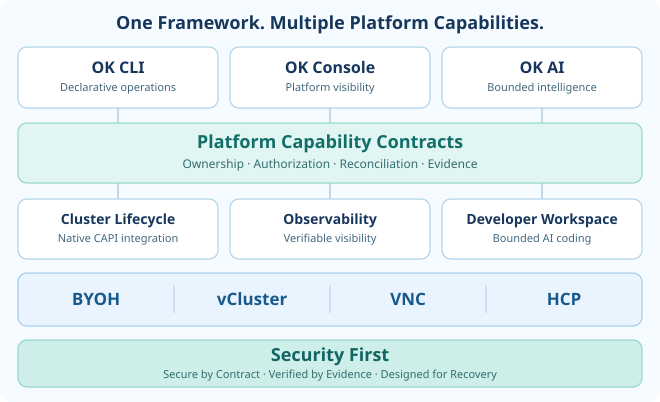

# OpenKubes Features

OPEN SOURCE · SOVEREIGN · CONTRACT-DRIVEN

<h2>Your infrastructure. Your platform. Your control.</h2>

Build, operate and evolve sovereign Kubernetes platforms across physical, virtual and cloud infrastructure — with explicit lifecycle contracts, security boundaries and verifiable outcomes.

<a class="ok-features-primary" href="/architecture/">Explore Architecture</a><a href="/tutorials/">Get Started</a>

## Platform capabilities at a glance

*Conceptual capability model — individual capabilities have different maturity levels.*

## Explore platform capabilities

<article class="ok-feature-card"><svg viewBox="0 0 24 24" width="28" height="28" fill="none" stroke="currentColor" stroke-width="1.7" stroke-linecap="round" stroke-linejoin="round" aria-hidden="true" focusable="false"><rect x="3" y="3" width="18" height="8" rx="2"/><rect x="3" y="13" width="18" height="8" rx="2"/><path d="M7 7h.01M7 17h.01M11 7h6M11 17h6"/></svg><h3>Infrastructure Freedom</h3>
Run Kubernetes on existing physical or virtual hosts with BYOH. Keep infrastructure choices separate from the lifecycle contract.
<a href="/docs/byoh/advanced-guide/">BYOH Advanced Guide →</a></article>
<article class="ok-feature-card"><svg viewBox="0 0 24 24" width="28" height="28" fill="none" stroke="currentColor" stroke-width="1.7" stroke-linecap="round" stroke-linejoin="round" aria-hidden="true" focusable="false"><path d="M20 8a8 8 0 0 0-14-3L3 8m0-5v5h5M4 16a8 8 0 0 0 14 3l3-3m0 5v-5h-5"/></svg><h3>Kubernetes Lifecycle Management</h3>
Use native Cluster API resources to manage desired state. Explore controlled in-place upgrades, explicit approval and recovery boundaries.
<a href="/architecture/capi/">CAPI Architecture →</a></article>
<article class="ok-feature-card"><svg viewBox="0 0 24 24" width="28" height="28" fill="none" stroke="currentColor" stroke-width="1.7" stroke-linecap="round" stroke-linejoin="round" aria-hidden="true" focusable="false"><rect x="2" y="4" width="20" height="16" rx="3"/><path d="m6 9 4 3-4 3m7 0h5"/></svg><h3>Declarative CLI</h3>
Declare cluster requests, review plans and initiate supported lifecycle workflows using the OK CLI community preview.
<a href="/tutorials/ok-cli-v1.0.1-getting-started/">OK CLI Getting Started →</a></article>
<article class="ok-feature-card"><svg viewBox="0 0 24 24" width="28" height="28" fill="none" stroke="currentColor" stroke-width="1.7" stroke-linecap="round" stroke-linejoin="round" aria-hidden="true" focusable="false"><rect x="2" y="3" width="20" height="15" rx="2"/><path d="M8 22h8m-4-4v4M6 14l4-4 3 2 5-5"/></svg><h3>OpenKubes Console</h3>
Explore an evidence-backed platform UI for cluster visibility and rehearsing guarded operations in a local evaluation environment.
<a href="/console/">Explore OK Console →</a></article>
<article class="ok-feature-card"><svg viewBox="0 0 24 24" width="28" height="28" fill="none" stroke="currentColor" stroke-width="1.7" stroke-linecap="round" stroke-linejoin="round" aria-hidden="true" focusable="false"><rect x="7" y="7" width="10" height="10" rx="2"/><path d="M9 3v4m6-4v4M9 17v4m6-4v4M3 9h4m-4 6h4m10-6h4m-4 6h4"/><circle cx="12" cy="12" r="2"/></svg><h3>AI &amp; Agentic Operations</h3>
Integrate self-hosted AI services and bounded agents. Keep sensitive execution authority independent of LLMs.
<a href="/ai/">Explore OK AI →</a></article>
<article class="ok-feature-card"><svg viewBox="0 0 24 24" width="28" height="28" fill="none" stroke="currentColor" stroke-width="1.7" stroke-linecap="round" stroke-linejoin="round" aria-hidden="true" focusable="false"><path d="M2 12h5l3-8 4 16 3-8h5"/></svg><h3>Observability by Contract</h3>
Define metrics, dashboards, searchable logs, alerting and cluster autonomy as testable guarantees, with explicit network and delivery prerequisites.
<a href="/observability/">OK Observability →</a></article>
<article class="ok-feature-card"><svg viewBox="0 0 24 24" width="28" height="28" fill="none" stroke="currentColor" stroke-width="1.7" stroke-linecap="round" stroke-linejoin="round" aria-hidden="true" focusable="false"><path d="m8 6-6 6 6 6m8-12 6 6-6 6m-2-15-4 18"/></svg><h3>Developer Workspaces</h3>
Explore Kubernetes-native AI-assisted coding with explicit identity, resource, connectivity and lifecycle boundaries.
<a href="/developer-workspace/">Developer Workspace →</a></article>
<article class="ok-feature-card"><svg viewBox="0 0 24 24" width="28" height="28" fill="none" stroke="currentColor" stroke-width="1.7" stroke-linecap="round" stroke-linejoin="round" aria-hidden="true" focusable="false"><path d="M12 2 3 6v6c0 5 4 8 9 10 5-2 9-5 9-10V6zM8 12l3 3 5-6"/></svg><h3>Security &amp; Trust</h3>
Separate intent, authorization, execution and verification. Design for recovery without restoring revoked authority.
<a href="/architecture/security-first/">Security First →</a></article>

## Kubernetes deployment models

<article class="ok-feature-model"><svg viewBox="0 0 24 24" width="28" height="28" fill="none" stroke="currentColor" stroke-width="1.7" stroke-linecap="round" stroke-linejoin="round" aria-hidden="true" focusable="false"><rect x="3" y="3" width="18" height="8" rx="2"/><rect x="3" y="13" width="18" height="8" rx="2"/><path d="M7 7h.01M7 17h.01M11 7h6M11 17h6"/></svg><h3>BYOH</h3>
<strong>Bring Your Own Host</strong>

Native Kubernetes on existing physical and virtual hosts.
</article>
<article class="ok-feature-model"><svg viewBox="0 0 24 24" width="28" height="28" fill="none" stroke="currentColor" stroke-width="1.7" stroke-linecap="round" stroke-linejoin="round" aria-hidden="true" focusable="false"><path d="m12 2 10 6-10 6L2 8zm-10 10 10 6 10-6M2 16l10 6 10-6"/></svg><h3>vCluster</h3>
<strong>Virtual Kubernetes Clusters</strong>

Virtual control planes on shared Kubernetes infrastructure.
</article>
<article class="ok-feature-model"><svg viewBox="0 0 24 24" width="28" height="28" fill="none" stroke="currentColor" stroke-width="1.7" stroke-linecap="round" stroke-linejoin="round" aria-hidden="true" focusable="false"><path d="m12 2 5 3v6l-5 3-5-3V5zm-6 12 5 3v5l-5-3-5-3v-5zm12 0 5-3v5l-5 3-5 3v-5z"/></svg><h3>VNC</h3>
<strong>Virtual Nested Clusters</strong>

Nested Kubernetes environments with distinct guest cluster boundaries.
</article>
<article class="ok-feature-model"><svg viewBox="0 0 24 24" width="28" height="28" fill="none" stroke="currentColor" stroke-width="1.7" stroke-linecap="round" stroke-linejoin="round" aria-hidden="true" focusable="false"><path d="M6 19a5 5 0 0 1-1-10 7 7 0 0 1 13-1 5.5 5.5 0 0 1 0 11z"/></svg><h3>HCP</h3>
<strong>Hosted Control Planes</strong>

Separate control-plane placement from workload infrastructure.
</article>

Different infrastructure models. Shared architectural principles. Independent validation requirements. These are architectural models, not a claim that all four are equally implemented or supported. See [Security First](/architecture/security-first/) and [Kubeception V2](/kubeception-v2/).

## What makes OpenKubes different?

| Principle | What it means |
| --- | --- |
| Contracts over components | Replace implementations without redefining the platform capability. |
| Infrastructure sovereignty | Retain control over infrastructure placement and operational decisions. |
| Native Kubernetes APIs | Build on declarative resources and established ecosystem interfaces. |
| Lifecycle beyond provisioning | Address upgrades, recovery, decommissioning and infrastructure reuse. |
| Policy-bounded autonomy | Agents propose and assist; trusted authorities control sensitive operations. |
| Evidence over claims | Verify operational outcomes rather than trusting success messages alone. |
| Open Source by Design | Maintain transparent implementation, architecture decisions and validation records. |

## Capability maturity & validation

The following is a documented scope overview, not a production certification or universal compatibility matrix. Follow the linked evidence for exact versions, environments and limitations.

| Capability | Documented maturity and scope |
| --- | --- |
| BYOH provisioning | Real-host lab provisioning demonstrated; [guide](/docs/byoh/advanced-guide/). |
| Kubernetes in-place upgrade | Alpha; one five-host HA lab E2E; production security NO-GO; no zero-downtime claim. [Validation & limitations](/docs/byoh/advanced-guide/12-validation-limitations/). |
| OK CLI | Community preview v1.0.1; unsigned artifacts and prepared-management-cluster prerequisites. [Tutorial](/tutorials/ok-cli-v1.0.1-getting-started/). |
| OK Console | Development and evaluation; local fixture-based proof, not production deployment. [Local installation](/console/). |
| OK Observability | Contract-tested reference implementation in documented environments; independent network-health and alert-delivery checks required. [Contract](/observability/contract/). |
| Self-hosted AI services | Internal use and integration; agent authority remains separately bounded. [OK AI](/ai/). |
| Developer Workspace | Bounded disposable-cluster reference proofs; production readiness gates remain open. [Validation](/developer-workspace/status/). |
| Autonomous SRE operations | Research and development; general agent-initiated HOTL is not production-approved. [Agentic Operations](/ai/agentic-operations/). |
| Management pivot & disaster recovery | Architecture defined; dedicated E2E validation pending in the published BYOH guide. [Blueprint](/architecture/capi/blueprint/). |
| Automated host reuse | Development; full lifecycle E2E pending in the published guide. [Lifecycle](/docs/byoh/advanced-guide/11-cluster-lifecycle/). |

## Open ecosystem

<h3>Built with the ecosystem. Not locked into it.</h3>

OpenKubes integrates established open-source technologies behind explicit platform contracts.

KubernetesCluster APIOpenTofuCrossplaneCiliumPrometheusGrafanaOpenSearchOpenCodeOpen WebUIOpenClawkagent

Selected technologies across implementation and evaluation profiles; inclusion is not a support or certification claim.

<a href="/open-universe/family/">Explore the Open Universe Technology Guide →</a>

**Contracts over components. Evidence over claims.**

[Explore the platform architecture](/architecture/) · [Read the BYOH Advanced Guide](/docs/byoh/advanced-guide/) · [Try a local CAPD environment](/tutorials/capd-local-dev-environment/)
