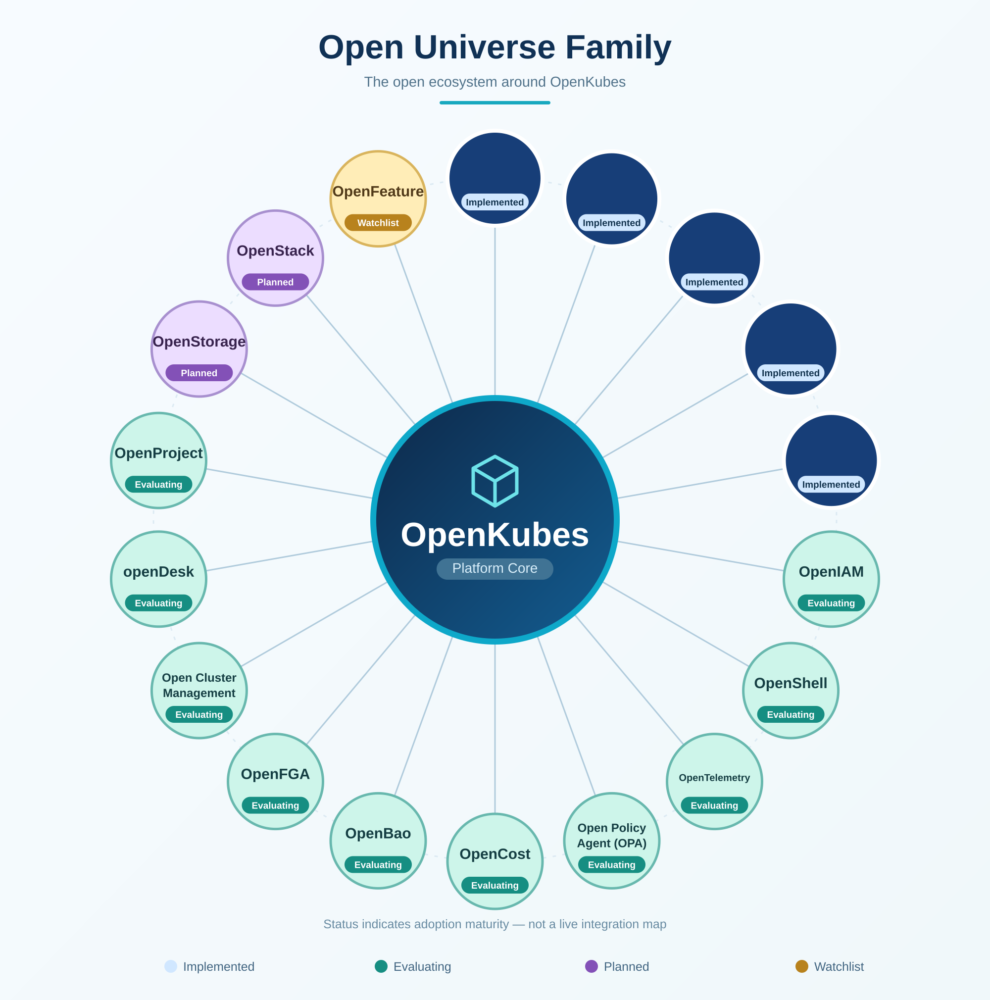
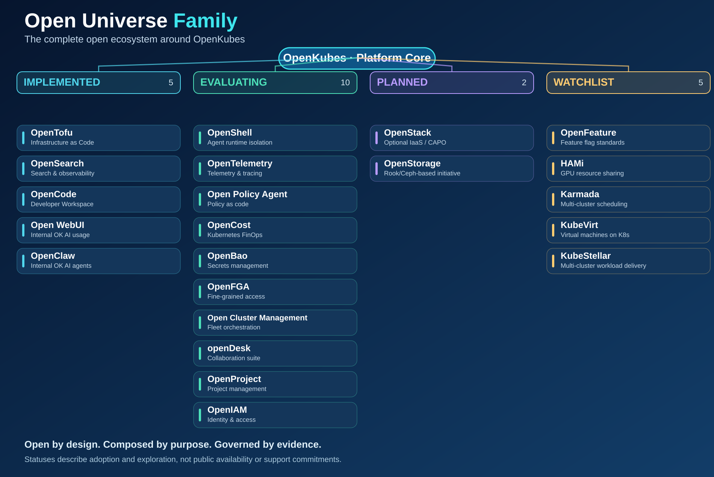

# OpenKubes Open Universe

**The open ecosystem around OpenKubes.**

Open source is more than a list of tools. **Open Universe** is our approach to composing selected open-source technologies around OpenKubes, with clear ownership boundaries, open interfaces and independently verifiable outcomes.

[**Open the full-size Open Universe Family SVG →**](open-universe-family.svg)

*The graphic shows technology families and architectural opportunities, **not** an assertion that every listed component is integrated or available as a supported OpenKubes offering.*

## Open by design. Composed by purpose. Governed by evidence.

- **Open by design:** Prefer open APIs and interoperability over permanent dependency on one vendor or implementation.
- **Composed by purpose:** Add a component only when it solves a real platform or user problem.
- **Governed by evidence:** Separate proposals, trusted authorization, execution and independently verifiable outcomes.
- **Optional by default:** Customer applications and infrastructure integrations should not silently become mandatory platform dependencies.

## Explore the family

| Area | Representative technologies | Architectural intent |
| --- | --- | --- |
| Infrastructure | OpenTofu, OpenStack | Declarative provisioning and optional IaaS providers |
| AI & agents | OpenCode, Open WebUI, OpenClaw, OpenShell | Developer workflows, self-hosted interfaces and bounded agent runtimes |
| Security & identity | OpenIAM, OpenFGA, Open Policy Agent, OpenBao | Federated identity, authorization, policy and secrets |
| Storage & FinOps | OpenStorage (Rook/Ceph initiative), OpenCost | Optional storage and cost visibility |
| Apps & collaboration | openDesk, OpenProject | Optional applications on Kubernetes |
| Observability & fleet | OpenSearch, OpenTelemetry, Open Cluster Management | Operational evidence, telemetry and multi-cluster capabilities |

## Complete Open Universe Family

The compact visual above introduces the ecosystem at a glance. For the **full technology family**, we maintain a readable, expanded diagram and individual descriptions of every currently tracked project.

[**Explore all 23 Open Universe technologies and their roles →**](family.md)

*Zoom in to read the full-size diagram; a text-based, accessible inventory with individual descriptions is available on the [Family page](family.md).*

## Technology radar

The radar differentiates between **Implemented**, **Evaluating**, **Planned** and **Watchlist**. *Implemented* can mean deployed in a specific internal environment; it does **not** imply general availability, production hardening or commercial support.

### Implemented

| Technology | Current context |
| --- | --- |
| OpenKubes | Core platform |
| OpenTofu | Infrastructure as Code; consolidation in progress |
| OpenSearch | Existing observability component |
| OpenCode | Developer Workspace integration |
| Open WebUI | Used internally on OK AI |
| OpenClaw | Used internally on OK AI |

### Evaluating

| Technology | Proposed role |
| --- | --- |
| OpenShell | Isolated agent runtime |
| OpenTelemetry | Standardized telemetry and tracing |
| Open Policy Agent (OPA) | Policy-as-code and governance |
| OpenCost | Cost allocation and FinOps |
| OpenBao | Secrets management |
| OpenFGA | Fine-grained authorization |
| Open Cluster Management | Fleet orchestration and add-on management |
| openDesk | Optional collaboration application |
| OpenProject | Optional project management application |
| OpenIAM | Identity and access management candidate |

### Planned

| Technology | Scope |
| --- | --- |
| OpenStack | Optional IaaS composition and CAPO integration; see ADR-Platform-040, OK-184, OK-106 and OK-108 |
| OpenStorage | Proposed Rook/Ceph-based storage distribution; fork/upstream strategy and operations are not yet finalized |

### Watchlist

OpenFeature, HAMi, Karmada, KubeVirt and KubeStellar remain technologies to monitor. A watchlist entry is **not** a commitment to integrate.

## How decisions are made

We evaluate candidates for tangible value, architecture compatibility, security and governance, implementation and maintenance cost, project health, licensing, and upstream sustainability. We prefer adapters and standards over unnecessary forks.

**Near-term delivery remains focused on the OpenKubes CLI, cluster lifecycle and `ok up`.** Open Universe must not derail those priorities.

The radar is reviewed regularly; proposed status changes require evidence and normal architectural review.

## Join the conversation

Which open-source technology would you add to the Open Universe Family?

Explore the [OpenKubes repository](https://github.com/openkubes/openkubes), our [platform architecture](/architecture/) and the [OK AI overview](/ai/).

*OpenKubes is an independent project. Listing third-party technology does not imply endorsement, affiliation, or product availability.*
