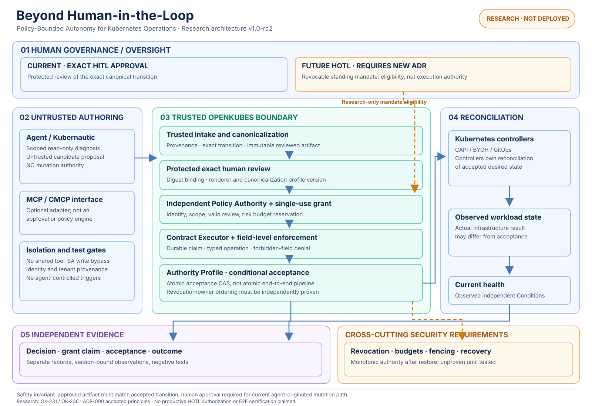

# Beyond Human-in-the-Loop: Policy-Bounded Autonomy for Kubernetes Operations

*How human review and supervision fit independently authorized, recoverable Kubernetes operations.*

**OpenKubes Research Paper 001 · Reviewed Research**

> Secure by Contract. Verified by Evidence. Designed for Recovery.  
> Humans govern. Policies constrain. Machines execute. Evidence verifies.

## Why agent confidence cannot be operational authority

An AI agent observes a Kubernetes node in `NotReady`, correlates events, and proposes remediation. Should it execute automatically? The answer depends not on confidence but on **who authorizes which exact operation, in which state, with which enforcement and independently checked outcome**. A safe response in an isolated kind namespace may be destructive during an upgrade, a management handover, or a capacity emergency.

OpenKubes' accepted **ADR-Platform-000** establishes lifecycle security principles, not production certification. Its least-privilege, independent-mutation-authority, monotonic-revocation, fencing and evidence requirements constrain any future Agentic Operations design.

## Two oversight patterns; one independently enforced boundary

**Human-in-the-Loop (HITL)** describes concrete human participation in a decision. In the **currently proposed OpenKubes agent-originated mutation path**, a protected human approves the *exact reviewed canonical transition* before Policy Authority may authorize it (ADR-035). **Human-on-the-Loop (HOTL)** describes human governance of a predefined class of operations, continuous supervision and intervention. **Policy-Bounded Autonomy** is the technical property that identity, scope, preconditions, budget and authority limits are enforced independently of the agent. These are orthogonal concepts, **not** successive maturity tiers.

A UI `requireApproval` switch, prompt, sandbox, MCP/CMCP adapter or model output is **not** the authoritative approval or execution boundary. A hosted sandbox may isolate computation, but it cannot grant the right to mutate the platform. Core OpenKubes must operate without agents.

*Conceptual architecture, not a deployed system diagram. Solid HITL flow represents the current proposed ADR-035 design; the dashed standing-mandate branch remains research only. Select the diagram to enlarge it in an overlay without leaving this page (on GitHub, the original SVG opens normally).*

## The current proposed execution contract

1. **Untrusted agent or client:** reads explicitly scoped, redacted diagnostics and submits a candidate-only request. Agent-controlled annotations, events or candidate objects must not quietly become trusted triggers for privileged controllers.
2. **Trusted intake and provenance:** a trusted service authenticates the original caller and tenant, attests request origin outside agent-writable fields and isolates candidate storage from authoritative Git refs and controller-watched resources.
3. **Canonicalization and planning:** a trusted, version-pinned canonicalizer rejects ambiguous inputs, duplicate keys, parser-dependent representations and unsupported schemas. It determines the semantic transition from the authoritative predecessor and produces an immutable, human-visible review artifact reflecting effective defaults and material dependencies.
4. **Protected human review (current path):** approval binds the reviewer identity; immutable rendered review artifact and its digest; renderer and canonicalization profile versions; exact canonical request digest, predecessor and requested revision; and trusted transition identity. Any post-review change invalidates approval. An opaque digest by itself is not meaningful review.
5. **Independent Policy Authority:** verifies protected approval and policy conditions, then issues a protected single-use authorization bound to the exact transition, audience, validity interval and allowed use count. It does not accept desired state.
6. **Bounded Contract Executor:** independently verifies the grant, trusted request digest and target identity. It durably claims the single-use authorization before any possible write, applies typed operation and field restrictions, and enforces the verified authorization at the mutation boundary. It must reject **approve A / execute B** even when the caller is privileged.
7. **Authority Profile:** conditionally accepts the exact desired revision by an **atomic compare-and-swap of the authoritative acceptance record**. This does **not** make the whole claim → check → acceptance pipeline atomic. The acceptance record binds the transition and authorization. `INDETERMINATE` requires durable inspection and bounded resolution, not blind grant replay.
8. **Controllers and evidence:** CAPI/BYOH, Enablement and GitOps controllers reconcile the accepted state. Separate independent sources record policy decision, grant claim, authority acceptance, historical transition outcome and dynamic health. **Acceptance ≠ execution success ≠ convergence.**

### The real identity and admission boundary

Earlier kagent experiments found that Kubernetes tool calls were executed as a **tool-server ServiceAccount**, not necessarily the agent Pod identity. Shared tool-server privilege is a potential *confused deputy*. A future design must ensure that an agent, tool adapter or agent-writable trigger cannot reach mutation interfaces outside the trusted approval/execution path. Execution must be bound to the authorized operation and its originating principal/tenant; this does **not necessarily require a new Kubernetes ServiceAccount per operation**, but it does require demonstrably equivalent isolation at every exposed route. Tests must prove that agent A cannot exercise agent B's authority and that an untrusted agent cannot bypass the canonicalizer via direct Kubernetes, Git, provider or other tool access.

Admission enforcement sees the **actual Kubernetes submitting identity**, typically an executor service identity; it does not automatically receive the original mandate. A protected grant/context binding and a trusted, independently testable enforcement point are needed. Candidate designs include scoped executor identities, a verified authorization gateway and carefully constrained impersonation; **Kubernetes impersonation is not a blanket requirement and a claim in a header is not proof**. Typed fixed-field APIs and independent object-level/admission validation must reject prohibited changes such as Pod-template `serviceAccountName`, image, command, Secret mounts or privileged container fields. Ensure the effective admission path is fail-closed and independently monitored.

## Four candidate operating models, not a progression

| Model | Decision mode | Normative status |
| --- | --- | --- |
| **A: exact HITL** | Protected human review of every agent-originated canonical transition | Current proposed ADR-035 path |
| **B: asynchronous HITL** | Durable queue; same exact human approval before authorization | Research: persistence / latency / recovery unsettled |
| **C: policy-bounded HOTL** | Human-approved scoped mandate may establish eligibility for individual single-use grants | **Future hypothesis; requires a new accepted normative ADR and reconciliation with ADR-035/042** |
| **D: deterministic platform automation** | A trusted controller reacts to independently established observations under its own approved policy, not via an agent-originated shortcut | Distinct alternative requiring its own bounded trigger and safety contract |

## Proposed future HOTL: mandates are not agent RBAC

A **Standing Policy Mandate** could describe a human-approved, revocable *eligibility envelope*: operation class, immutable tenant/resource scope, versioned policy, TTL, allowed fields, conditions, owner, risk/concurrency budget and stop rules. It is **not** a long-lived mutation credential or permanent RBAC addition to an agent. A **Single-Use Transition Grant** is a distinct, tightly bound execution authorization for one canonical transition. The issuance and acceptance paths must not allow a grant to outlive a revoked mandate contrary to the specified race semantics.

The future ADR must define **which security facts are checked at authoritative acceptance, and a linearization order** for revocation, expiry, owner fencing, budget reservation and desired-state commit. Merely checking mandate validity before a separate CAS is vulnerable to time-of-check/time-of-use races. If a selected Git-backed or API-backed Authority Profile **cannot** enforce the ordering guarantee, it must **not claim** reliable pre-acceptance revocation and must not enable that HOTL mode.

Risk and concurrency budgets require **atomic reservation against other contenders within the relevant budget domain**, an explicit charge/commit/release rule and durable reconciliation of uncertain work. Two individual valid grants cannot both consume a single remaining slot. Timeouts must not release budget while effects may still be in flight. A single global shared transaction is a possible implementation, **not** an assumption of existing ADR-034 profiles.

### Stop, indeterminate outcomes and the liveness trade-off

Stop has distinct meanings: (a) stop intake, (b) deny new grants, (c) fence unaccepted operations at a proven point, (d) suspend controllable execution steps, and (e) initiate a separately authorized recovery when desired state is already accepted. A Stop UI may acknowledge only what its enforcement and evidence prove. An accepted Kubernetes revision cannot be retroactively 'unaccepted', and running reconciliation cannot generically be cancelled instantaneously.

A fresh Policy Authority decision on every **agent-originated** mutation creates a deliberate availability dependency: if the Policy Authority or revocation source is unavailable, new agent-driven authority must fail closed. Routine operational liveness may be preserved in selected circumstances by **independent pre-authorized deterministic controllers (model D)**, but only when their observations, policy and scope remain trustworthy during the outage. Model D is not a general bypass or a claim of immunity from failures.

## Three authorization races that determine safety

A future HOTL implementation must define a defensible *authoritative ordering*, not merely a short interval between policy evaluation and Kubernetes acceptance. Consider an operator revoking a mandate while a previously issued single-use grant is being used:

| Event ordering | Correct interpretation | What the system may claim |
| --- | --- | --- |
| **Revocation wins before acceptance** | The selected Authority Profile must deny any subsequent acceptance covered by that revoked authority, **if** it claims strict pre-acceptance revocation. | `FENCED_PRE_ACCEPTANCE` only after the actual writer boundary is fenced and independently checked. |
| **Acceptance wins before revocation** | The accepted desired revision remains authoritative; revocation prevents new authorization but does not undo prior acceptance or cancel reconciliation. | `ACCEPTED_BEFORE_REVOKE`; recovery requires a separately authorized transition. |
| **Commit or response is indeterminate** | Inspect the complete immutable acceptance identity and authoritative store. Do not replay a consumed grant for another transition, release budget prematurely or infer failure from a timeout. | `INDETERMINATE` / `RECOVERY_REQUIRED` until evidence resolves the result. |

The crucial caveat is that **the chosen serialization mechanism is not yet selected or validated**. ADR-034 provides conditional authority acceptance and single-use transition concepts, but a CAS on desired state alone does not atomically check independently stored mandate revocation, owner epoch or shared risk budgets. A future protocol must prove these properties under crash, concurrency, restore and alternate-writer conditions before enabling the HOTL path.

### Git-backed and Kubernetes-API-backed authority are not interchangeable implementations

A protected Git ref can be updated conditionally, but a ref CAS cannot by itself order that write against revocation in an independent security system. A Kubernetes API `resourceVersion` precondition similarly protects a particular object update, not a cross-resource security transaction. Both profiles need independently testable safeguards against bypassing the accepted writer path, stale ownership and unsafe restore. Neither should claim strong revocation semantics until an authoritative ordering and fencing point is proven for that profile.

If policy or current security facts are unavailable, new **agent-originated** authority must fail closed. That safety decision has an availability cost. Independently authorized deterministic controllers may preserve bounded operations in a degraded mode only where their own trigger, policy, identity and fencing remain valid; they are not a blanket fallback for agent-generated requests.

## Six concrete Kubernetes scenarios

### 1. Routine workload remediation — isolated security-lab hypothesis

An isolated kagent lab proposes periodic diagnosis and a narrowly scoped Pod/Deployment repair in one kind namespace. HOTL is the **experiment's supervised demonstration**, not an accepted production exception. The target action must have fixed editable fields, independent admission checks, one identity-bound decision and an enforceable stop. A separate, explicitly authorized *inverse transition* may exist; that does **not** imply a cheap undo of evictions, rollout effects or data changes. Negative tests include cross-namespace writes, cross-agent identities, direct tool-server API bypass, Secret access, illicit Pod-template fields, revoked grants and stale approvals.

### 2. BYOH in-place upgrade — exact HITL

The human reviews a specific Cluster/Machine/host set, version transition, execution artifacts, intended lifecycle profile and readiness/recovery prerequisites. Execution must match the reviewed artifact and protected MachineDeployment/MachineSet/host identities; a declined or failed in-place upgrade **must not trigger an unauthorized replacement fallback**. No-Replacement Protection remains engaged. Recovery or replacement requires its own authorized transition and independent host-release/sanitization evidence. Relevant real-BYOH protected E2E outcomes are **not proven** by the published bounded DEV spike.

### 3. Machine replacement — distinct authority

Replacement is not an upgrade side effect. A distinct protected decision names the old Machine and host, permitted replacement target, availability constraints, provider effects and required independent host-reset/reassignment checks. Negative testing attempts CREATE/DELETE using an upgrade grant or a host's self-declared clean state; both must be denied without the distinct replacement authorization.

### 4. Management-plane handover — ownership before activation

A human-authorized handover must fence the prior owner at **all relevant write boundaries**: workload APIs, BYOH host actions and provider interfaces. Merely shutting down old controllers is insufficient against a disconnected/returning owner. Negative testing reconnects the old owner and attempts writes. A destination owner remains quarantined where effective fencing is unverifiable; integrated cross-boundary proof is still open.

### 5. Disaster recovery — current authority survives old snapshots

Restore a backup predating revocation and grant consumption. Prior to ordinary access and reconciliation, establish current security facts **independently of the restored cluster's snapshot** or independently invalidate affected authority. Revocation, retired identities, consumed grants and ownership epochs must not roll back. Relevant records and tamper-evident evidence require an appropriately independent restore/compromise domain; their exact storage design is unresolved. Independently detect absent or degraded enforcement, not merely missing denials. If freshness/fencing cannot be proven, quarantine and follow authorized recovery procedures.

### 6. Cluster destruction — exact human review and independent absence proof

`DeleteCluster` requires protected approval of the exact target and retention/provider scope. Atomic acceptance of `DESIRED_ABSENT` makes absence *desired*; only cleanup verification establishes `CONFIRMED_ABSENT`. Finalizer progress, credentials, external resources and terminal evidence survive removal of the top-level object. A successful API response or absent Kubernetes object is not proof of infrastructure destruction.

## Evidence and maturity: what is proven, and what is not

The kagent kind security-lab PoC is **in progress**. Findings from earlier tool-server experiments guide negative tests but cannot serve as fresh proof. The status of any lab test is **PASS / FAIL / NOT PROVEN** against exact component versions, identities and artifacts; a lab PASS never authorizes production HOTL. Related architecture research is investigating risk acceptance, asynchronous approval, bounded standing mandates and deterministic automation. ADR-030's bounded DEV-profile evidence does not establish general BYOH upgrade, recovery or HOTL E2E guarantees.

For a deployment-profile production claim, require **requirement → enforcement point → positive/negative tests → version-bound evidence → scoped approval**. A policy that can silently be disabled without independent detection does not meet ADR-000's requirements. Unverified claims remain NOT PROVEN, not assumed PASS.

## Publication boundary and next research

The diagram accompanying this draft depicts **logical responsibilities**, not an implemented service topology. The future HOTL path is deliberately dashed and labelled **RESEARCH ONLY — NEW ADR REQUIRED**. A conformant design still needs an explicit Authority Profile protocol for concurrent budget reservations, revocation ordering at acceptance, identity-bound admission and restore-independent security facts. The existing ADR-035/042 requirements must be reconciled by an accepted normative change **before** agent-originated HOTL mutations become an approved platform option.

**The goal is not maximum autonomy; it is the maximum safe delegation of explicitly authorized operational responsibility.**

This publication explains a proposed architecture and its explicit proof obligations. It does **not** announce working standing-mandate authorization, production HOTL, a selected authorization store, or successful end-to-end revocation/restore enforcement.

> Humans govern. Policies constrain. Machines execute. Evidence verifies.

### References and boundaries

- [Security First introduction](https://openkubes.org/architecture/security-first/) and [accepted ADR-Platform-000](https://github.com/openkubes/openkubes/blob/main/architecture/decisions/ADR-Platform-000-security-first.md) — architectural principles, not deployment certification.
- [ADR-Platform-030](https://github.com/openkubes/openkubes/blob/main/architecture/decisions/ADR-Platform-030-control-plane-execution-model.md), [031](https://github.com/openkubes/openkubes/blob/main/architecture/decisions/ADR-Platform-031-ok-mgmt-disaster-recovery.md), [034](https://github.com/openkubes/openkubes/blob/main/architecture/decisions/ADR-Platform-034-ok-up.md), [035](https://github.com/openkubes/openkubes/blob/main/architecture/decisions/ADR-Platform-035-hybrid-intent-and-control-plane-execution.md), [042](https://github.com/openkubes/openkubes/blob/main/architecture/decisions/ADR-Platform-042-openshell-hosted-external-agentic-operations.md) — proposed execution/agentic/recovery contracts unless individually accepted later.
- Related internal architecture research and an isolated kagent security lab are ongoing; neither authorizes production autonomy. Public findings will be linked here when available.

*Research scope: This paper does not claim operational production certification or completed HOTL E2E validation.*