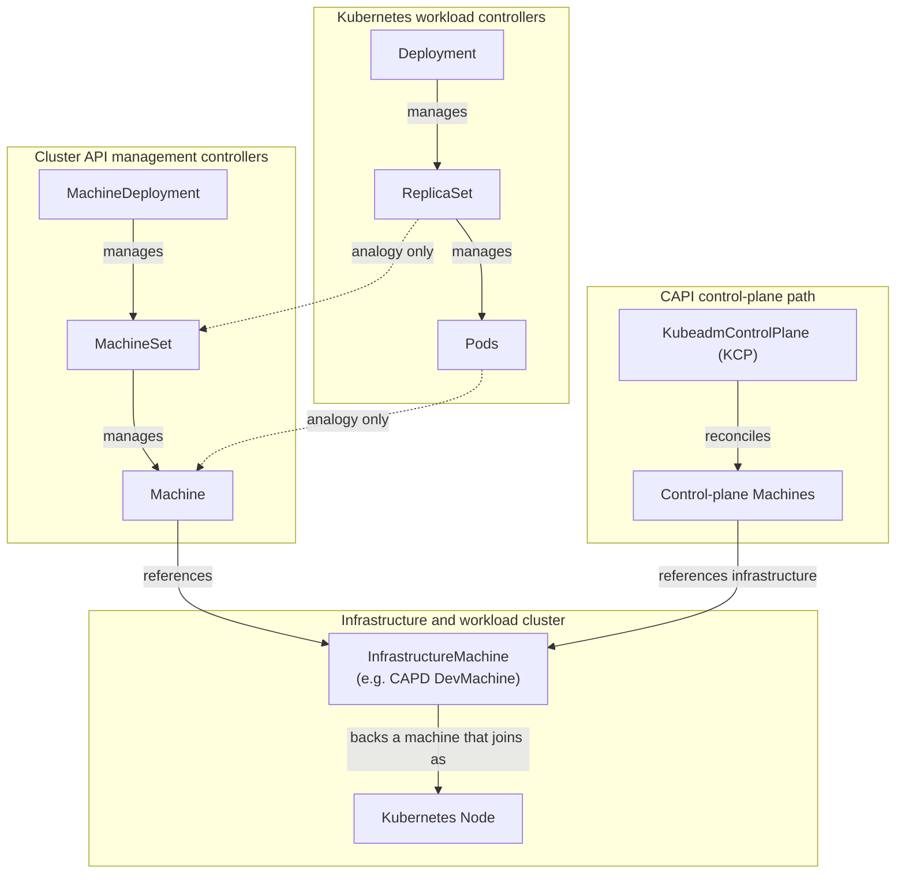
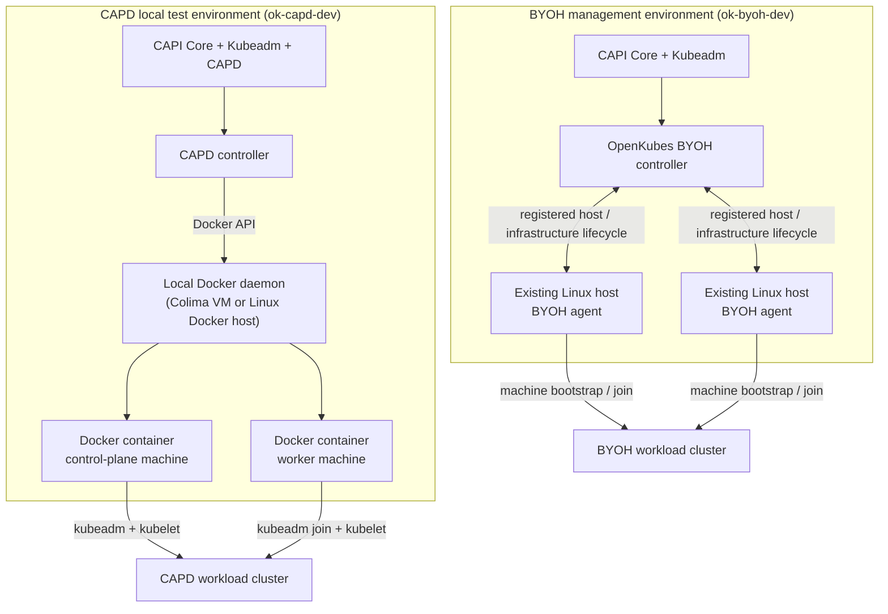
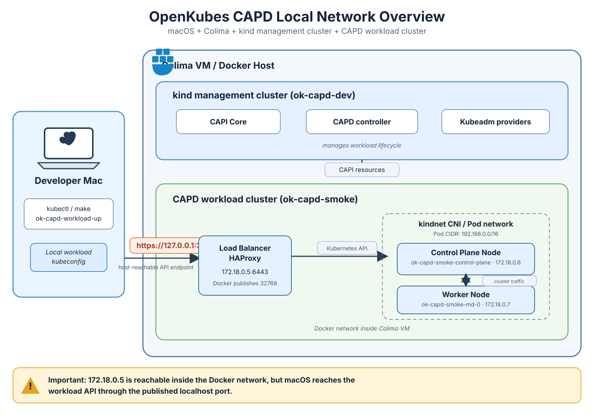

# Build a local OpenKubes BYOH development environment with CAPD

> **Community contributor tutorial — 21 November 2026**
>
> This tutorial documents the local CAPD developer environment in
> `openkubes/ok-baremetal-byoh`. The management-cluster bootstrap, provider
> checks, Docker-socket verification and first CAPD workload creation have
> succeeded on macOS Apple Silicon with Colima. Both workload Nodes and the
> kindnet DaemonSet reached Ready. The CAPI-driven workload deletion and Linux
> validation remain before this tutorial is considered fully end-to-end
> verified across platforms.

## TL;DR

From the repository root, these five commands cover the main local CAPD
developer lifecycle:

| Command | Purpose |
| --- | --- |
| `make ok-capd-setup` | Start the complete environment: management cluster, CAPI/CAPD providers, smoke checks and sample workload cluster. |
| `make ok-capd` | Create or verify only the Kind management plane with CAPI, Kubeadm, CAPD and cert-manager. |
| `make ok-capd-workload-up` | Create or verify the disposable CAPD workload cluster. |
| `OK_CAPD_CONFIRM_WORKLOAD_DELETE=ok-capd-smoke make ok-capd-workload-down` | Delete only the sample workload through CAPI; preserve the management cluster. |
| `OK_CAPD_CONFIRM_DELETE=ok-capd-dev make ok-capd-clean` | Delete the management Kind cluster after safety checks and explicit confirmation. |

For inspection without changing resources, use `make ok-capd-status`,
`make ok-capd-workload-status` and `make ok-capd-report`. For troubleshooting,
use `make ok-capd-workload-diagnose`. These supporting commands are explained
in the detailed Make-target reference below.

`make ok-capd-setup` is the recommended first-time path. It does not install
the OpenKubes BYOH controller. The existing `make ok-up` workflow is separate
and must not share the CAPD Kind cluster or kubeconfig.

The RuntimeSDK and No-Replacement targets are reserved but not implemented:
`make ok-capd-inplace-test` and `make ok-capd-guard-test` currently report
that status rather than running tests.

## What you will build

You will create an isolated local Cluster API (CAPI) management cluster using
Kind, then install the Cluster API Docker infrastructure provider (CAPD).
CAPD lets CAPI create disposable Kubernetes workload-cluster machines as
Docker containers.

The environment is intended for OpenKubes contributors developing and testing
the BYOH infrastructure provider. CAPD supplies repeatable, disposable
infrastructure; BYOH remains the provider under development.

The workflow is deliberately separate from the existing local BYOH management
workflow:

| Environment | Purpose | Kind cluster | Kubeconfig |
| --- | --- | --- | --- |
| Existing BYOH workflow (`make ok-up`) | BYOH management and host lifecycle | `ok-byoh-dev` | `~/.config/ok/byoh-dev/kubeconfig` |
| Local CAPD workflow (`make ok-capd`) | Disposable CAPI/CAPD development | `ok-capd-dev` | `~/.config/ok/capd/kubeconfig` |

They must not share a Kind cluster or kubeconfig. The CAPD workflow does not
use Scaleway inventories, SSH tunnels, OpenTofu state or BYOH host credentials.
It does not modify `ok-up`.

## 1. A short introduction to Cluster API

Kubernetes manages the workloads running inside a cluster. Cluster API manages
the lifecycle of Kubernetes clusters themselves.

CAPI runs in a **management cluster**. Its controllers reconcile declarative
CAPI objects and call infrastructure and bootstrap providers to create or
configure the machines that form a separate **workload cluster**.

A CAPI `Machine` is not the same object as a Kubernetes `Node`:

- A CAPI `Machine` is a management-plane API object representing a machine
  that should exist in a workload cluster. It records the desired Kubernetes
  version, bootstrap configuration and infrastructure reference.
- An infrastructure provider creates the underlying infrastructure object and
  machine. CAPD uses Docker containers; BYOH connects CAPI lifecycle to an
  existing host.
- Once the machine has bootstrapped and joined the workload cluster, the
  workload cluster's kubelet registers a Kubernetes `Node`.
- CAPI controllers use provider status and workload-cluster observations to
  reconcile the `Machine` lifecycle. A `Machine` and a `Node` are related,
  but they are different API objects with different responsibilities.

### The controller hierarchy and its Kubernetes analogy

The following analogy is useful when learning CAPI. It describes the
*relationship between controllers*, not identical APIs or identical runtime
semantics.



Read the worker side from top to bottom:

| Cluster API | Rough Kubernetes analogy | Responsibility |
| --- | --- | --- |
| `MachineDeployment` | `Deployment` | Declares the desired number and template of worker Machines; manages MachineSets |
| `MachineSet` | `ReplicaSet` | Keeps the desired number of Machines |
| `Machine` | No exact equivalent; a Pod is the closest *lifecycle-object* analogy | Represents one workload-cluster machine and connects bootstrap and infrastructure references |
| InfrastructureMachine | Underlying compute backing a Node | Provider-specific machine resource; for CAPD this is a Docker-backed machine |
| Kubernetes `Node` | Kubernetes `Node` | The actual node registered by kubelet in the workload cluster |

A worker `MachineDeployment` therefore manages `MachineSet` objects, and a
`MachineSet` manages `Machine` objects. This resembles a Kubernetes
`Deployment` managing `ReplicaSets`, which manage `Pods`. It is a useful
mental model, but a CAPI Machine is not a Pod and a Kubernetes Node is not a
MachineSet.

The control plane normally follows a different path. The
`KubeadmControlPlane` (KCP) controller manages control-plane Machines and
their kubeadm configuration. It is responsible for control-plane rollout and
health behavior; it does **not** create a MachineDeployment/MachineSet chain.
KCP has a high-level desired-state role, but it is not a one-to-one equivalent
of a Kubernetes Deployment or StatefulSet.

The CAPI `Cluster` object ties the workload cluster together. It references
an infrastructure-cluster object (for CAPD, a `DevCluster`) and a control
plane object (for this tutorial, a `KubeadmControlPlane`).

### What CAPD and BYOH contribute

CAPI core defines the common cluster and machine lifecycle APIs. Providers
implement the infrastructure- and bootstrap-specific parts:

- **CAPD** (Cluster API Provider Docker) provisions disposable Docker-backed
  infrastructure. It is ideal for repeatable local tests and CI.
- **BYOH** (Bring Your Own Host) manages existing Linux hosts through the
  OpenKubes BYOH infrastructure provider and its host agent. It is the provider
  being developed here.

Using CAPD for the test substrate does not mean BYOH is replaced by CAPD.
The same CAPI concepts can be exercised against different infrastructure
providers, while each provider retains its own infrastructure resources and
operational boundaries.

## 2.5 What the Make targets actually do

The Make targets are thin, named entry points. The actual work is performed by
the scripts they call. This section describes both local workflows because
they serve different purposes and must not be confused.

### CAPD development workflow

| Make target | Script | What actually happens |
| --- | --- | --- |
| `make ok-capd-setup` | `dev/ok-capd/scripts/setup.sh` | Orchestrates the full sequence: bootstrap/verify management cluster, run CAPI/CAPD smoke tests, create/verify the workload cluster, then print management and workload status. It does not install BYOH. |
| `make ok-capd` | `dev/ok-capd/scripts/up.sh` | Checks local tools and Docker, creates the dedicated Kind management cluster if absent, writes its private kubeconfig, initializes CAPI core + Kubeadm + CAPD with `clusterctl init`, then verifies the provider inventory and status. Existing verified clusters are preserved. |
| `make ok-capd-status` | `dev/ok-capd/scripts/status.sh` | Read-only inspection of the dedicated Kind node, CAPI Provider objects, controller Deployments and CAPI workload Clusters. |
| `make ok-capd-test` | `dev/ok-capd/scripts/test.sh` | Rechecks prerequisites and provider versions, waits for the seven CAPI/cert-manager Deployments, and verifies that the Docker socket is mounted in the Kind node and CAPD controller. It does not create a workload cluster. |
| `make ok-capd-workload-render` | `dev/ok-capd/scripts/workload-render.sh` | Renders the pinned upstream CAPI v1.14.4 CAPD template into `/tmp/ok-capd-smoke.yaml`. No Kubernetes resources are written. |
| `make ok-capd-workload-up` | `dev/ok-capd/scripts/workload-up.sh` | Verifies the management cluster, renders the template, runs server-side dry-run, applies CAPI resources, waits for CAPI readiness, extracts the workload kubeconfig Secret and waits for workload Nodes to become Ready. |
| `make ok-capd-workload-status` | `dev/ok-capd/scripts/workload-status.sh` | Read-only view of the CAPI Cluster, KCP, MachineDeployment, Machines, CAPD DevCluster/DevMachines, workload Nodes and matching Docker containers. |
| `make ok-capd-workload-diagnose` | `dev/ok-capd/scripts/workload-diagnose.sh` | Collects read-only failure diagnostics: CAPI conditions, KCP/Machines, CAPD infrastructure, ClusterResourceSet bindings, CNI ConfigMap, Docker containers, CAPD controller logs and recent Kubernetes events. Saves a private report under `~/.local/state/ok/capd/diagnostics/`. |
| `make ok-capd-workload-down` | `dev/ok-capd/scripts/workload-down.sh` | Requires `OK_CAPD_CONFIRM_WORKLOAD_DELETE=ok-capd-smoke`, deletes only that CAPI Cluster, waits for Machines and CAPD containers to disappear, and removes its private workload kubeconfig. The management cluster stays running. |
| `make ok-capd-report` | `dev/ok-capd/scripts/report.sh` | Currently read-only: lists workload Clusters. It does not stop or delete anything. |
| `make ok-capd-clean` | `dev/ok-capd/scripts/clean.sh` | Deletes only the dedicated `ok-capd-dev` Kind management cluster after explicit confirmation and only when no CAPI workload Clusters, Machines or CAPD-labelled Docker containers remain. |
| `make ok-capd-inplace-test` | placeholder | Reserved for RuntimeSDK in-place upgrade scenarios; currently exits with NOT IMPLEMENTED. |
| `make ok-capd-guard-test` | placeholder | Reserved for No-Replacement Guard scenarios; currently exits with NOT IMPLEMENTED. |

The CAPD workflow currently installs CAPI core, Kubeadm Bootstrap,
Kubeadm Control Plane, CAPD and cert-manager. It does **not** install the
OpenKubes BYOH controller or enroll BYOH hosts. That integration is a later,
separately planned stage.

### Existing BYOH management workflow

The existing `make ok-up` workflow is different. It brings up the local
BYOH management plane, not the CAPD environment:

```bash
make ok-up
```

By default, `BYOH_KIND_NAME=ok-byoh-dev`. The target calls
`byoh-kind-up`, which runs `hack/dev/byoh-controller.sh up`. That script:

1. Verifies the Docker daemon and the exact allow-listed Kind target.
2. Creates the dedicated `ok-byoh-dev` Kind cluster if it does not exist.
3. Initializes CAPI core, Kubeadm Bootstrap and Kubeadm Control Plane
   v1.14.4 if the provider inventory is absent.
4. Builds the OpenKubes BYOH controller image locally, tagged with the Git
   revision.
5. Loads that image into the selected Kind cluster.
6. Renders and validates the BYOH controller deployment manifest.
7. Deploys the controller into the `byoh-system` namespace.
8. Verifies its image, rollout, RBAC and manual CSR approval mode.

Useful individual targets expose the same stages:

| Make target | Actual responsibility |
| --- | --- |
| `make byoh-preflight` | Read-only prerequisite checks |
| `make byoh-kind-create` | Create the isolated Kind cluster only |
| `make byoh-capi-init` | Install CAPI core and Kubeadm providers |
| `make byoh-capi-verify` | Verify the CAPI provider inventory and rollouts |
| `make byoh-controller-build` | Build the local BYOH controller image |
| `make byoh-controller-load` | Load the image into the selected Kind cluster |
| `make byoh-controller-render` | Render a fail-closed controller manifest; no cluster write |
| `make byoh-controller-deploy` | Validate and apply the BYOH controller deployment |
| `make byoh-controller-verify` | Verify image, rollout, RBAC and manual CSR mode |
| `make ok-up` | Orchestrate the complete local Kind + CAPI + BYOH controller flow |

The optional `BYOH_ENROLL=true` flag asks `ok-up` to continue into the
host-enrollment preparation target. This is a separate trust boundary, not
part of the controller installation. The current enrollment script is
restricted to the disposable `ok-byoh-make-test` management cluster and a
matching explicit inventory. It creates or verifies short-lived bootstrap
credentials, transfers them securely and prepares agent systemd units in a
stopped state. It explicitly does **not** start agents, approve CSRs or install
Kubernetes. Those are separate lifecycle and trust decisions.

### How a BYOH host becomes a Kubernetes worker

The BYOH controller does not manufacture physical or virtual hosts. It
reconciles CAPI infrastructure objects against hosts that already exist and
have been deliberately enrolled.

At a high level, the flow is:

1. A Linux host exists and is reachable through its approved management path.
2. The enrollment workflow prepares a short-lived bootstrap credential and
   the BYOH agent unit. Agent activation is a separate explicit step.
3. The agent starts and requests its bootstrap identity. Its CSR is inspected
   and manually approved according to the configured trust policy.
4. The host is registered as a BYOH host resource in the management cluster.
5. A CAPI `Machine` references the BYOH infrastructure resource created for
   that host. The BYOH controller and host agent cooperate to prepare the host
   for the requested machine lifecycle.
6. Kubeadm bootstrap/control-plane logic configures the host and joins it to
   the workload cluster. The kubelet then registers a Kubernetes `Node`.
7. For a worker, the CAPI `MachineDeployment` / `MachineSet` hierarchy
   maintains the desired number of Machines; KCP manages the control plane
   through its separate controller path.

The exact host registration, Machine binding and worker installation steps
are provider-specific. This high-level sequence is an architectural overview,
not a claim that `make ok-up` or `BYOH_ENROLL=true` completes all of them.

### Two infrastructure paths, one CAPI management model



The Docker daemon is the infrastructure host for CAPD's container-machines.
It is not itself a Kubernetes worker Node. The Docker containers are the
machine instances that are bootstrapped and join the workload cluster as
Kubernetes Nodes.

In the BYOH path, the Linux hosts already exist. They are not created by
CAPI or by the BYOH controller. Once correctly enrolled and bound to CAPI
Machines, they can be prepared and joined as workload-cluster Nodes.

**Current implementation boundary:** `ok-capd-dev` and `ok-byoh-dev` are
separate Kind management clusters with separate kubeconfigs. The current
`ok-capd` bootstrap does not deploy BYOH into CAPD. The diagram shows the two
provider paths conceptually, not a single combined cluster that has already
been deployed.

## 2. Architecture and pinned versions

The initial local management cluster contains:

- Kind / Kubernetes node image: `kindest/node:v1.36.4`
- CAPI core: `v1.14.4`
- Kubeadm Bootstrap provider: `v1.14.4`
- Kubeadm Control Plane provider: `v1.14.4`
- CAPD: `v1.14.4`
- cert-manager: `v1.21.3`

The version contract is kept in
[`dev/ok-capd/versions.env`](https://github.com/openkubes/ok-baremetal-byoh/blob/main/dev/ok-capd/versions.env). Keep the CAPI
providers on the same release line. Do not infer the local cluster version
from the provider repository's Go module: the repository's current Go
dependencies and the local CAPI management-cluster version are separate
versioning concerns.

The Kind node mounts `/var/run/docker.sock`. CAPD's controller also mounts
that socket so it can create and manage Docker containers. Access to this
socket is effectively Docker-daemon-level authority. Use only a dedicated
local development Docker daemon, never a shared or production daemon.

## 3. Prerequisites

Install and make the following tools available on `PATH`:

- Git (to clone the repository)
- GNU Make (`make`) and Bash
- Docker CLI and a running Docker daemon that runs Linux containers
- kind
- kubectl
- clusterctl `v1.14.4`
- jq
- curl (workload API endpoint probe)
- Python 3 (used by the pinned template renderer and kubeconfig decoding)

Colima is **not** a universal prerequisite. It is one option for providing a
Linux Docker daemon on macOS; Docker Desktop is another. On Linux, use a local
Docker Engine. The CAPD workflow talks to whichever daemon the active Docker
context selects. Confirm that context before starting, because CAPD mounts the
Docker socket into the Kind management node and therefore has Docker-daemon
level authority.

On macOS, Docker Desktop or Colima can provide the Linux Docker daemon. On
Linux, use a local Docker Engine. Confirm that the active Docker context is
the intended disposable development daemon:

```bash
docker context show
docker info
kind version
kubectl version --client
clusterctl version
jq --version
python3 --version
```

The tested macOS/Apple Silicon setup used a Colima profile with 6 CPUs and
16 GiB RAM. Those resources were sufficient for the management cluster and
the first small workload-cluster test. Workload-cluster creation will need
additional memory and CPU beyond the management cluster itself.

### macOS / Colima limits

The first Kind node start on the tested Colima profile failed before reaching
systemd's multi-user target. The local shell had an open-file soft limit of
256 and the Colima VM had `fs.inotify.max_user_instances=128`. The test was
rerun successfully after raising the shell limit and the VM's inotify
instances. This sequence is recorded as an observed troubleshooting measure;
it does not prove either limit was the sole root cause.

For the tested shell session:

```bash
ulimit -n 65536
```

For the Colima profile used by the Docker context (example profile name
`ok-cli-kvm`):

```bash
colima ssh --profile ok-cli-kvm -- sudo sysctl -w \
  fs.inotify.max_user_instances=512

colima ssh --profile ok-cli-kvm -- \
  sysctl fs.inotify.max_user_instances fs.inotify.max_user_watches
```

These are runtime settings; they may need to be reapplied after a VM restart.
Do not change unrelated Colima profiles. Confirm the Docker context endpoint
and profile before making changes.

## 4. Create the CAPD management cluster

Clone the repository and enter its root directory. During development, use
the `feat/ok-capd-local-dev-environment` branch; after this work is merged,
the tutorial commands will be available from the default branch.

```bash
git clone https://github.com/openkubes/ok-baremetal-byoh.git
cd ok-baremetal-byoh
git checkout feat/ok-capd-local-dev-environment
```

Run the bootstrap:

```bash
make ok-capd
```

On first run this command:

1. Runs a read-only prerequisite check.
2. Creates the dedicated Kind cluster `ok-capd-dev` if it does not exist.
3. Writes its private kubeconfig to
   `~/.config/ok/capd/kubeconfig` (directory mode `0700`, file mode
   `0600`).
4. Runs `clusterctl init` for CAPI core, Kubeadm Bootstrap, Kubeadm Control
   Plane and CAPD, all pinned to `v1.14.4`.
5. Installs cert-manager `v1.21.3` through the pinned clusterctl
   configuration.
6. Verifies the provider inventory and reports management-cluster status.

A repeated `make ok-capd` preserves an existing verified cluster. It does not
blindly re-run provider initialization. Unexpected or partial states fail
closed for manual inspection.

The workflow always passes its dedicated kubeconfig to Kubernetes operations.
It does not rely on the current kubectl context or the ambient
`KUBECONFIG` variable.

## 5. Verify the management cluster

Run:

```bash
make ok-capd-status
make ok-capd-test
```

The status command reports the Kind node, provider inventory, controller
deployments and any CAPI workload Clusters.

The smoke test verifies:

- the four expected CAPI providers are registered at `v1.14.4`;
- CAPI core, both Kubeadm providers, CAPD and all three cert-manager
  deployments roll out successfully;
- the Docker socket is present in the Kind node and mounted by the CAPD
  controller.

On the tested macOS/Apple Silicon setup, all seven provider/cert-manager
controller deployments reached `1/1` and the smoke test passed.

At this point the management cluster is ready. The first CAPD workload
creation has since been completed successfully; see the workload lifecycle
and network sections below.

## 6. Render and validate the first CAPD workload manifest

The CAPD provider's component installation and its workload-cluster template
are separate artifacts. In CAPI `v1.14.4`, the Docker provider is installed
from `infrastructure-components-development.yaml`; the default
`clusterctl generate cluster` lookup for a release asset named
`cluster-template.yaml` does not succeed for this provider/version.

For this local workflow, the repository therefore pins the relevant upstream
CAPI `v1.14.4` E2E template sources under
[`dev/ok-capd/templates/upstream-v1.14.4/`](https://github.com/openkubes/ok-baremetal-byoh/tree/main/dev/ok-capd/templates/upstream-v1.14.4).
The renderer combines the upstream cluster, worker and ClusterResourceSet
resources, substitutes the local values and embeds the pinned kindnet CNI
manifest.

Render without changing the management cluster:

```bash
make ok-capd-workload-render
```

The rendered file is written to:

```text
/tmp/ok-capd-smoke.yaml
```

Inspect the objects:

```bash
grep -E '^kind:|^  name:|^  replicas:' /tmp/ok-capd-smoke.yaml
wc -l /tmp/ok-capd-smoke.yaml
```

Validate against the management cluster API without persisting resources:

```bash
kubectl --kubeconfig "$HOME/.config/ok/capd/kubeconfig" \
  apply --dry-run=server -f /tmp/ok-capd-smoke.yaml
```

The initial template contains a `DevCluster`, CAPI `Cluster`,
control-plane and worker `DevMachineTemplate` objects, a
`KubeadmControlPlane`, a `KubeadmConfigTemplate`, a `MachineDeployment`,
a CNI ConfigMap and a `ClusterResourceSet`.

A successful server-side dry run means the API server accepts the objects and
their schemas. It does **not** prove that CAPD can create machines or that the
workload cluster will become Ready.

## 7. Create and inspect the CAPD workload cluster

After reviewing the rendered manifest and successful server-side dry run, the
workload lifecycle targets are:

```bash
make ok-capd-workload-up
make ok-capd-workload-status
```

The intended smoke cluster is named `ok-capd-smoke`, with one control-plane
machine and one worker, both running Kubernetes `v1.36.4`.

The workload-up workflow re-renders the pinned template, performs a
server-side dry run, applies the CAPI objects, waits for the CAPI Cluster,
KubeadmControlPlane and MachineDeployment to become available, extracts the
workload kubeconfig from the CAPI-generated Secret and waits for workload
Kubernetes Nodes to become Ready. With the CAPI v1beta2 APIs used here, the
relevant condition is `Available=True`; the Cluster object does not expose a
legacy top-level `Ready=True` condition.

The workload kubeconfig is kept separately at:

```text
~/.config/ok/capd/workloads/ok-capd-smoke.kubeconfig
```

On macOS with Colima, the CAPI-generated kubeconfig initially points to the
CAPD load balancer's Docker-bridge address. That address is reachable from
containers on the Docker network, but is not necessarily routable from the
macOS host. The workload-up helper therefore discovers the load balancer's
published host port with `docker port`, checks
`https://127.0.0.1:<published-port>/readyz`, and updates only the local
workload kubeconfig to use that loopback endpoint. The API server certificate
generated by this template includes `localhost` and `127.0.0.1` SANs, so
TLS verification remains enabled and the certificate itself is not changed.
The CAPI kubeconfig Secret and the in-cluster API endpoint are not modified.

The management kubeconfig remains
`~/.config/ok/capd/kubeconfig`. Never commit either kubeconfig.

> **Verified on 21 November 2026:** `make ok-capd-workload-up` completed
> successfully on macOS Apple Silicon with Colima. CAPI reported the Cluster,
> KubeadmControlPlane and MachineDeployment available; the workload kubeconfig
> was retrieved; the local API endpoint was switched to the published
> localhost port; and both the control-plane and worker Kubernetes Nodes
> reached `Ready`. The CAPI-driven workload deletion and Linux validation are
> still pending.

## 8. Diagnose a workload that does not become Ready

When `make ok-capd-workload-up` times out, do not immediately rerun it or
delete Docker containers. The CAPI resources may already exist and the
controllers may still be reconciling them.

Run the reusable read-only diagnostic:

```bash
make ok-capd-workload-diagnose
```

The command checks:

1. CAPI Cluster phase, infrastructure/control-plane readiness and conditions.
2. KubeadmControlPlane, CAPI Machines, CAPD DevMachines and DevCluster.
3. ClusterResourceSets, their bindings and the CNI ConfigMap.
4. CAPD Docker containers and recent CAPD controller logs.
5. Kubernetes events across namespaces, ordered by creation time.

The report is written outside the repository under
`~/.local/state/ok/capd/diagnostics/`. The directory is mode `0700` and the
report is mode `0600`. It contains local cluster diagnostics; inspect and
redact it before sharing outside your machine.

The diagnostic is read-only: it does not apply manifests, restart controllers,
delete resources, change CNI configuration or alter Docker containers. A
failed section is recorded as a warning and the remaining checks continue.

Use the evidence to distinguish infrastructure provisioning failures from
control-plane bootstrap, ClusterResourceSet/CNI and worker-join failures.
Do not assume that every Cluster Ready timeout is a CNI failure: the CNI
primarily affects workload Pod networking, while CAPD provisioning and
control-plane bootstrap have their own conditions and events.

### Network architecture diagram

The diagram below summarizes the tested macOS/Colima path. It distinguishes
the Docker bridge address used inside the Colima VM from the published
localhost endpoint used by kubectl on macOS.



Source: [`docs/ok-capd/images/capd-local-network.svg`](https://github.com/openkubes/ok-baremetal-byoh/blob/main/docs/ok-capd/images/capd-local-network.svg).
The SVG is editable and can be reused in the OpenKubes tutorial website.

### How CAPD implements the Kubernetes API Load Balancer with HAProxy

CAPD creates a dedicated Docker container for the workload cluster's external
control-plane load balancer. In this environment the container is named
`ok-capd-smoke-lb` and uses the pinned image
`kindest/haproxy:v20230606-42a2262b`.

This is not a Kubernetes Service, an Ingress controller or a load balancer
running inside the workload cluster. It is infrastructure created by CAPD on
the Docker network. Its job is to provide a stable endpoint for clients and
nodes to reach the Kubernetes API server on the control-plane machine(s).

#### What we observed in this environment

The Docker runtime reported:

```text
ok-capd-smoke-lb
  image: kindest/haproxy:v20230606-42a2262b
  container IP: 172.18.0.5
  container API frontend: 6443/tcp
  container stats frontend: 8404/tcp
  published host ports: 32768 -> 6443, 32769 -> 8404
```

The exact host ports are dynamically allocated by Docker and can differ on
another run. Discover them instead of hard-coding them:

```bash
docker port ok-capd-smoke-lb
docker inspect ok-capd-smoke-lb \
  --format 'Image={{.Config.Image}} Entrypoint={{json .Config.Entrypoint}} Networks={{json .NetworkSettings.Networks}} Ports={{json .NetworkSettings.Ports}}'
```

The observed container entrypoint was:

```text
haproxy -W -db -f /usr/local/etc/haproxy/haproxy.cfg
```

The CAPD v1.14.4 source pins the default image repository, tag and
configuration path. It starts HAProxy with this configuration file and
publishes the control-plane API port plus the HAProxy statistics port.

#### How traffic flows

1. A local client uses the workload kubeconfig.
2. On macOS with Colima, the local kubeconfig points to the Docker-published
   loopback endpoint, for example `https://127.0.0.1:32768`.
3. Docker forwards that host port to HAProxy's container port `6443`.
4. HAProxy's `control-plane` frontend listens on `6443` in TCP mode and
   forwards connections to the `kube-apiservers` backend.
5. The backend contains the control-plane container address(es) on port
   `6443`. CAPD discovers these containers and updates the HAProxy
   configuration when control-plane machines are added or removed.
6. HAProxy performs a TLS-enabled health check against the API server's
   `/healthz` endpoint. The default template uses `check-ssl verify none`;
   this is the backend health-check behavior, not a recommendation to disable
   TLS verification in kubectl clients.

For the first smoke cluster there is one control-plane backend:
`ok-capd-smoke-control-plane-j64l2` at `172.18.0.6:6443`. With multiple
control-plane machines, CAPD can add the corresponding backend entries. The
default template assigns each discovered backend a weight of 100.

The management cluster and workload nodes share the Docker network named
`kind` inside the Colima VM. The management node can reach the load balancer's
container IP (`172.18.0.5:6443`), while macOS reaches it through the published
localhost port. This is why the internal Docker bridge IP must not be copied
unchanged into a macOS kubeconfig.

#### HAProxy statistics endpoint

CAPD also exposes HAProxy's statistics frontend on container port `8404`.
In the observed run Docker mapped it to host port `32769`. The default
configuration serves the statistics page at `/stats`.

This endpoint is for local diagnostics, not for public exposure. The default
template enables the stats admin option, so keep the CAPD Docker daemon and
its published ports restricted to the local development environment. Do not
forward the statistics port to an untrusted network.

#### Inspecting HAProxy

The minimal HAProxy image does not necessarily contain general-purpose tools
such as `ps`; in our container, `docker exec ... ps aux` returned
`executable file not found`. That is not a HAProxy failure. Use Docker
metadata, logs and the config file instead:

```bash
# Container image, entrypoint, network and port mappings.
docker inspect ok-capd-smoke-lb \
  --format 'Image={{.Config.Image}} Entrypoint={{json .Config.Entrypoint}} Networks={{json .NetworkSettings.Networks}} Ports={{json .NetworkSettings.Ports}}'

# HAProxy startup, backend health and reload messages.
docker logs --tail 100 ok-capd-smoke-lb

# Read the generated configuration (if the image includes cat).
docker exec ok-capd-smoke-lb \
  cat /usr/local/etc/haproxy/haproxy.cfg

# Discover the published statistics port, then query it locally.
docker port ok-capd-smoke-lb 8404/tcp
```

If `cat` is also absent, copy the file out without needing tools inside the
container:

```bash
docker cp ok-capd-smoke-lb:/usr/local/etc/haproxy/haproxy.cfg \
  /tmp/ok-capd-smoke-haproxy.cfg
```

The default configuration is generated by CAPD from its template. CAPD
updates the file when the set of control-plane backends changes, reads the
file back to verify it was written, and signals HAProxy with `SIGHUP` to
reload it.

#### Important distinction

HAProxy only fronts the Kubernetes API endpoint. It does not provide Pod
networking, Service routing or application ingress. Those are separate
workload-cluster networking functions:

- HAProxy: client/control-plane API traffic on TCP `6443`.
- kindnet CNI: Pod networking between workload nodes and Pods.
- kube-proxy: Kubernetes Service traffic.
- An Ingress controller or Gateway: north-south application traffic, if
  installed separately.

Upstream implementation for the pinned CAPI v1.14.4 release:

- [CAPD Docker manager: container entrypoint and published ports](https://github.com/kubernetes-sigs/cluster-api/blob/v1.14.4/test/infrastructure/docker/internal/docker/manager.go)
- [CAPD load-balancer lifecycle and backend updates](https://github.com/kubernetes-sigs/cluster-api/blob/v1.14.4/test/infrastructure/docker/internal/docker/loadbalancer.go)
- [Default HAProxy configuration template](https://github.com/kubernetes-sigs/cluster-api/blob/v1.14.4/test/infrastructure/docker/internal/loadbalancer/config.go)
- [Default image and configuration path](https://github.com/kubernetes-sigs/cluster-api/blob/v1.14.4/test/infrastructure/docker/internal/loadbalancer/const.go)

### CNI, kindnet and the workload Pod network

A Kubernetes cluster needs a Container Network Interface (CNI) implementation
to connect Pods to one another and to the cluster network. The CNI is separate
from the Docker network that CAPD uses to create the machine containers.

In this smoke environment, the workload template installs **kindnet** through
a CAPI ClusterResourceSet (CRS):

1. The pinned kindnet manifest is embedded in the ConfigMap
   `cni-ok-capd-smoke-crs-0` in the management cluster.
2. The `ClusterResourceSet` selects the workload Cluster and references that
   ConfigMap.
3. CAPI's ClusterResourceSet controller creates a binding and applies the
   manifest to the workload cluster.
4. The kindnet DaemonSet runs on the workload nodes and configures Pod
   networking using the workload Pod CIDR (`192.168.0.0/16` in this test).

kindnet is the CNI implementation used by this CAPD test template; it is not
the CNI used by the Kind management cluster simply because both environments
use Kind-related images. The management cluster and workload cluster have
separate Kubernetes APIs and separate networking state.

The following network layers must not be confused:

| Network layer | What it connects | Example in this environment |
| --- | --- | --- |
| Colima / Docker network | Docker containers that represent CAPD machines and the CAPD load balancer | Internal addresses in the Docker network, including the workload API endpoint |
| Workload Kubernetes API endpoint | kubectl/clients to the workload API server through the CAPD load balancer | `172.18.0.5:6443` as observed in this test |
| Kubernetes CNI (kindnet) | Pods and node networking inside the workload cluster | Pod CIDR `192.168.0.0/16` |
| Kubernetes Service networking | Virtual ClusterIP service addresses | Service CIDR configured for the workload |

A timeout to the workload API endpoint does not, by itself, prove a CNI
failure. The API endpoint is reached before kubectl can list Pods or inspect
the kindnet DaemonSet. First prove that the client can reach the load balancer
and API server; then inspect CNI health from a working workload-cluster
connection.

#### Verify kindnet after workload API access works

Use the workload kubeconfig only after it has been extracted and its API
endpoint is reachable:

```bash
WORKLOAD_KUBECONFIG="$HOME/.config/ok/capd/workloads/ok-capd-smoke.kubeconfig"

kubectl --kubeconfig "$WORKLOAD_KUBECONFIG" -n kube-system \
  get daemonset kindnet
kubectl --kubeconfig "$WORKLOAD_KUBECONFIG" -n kube-system \
  get pods -l app=kindnet -o wide
kubectl --kubeconfig "$WORKLOAD_KUBECONFIG" \
  get nodes -o wide
kubectl --kubeconfig "$WORKLOAD_KUBECONFIG" \
  get pods -A -o wide
```

Expected evidence is a kindnet DaemonSet with a Ready Pod on each workload
node, followed by Ready Kubernetes Nodes. If the API endpoint is unreachable
from the Mac, perform the network-path checks below first; do not infer CNI
health from an API connection timeout.

#### Troubleshoot a workload API endpoint timeout on macOS / Colima

An observed error in the first CAPD run was:

```text
Get "https://172.18.0.5:6443/api?timeout=32s":
dial tcp 172.18.0.5:6443: i/o timeout
```

The CAPI Cluster, KubeadmControlPlane and MachineDeployment had already
reported `Available=True`, and CAPD had created the control-plane, worker
and load-balancer containers. The workload kubeconfig's API endpoint was an
internal Docker-network address. On macOS, Docker networking is provided by
the Colima Linux VM; an address inside that VM's Docker bridge is not
automatically routable from the macOS host.

Diagnose the layers separately before changing configuration:

```bash
# 1. Read the API endpoint from the workload kubeconfig (do not print credentials).
kubectl --kubeconfig "$HOME/.config/ok/capd/workloads/ok-capd-smoke.kubeconfig" \
  config view --minify -o jsonpath='{.clusters[0].cluster.server}'

# 2. Inspect CAPD containers and published ports.
docker ps -a --format \
  'table {{.Names}}\\t{{.Status}}\\t{{.Ports}}' | grep -E 'NAMES|ok-capd-smoke'

# 3. Inspect the load-balancer container network and port bindings.
docker inspect ok-capd-smoke-lb --format \
  'Networks={{json .NetworkSettings.Networks}} Ports={{json .NetworkSettings.Ports}}'

# 4. Test the endpoint from the Kind management node, attached to the Docker network.
docker exec ok-capd-dev-control-plane \
  bash -c 'timeout 5 bash -c "</dev/tcp/172.18.0.5/6443"'

# 5. Inspect the CAPD load-balancer logs.
docker logs --tail 100 ok-capd-smoke-lb
```

Use the actual endpoint printed in step 1 if it differs from
`172.18.0.5:6443`. A successful TCP test from the management node but a
timeout from macOS indicates a host-to-Colima/Docker-network reachability
problem, not a workload CNI failure. If the TCP test also fails inside the
management node, investigate the load balancer, its backend targets and
control-plane listener before changing host routing.

Do not add a route to the Docker bridge, publish ports, recreate the
load-balancer container or change the workload kubeconfig until the current
container network and port bindings have been inspected. Any host-access
solution must preserve the API server certificate SANs and be repeatable on
macOS/Colima and Linux.

## 8. Delete only the CAPD workload cluster

When the workload lifecycle has been verified, delete the disposable workload
through CAPI:

```bash
OK_CAPD_CONFIRM_WORKLOAD_DELETE=ok-capd-smoke \
  make ok-capd-workload-down
```

The command requires explicit confirmation, deletes only the CAPI Cluster
named `ok-capd-smoke`, waits for the Cluster and its Machines to disappear,
and checks that CAPD-labelled Docker containers have been removed. It then
removes only the workload kubeconfig.

The Kind management cluster `ok-capd-dev` is preserved.

Do not manually remove CAPD containers while their CAPI resources still
exist. CAPI must drive infrastructure deletion so that Kubernetes objects and
Docker infrastructure remain consistent.

## 9. CAPD and BYOH: two providers, one CAPI lifecycle model

CAPD is useful for local development because it creates disposable Docker
machines quickly and consistently. It is not a substitute for testing the
behavior of BYOH on real Linux hosts.

The development strategy is:

1. Use CAPD for fast, isolated CAPI and controller experiments.
2. Install the OpenKubes BYOH provider into a separate test stage of the
   management environment when its integration plan is ready.
3. Exercise BYOH-specific host registration, infrastructure lifecycle and
   host-agent behavior against dedicated test hosts.
4. Reuse the CAPI-level test concepts where appropriate, while keeping
   provider-specific resources and evidence separate.

The initial CAPD bootstrap does not install the BYOH provider, RuntimeSDK
extensions or the No-Replacement Guard.

## 10. RuntimeSDK and No-Replacement test stages

The next development stages will integrate the existing OpenKubes test
harnesses rather than recreate them:

- RuntimeSDK accept, decline, update failure and controller restart cases;
- in-place upgrade evidence and identity-preservation checks;
- No-Replacement Guard admission tests, including denied replacement and
  deletion operations;
- test evidence and failure classification.

The Make targets for these stages must not be treated as passing tests until
the corresponding existing spike assets have been inventoried, integrated and
executed in this isolated environment.

## 11. Troubleshooting and lessons from the first run

### Kind cannot find the systemd multi-user boot log

Observed error:

```text
could not find a log line that matches
"Reached target .*Multi-User System.*|detected cgroup v1"
```

The first attempt failed while preparing the Kind node. After checking the
Colima profile, raising the shell file-descriptor limit and increasing the
Colima VM's inotify instances, the next attempt created the Kind node
successfully. Check the Docker context, the correct Colima profile, available
resources and VM limits before changing Kubernetes or Kind versions.

### Provider verification reports the wrong version

CAPI `Provider` inventory objects expose `version` at the resource root,
not under `.spec.version`. Inspect with:

```bash
kubectl --kubeconfig "$HOME/.config/ok/capd/kubeconfig" \
  get providers.clusterctl.cluster.x-k8s.io -A -o wide
```

### clusterctl connects to the wrong Kubernetes API endpoint

Always pass the CAPD kubeconfig explicitly to commands that support it:

```bash
clusterctl generate cluster ... --kubeconfig "$HOME/.config/ok/capd/kubeconfig"
```

The CAPD workflow must not depend on the ambient kubeconfig or current
kubectl context.

### clusterctl cannot find the CAPD cluster template

The CAPI v1.14.4 Docker provider component artifact does not provide the
expected release `cluster-template.yaml`. Use the repository's pinned
upstream E2E template renderer instead of assuming that
`clusterctl generate cluster` can fetch a default CAPD template.

### CAPI workload-up times out although Machines are available

CAPI v1beta2 exposes availability conditions on the Cluster,
KubeadmControlPlane and MachineDeployment. A script waiting for
`condition=Ready` on the Cluster can time out even when the Cluster reports
`Available=True`, the control plane is initialized and the worker is
available. The workload-up script therefore waits for `Available=True` on
these three resources, then checks the workload Kubernetes Nodes separately.

Use `make ok-capd-workload-diagnose` to capture conditions, Machines,
ClusterResourceSet bindings, CNI configuration, Docker containers, controller
logs and events without changing resources.

### CAPD Docker containers do not have the expected cluster label

The observed CAPD containers were named
`ok-capd-smoke-control-plane-...`, `ok-capd-smoke-md-...` and
`ok-capd-smoke-lb`. Do not rely solely on the
`cluster.x-k8s.io/cluster-name` Docker label being present. The status,
diagnostic and cleanup checks identify this disposable test set by its
configured workload-name prefix instead.

### A helper script returns Permission denied

The Make targets invoke helper scripts with `bash` explicitly. Keep that
pattern when adding new scripts unless executable file modes are deliberately
set and verified in Git.

## 12. Cleanup the entire local CAPD management environment

Normally, keep the management cluster running between development sessions.
The workload can be created and deleted independently.

If the entire disposable CAPD environment must be removed, first ensure all
CAPI workload Clusters and Machines have been deleted. Then run:

```bash
make ok-capd-report
OK_CAPD_CONFIRM_DELETE=ok-capd-dev make ok-capd-clean
```

The cleanup target is restricted to the dedicated `ok-capd-dev` Kind cluster,
requires explicit confirmation and refuses to proceed while CAPI workload
Clusters, Machines or CAPD-labelled Docker containers remain.

Never use `kind delete clusters --all`. Never delete the existing BYOH
management clusters as part of CAPD cleanup.

## Evidence and reproducibility checklist

When following this tutorial, record the following in the test log or CI
artifact:

- repository commit SHA and branch;
- Docker context and Colima profile (if applicable);
- versions of Docker, kind, kubectl, clusterctl and Python;
- CAPI/CAPD provider inventory and cert-manager version;
- `make ok-capd-status` and `make ok-capd-test` output;
- rendered template SHA256 and server-side dry-run output;
- CAPI Cluster, KubeadmControlPlane, MachineDeployment and Machine status;
- workload-cluster Node readiness;
- workload deletion result and remaining CAPD Docker containers.

Keep raw kubeconfigs, certificates, tokens and private host information out of
Git and public issue attachments.
