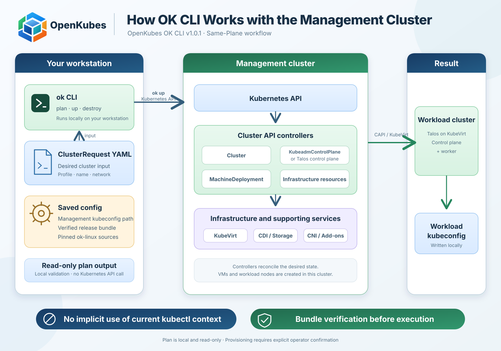

# Getting Started with OpenKubes OK CLI v1.0.1

> **Community Preview:** v1.0.1 is not production-certified. Release artifacts are unsigned; verify the published SHA-256 before installation.

Use this guide to install the `ok` CLI, explore it locally and prepare a workload-cluster request.




## What you need

- macOS (Apple Silicon or Intel) or Linux AMD64.
- Git, Make, Python 3 **with PyYAML available to the same `python3` that `ok up` will use**, kubectl, clusterctl and Helm.
- For creating a cluster: an already prepared Kubernetes management cluster that meets the **Same-Plane Talos/KubeVirt** requirements, plus an authorized management kubeconfig.

The CLI does **not** install Kubernetes or prepare the management cluster, CAPI, KubeVirt, storage, networking, CDI, cert-manager or Talos Golden Images.

The workstation bundle and workload architecture are different: the CLI runs natively on Apple Silicon, but v1.0.1 provisions **AMD64** workload VMs only.

### Check PyYAML before `ok up`

Run on **macOS, Linux or WSL2**:

```bash
python3 -c 'import yaml; print("PyYAML", yaml.__version__)'
```

If the import fails, use a dedicated environment (recommended on all platforms):

```bash
python3 -m venv "$HOME/.local/share/ok/python-env"
"$HOME/.local/share/ok/python-env/bin/python" -m pip install 'PyYAML>=6,<7'
export PATH="$HOME/.local/share/ok/python-env/bin:$PATH"
```

On Ubuntu/Debian or WSL2, install `python3-venv` using your distribution package manager first if `venv` is unavailable. Reuse the same PATH when running `ok up`.

**Optional: permanent Homebrew-Python setup (macOS Apple Silicon / Intel).** Homebrew's Python may reject `pip install --user` because of PEP 668. To keep PyYAML in your home directory without a venv:

```bash
python3 -m pip install --target "$HOME/.local/share/ok/python-packages" 'PyYAML>=6,<7'
echo 'export PYTHONPATH="$HOME/.local/share/ok/python-packages${PYTHONPATH:+:$PYTHONPATH}"' >> ~/.zshrc
source ~/.zshrc
python3 -c 'import yaml; print("PyYAML", yaml.__version__)'
```

This persists in new zsh sessions but affects other Python programs and may need reinstalling after a Python upgrade. Do not use `--break-system-packages`. On Linux/WSL2, prefer the venv above or a distribution-provided `python3-yaml` package if it matches your active `python3`.

## 1. Download and verify

Download the matching archive from the [v1.0.1 GitHub release](https://github.com/openkubes/ok-cluster/releases/tag/v1.0.1).

| Workstation | Archive | SHA-256 |
|---|---|---|
| Apple Silicon Mac | `ok-v1.0.1-darwin-arm64.tar.gz` | `28e412ea9fa6c116d85caf4650c6449030d17d8b50de9d964c6ed2ee39795d11` |
| Intel Mac | `ok-v1.0.1-darwin-amd64.tar.gz` | `3b69891825e641e1f1dc09c7102b9f8fc82205577d08713341394bb3b1cb5369` |
| Linux AMD64 | `ok-v1.0.1-linux-amd64.tar.gz` | `722c09f3307d70bb5e05a76d93dd685c9fa9918ac2c2ce69a316d3afaee7e694` |

Example for Apple Silicon (change the archive and checksum for your platform):

```bash
ARCHIVE=ok-v1.0.1-darwin-arm64.tar.gz
EXPECTED=28e412ea9fa6c116d85caf4650c6449030d17d8b50de9d964c6ed2ee39795d11

printf '%s  %s\\n' "$EXPECTED" "$ARCHIVE" | shasum -a 256 -c - || exit 1

tar -xzOf "$ARCHIVE" "ok-v1.0.1-darwin-arm64/ok-cluster/scripts/install-ok.sh" > install-ok.sh
sh install-ok.sh --archive "$ARCHIVE" --sha256 "$EXPECTED" --link

ok version
```

On Linux, replace `shasum -a 256 -c -` with `sha256sum -c -`. The installer verifies the bundle again and installs it under `~/.local/share/ok/`; the `ok` link is placed in `~/.local/bin/`. Add that directory to your `PATH` if needed.

**One bundle, one toolchain:** the release includes the CLI, pinned `ok-cluster` and `ok-linux` sources, Cilium chart and `release.txt`. Users do not need to clone or manage these repositories.

## 2. Explore the CLI

These commands are local and do not provision infrastructure:

```bash
ok version
ok --help
ok config --help
ok up --help
ok cluster plan --help
```

## 3. Configure a management cluster

For live provisioning, use the kubeconfig for your prepared management cluster (not a workload kubeconfig):

```bash
MGMT="$HOME/.kube/management-operator.yaml"
chmod 600 "$MGMT"

kubectl --kubeconfig "$MGMT" config current-context
kubectl --kubeconfig "$MGMT" get nodes

ok config init --management "$MGMT"
ok config show
```

Review the bundle verification and saved paths before confirming. `ok config init` stores only the kubeconfig path; it does not copy credentials, contact Kubernetes or create a cluster. It never overwrites an existing configuration.

## 4. Create a read-only cluster plan

Save this as `my-cluster.yaml`:

```yaml
apiVersion: cli.openkubes.io/v1alpha1
kind: ClusterRequest
metadata:
  name: my-cluster
spec:
  profile: talos-kubevirt-reference
  network:
    endpoint: auto
    podCIDR: auto
    serviceCIDR: auto
```

Review the plan:

```bash
ok cluster plan -f my-cluster.yaml
```

The v1.0.1 reference defaults to one control-plane VM and one worker VM. The plan validates the request and displays the intended Make workflow. It does not contact Kubernetes, reserve addresses or change resources.

## 5. Optional: create and verify the cluster

Only continue with explicit authorization and a disposable, compatible management cluster:

```bash
ok up -f my-cluster.yaml
```

Review the target and plan carefully. The CLI asks for two separate typed confirmations: one before provisioning and one before bootstrap.

A successful command is not proof that the workload is Ready. Verify it independently:

```bash
WORKLOAD="$HOME/.config/ok/kubeconfigs/my-cluster.yaml"

kubectl --kubeconfig "$WORKLOAD" get nodes -o wide
kubectl --kubeconfig "$WORKLOAD" get pods -A
kubectl --kubeconfig "$MGMT" -n my-cluster get cluster,machines,vm,vmi,pvc
```

When finished, use the **same v1.0.1 CLI bundle** to destroy the cluster:

```bash
ok destroy my-cluster
```

Review the management identity and deletion inventory before confirming. Verify that the workload resources are gone. Do not manually remove lifecycle evidence, finalizers or storage to bypass a refusal.

## Next

This tutorial assumes an existing management plane. Follow-up tutorials will cover preparing that plane, including OpenKubes BYOH, and the future ARM64 workload support.

## References

- [OK CLI v1.0.1 release](https://github.com/openkubes/ok-cluster/releases/tag/v1.0.1)
- [Official Same-Plane quickstart](https://github.com/openkubes/ok-cluster/blob/main/docs/cli-v1-same-plane-quickstart.md)
- [OpenKubes ok-cluster](https://github.com/openkubes/ok-cluster)
